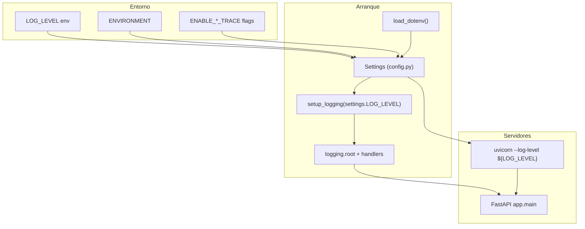

# F12-E2B1 — Logging Infrastructure Report

**Ticket:** F12-E2B1 — Infraestructura de logging (implementación controlada)  
**Fecha:** 2026-06-27  
**Alcance:** Gobernanza de `LOG_LEVEL`, alineación Docker/Uvicorn, flags diagnósticas (solo config)  
**Fuera de alcance (F12-E2B2):** eliminar/bajar logs, conectar flags al código, QueryAuditor, Redis trace, RBAC debug, middleware  

---

## 8. Resultado

**Infraestructura lista.** El backend mantiene **comportamiento funcional idéntico** en HTTP, auth e IAM. Los logs existentes no fueron eliminados ni reclasificados.

| Objetivo | Estado |
|----------|--------|
| `setup_logging()` usa `settings.LOG_LEVEL` | ✅ |
| Docker/Uvicorn alineados con `LOG_LEVEL` env | ✅ |
| 7 flags diagnósticas en `config.py` | ✅ (no conectadas) |
| Documentación `.env.example` / `.env.docker` | ✅ |
| Tests unitarios infra | ✅ 16 passed |
| Smoke auth Shared + Platform | ✅ (ver §6) |

---

## 1. Arquitectura final del logging



**Componentes:**

| Componente | Archivo | Rol |
|------------|---------|-----|
| Normalización | `app/core/logging_config.py` | `normalize_log_level`, `get_uvicorn_log_level` |
| Setup app | `setup_logging()` | Handlers rotativo + stdout; nivel desde env |
| Config | `app/core/config.py` | `LOG_LEVEL`, flags `ENABLE_*`, `UVICORN_LOG_LEVEL` |
| Entry | `app/main.py` | `settings` → `setup_logging(settings.LOG_LEVEL)` |
| Contenedor | `Dockerfile`, `docker-compose*.yml` | `LOG_LEVEL` → uvicorn vía `sh -c` + `tr` |

**Handlers (sin cambio de formato):**

- `logs/app.log` — `SafeRotatingFileHandler` (1 MB × 5)
- stdout — `StreamHandler`
- Formato: `%(asctime)s - %(name)s - %(levelname)s - %(message)s`

---

## 2. Cómo se determina LOG_LEVEL

1. Variable de entorno `LOG_LEVEL` (default **`INFO`**).
2. Carga vía `load_dotenv()` en `config.py` antes de instanciar `Settings`.
3. `normalize_log_level()` valida: `DEBUG`, `INFO`, `WARNING`, `ERROR`, `CRITICAL` (case-insensitive).
4. Valor inválido → fallback **`INFO`** (comportamiento seguro, igual que antes en la práctica).
5. `setup_logging(settings.LOG_LEVEL)` aplica el nivel al **root logger** y a **ambos handlers**.

**Significado de niveles (stdlib Python):**

| Nivel | Uso típico en CAXIS |
|-------|---------------------|
| **DEBUG** | Diagnóstico detallado (tenant filter, identity lookup, UOW) |
| **INFO** | Operaciones normales (login, tenant resuelto, startup) |
| **WARNING** | Situaciones anómalas no fatales (QueryAuditor FP, fail-soft Redis) |
| **ERROR** | Fallos recuperables / mapeados a HTTP |
| **CRITICAL** | Fallos de inicialización (ej. Fernet) |

---

## 3. Cómo interactúan Docker, Uvicorn y FastAPI

| Capa | Antes (F12-E2A) | Después (F12-E2B1) |
|------|-----------------|---------------------|
| `setup_logging()` | Hardcode `logging.INFO` | `settings.LOG_LEVEL` |
| `Dockerfile CMD` | `--log-level info` fijo | `--log-level $(echo $LOG_LEVEL \| tr …)` |
| `docker-compose` | `--log-level info` fijo | Mismo patrón shell |
| `python main.py` | `settings.LOG_LEVEL.lower()` | `settings.UVICORN_LOG_LEVEL` |

**Flujo Docker:**

1. `.env.docker` define `LOG_LEVEL=INFO` (sin cambio de valor default).
2. Contenedor exporta `ENV LOG_LEVEL=INFO` en imagen.
3. Uvicorn arranca con el mismo nivel en minúsculas.
4. Al importar `app.main`, `setup_logging` aplica el mismo nivel a loggers de aplicación.

**Nota:** Los access logs de uvicorn y los `logger.info` de la app comparten umbral de nivel; filtrar uno implica filtrar el otro al subir a WARNING.

---

## 4. Descripción de cada nueva flag

Infraestructura en `Settings` — **propiedades booleanas**. Resolución:

```text
Si ENV explícito (true|false) → override
Si ENV vacío            → development=true, production=false
```

| Flag | Propósito (F12-E2B2) | Logs objetivo |
|------|----------------------|---------------|
| `ENABLE_REDIS_TRACE` | Trazas Redis diagnósticas | `[REDIS-TRACE-01]`, `[REDIS-RUNTIME-FINAL]`, `[BLACKLIST-DIAG]` |
| `ENABLE_RBAC_TRACE` | Trazas RBAC | `[RBAC_DEBUG]`, `print("[RBAC DEBUG]")` |
| `ENABLE_QUERY_AUDITOR_VERBOSE` | QueryAuditor verboso | `[QUERY_AUDITOR]` WARNING con SQL |
| `ENABLE_HTTP_TRACE` | HTTP request logging | `main.log_requests` middleware |
| `ENABLE_MIDDLEWARE_TRACE` | Tenant middleware verbose | `[TENANT]`, `[HOST_DETECTION]` INFO/DEBUG |
| `ENABLE_IMPERSONATE_DIAG` | Diagnóstico impersonate | `ImpersonateAuthDiagMiddleware`, `[IMPERSONATE-AUTH]` |
| `ENABLE_AUTH_VERBOSE` | Auth verboso | `[ME]`, login/refresh INFO detallado |

**Estado F12-E2B1:** flags **existen y documentadas**; **ningún módulo de negocio las consulta aún**. El runtime sigue emitiendo los mismos logs que antes.

---

## 5. Matriz Development vs Production

| Variable | `ENVIRONMENT=development` | `ENVIRONMENT=production` | Override env |
|----------|---------------------------|--------------------------|--------------|
| `LOG_LEVEL` | Default `INFO` | Default `INFO` | Siempre |
| `ENABLE_REDIS_TRACE` | `true` (implícito) | `false` (implícito) | `true`/`false` |
| `ENABLE_RBAC_TRACE` | `true` | `false` | `true`/`false` |
| `ENABLE_QUERY_AUDITOR_VERBOSE` | `true` | `false` | `true`/`false` |
| `ENABLE_HTTP_TRACE` | `true` | `false` | `true`/`false` |
| `ENABLE_MIDDLEWARE_TRACE` | `true` | `false` | `true`/`false` |
| `ENABLE_IMPERSONATE_DIAG` | `true` | `false` | `true`/`false` |
| `ENABLE_AUTH_VERBOSE` | `true` | `false` | `true`/`false` |

**Decisión:** Se usa `ENVIRONMENT` ya existente (`development` \| `production`). No se introdujo `IS_DEV`/`IS_PRODUCTION` adicionales para evitar duplicidad.

**Comportamiento actual sin cambio:** `.env.docker` tiene `ENVIRONMENT=development` y `LOG_LEVEL=INFO` — mismo perfil observable que pre-E2B1.

---

## 6. Pruebas ejecutadas

### Unit tests

```text
pytest tests/unit/test_logging_config_f12_e2b1.py
     tests/unit/test_login_custom_exception_propagation.py
     tests/unit/test_login_user_data_serialization.py
     tests/unit/test_unit_of_work.py

→ 31 passed, 2 skipped
```

Cobertura E2B1:

- Normalización `LOG_LEVEL` (válidos + inválidos)
- `setup_logging(force=True)` aplica nivel root
- `UVICORN_LOG_LEVEL` alineado con `LOG_LEVEL`
- Defaults flags dev/prod
- Override raw en instancia Settings

### Smoke HTTP (localhost:8000)

| Plano | Flujos | Resultado |
|-------|--------|-----------|
| Shared (`acme`) | login, `/me`, permissions, menu, refresh, logout, logout_all | PASS (script `f8a_auth_runtime_e2e.py`) |
| Dedicated (`acmec`) | login | FAIL credenciales (`admin123` — entorno; no regresión E2B1) |
| Platform | login, `/auth/me`, `/auth/menu`, `/auth/permissions/me` | PASS |

**No ejecutado en esta fase:** suites ORG/INV/SYS_ADMIN E2E completas (sin cambio funcional esperado; recomendado en CI post-merge).

---

## 7. Riesgos

| Riesgo | Mitigación |
|--------|------------|
| Orden import `settings` antes de `setup_logging` | Validado; `main.py` importa `settings` primero |
| `logging.basicConfig` solo efecto primera vez | Tests usan `force=True`; prod arranca una vez |
| Flags dev default `true` sin cablear | Sin efecto hasta E2B2 |
| Uvicorn + app niveles desalineados si env distinto en shell | Mismo `LOG_LEVEL` en compose y Dockerfile |
| Subir `LOG_LEVEL=WARNING` oculta INFO operacional | Documentado; decisión operativa en E2B2 |
| Circular import config ↔ logging_config | `normalize_log_level` import lazy en property |

---

## Archivos modificados

| Archivo | Cambio |
|---------|--------|
| `app/core/logging_config.py` | `normalize_log_level`, `setup_logging(level)`, `get_uvicorn_log_level` |
| `app/core/config.py` | Flags diagnósticas + `NORMALIZED_LOG_LEVEL`, `UVICORN_LOG_LEVEL` |
| `app/main.py` | `setup_logging(settings.LOG_LEVEL)` |
| `Dockerfile` | `ENV LOG_LEVEL`, CMD dinámico |
| `docker-compose.yml` | command con `LOG_LEVEL` |
| `docker-compose.dev.yml` | idem |
| `.env.example` | Documentación LOG_LEVEL + flags |
| `.env.docker` | idem |
| `tests/unit/test_logging_config_f12_e2b1.py` | **nuevo** |

---

## Próximo paso — F12-E2B2

Conectar flags a:

- `refresh_token_service` / `redis/client` → `ENABLE_REDIS_TRACE`
- `rbac.py` / `permission_startup` → `ENABLE_RBAC_TRACE`
- `query_auditor.py` → `ENABLE_QUERY_AUDITOR_VERBOSE`
- `main.log_requests` → `ENABLE_HTTP_TRACE`
- `TenantMiddleware` → `ENABLE_MIDDLEWARE_TRACE`
- `impersonate_auth_diag` → `ENABLE_IMPERSONATE_DIAG`
- `endpoints.py` `/me` → `ENABLE_AUTH_VERBOSE`

Sin eliminar logs en E2B2 inicial — solo **gatear** tras flags.

---

*Implementación F12-E2B1 — sin limpieza de logs.*
