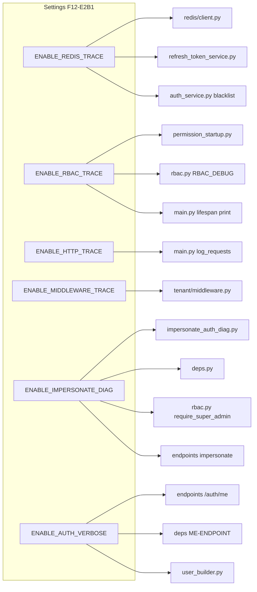

# F12-E2B2.1 — Logging Flags Wiring Report

**Ticket:** F12-E2B2.1 — Conexión flags diagnósticas → logs existentes  
**Fecha:** 2026-06-27  
**Alcance:** Gatear bloques de traza identificados en F12-E2A mediante `if settings.ENABLE_*`  
**Fuera de alcance:** eliminar logs, reclasificar niveles, QueryAuditor, cambios de lógica/middleware/endpoints/RBAC/IAM  

---

## 6. Resultado

**Wiring completado.** El backend mantiene **comportamiento funcional idéntico** en HTTP, auth e IAM. Los mensajes, niveles y ubicaciones de log no fueron modificados; solo se añadió el guard de configuración.

| Objetivo | Estado |
|----------|--------|
| 6 flags conectadas (sin `ENABLE_QUERY_AUDITOR_VERBOSE`) | ✅ |
| QueryAuditor sin cambios | ✅ |
| Mensajes y niveles preservados | ✅ |
| Tests unitarios infra | ✅ 18 passed |
| Smoke Platform + Shared + Dedicated | ✅ |
| Logout / logout_all / auth paths | ✅ |

---

## 1. Archivos modificados

| Archivo | Cambio |
|---------|--------|
| `app/infrastructure/redis/client.py` | Gate `[REDIS-TRACE-01]` → `ENABLE_REDIS_TRACE` |
| `app/modules/auth/application/services/refresh_token_service.py` | Gate `[BLACKLIST-DIAG]`, `[REDIS-TRACE-01]`, `[REDIS-RUNTIME-FINAL]` → `ENABLE_REDIS_TRACE` |
| `app/modules/auth/application/services/auth_service.py` | Gate trace en `blacklist_access_token_jti` → `ENABLE_REDIS_TRACE` |
| `app/core/tenant/middleware.py` | Helper `_middleware_trace()` → `ENABLE_MIDDLEWARE_TRACE` |
| `app/core/authorization/permission_startup.py` | Gate `print("[RBAC DEBUG] ...")` → `ENABLE_RBAC_TRACE` |
| `app/core/authorization/rbac.py` | Gate `[RBAC_DEBUG]` e `[IMPERSONATE-AUTH]` en `require_super_admin` |
| `app/core/auth/impersonate_auth_diag.py` | Early return + gate middleware 401 → `ENABLE_IMPERSONATE_DIAG` |
| `app/api/deps.py` | Gate `[IMPERSONATE-AUTH]` y `[ME-ENDPOINT]` en deps |
| `app/main.py` | Gate `log_requests` (2× INFO) → `ENABLE_HTTP_TRACE`; gate print lifespan → `ENABLE_RBAC_TRACE` |
| `app/modules/auth/presentation/endpoints.py` | Gate `/auth/me` verbose + impersonate handler log |
| `app/core/auth/user_builder.py` | Gate `[ME-ENDPOINT] build_user_with_roles exception` → `ENABLE_AUTH_VERBOSE` |

**No modificados (explícito):** QueryAuditor, lógica de middleware, endpoints (contrato), OpenAPI, RBAC enforcement, IAM session services.

---

## 2. Flags conectadas

| Flag | Patrón de gate | Logs / bloques protegidos |
|------|----------------|---------------------------|
| `ENABLE_REDIS_TRACE` | `if settings.ENABLE_REDIS_TRACE:` | `[REDIS-TRACE-01]`, `[REDIS-RUNTIME-FINAL]`, `[BLACKLIST-DIAG]` en redis client, refresh blacklist, auth_service jti blacklist |
| `ENABLE_RBAC_TRACE` | `if settings.ENABLE_RBAC_TRACE:` | `[RBAC_DEBUG]` en `has_permission`; `print("[RBAC DEBUG]")` en startup; print lifespan en `main.py` |
| `ENABLE_HTTP_TRACE` | `if settings.ENABLE_HTTP_TRACE:` | Middleware `log_requests` — líneas `->` y `<-` (request/response + duration) |
| `ENABLE_MIDDLEWARE_TRACE` | `_middleware_trace(...)` | `[TENANT]`, `[HOST_DETECTION]`, `[SUBDOMAIN]`, `[TENANT_MW]` INFO/DEBUG/WARNING diagnósticos por request |
| `ENABLE_IMPERSONATE_DIAG` | `if settings.ENABLE_IMPERSONATE_DIAG:` (+ early return en helpers) | `ImpersonateAuthDiagMiddleware` logs, `[IMPERSONATE-AUTH]` en deps, rbac, endpoints, `impersonate_auth_diag.py` |
| `ENABLE_AUTH_VERBOSE` | `if settings.ENABLE_AUTH_VERBOSE:` | `[ME]`, `[ME-ENDPOINT]`, `Solicitud /me/` en endpoints; `[ME-ENDPOINT]` en deps y user_builder |

### No conectada (F12-E2B2 posterior)

| Flag | Motivo |
|------|--------|
| `ENABLE_QUERY_AUDITOR_VERBOSE` | Alcance explícitamente excluido en F12-E2B2.1 |

### Logs operacionales sin gate (intencional)

Permanecen siempre activos según F12-E2A (clase A/B):

- `[SECURITY]`, `[TENANT]` errors, `ClientNotFound`, config warnings en tenant middleware
- `[SESSION-ACCESS]` fail-soft en refresh_token_service
- `[AUTH]`, `[LOGOUT]`, deny permiso estándar en rbac (fuera de `[RBAC_DEBUG]`)
- `[RBAC]` logger.info resumen startup/sync en permission_startup
- Rate limit, CORS, health, pool shutdown en `main.py`

---

## 3. Módulos afectados



---

## 4. Pruebas ejecutadas

### Unit tests

```text
pytest tests/unit/test_logging_config_f12_e2b1.py tests/unit/test_http_smoke_runner.py -q
→ 18 passed
```

### Smoke HTTP (Docker `:8000`, post-wiring)

| Suite | Credenciales / tenant | Resultado |
|-------|----------------------|-----------|
| Platform | `superadmin` / `admin123`, Origin `platform.app.local` | **PASS** — login, me, menu, permissions/me, refresh |
| Shared | `acme`, `admin` / `admin123` | **PASS** — login, org/empresa, me, menu (ORG+INV+SYS_ADMIN), refresh, permissions/me |
| Dedicated | `acmec`, `admin` / `F11Gate!acmec2026` | **PASS** — mismo alcance tenant |

### Flujos auth adicionales (Shared acme)

| Flujo | Resultado |
|-------|-----------|
| Login | PASS |
| Refresh | PASS |
| Logout (`POST /auth/logout/`) | PASS |
| Logout all (`POST /auth/logout_all/`) | PASS |
| `/auth/me` | PASS (incluido en smoke) |
| `/auth/menu` | PASS |
| `/auth/permissions/me` | PASS |

---

## 5. Riesgos

| Riesgo | Mitigación / nota |
|--------|-------------------|
| **Dev vs prod defaults** | En `development`, flags implícitas `true` → logs diagnósticos siguen visibles como antes. En `production`, default `false` silencia trazas sin alterar respuestas HTTP. |
| **Impersonate middleware sigue montado** | Solo se gatean emisiones de log; el middleware ejecuta dispatch (sin cambio de lógica). Desmontaje → fase posterior. |
| **Errores operacionales gated por error de copy-paste** | Revisión manual: ERROR/WARNING de seguridad y tenant resolution **no** están bajo flags de trace. |
| **QueryAuditor sin flag** | Sigue emitiendo como en E2A; conexión `ENABLE_QUERY_AUDITOR_VERBOSE` → F12-E2B2.x posterior. |
| **Doble gate impersonate** | `is_impersonate_diag_request()` + `ENABLE_IMPERSONATE_DIAG` en deps/rbac — coherente: flag global desactiva todo el bloque diagnóstico. |

---

## 7. Verificación de gateo (opcional)

Para confirmar silencio diagnóstico sin reiniciar código:

```env
ENABLE_REDIS_TRACE=false
ENABLE_RBAC_TRACE=false
ENABLE_HTTP_TRACE=false
ENABLE_MIDDLEWARE_TRACE=false
ENABLE_IMPERSONATE_DIAG=false
ENABLE_AUTH_VERBOSE=false
```

Tras restart, login/me no deben emitir `[REDIS-TRACE-01]`, `[RBAC DEBUG]`, `->/<-` HTTP trace, `[TENANT] CONTEXTO`, `[ME]` ni `[IMPERSONATE-AUTH]`; errores de seguridad y respuestas API permanecen iguales.

---

## 8. Próxima fase (NO incluida aquí)

- F12-E2B2.2+: conectar `ENABLE_QUERY_AUDITOR_VERBOSE`
- Eliminar/reclasificar logs duplicados (INFO→DEBUG, etc.)
- Consolidar HTTP logging en una línea structured

**F12-E2B2.1 cerrado.**
