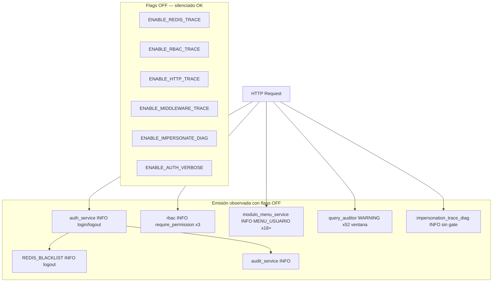

# F12-E2B3A — Runtime Residual Logs Audit (Read Only)

**Fecha:** 2026-06-28  
**Referencia:** F12-E2B2.2 (flags diagnósticas opt-in, default `false`)  
**Modo:** Solo auditoría — sin cambios de código

---

## 1. Condiciones verificadas

### 1.1 Archivo `.env.docker`

| Variable | Valor configurado |
|----------|-------------------|
| `LOG_LEVEL` | `INFO` |
| `ENABLE_REDIS_TRACE` | *(comentada — sin override)* |
| `ENABLE_RBAC_TRACE` | *(comentada)* |
| `ENABLE_HTTP_TRACE` | *(comentada)* |
| `ENABLE_MIDDLEWARE_TRACE` | *(comentada)* |
| `ENABLE_IMPERSONATE_DIAG` | *(comentada)* |
| `ENABLE_AUTH_VERBOSE` | *(comentada)* |

### 1.2 Runtime efectivo (`fastapi_backend`, Python `settings`)

```
LOG_LEVEL = INFO
ENABLE_REDIS_TRACE = False
ENABLE_RBAC_TRACE = False
ENABLE_HTTP_TRACE = False
ENABLE_MIDDLEWARE_TRACE = False
ENABLE_IMPERSONATE_DIAG = False
ENABLE_AUTH_VERBOSE = False
ENABLE_QUERY_AUDITOR_VERBOSE = False
```

Todas las flags diagnósticas F12-E2B1 están **efectivamente deshabilitadas** (opt-in sin env → `False` per `config._resolve_diagnostic_trace_flag`).

---

## 2. Pruebas ejecutadas

Contenedor `fastapi_backend`, ventana `2026-06-28 01:40:21–01:40:25 UTC`.

| Plano | Tenant | Credencial | Endpoints (todos HTTP 200 salvo nota) |
|-------|--------|------------|----------------------------------------|
| **Platform** | `platform` / SYSTEM | `superadmin` | login → org/empresa → me → menu → permissions/me → logout |
| **Shared** | `acme` | `admin` | login → org/empresa → empresa/cambiar (**400** ya activa) → me → menu → permissions/me → usuarios → roles → logout |
| **Dedicated** | `acce` | `admin` | Idem Shared |

**Captura:** `docker logs fastapi_backend --since 90s` durante la secuencia.

| Métrica | Valor |
|---------|------:|
| Líneas totales capturadas | 344 |
| Líneas Uvicorn access (`INFO: … HTTP/1.1`) | 27 |
| Líneas healthcheck (`GET /health`) | 3 |
| **Líneas logger aplicación** | **240** |
| Patrones únicos normalizados | 126 |

---

## 3. Logs eliminados tras F12-E2B2.2 (ausentes en captura)

Con flags en `false`, **no apareció** ninguna de estas familias (objetivo F12-E2B2):

| Marcador / familia | Flag que lo controla |
|--------------------|----------------------|
| `[REDIS-TRACE-01]`, `[REDIS-RUNTIME-FINAL]` | `ENABLE_REDIS_TRACE` |
| `[RBAC_DEBUG]` | `ENABLE_RBAC_TRACE` |
| `[TENANT] Host:…`, `[DB] Consultando subdominio` (middleware verbose) | `ENABLE_MIDDLEWARE_TRACE` |
| `[HTTP] Request/Response` duplicado (`main.log_requests`) | `ENABLE_HTTP_TRACE` |
| `[ME]`, `[DEPS-AUTH]` verbose en `/auth/me` | `ENABLE_AUTH_VERBOSE` |
| `[IMPERSONATE-AUTH]` middleware diag | `ENABLE_IMPERSONATE_DIAG` |

**Conclusión parcial:** El cableado F12-E2B2.1/2.2 **silencia correctamente** las trazas flag-gated documentadas.

---

## 4. Inventario residual (solo lo que apareció)

Cada fila agrupa mensajes equivalentes observados en runtime. **Frecuencia** = apariciones en la ventana de 3 sesiones (~4 s).

### 4.1 Autenticación y sesión

| # | Archivo | Línea | Logger | Nivel | Freq | Propósito | Flag | INFO permanente |
|---|---------|------:|--------|-------|-----:|-----------|------|-----------------|
| R-01 | `app/modules/auth/presentation/endpoints.py` | 238 | `…endpoints` | INFO | 3× | Cliente resuelto para login | No | Sí |
| R-02 | `app/modules/auth/application/services/auth_service.py` | 620 | `…auth_service` | INFO | 3× | Intento login + destino | No | Sí |
| R-03 | `app/modules/auth/application/services/auth_service.py` | 631–641 | `…auth_service` | INFO | 1+2× | Rama SUPERADMIN vs usuario regular | No | Sí |
| R-04 | `app/modules/auth/application/services/auth_service.py` | 730 | `…auth_service` | INFO | 3× | Login exitoso (usuario_id, cliente, level) | No | Sí |
| R-05 | `app/modules/auth/application/services/auth_service.py` | 580 | `…auth_service` | INFO | 2× | Niveles calculados (platform superadmin) | No | Sí |
| R-06 | `app/core/identity/identity_gateway.py` | 211 | `…identity_gateway` | INFO | 4× | Niveles calculados (tenant_admin) | No | Sí |
| R-07 | `app/modules/auth/application/services/auth_service.py` | ~315, ~1833 | `…auth_service` | INFO | 4× | Empresa login / admin sin empresa | No | Sí |
| R-08 | `app/modules/auth/presentation/endpoints.py` | ~448 | `…endpoints` | INFO | 3× | Usuario autenticado exitosamente (MOBILE) | No | Sí |
| R-09 | `app/modules/auth/application/services/auth_service.py` | 838 | `…auth_service` | INFO | 3× | `[LOGIN-V2] Sesión persistida` | No | Sí |
| R-10 | `app/modules/auth/application/services/auth_service.py` | 2070 | `…auth_service` | INFO | 3× | `[LOGOUT-V2-MOBILE] refresh_revoked` | No | Sí |
| R-11 | `app/modules/auth/presentation/endpoints.py` | ~331 | `…endpoints` | INFO | 1× | `[LOGIN] Superadmin accediendo` | No | Sí |

**Clasificación:** R-01–R-04 → **A** Obligatorio; R-09–R-10 → **C** Auditoría operativa IAM V2; R-05–R-07 → **G** Residual (duplican identity_gateway).

---

### 4.2 Auditoría de seguridad

| # | Archivo | Línea | Logger | Nivel | Freq | Propósito | Flag | INFO permanente |
|---|---------|------:|--------|-------|-----:|-----------|------|-----------------|
| R-12 | `app/modules/superadmin/application/services/audit_service.py` | 170–176 | `…audit_service` | INFO | 6× | `auth_audit_log` login_success / logout | No | Sí |

**Clasificación:** **B** Seguridad / **C** Auditoría

---

### 4.3 Redis blacklist (logout)

| # | Archivo | Línea | Logger | Nivel | Freq | Propósito | Flag | INFO permanente |
|---|---------|------:|--------|-------|-----:|-----------|------|-----------------|
| R-13 | `app/infrastructure/redis/client.py` | 200 | `…redis.client` | INFO | 6× | `[REDIS_BLACKLIST] Token revocado: jti=…` | No (`ENABLE_REDIS_TRACE` solo añade trazas extra) | Sí |

**Clasificación:** **B** Seguridad (revocación JWT)

---

### 4.4 RBAC — `require_permission` (no flag-gated)

| # | Archivo | Línea | Logger | Nivel | Freq | Propósito | Flag | INFO permanente |
|---|---------|------:|--------|-------|-----:|-----------|------|-----------------|
| R-14 | `app/core/authorization/rbac.py` | 398 | `…rbac` | INFO | 8× | `Validando permiso '…' para usuario` | No | Sí |
| R-15 | `app/core/authorization/rbac.py` | 103–121 | `…rbac` | INFO | 8× | SUPER ADMIN / TENANT ADMIN detectado | No | Sí |
| R-16 | `app/core/authorization/rbac.py` | 409 | `…rbac` | INFO | 8× | `Permiso '…' autorizado` | No | Sí |

**Nota:** `ENABLE_RBAC_TRACE` solo activa `[RBAC_DEBUG]` (L210–215) — **ausente** en captura.

**Clasificación:** R-14–R-16 → **G** Residual (3 líneas INFO por endpoint protegido)

---

### 4.5 Session scope ORG (solo `ENVIRONMENT=development`)

| # | Archivo | Línea | Logger | Nivel | Freq | Propósito | Flag | INFO permanente |
|---|---------|------:|--------|-------|-----:|-----------|------|-----------------|
| R-17 | `app/core/tenant/session_scope.py` | 213–222 | `…session_scope` | INFO | 8× | `[ORG-SESSION-SCOPE]` | `ENVIRONMENT=development` (no ENABLE_*) | Dev only |
| R-18 | `app/core/tenant/session_scope.py` | 236–245 | `…session_scope` | INFO | 4× | `[ORG-SCOPE-POLICY]` | Idem | Dev only |
| R-19 | `app/core/tenant/session_scope.py` | 258+ | `…session_scope` | INFO | 4× | `[ORG-ERP-SESSION]`, `[ORG-TENANT-SCOPE]` | Idem | Dev only |

**Clasificación:** **E** Diagnóstico (condicionado a dev, no a flag F12)

---

### 4.6 Menú usuario (`GET /auth/menu`)

| # | Archivo | Línea | Logger | Nivel | Freq | Propósito | Flag | INFO permanente |
|---|---------|------:|--------|-------|-----:|-----------|------|-----------------|
| R-20 | `app/modules/modulos/application/services/modulo_menu_service.py` | 931 | `…modulo_menu_service` | INFO | 3× | Obteniendo menú para usuario | No | Sí |
| R-21 | `app/modules/modulos/application/services/modulo_menu_service.py` | 1048–1049 | `…modulo_menu_service` | INFO | 1× | `[MENU_USUARIO] Elevado super_admin` (platform) | No | Sí |
| R-22 | `app/modules/modulos/application/services/modulo_menu_service.py` | 1089–1210 | `…modulo_menu_service` | INFO | 2× c/u | Query RAW, permisos, **18× INCLUIDO por ítem** | No | Sí |
| R-23 | `app/modules/modulos/application/helpers/menu_transformer.py` | 221 | `…menu_transformer` | INFO | 3× | Transformación completada N módulos | No | Sí |
| R-24 | `app/core/authorization/menu_permission_resolver.py` | 128–134 | `…menu_permission_resolver` | WARNING | 3× | Permiso leer no encontrado SYS_ADMIN.* (solo acce) | No | Sí |

**Clasificación:** R-20–R-23 → **G** Residual (alto volumen por request); R-24 → **G** Residual

---

### 4.7 Admin listados (`usuarios`, `roles`)

| # | Archivo | Línea | Logger | Nivel | Freq | Propósito | Flag | INFO permanente |
|---|---------|------:|--------|-------|-----:|-----------|------|-----------------|
| R-25 | `app/modules/users/presentation/endpoints.py` | ~list handler | `…endpoints` | INFO | 2× | Solicitud GET /usuarios/ | No | Sí |
| R-26 | `app/modules/users/application/services/user_service.py` | paginados | `…user_service` | INFO | 4× | `[USUARIOS-PAGINADOS]` pipeline | No | Sí |
| R-27 | `app/modules/rbac/presentation/endpoints.py` | list handler | `…endpoints` | INFO | 2× | Solicitud GET /roles/ | No | Sí |
| R-28 | `app/modules/rbac/application/services/rol_service.py` | paginados | `…rol_service` | INFO | 8× | `[ROLES-PAGINADOS]` pipeline | No | Sí |

**Clasificación:** **G** Residual (presentation + service duplican narrativa)

---

### 4.8 Query auditor y SQL legacy (WARNING persistente en dev)

| # | Archivo | Línea | Logger | Nivel | Freq | Propósito | Flag | INFO permanente |
|---|---------|------:|--------|-------|-----:|-----------|------|-----------------|
| R-29 | `app/core/security/query_auditor.py` | 194–197, 309–312 | `…query_auditor` | WARNING | **52×** | Query sin filtro explícito `cliente_id` | No (`ENABLE_QUERY_AUDITOR_VERBOSE` **no wired**) | Dev WARNING |
| R-30 | `app/infrastructure/database/queries_async.py` | 382–385 | `…queries_async` | WARNING | 6× | `[QUERY] DEPRECATED: execute_query() string SQL` | No | Sí |

**Clasificación:** R-29 → **E** Diagnóstico / **G** Residual (dominante en volumen); R-30 → **G** Residual

---

### 4.9 Infraestructura conexión / routing

| # | Archivo | Línea | Logger | Nivel | Freq | Propósito | Flag | INFO permanente |
|---|---------|------:|--------|-------|-----:|-----------|------|-----------------|
| R-31 | `app/infrastructure/database/connection_async.py` | 241 | `…connection_async` | INFO | 2× | `[ASYNC_CONNECTION] AsyncEngine creado` (1er login shared/dedicated) | No | Sí |
| R-32 | `app/core/tenant/routing.py` | ~470 | `…routing` | WARNING | 1× | `[METADATA] No se encontró metadata… fallback SINGLE-DB` (acme login) | No | Sí |
| R-33 | `app/core/tenant/empresa_preference.py` | 60 | `…empresa_preference` | INFO | 2× | `[EMPRESA_PREF] empresa_default_id` (empresa/cambiar 400) | No | Sí |

**Clasificación:** R-31 → **D** Startup-ish (lazy engine); R-32 → **G** Residual; R-33 → **G** Residual

---

### 4.10 Trazas impersonación **sin flag** (residual crítico)

| # | Archivo | Línea | Logger | Nivel | Freq | Propósito | Flag | INFO permanente |
|---|---------|------:|--------|-------|-----:|-----------|------|-----------------|
| R-34 | `app/core/auth/impersonation_trace_diag.py` | 59–70 | `…impersonation_trace_diag` | INFO | 2× | `[IMPERSONATION-TRACE] REQUEST` (empresa/cambiar) | **No** (módulo RC2 sin gate) | Sí |
| R-35 | `app/core/auth/impersonation_trace_diag.py` | 87–107 | `…impersonation_trace_diag` | INFO | 2× | `[IMPERSONATION-TRACE] RESPONSE` | **No** | Sí |

**Clasificación:** **E** Diagnóstico / **G** Residual — **no depende** de `ENABLE_IMPERSONATE_DIAG` (distinto módulo que `impersonate_auth_diag.py`)

---

### 4.11 Uvicorn access (infraestructura HTTP)

| Origen | Nivel | Freq | Propósito | Flag |
|--------|-------|-----:|-----------|------|
| `uvicorn.access` | INFO | 27× | `POST/GET … HTTP/1.1" 200/400` | `--log-level info` Dockerfile |

**Clasificación:** **A** Obligatorio (servidor ASGI)

---

## 5. Matriz de clasificación (familias)

| Clase | Familias | Volumen relativo |
|-------|----------|------------------|
| **A — Obligatorio** | Uvicorn access; login exitoso mínimo | Medio |
| **B — Seguridad** | `auth_audit_log`; `[REDIS_BLACKLIST] Token revocado` | Bajo |
| **C — Auditoría** | `[LOGIN-V2]`, `[LOGOUT-V2-MOBILE]` | Bajo |
| **D — Startup** | `[ASYNC_CONNECTION] AsyncEngine creado` (lazy) | Muy bajo |
| **E — Diagnóstico** | `[ORG-SESSION-SCOPE]*`; `[QUERY_AUDITOR]`; `[IMPERSONATION-TRACE]` | **Alto** |
| **F — Duplicado** | `Niveles calculados` auth_service + identity_gateway; endpoint + service en users/roles | Medio |
| **G — Residual** | RBAC 3×INFO/check; `[MENU_USUARIO]` 18+ líneas/menu; `[ROLES-PAGINADOS]` 4 líneas/listado | **Alto** |

---

## 6. Resumen por endpoint (Shared/Dedicated, 1 ciclo)

| Endpoint | ~Líneas app logger | Principales emisores |
|----------|-------------------:|----------------------|
| `POST /auth/login/` | 15–25 | auth_service, identity_gateway, audit, query_auditor |
| `GET /auth/me/` | 8–12 | query_auditor (deps rebuild user) |
| `GET /auth/menu` | **35–45** | modulo_menu_service (por ítem), menu_transformer |
| `GET /auth/permissions/me` | 8–10 | query_auditor |
| `GET /usuarios/` | 10–12 | rbac×3, user_service, query_auditor |
| `GET /roles/` | 12–14 | rbac×3, rol_service×4, session_scope |
| `POST /auth/logout/` | 5–6 | redis blacklist×2, audit, auth_service |

Platform (superadmin): menú elevado → **~12 líneas** en menu (vs ~40 tenant).

---

## 7. Diagrama flujo de emisión residual



---

## 8. Conclusiones (solo observación)

1. **F12-E2B2.2 cumple** para las seis flags `ENABLE_*` auditadas: trazas flag-gated **ausentes** en runtime.
2. **Volumen residual dominante:** `[QUERY_AUDITOR]` WARNING (~22% líneas app), menú `[MENU_USUARIO]` (~25%), RBAC INFO triplicado por check (~10%).
3. **`[IMPERSONATION-TRACE]`** sigue emitiendo a INFO sin flag — módulo `impersonation_trace_diag.py` independiente de F12-E2B1 wiring.
4. **`ENABLE_QUERY_AUDITOR_VERBOSE`** existe en config pero **no condiciona** emisión en `query_auditor.py`.
5. **`[ORG-SESSION-SCOPE]`** residual solo en `ENVIRONMENT=development` (no en prod con misma config).
6. **`[REDIS_BLACKLIST] Token revocado`** es INFO permanente de operación de seguridad (no es `[REDIS-TRACE-01]`).

---

**F12-E2B3A Runtime Residual Logs Audit cerrado — read only.**
