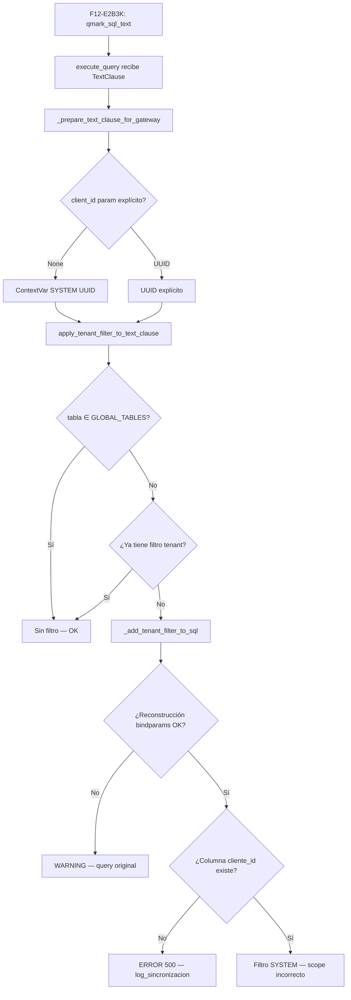

# F12-E2B3L — Tenant Filter Compatibility Audit

**Fecha:** 2026-06-28  
**Referencia:** F12-E2B3K (`qmark_sql_text` / migración TextClause)  
**Alcance:** Auditoría exclusiva — **sin cambios de código**  
**Archivos analizados:** `query_helpers.py`, `queries_async.py`, `superadmin_auditoria_service.py`, `superadmin_usuario_service.py`, `cliente_service.py`, `tenant_service.py`

---

## 1. Resumen ejecutivo

Tras F12-E2B3K desaparecieron los warnings `[QUERY] DEPRECATED`, pero aparecieron dos síntomas nuevos en navegación Platform Admin:

| Síntoma | Severidad | Causa raíz |
|---------|-----------|------------|
| `[TENANT_FILTER] No se pudo aplicar filtro automático a TextClause` | WARNING | Regresión de activación del filtro + incompatibilidad `bindparams` al reconstruir el `TextClause` |
| `Invalid column name 'cliente_id'` en `log_sincronizacion_usuario` | ERROR → HTTP **500** | Filtro inyectado con éxito sobre tabla CP sin columna `cliente_id` |

**Causa raíz única:** la migración E2B3K convirtió SQL string en `TextClause`, activando el pipeline `_prepare_text_clause_for_gateway` → `apply_tenant_filter_to_text_clause`, que **antes no se ejecutaba** para strings SQL. En contexto Platform Admin, `client_id=None` en el servicio se resuelve al UUID SYSTEM del middleware (`00000000-0000-0000-0000-000000000001`), provocando intentos de filtro automático en consultas de Control Plane / vista global que nunca debieron recibirlo.

---

## 2. Mecanismo técnico (pre vs post E2B3K)

### 2.1 Flujo post-E2B3K

```
execute_query(qmark_sql_text(...), client_id=None)
  └─ isinstance(query, TextClause)  →  TRUE
       └─ _prepare_text_clause_for_gateway()
            ├─ effective_client_id = _resolve_effective_client_id(None)
            │     └─ try_get_current_client_id()  →  SUPERADMIN_CLIENTE_ID (ContextVar)
            └─ apply_tenant_filter_to_text_clause(effective_client_id=SYSTEM)
                 ├─ table ∈ GLOBAL_TABLES?  → skip
                 ├─ _has_tenant_filter()?     → skip si ya existe
                 └─ _add_tenant_filter_to_sql() + reconstrucción bindparams
```

### 2.2 Flujo pre-E2B3K (string SQL)

```
execute_query("SELECT ... WHERE ?", params, client_id=None)
  └─ isinstance(query, str)  →  TRUE
       └─ Solo QueryAuditor (opcional). NO apply_tenant_filter_to_text_clause.
       └─ Conversión ? → :pN inline, ejecución directa.
```

**Conclusión:** E2B3K no introdujo lógica nueva de tenant filter; **expuso** la existente al migrar call sites al branch `TextClause`.

### 2.3 Punto de resolución de `cliente_id`

```python
# queries_async.py — _resolve_effective_client_id
coerced = _coerce_client_id_uuid(client_id)   # param explícito
if coerced is not None:
    return coerced
return try_get_current_client_id()            # ContextVar del TenantMiddleware
```

En Platform Admin (`Origin: platform.app.local`), el middleware siempre establece `current_client_id` al cliente SYSTEM (`settings.SUPERADMIN_CLIENTE_ID`). Los servicios superadmin pasan `client_id=None` para indicar **vista global**, pero el gateway interpreta eso como «usar contexto» → SYSTEM.

---

## 3. Respuestas a las 10 preguntas

### 3.1 ¿Por qué aparecen los WARNING `[TENANT_FILTER]`?

Porque `apply_tenant_filter_to_text_clause` intenta inyectar `AND cliente_id = :cliente_id` y reconstruir el `TextClause` con:

```python
existing_params = _extract_text_clause_bind_params(query)
existing_params["cliente_id"] = client_id
new_query = text(modified_query_str).bindparams(**existing_params)
```

En consultas producidas por `qmark_sql_text` (parámetros `:p0`, `:p1`, …), la reconstrucción falla con:

> `This text() construct doesn't define a bound parameter named 'cliente_id'`

Esto ocurre cuando `_add_tenant_filter_to_sql` **no logra** insertar `:cliente_id` en el SQL (devuelve el string original), pero el código **sí** añade `cliente_id` al dict de bindparams. El `except` captura el error, emite WARNING y devuelve la query **sin modificar**.

**Patrón observado:** queries con `OFFSET/FETCH`, `GROUP BY`, `JOIN` múltiple o muchos placeholders `?` → fallo de reconstrucción → WARNING (query original se ejecuta).

### 3.2 ¿Cuántas consultas los generan?

**Smoke reproducido (Platform Admin, login `superadmin`):**

| Endpoint HTTP | HTTP | Warnings `[TENANT_FILTER]` | Errores SQL `cliente_id` |
|---------------|-----:|---------------------------:|-------------------------:|
| `GET /superadmin/usuarios/?page=1&limit=3` | 200 | **6** | 0 |
| `GET /superadmin/usuarios/?page=1&limit=1` | 200 | **2** | 0 |
| `GET /superadmin/auditoria/autenticacion/?page=1&limit=3` | 200 | **2** | 0 |
| `GET /superadmin/auditoria/sincronizacion/?page=1&limit=3` | **500** | **0** | **≥1** (count) |
| `GET /superadmin/auditoria/estadisticas/` | 200 | **4** | 0 |
| `GET /clientes/?page=1&limit=3` | 200 | **0** | 0 |

**Ciclo de navegación completo (todos los endpoints anteriores):** **~11 warnings** (consistente con observación en runtime).

**Desglose por servicio (call sites `qmark_sql_text` en alcance):**

| Servicio | Call sites `qmark_sql_text` | Generan WARNING en Platform (sin filtro tenant explícito) |
|----------|----------------------------:|----------------------------------------------------------:|
| `superadmin_usuario_service.py` | 15 | **2 + 2×N** por página (`N` = filas devueltas; auxiliares roles/cliente por fila) |
| `superadmin_auditoria_service.py` | 9 | **2** (auth list) + **4** (stats) + **0** (sync count — falla antes con ERROR) |
| `cliente_service.py` | 2 | **0** (tabla `cliente` ∈ `GLOBAL_TABLES`) |
| `tenant_service.py` | 3 | **0** en Platform Admin smoke (no invocado en ciclo auditado) |

**Fórmula usuarios:** `warnings = 2 (count+data) + 2 × limit` en el smoke actual (roles + lookup auxiliar por fila).

### 3.3 ¿Cuáles son falsas alarmas?

Consultas donde el WARNING indica **intento fallido** de filtro; la query original se ejecuta sin modificación:

| Query / contexto | Tabla | Motivo «falsa alarma» |
|------------------|-------|------------------------|
| `data_query` auth audit con `OFFSET/FETCH` + JOIN | `auth_audit_log` | bindparams falla → no se inyecta filtro → listado global funciona (200) |
| `auth_stats_query`, `top_ips_query`, `top_usuarios_query` | `auth_audit_log` | Idem — GROUP BY / agregaciones impiden reconstrucción |
| `data_query` usuarios con paginación | `usuario` | bindparams falla → no se inyecta filtro → listado global funciona |
| Queries auxiliares por fila (roles, etc.) | `usuario` / `rol` | bindparams falla → no se inyecta filtro |

**Interpretación:** el WARNING es una **falsa alarma de seguridad** (el filtro no se aplicó), pero un **comportamiento funcionalmente correcto** para superadmin global. El sistema queda en estado inconsistente: log de advertencia sin filtro real.

### 3.4 ¿Cuáles representan un problema real?

| Query | Tabla | Resultado | Tipo de problema |
|-------|-------|-----------|------------------|
| `count_query` sincronización (`WHERE 1=1`) | `log_sincronizacion_usuario` | HTTP **500** | **Bloqueante** — filtro inyectado con éxito, columna inexistente |
| `count_query` sincronización (mismo patrón) | `log_sincronizacion_usuario` | SQL verificado | Inyección: `WHERE 1=1 AND cliente_id = ?` con UUID SYSTEM |
| Cualquier query simple COUNT sin GROUP BY/OFFSET sobre tablas CP sin `cliente_id` | CP tables | Potencial 500 | **Bloqueante** si bindparams tiene éxito |
| Queries sobre `usuario` / `auth_audit_log` donde bindparams **tuviera** éxito | tenant tables | Filtrado silencioso a SYSTEM | **Funcional** — superadmin vería solo datos del cliente SYSTEM, no todos los tenants |

**SQL capturado en runtime (sync count):**

```sql
SELECT COUNT(*) as total
FROM dbo.log_sincronizacion_usuario l
WHERE 1=1
 AND cliente_id = ?
-- parameters: UUID('00000000-0000-0000-0000-000000000001')
```

### 3.5 ¿Qué tablas realmente poseen `cliente_id`?

Tablas referenciadas en los servicios auditados:

| Tabla | ¿Tiene `cliente_id`? | Fuente |
|-------|:--------------------:|--------|
| `cliente` | ✅ Sí (PK) | V020 |
| `usuario` | ✅ Sí | V020 |
| `auth_audit_log` | ✅ Sí (NOT NULL) | V020 |
| `rol` | ✅ Sí (nullable, roles sistema) | V020 |
| `federacion_identidad` | ✅ Sí | tenant_service |
| `cliente_modulo_activo` | ✅ Sí | tenant_service |
| `log_sincronizacion_usuario` | ❌ **No** | V020 — usa `cliente_origen_id`, `cliente_destino_id` |

### 3.6 ¿Qué tablas nunca deberían recibir Tenant Filter?

| Clasificación | Tablas (alcance auditado) | Razón |
|---------------|---------------------------|-------|
| **Global / catálogo** | `cliente`, `cliente_modulo`, `modulo*`, `permiso`, `cat_*` | Ya en `GLOBAL_TABLES` — correcto |
| **Control Plane (BD central, cross-tenant)** | `log_sincronizacion_usuario` | Sin `cliente_id`; filtros explícitos `cliente_origen_id` / `cliente_destino_id` en servicio |
| **Control Plane — lectura global superadmin** | `auth_audit_log` (listado sin filtro tenant) | Tiene `cliente_id` pero la operación es vista cross-tenant; filtro automático a SYSTEM es semánticamente incorrecto |
| **Control Plane — lectura global superadmin** | `usuario` (listado superadmin sin `cliente_id` query param) | Idem — vista global de todos los tenants |
| **Platform ADMIN explícito** | `cliente` vía `connection_type=ADMIN, client_id=None` | Ya protegida por `GLOBAL_TABLES` |

### 3.7 ¿La tabla `log_sincronizacion_usuario` posee `cliente_id`?

**No.** Esquema V020:

```sql
CREATE TABLE log_sincronizacion_usuario (
    log_id UNIQUEIDENTIFIER PRIMARY KEY,
    cliente_origen_id UNIQUEIDENTIFIER NULL,
    cliente_destino_id UNIQUEIDENTIFIER NULL,
    usuario_id UNIQUEIDENTIFIER NOT NULL,
    ...
);
```

Índices: `IDX_log_sync_origen(cliente_origen_id)`, `IDX_log_sync_destino(cliente_destino_id)`.

### 3.8 Si no lo posee: ¿por qué se intentó agregar ese filtro?

Cadena causal:

1. `get_logs_sincronizacion` llama `execute_query(qmark_sql_text(...), client_id=target_client_id)` con `target_client_id = None` (sin filtros origen/destino).
2. `_resolve_effective_client_id(None)` → ContextVar SYSTEM.
3. `_infer_table_name_from_sql_text` → `dbo.log_sincronizacion_usuario` (no está en `GLOBAL_TABLES`).
4. `_has_tenant_filter` busca `cliente_id = :cliente_id` — no encuentra (solo hay `l.cliente_origen_id` / `l.cliente_destino_id` en filtros opcionales).
5. `_add_tenant_filter_to_sql` inyecta `AND cliente_id = :cliente_id` antes de `ORDER BY` / fin de `WHERE`.
6. Reconstrucción bindparams **tiene éxito** en COUNT simple → SQL Server rechaza columna inexistente → **500**.

El servicio modela correctamente el aislamiento con `cliente_origen_id` / `cliente_destino_id`; el filtro automático asume universalmente columna `cliente_id`.

### 3.9 ¿Existe clasificación incorrecta Global / Platform / Tenant / Company?

**Sí — tres fallas de clasificación:**

| Dimensión | Estado actual | Problema |
|-----------|---------------|----------|
| **Global vs CP** | `GLOBAL_TABLES` incluye catálogos SaaS | `log_sincronizacion_usuario` y lecturas CP globales de `auth_audit_log` / `usuario` **no** están registradas |
| **Platform vs Tenant** | ContextVar SYSTEM siempre activo en Platform Admin | `client_id=None` del servicio no significa «sin filtro»; significa «filtrar por SYSTEM» |
| **Tenant column** | Filtro hardcoded `cliente_id` | Tablas CP usan columnas distintas (`cliente_origen_id`, `cliente_destino_id`) |
| **Inferencia de tabla** | `_infer_table_name_from_sql_text` devuelve `dbo.tabla` sin normalizar | `_extract_table_name_from_sql` (regex `\bfrom\s+(\w+)`) captura solo `dbo` si se usara sin `table_name` pre-pasado — inconsistencia entre helpers |
| **Connection vs filter** | `connection_type=ADMIN` no desactiva filtro automático | Solo `GLOBAL_TABLES` o `skip_tenant_validation` lo evitan |

**Matriz de clasificación correcta (referencia):**

| Scope | Ejemplo operación | Filtro automático `cliente_id` |
|-------|-------------------|:------------------------------:|
| Global | `GET /clientes/` | ❌ No |
| Platform / CP lectura global | `GET /superadmin/usuarios/` sin filtro | ❌ No |
| Platform / CP lectura global | `GET /superadmin/auditoria/sincronizacion/` | ❌ No (usar origen/destino explícito) |
| Platform / CP filtrada | `GET /superadmin/auditoria/autenticacion/?cliente_id=X` | ⚠️ Solo si explícito vía param, no ContextVar |
| Tenant | `GET /usuarios/` tenant admin | ✅ Sí |
| Company | ERP session scope | ✅ Sí (+ `empresa_id` en capa ERP) |

### 3.10 ¿Cuál es la solución arquitectónica recomendada?

**No implementada en esta fase** — recomendaciones ordenadas por prioridad:

#### P0 — Desbloquear HTTP 500 (inmediato)

1. **Registrar tablas Control Plane** en un conjunto `CONTROL_PLANE_TABLES` (o ampliar `GLOBAL_TABLES` con criterio documentado):
   - `log_sincronizacion_usuario` (obligatorio)
   - Evaluar `auth_audit_log` para rutas superadmin global

2. **Bypass explícito en servicios CP** para queries cross-tenant:
   - `skip_tenant_validation=True` + `identity_scope=IdentityScope.ENGINE_SCOPED`, **o**
   - `connection_type=DatabaseConnection.ADMIN` + contrato documentado que desactiva filtro en CP

#### P1 — Corregir semántica Platform Admin

3. **`_resolve_effective_client_id` con intención de operación:**
   - Si el servicio pasa `client_id=None` **y** la ruta es superadmin/CP → `effective_client_id = None` (no leer ContextVar).
   - Alternativa: flag `tenant_filter_mode=global|context|explicit` en `execute_query`.

4. **Integrar `operation_class=control_plane`** (ya existe en `routing.py` como `OPERATION_CLASS_CONTROL_PLANE`) con el gateway TextClause para omitir filtro automático.

#### P2 — Compatibilidad técnica E2B3K + tenant filter

5. **Reconstrucción bindparams compatible con `qmark_sql_text`:**
   - Usar `query.bindparams(bindparam("cliente_id", value=client_id))` sobre el TextClause existente en lugar de `text(new_sql).bindparams(**all)`.
   - Normalizar nombre de tabla: strip `dbo.` antes de comparar con registros.

6. **`_has_tenant_filter` ampliado:**
   - Detectar `alias.cliente_id = :pN` además de `:cliente_id`.
   - No re-inyectar si ya hay filtro explícito con otro placeholder.

#### P3 — Gobernanza a largo plazo

7. **Metadatos por tabla** (`tables.py` o registry):
   ```python
   TableTenantPolicy(
       table="log_sincronizacion_usuario",
       scope="control_plane",
       tenant_columns=("cliente_origen_id", "cliente_destino_id"),
       auto_filter=False,
   )
   ```

8. **Tests de regresión:**
   - Platform Admin smoke: 0 WARNING `[TENANT_FILTER]` en rutas CP globales.
   - `GET /superadmin/auditoria/sincronizacion/` → 200.
   - Tenant Admin: filtro defensivo sigue activo en dedicated.

---

## 4. Inventario de call sites `qmark_sql_text` (alcance auditado)

### 4.1 `superadmin_auditoria_service.py` (9)

| # | Método | Tabla principal | `client_id` param | Riesgo Platform global |
|---|--------|-----------------|-------------------|------------------------|
| 1 | `get_logs_autenticacion` count | `auth_audit_log` | `None` | WARNING (bindparams) |
| 2 | `get_logs_autenticacion` data | `auth_audit_log` | `None` | WARNING |
| 3 | `get_logs_sincronizacion` count | `log_sincronizacion_usuario` | `None` | **ERROR 500** |
| 4 | `get_logs_sincronizacion` data | `log_sincronizacion_usuario` | `None` | ERROR (si count pasara) |
| 5 | `obtener_estadisticas` auth_stats | `auth_audit_log` | `None` | WARNING |
| 6 | `obtener_estadisticas` sync_stats | `log_sincronizacion_usuario` | `None` | WARNING (bindparams falla; datos incorrectos potenciales si tuviera éxito) |
| 7 | `obtener_estadisticas` top_ips | `auth_audit_log` | `None` | WARNING |
| 8 | `obtener_estadisticas` top_usuarios | `auth_audit_log` + JOIN | `None` | WARNING |

*(Queries auxiliares `text().bindparams` sobre `cliente` con `connection_type=ADMIN` no pasan por el patrón problemático cuando `cliente` ∈ `GLOBAL_TABLES`.)*

### 4.2 `superadmin_usuario_service.py` (15)

| # | Método | Tabla | Riesgo Platform global |
|---|--------|-------|------------------------|
| 1–2 | `listar_usuarios` count/data | `usuario` | WARNING (+ escala con paginación) |
| 3–15 | Detalle, roles, eventos, sesiones | `usuario`, `rol`, `cliente` | WARNING o skip (`cliente` global) |

### 4.3 `cliente_service.py` (2)

| # | Método | Tabla | Riesgo |
|---|--------|-------|--------|
| 1–2 | `_validar_subdominio_cliente`, `_validar_codigo_cliente` | `cliente` | **Ninguno** (`GLOBAL_TABLES`) |

### 4.4 `tenant_service.py` (3)

| # | Método | Tabla | Riesgo en tenant normal |
|---|--------|-------|-------------------------|
| 1 | `obtener_configuracion_tenant` | `cliente` | Ninguno (global) |
| 2 | SSO providers | `federacion_identidad` | Filtro deseado si `cliente_id` explícito |
| 3 | módulos activos | `cliente_modulo_activo` | Filtro deseado; tabla **no** está en `GLOBAL_TABLES` |

---

## 5. Diagrama causal



---

## 6. Conclusiones

1. **Los WARNING no son un bug independiente:** son el síntoma B de un mecanismo que no debería activarse en Platform Admin global; cuando falla la reconstrucción, el comportamiento funcional es accidentalmente correcto.

2. **El ERROR 500 es el síntoma A crítico:** ocurre cuando la inyección tiene éxito sobre tablas sin `cliente_id` — caso `log_sincronizacion_usuario`.

3. **`GET /clientes/` no se ve afectado** porque `cliente ∈ GLOBAL_TABLES`, demostrando que el registro de tablas exentas funciona cuando la tabla está catalogada.

4. **La regresión es estructural, no de SQL de negocio:** los servicios superadmin ya modelaban correctamente CP vs tenant; el gateway TextClause post-E2B3K rompe ese contrato implícito.

5. **Próximo paso recomendado (fuera de E2B3L):** fase E2B3M con P0+P1 de la sección 3.10, sin revertir E2B3K.

---

## 7. Evidencia de verificación

| Prueba | Resultado |
|--------|-----------|
| Sync aislado | HTTP 500, SQL con `AND cliente_id = ?`, param SYSTEM UUID |
| Stats aislado | HTTP 200, 4 WARNING, 0 ERROR SQL |
| Usuarios limit=1 / limit=3 | 2 / 6 WARNING respectivamente |
| Clientes list | 0 WARNING |
| `[QUERY] DEPRECATED` post-E2B3K | 0 (objetivo E2B3K mantenido) |

---

*Documento generado en F12-E2B3L. Sin modificaciones de código, SQL, helpers ni commits.*
