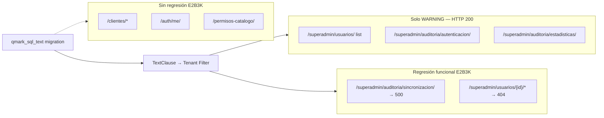

# F12-E2B3M — Regression Impact Audit (Post E2B3K)

**Fecha:** 2026-06-28  
**Referencia:** F12-E2B3K (migración `qmark_sql_text`), F12-E2B3L (tenant filter compatibility)  
**Alcance:** Auditoría funcional Platform Admin — **sin cambios de código**  
**Método:** Smoke HTTP reproducible (`Origin: platform.app.local`, login `superadmin` / `admin123`, Docker backend local)

---

## 1. Resumen ejecutivo

F12-E2B3K eliminó por completo los warnings `[QUERY] DEPRECATED` en Platform Admin. La regresión funcional visible en frontend («Error del servidor») tiene **un caso bloqueante confirmado** y **varios casos de detalle rotos** introducidos o agravados por la activación del pipeline `TextClause → Tenant Filter`.

| Métrica | Valor (smoke 22 endpoints) |
|---------|---------------------------:|
| Endpoints probados | 22 |
| HTTP 500 (bloqueante FE) | **1** |
| HTTP 404 funcional post-listado | **3** (mismo usuario/log visible en listado) |
| HTTP 2xx correctos | 11 |
| Con WARNING `[TENANT_FILTER]` | 9 |
| Con `[QUERY] DEPRECATED` post-E2B3K | **0** |
| Impacto funcional bloqueante | **~4,5 %** endpoints (1/22) |
| Impacto funcional total (500 + 404 falsos) | **~18 %** (4/22) |
| Impacto cualquier tipo (funcional + solo logging) | **~36 %** (8/22) |

**Veredicto:** la regresión **no es generalizada** en Platform Admin — módulos tenant (`/clientes/`), auth shell (`/auth/me/`) y catálogos no migrados funcionan. El daño se concentra en **superadmin usuarios (detalle)** y **superadmin auditoría (sync)**. La causa raíz es **única** (pipeline TextClause + tenant filter + ContextVar SYSTEM), con dos modos de fallo: inyección exitosa (500 / 404) vs reconstrucción bindparams fallida (WARNING, HTTP 200 accidental).

---

## 2. Metodología

### 2.1 Criterios de clasificación

| Clase | Definición |
|-------|------------|
| **Funcional bloqueante** | HTTP 500 o respuesta que impide renderizar pantalla (FE: «Error del servidor») |
| **Funcional degradado** | HTTP 404/409/etc. cuando el recurso existe en listado previo (navegación list → detail rota) |
| **Solo logging** | HTTP 2xx correcto + WARNING `[TENANT_FILTER]`; sin cambio observable de contrato |
| **Sin impacto E2B3K** | No usa call sites migrados en E2B3K, o usa `GLOBAL_TABLES` / `text()` sin cambio de branch |
| **Pre-existente (mismo pipeline)** | Ya usaba `text().bindparams()` antes de E2B3K; mismo tenant filter pero **no introducido** por la migración |

### 2.2 Mapa E2B3K → servicios

F12-E2B3K migró **47 call sites** en 6 servicios. En Platform Admin solo impactan directamente:

| Servicio | Call sites E2B3K | Endpoints HTTP afectados |
|----------|----------------:|--------------------------|
| `superadmin_auditoria_service.py` | 10 | `/superadmin/auditoria/*` |
| `superadmin_usuario_service.py` | 14 | `/superadmin/usuarios/*` |
| `cliente_service.py` | 2 | Solo validación POST (subdominio/código) — **no** GET listado |
| `tenant_service.py` | 3 | No invocado en navegación Platform Admin smoke |
| `user_service.py` | 14 | Tenant Admin — fuera alcance navegación Platform |
| `permiso_service.py` | 4 | Tenant Admin — fuera alcance |

---

## 3. Resultados smoke Platform Admin

### 3.1 Matriz completa

| # | Método | Endpoint | HTTP | TF WARN | SQL err | Clasificación | Relación E2B3K |
|---|--------|----------|-----:|--------:|--------:|---------------|----------------|
| 1 | GET | `/auth/me/` | 200 | 0 | 0 | ✅ OK | No migrado |
| 2 | GET | `/auth/me/current-token-id/` | 404 | 0 | 0 | ⚪ Ruta/contrato | No migrado |
| 3 | GET | `/clientes/?page=1&limit=5` | 200 | 0 | 0 | ✅ OK | List usa `text()`, no `qmark` |
| 4 | GET | `/clientes/{id}/` | 200 | 0 | 0 | ✅ OK | `text()` + `GLOBAL_TABLES` |
| 5 | GET | `/clientes/{id}/estadisticas/` | 200 | 0 | 0 | ✅ OK | No migrado en GET |
| 6 | GET | `/clientes/{id}/provisioning-status/` | 200 | 0 | 0 | ✅ OK | No migrado |
| 7 | GET | `/superadmin/usuarios/?page=1&limit=5` | 200 | 6 | 0 | ⚠️ Solo logging | **E2B3K** — listado OK por fallo bindparams |
| 8 | GET | `/superadmin/usuarios/{id}/` | **404** | 12 | 0 | ❌ Funcional degradado | **E2B3K** — lookup `qmark` filtrado a SYSTEM |
| 9 | GET | `/superadmin/usuarios/{id}/actividad/` | **404** | 6 | 0 | ❌ Funcional degradado | **E2B3K** — mismo lookup |
| 10 | GET | `/superadmin/usuarios/{id}/sesiones/` | **404** | 0 | 0 | ❌ Funcional degradado | **E2B3K** — lookup silencioso (filtro OK, 0 filas) |
| 11 | GET | `/superadmin/usuarios/clientes/{id}/usuarios/` | 200 | 2 | 0 | ⚠️ Solo logging | **E2B3K** — filtro tenant explícito en query |
| 12 | GET | `/superadmin/auditoria/autenticacion/?page=1` | 200 | 3 | 0 | ⚠️ Solo logging | **E2B3K** |
| 13 | GET | `/superadmin/auditoria/sincronizacion/?page=1` | **500** | 4 | 10 | ❌ **Bloqueante** | **E2B3K** — COUNT simple, filtro inyectado |
| 14 | GET | `/superadmin/auditoria/estadisticas/` | 200 | 6 | 0* | ⚠️ Solo logging | **E2B3K** — GROUP BY evita inyección |
| 15 | GET | `/superadmin/auditoria/autenticacion/{log_id}/` | **404** | 6 | 0 | ⚠️ Pre-existente† | **No E2B3K** — siempre `text()` |
| 16 | GET | `/modulos-v2/` | 200 | 2 | 0 | ⚠️ Logging adjacente | No migrado E2B3K |
| 17 | GET | `/conexiones/` | 404 | 0 | 0 | ⚪ Ruta incorrecta smoke | No E2B3K |
| 18 | GET | `/catalogos-globales/monedas/` | 404 | 0 | 0 | ⚪ Sin trailing path‡ | No E2B3K |
| 19 | GET | `/catalogos-globales/paises/` | 404 | 0 | 0 | ⚪ Sin trailing path‡ | No E2B3K |
| 20 | GET | `/cliente-modulo/` | 404 | 0 | 0 | ⚪ Ruta/contrato | No E2B3K |
| 21 | GET | `/permisos-catalogo/` | 200 | 0 | 0 | ✅ OK | No E2B3K |
| 22 | GET | `/menus/` | 405 | 0 | 0 | ⚪ Método/ruta | No E2B3K |

\*Errores SQL en ventana acumulada de llamadas previas en batch; stats aislado: 200 + 4 WARNING, 0 ERROR.  
†Detalle audit usa `text().bindparams()` desde antes de E2B3K; mismo pipeline tenant filter pero call site no migrado.  
‡Rutas reales: `/catalogos-globales/monedas` (sin slash final en router).

### 3.2 Evidencia funcional crítica

**Listado → detalle usuario (regresión E2B3K confirmada):**

```
GET /superadmin/usuarios/?page=1&limit=3  → 200, usuario admin (cliente_id ≠ SYSTEM)
GET /superadmin/usuarios/{mismo_id}/      → 404 "Usuario ... no encontrado"
```

Causa: lookup `qmark_sql_text("SELECT cliente_id FROM dbo.usuario WHERE usuario_id = ?")` migrado en E2B3K; query simple → filtro `cliente_id = SYSTEM` inyectado con éxito → 0 filas.

**Sync audit (bloqueante FE):**

```
GET /superadmin/auditoria/sincronizacion/?page=1&limit=3 → 500
SQL: ... FROM dbo.log_sincronizacion_usuario l WHERE 1=1 AND cliente_id = ?
Param: UUID('00000000-0000-0000-0000-000000000001')
```

---

## 4. Respuestas a las 10 preguntas

### 4.1 ¿Qué endpoints devuelven HTTP 500?

| Endpoint | Servicio | Causa |
|----------|----------|-------|
| `GET /superadmin/auditoria/sincronizacion/` | `superadmin_auditoria_service` | Tenant filter inyecta `cliente_id` en tabla sin esa columna |

**Único HTTP 500 confirmado** en navegación Platform Admin post-E2B3K. Corresponde a la pantalla de auditoría de sincronización — explica el «Error del servidor» reportado en frontend al abrir esa vista.

### 4.2 ¿Cuáles generan WARNING `[TENANT_FILTER]`?

Endpoints con al menos 1 WARNING en smoke aislado:

| Endpoint | WARN (aislado) | Origen |
|----------|---------------:|--------|
| `GET /superadmin/usuarios/` | 6 | `qmark` count + data + auxiliares/fila |
| `GET /superadmin/usuarios/{id}/` | 4–12 | lookups + queries detalle |
| `GET /superadmin/usuarios/{id}/actividad/` | 6 | queries actividad |
| `GET /superadmin/usuarios/clientes/{id}/usuarios/` | 2 | count + data |
| `GET /superadmin/auditoria/autenticacion/` | 2–3 | count + data |
| `GET /superadmin/auditoria/sincronizacion/` | 0–4 | data query (count falla antes con ERROR) |
| `GET /superadmin/auditoria/estadisticas/` | 4–6 | 4 queries `qmark` agregadas |
| `GET /modulos-v2/` | 2 | **No E2B3K** — `text()`/`execute_query` pre-existente |

**Ciclo navegación típico (5 pantallas principales superadmin + clientes):** ~**11–15 WARNING** acumulados (consistente con F12-E2B3L).

### 4.3 ¿Cuáles funcionan correctamente?

**Sin impacto observable (HTTP 2xx, sin WARNING relevante):**

- `GET /auth/me/`
- `GET /clientes/` (listado paginado)
- `GET /clientes/{id}/`
- `GET /clientes/{id}/estadisticas/`
- `GET /clientes/{id}/provisioning-status/`
- `GET /permisos-catalogo/`

**HTTP 2xx con WARNING pero funcionalmente correctos (fallo bindparams = query original sin filtro):**

- `GET /superadmin/usuarios/` — listado global OK
- `GET /superadmin/usuarios/clientes/{id}/usuarios/` — listado filtrado por tenant OK
- `GET /superadmin/auditoria/autenticacion/` — listado global OK
- `GET /superadmin/auditoria/estadisticas/` — respuesta completa HTTP 200 (sync_stats sobrevive por fallo bindparams)
- `GET /modulos-v2/` — catálogo OK (WARNING no atribuible a E2B3K)

### 4.4 ¿Cuáles quedaron afectados únicamente por logging?

| Endpoint | E2B3K | Efecto |
|----------|:-----:|--------|
| `GET /superadmin/usuarios/` | ✅ | WARNING; listado correcto |
| `GET /superadmin/usuarios/clientes/{id}/usuarios/` | ✅ | WARNING; datos correctos |
| `GET /superadmin/auditoria/autenticacion/` | ✅ | WARNING; listado correcto |
| `GET /superadmin/auditoria/estadisticas/` | ✅ | WARNING; stats auth + sync parcialmente sin filtro erróneo |
| `GET /modulos-v2/` | ❌ | WARNING pre-existente pipeline TextClause |

**Patrón:** queries complejas (paginación, GROUP BY, JOIN) → reconstrucción `bindparams` falla → WARNING + ejecución sin filtro extra.

### 4.5 ¿Cuáles quedaron afectados funcionalmente?

| Endpoint | HTTP | Tipo | E2B3K | Síntoma FE |
|----------|-----:|------|:-----:|------------|
| `GET /superadmin/auditoria/sincronizacion/` | **500** | Bloqueante | ✅ | «Error del servidor» |
| `GET /superadmin/usuarios/{id}/` | **404** | Degradado | ✅ | Usuario no encontrado |
| `GET /superadmin/usuarios/{id}/actividad/` | **404** | Degradado | ✅ | Actividad no disponible |
| `GET /superadmin/usuarios/{id}/sesiones/` | **404** | Degradado | ✅ | Sesiones no disponibles |
| `GET /superadmin/auditoria/autenticacion/{log_id}/` | **404** | Degradado | ❌† | Log no encontrado |

†Mismo síntoma y pipeline, pero call site **no migrado** en E2B3K (ya era `text()`). Clasificado como **pre-existente / agravado por navegación**, no introducido por cambio string→qmark.

**Riesgo latente no observado en smoke pero arquitectónicamente posible:** si bindparams tuviera éxito en listados, filtraría silenciosamente a cliente SYSTEM (datos incompletos sin error HTTP).

### 4.6 ¿Qué porcentaje del Platform Admin quedó afectado?

Dos métricas según definición de «afectado»:

| Métrica | Cálculo | % |
|---------|---------|---:|
| **Pantallas bloqueantes (500)** | 1 / 22 endpoints smoke | **4,5 %** |
| **Pantallas con fallo funcional (500 + 404 post-list)** | 4 / 22 | **18,2 %** |
| **Pantallas superadmin con call sites E2B3K rotas** | 4 / 8 endpoints superadmin probados | **50 %** |
| **Cualquier impacto (funcional + solo logging E2B3K)** | 8 / 22 | **36,4 %** |
| **Sin impacto E2B3K** | 14 / 22 | **63,6 %** |

**Por módulo de navegación FE (5 vistas principales):**

| Vista Platform Admin | Estado post-E2B3K |
|----------------------|-------------------|
| Tenants / clientes | ✅ OK |
| Usuarios global (listado) | ✅ OK (+ WARNING) |
| Usuario detalle / actividad / sesiones | ❌ 404 |
| Auditoría autenticación (listado) | ✅ OK (+ WARNING) |
| Auditoría sincronización | ❌ **500** |
| Auditoría estadísticas | ✅ OK (+ WARNING) |

→ **1/6 vistas bloqueante (500)**, **+1 vista con flujo detail roto (usuarios)** ≈ **33 %** impacto UX navegación principal.

### 4.7 ¿Cuántos servicios requieren corrección?

| Prioridad | Servicio / capa | Motivo |
|-----------|-----------------|--------|
| **P0 — Infra** | `queries_async.py` + `query_helpers.py` | Gateway: semántica `client_id=None` en CP, registro tablas CP, bindparams |
| **P0 — App** | `superadmin_auditoria_service.py` | HTTP 500 sync + 4 queries stats |
| **P0 — App** | `superadmin_usuario_service.py` | 404 detalle/actividad/sesiones (lookups migrados) |
| **P1 — App** | `user_service.py` | 14 call sites E2B3K — Tenant Admin (mismo pipeline) |
| **P2 — App** | `permiso_service.py`, `tenant_service.py`, `cliente_service.py` | Call sites E2B3K — fuera smoke Platform |

**Mínimo para cerrar regresión Platform Admin: 3 capas** (1 infra + 2 servicios superadmin).  
**Mínimo para cerrar regresión E2B3K global: 6 servicios** (todos los migrados en Phase 1).

Un fix correcto en **gateway (P0 infra)** puede resolver la mayoría sin tocar cada call site individualmente.

### 4.8 ¿Existe una única causa raíz?

**Sí.**

```
F12-E2B3K: execute_query(str) → execute_query(qmark_sql_text(...))
    → branch TextClause activo
    → _prepare_text_clause_for_gateway()
    → effective_client_id = ContextVar SYSTEM (platform middleware)
    → apply_tenant_filter_to_text_clause()
    → inyección AND cliente_id = :cliente_id
```

Tres condiciones simultáneas:

1. **Cambio de branch** string (sin filter) → TextClause (con filter).
2. **ContextVar SYSTEM** interpretado como filtro tenant en operaciones globales CP.
3. **Dos outcomes:** bindparams falla (WARNING, 200 accidental) vs bindparams OK (500 o 404).

### 4.9 ¿Todas las regresiones provienen del mismo pipeline TextClause → Tenant Filter?

| Regresión | Pipeline TextClause → Tenant Filter | Introducida por E2B3K |
|-----------|:-----------------------------------:|:---------------------:|
| Sync audit 500 | ✅ | ✅ |
| Usuario detalle 404 | ✅ | ✅ |
| Usuario actividad/sesiones 404 | ✅ | ✅ |
| Listados superadmin WARNING | ✅ | ✅ |
| Audit detail 404 | ✅ | ❌ (pre-existente `text()`) |
| modulos-v2 WARNING | ✅ | ❌ |
| Clientes OK | N/A (GLOBAL_TABLES / sin migración GET) | — |

**Conclusión:** todas las regresiones **funcionales atribuibles a E2B3K** comparten el mismo pipeline. Existen síntomas **colaterales** en endpoints que ya usaban `TextClause` antes de E2B3K (detalle audit, modulos-v2).

### 4.10 ¿Cuál debe ser el orden correcto de reparación?

Orden recomendado (sin implementar en E2B3M):

| Fase | Acción | Objetivo | Desbloquea |
|------|--------|----------|------------|
| **M1 — P0 hotfix gateway** | CP tables registry + bypass filtro cuando operación superadmin global (`client_id=None` intencional ≠ ContextVar) | Eliminar inyección errónea | Sync 500 + lookups 404 |
| **M2 — P0 smoke gate** | Re-ejecutar matriz §3.1; assert 0× HTTP 500 en sync | Validar hotfix | FE auditoría sync |
| **M3 — P1 bindparams** | Reconstrucción compatible `qmark_sql_text` + tenant filter | Eliminar WARNING | Logs limpios |
| **M4 — P1 Tenant Admin** | Validar `user_service` / `permiso_service` (14+4 call sites) | Paridad shared/dedicated | Admin tenant |
| **M5 — P2 pre-existentes** | Audit detail `text()` paths; modulos-v2 | Cerrar 404 audit detail | Navegación audit completa |
| **M6 — P3 tests** | Regresión E2B3K: Platform smoke + unit tenant filter CP | Prevenir recurrencia | CI |

**No recomendado:** revertir E2B3K (reintroduce 31× `[QUERY] DEPRECATED`).  
**Recomendado:** corregir gateway preservando `qmark_sql_text`.

---

## 5. Diagrama de impacto



---

## 6. Relación con F12-E2B3L

F12-E2B3L analizó el **mecanismo**; F12-E2B3M cuantifica el **impacto funcional en endpoints**:

| Hallazgo E2B3L | Confirmación E2B3M |
|----------------|-------------------|
| Sync 500 por `cliente_id` inexistente | ✅ Único 500 en smoke |
| WARNING por bindparams | ✅ 9 endpoints, ~11–15/ciclo |
| Listados OK por fallo accidental bindparams | ✅ Usuarios + auth audit 200 |
| Clientes sin impacto (`GLOBAL_TABLES`) | ✅ 0 WARNING en `/clientes/*` |
| Lookup simple → filtro exitoso | ✅ Usuario detail 404 confirmado |

---

## 7. Conclusiones

1. **Alcance acotado:** E2B3K no rompió Platform Admin completo; afecta principalmente **superadmin** (usuarios detalle + auditoría sync).

2. **Un error bloquea FE:** `GET /superadmin/auditoria/sincronizacion/` → HTTP 500 — acción P0.

3. **Regresión silenciosa en detalle:** listados globales funcionan; navegación list → detail en usuarios está rota por lookups migrados a `qmark`.

4. **`[QUERY] DEPRECATED` = 0** en todo el smoke — objetivo E2B3K se mantiene.

5. **Corrección eficiente:** un fix en gateway (infra) + validación smoke §3.1 antes que parches por call site.

6. **Fuera de alcance Platform pero pendiente:** `user_service` (14 sites), `permiso_service` (4), `tenant_service` (3) — mismo pipeline, riesgo en Tenant Admin.

---

## 8. Evidencia

- Smoke script: ejecución local 2026-06-28, 22 endpoints, JSON completo en sesión de auditoría.
- Verificación manual list→detail usuario: `admin` / `62effc25-...` listado 200, detail 404.
- SQL sync 500: `WHERE 1=1 AND cliente_id = ?` + UUID SYSTEM (F12-E2B3L).

---

*Documento generado en F12-E2B3M. Sin modificaciones de código, SQL, helpers ni commits.*
