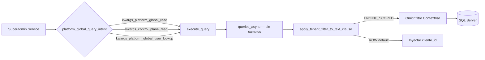

# F12-E2B3N — Platform Global Query Intent Implementation

**Fecha:** 2026-06-28  
**Referencia:** F12-E2B3K (migración `qmark_sql_text`), F12-E2B3L (tenant filter audit), F12-E2B3M (regression impact)  
**Alcance:** Corrección mínima en capa de servicio Superadmin — **sin modificar gateway ni tenant filter**

---

## 1. Qué cambió

### 1.1 Nuevo módulo de intención explícita

**Archivo:** `app/modules/superadmin/application/platform_global_query_intent.py`

Expone tres contratos de kwargs para `execute_query`:

| Función | Uso | `identity_scope` | Conexión |
|---------|-----|------------------|----------|
| `kwargs_platform_global_read()` | Lecturas cross-tenant / listados CP | `ENGINE_SCOPED` | DEFAULT (o explícita) |
| `kwargs_platform_global_user_lookup()` | Resolver `usuario_id → cliente_id` en identity store | `ENGINE_SCOPED` | DEFAULT |
| `kwargs_control_plane_read()` | Tablas solo en BD central (CP) | `ENGINE_SCOPED` | ADMIN + `operation_class=control_plane` |

**Mecanismo:** `IdentityScope.ENGINE_SCOPED` ya existía en `query_helpers.apply_tenant_filter_to_text_clause` y omite la inyección automática de `cliente_id` desde ContextVar. No se usó `skip_tenant_validation` ni bypass global.

### 1.2 Servicios modificados

| Archivo | Cambio |
|---------|--------|
| `superadmin_auditoria_service.py` | 8 call sites `qmark_sql_text` → kwargs platform global / CP |
| `superadmin_usuario_service.py` | 14 call sites `qmark_sql_text` → kwargs platform global / CP / user lookup |

### 1.3 Ajustes adicionales (sesiones)

- Normalización `usuario_cliente_id` a `UUID` tras lookup SQL.
- Eliminación de validación SQL redundante en `obtener_sesiones_usuario` (lookup ya confirma existencia).

### 1.4 Sin cambios (explícitamente excluidos)

- `queries_async.py`
- `query_helpers.py` (solo consumo de API existente)
- `routing.py`, Connection Resolver, Database Router

---

## 2. Por qué esa solución es arquitectónicamente correcta

1. **Intención en la capa correcta (RD-07):** Las operaciones Superadmin son Control Plane / vistas globales. La intención «no aplicar filtro row-scoped del middleware» se declara en el **servicio de aplicación**, no se desactiva el tenant filter globalmente.

2. **Reutiliza contrato existente:** `identity_scope=IdentityScope.ENGINE_SCOPED` está documentado en `identity_scope.py` y soportado en `apply_tenant_filter_to_text_clause` para SQL no acotado por fila — mismo patrón que Dedicated engine-scoped identity.

3. **Separación CP vs tenant_data:**
   - Tablas CP (`log_sincronizacion_usuario`, `cliente`) → `connection_type=ADMIN` + `operation_class=control_plane`.
   - Tablas identity/tenant (`usuario`, `auth_audit_log` en shared) → DEFAULT + scope global; `client_id` solo para **routing** cuando el servicio lo conoce.

4. **No es bypass:** `skip_tenant_validation=True` queda reservado a scripts/migración (`ALLOW_TENANT_FILTER_BYPASS`). Esta solución usa el canal semántico de scope de identidad.

5. **SQL sigue siendo fuente de verdad:** Filtros explícitos en WHERE (`cliente_origen_id`, `u.cliente_id = ?` cuando el operador filtra) se mantienen; solo se evita la **doble aplicación** errónea vía ContextVar SYSTEM.

---

## 3. Qué consultas quedaron marcadas como Platform Global

### 3.1 `kwargs_platform_global_read` (cross-tenant / shared store)

| Servicio | Operación | Queries |
|----------|-----------|---------|
| `superadmin_usuario_service` | `get_usuarios_globales` | COUNT + DATA listado |
| `superadmin_usuario_service` | `obtener_usuario_completo` | SELECT usuario por id (post-lookup) |
| `superadmin_usuario_service` | `_obtener_roles_usuario` | JOIN rol/usuario_rol |
| `superadmin_usuario_service` | `obtener_actividad_usuario` | SELECT usuario + auth_audit_log |
| `superadmin_usuario_service` | `obtener_sesiones_usuario` | SELECT refresh_tokens (V1) |
| `superadmin_auditoria_service` | `get_logs_autenticacion` | COUNT + DATA |
| `superadmin_auditoria_service` | `obtener_estadisticas` | auth_stats, top_ips, top_usuarios |

### 3.2 `kwargs_platform_global_user_lookup` (identity store DEFAULT)

| Servicio | Operación | Query |
|----------|-----------|-------|
| `superadmin_usuario_service` | Lookup `usuario_id → cliente_id` | `SELECT cliente_id FROM dbo.usuario WHERE usuario_id = ?` |

Usado en: `obtener_usuario_completo`, `obtener_actividad_usuario`, `obtener_sesiones_usuario`.

### 3.3 `kwargs_control_plane_read` (ADMIN / CP-only)

| Servicio | Operación | Tabla |
|----------|-----------|-------|
| `superadmin_usuario_service` | `_fetch_cliente_info_from_admin` | `cliente` |
| `superadmin_usuario_service` | Embeddable cliente en detalle | `cliente` |
| `superadmin_auditoria_service` | `get_logs_sincronizacion` | `log_sincronizacion_usuario` (+ JOIN usuario) |
| `superadmin_auditoria_service` | `obtener_estadisticas` | `log_sincronizacion_usuario` (sync_stats) |

### 3.4 Consultas tenant-routed (platform global + `client_id` explícito)

Cuando el servicio conoce el tenant destino, se usa:

```python
**kwargs_platform_global_read(client_id=usuario_cliente_id)
```

`client_id` guía **routing**; `ENGINE_SCOPED` evita inyección ContextVar. Aplica a detalle usuario, actividad, sesiones V1, roles.

---

## 4. Impacto sobre Shared

| Aspecto | Efecto |
|---------|--------|
| Tenant Admin (`/usuarios/`, ERP) | **Sin cambio** — no tocados |
| Platform Admin listados globales | **Corregido** — ya no filtran a SYSTEM |
| Aislamiento shared (`cliente_id` en SQL tenant) | **Preservado** — servicios tenant siguen pasando `client_id` explícito en WHERE |
| Dedicated tenants en shared físico | Superadmin puede listar/consultar con routing por `client_id` resuelto |

---

## 5. Impacto sobre Dedicated

| Aspecto | Efecto |
|---------|--------|
| Superadmin vista global | **Mejorado** — lookup usuario + routing a BD dedicada vía `client_id` resuelto |
| Filtro defensivo TD-08 en dedicated | **No alterado** en gateway; servicios Superadmin declaran scope global explícito |
| Operaciones ERP tenant | **Sin cambio** |

---

## 6. Impacto sobre Tenant

| Aspecto | Efecto |
|---------|--------|
| Endpoints tenant (`user_service`, etc.) | **Sin cambio** en esta fase |
| Riesgo residual E2B3K en Tenant Admin | **Pendiente** fase gateway (E2B3O+) — 14 call sites en `user_service.py` no incluidos aquí |
| Seguridad tenant aislado | **No degradada** — no se desactivó tenant filter; solo Superadmin declara scope |

---

## 7. Validación completa

**Entorno:** Docker local, `Origin: platform.app.local`, login `superadmin` / `admin123`  
**Fecha smoke:** 2026-06-28

| Endpoint | Pre-E2B3N | Post-E2B3N | TF WARN | SQL err |
|----------|-----------|------------|---------|---------|
| `GET /superadmin/auditoria/sincronizacion/` | **500** | **200** | 0 | 0 |
| `GET /superadmin/usuarios/` | 200 + WARN | **200** | 0 | 0 |
| `GET /superadmin/usuarios/{id}/` | **404** | **200** | 0 | 0 |
| `GET /superadmin/usuarios/{id}/actividad/` | **404** | **200** | 0 | 0 |
| `GET /superadmin/usuarios/{id}/sesiones/` | **404** | **200** | 0 | 0 |

**Métricas globales post-fix (ciclo 5 endpoints):**

- `[QUERY] DEPRECATED`: **0** (objetivo E2B3K mantenido)
- `[TENANT_FILTER] WARNING`: **0**
- `Invalid column name 'cliente_id'`: **0**

---

## 8. Riesgos residuales

| ID | Riesgo | Severidad | Mitigación futura |
|----|--------|-----------|-------------------|
| R1 | `ENGINE_SCOPED` usado semánticamente para Platform global (alias de CP) | Baja | Introducir `IdentityScope.PLATFORM_GLOBAL` en gateway + `query_helpers` |
| R2 | Call sites E2B3K en `user_service`, `permiso_service`, `tenant_service` sin intent explícito | Media | Fase gateway o replicar patrón Superadmin |
| R3 | Detalle audit `text()` (`obtener_log_autenticacion`) pre-existente sin intent | Media | Aplicar mismo kwargs en paths `text().bindparams()` |
| R4 | Gateway sigue resolviendo ContextVar cuando `client_id=None` sin `identity_scope` | Media | `_resolve_effective_client_id` con intención CP en fase E2B3O |
| R5 | Normalización UUID post-lookup solo en sesiones | Baja | Extraer helper `_coerce_uuid` en intent module si se repite |

---

## 9. Diagrama



---

*Implementación F12-E2B3N. Gateway y tenant filter global sin modificar.*
