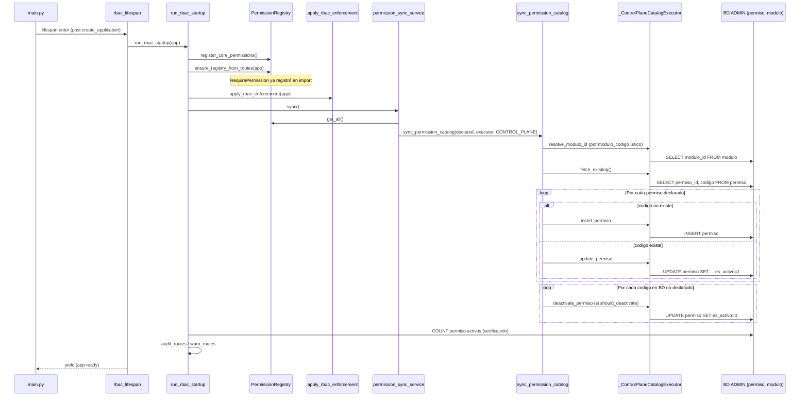

# F12-E2B3T — RBAC Permission Catalog Sync Architecture Audit

**Fecha:** 2026-06-28  
**Modo:** Solo auditoría — **sin cambios de código**  
**Alcance:** `app/core/authorization/` + startup/lifespan + sync dedicado relacionado  
**Referencias:** F12-B (motor compartido), `RUNTIME_RBAC_AUDIT.md`, `RUNTIME_DEPENDENCY_MATRIX.md`, `RBAC_CODE_FIRST_PERMISSIONS.md`

---

## 1. Conclusión ejecutiva

El **Permission Catalog Sync** es un pipeline **code-first** que materializa en la tabla `permiso` los permisos declarados en código (`PermissionRegistry`) al arrancar FastAPI. No existe capa Repository clásica: se usa el patrón **Executor** (`PermissionCatalogExecutor`) con dos implementaciones (Control Plane y Dedicated Data Plane).

| Aspecto | Hallazgo |
|---------|----------|
| **Iniciador** | `rbac_lifespan` → `run_rbac_startup` → `permission_sync_service.sync()` |
| **Momento** | Fase **yield-before** del lifespan (post-registro de routers) |
| **Obligatoriedad** | Default **sí**; omitible vía `RBAC_PERMISSION_SYNC_ENABLED=false` |
| **Operaciones SQL** | INSERT + UPDATE (siempre) + soft-deactivate (`es_activo=0`); **sin DELETE físico** |
| **Batch** | **No** — una consulta por permiso declarado + una por desactivación |
| **Idempotencia datos** | **Sí** (estado estable) |
| **Idempotencia I/O** | **No** — re-UPDATE aunque no haya cambios |
| **Riesgo principal** | Desactivación de permisos solo-SQL (~284 códigos seed) no presentes en registry (~113 rutas) |

---

## 2. Diagrama de flujo (FastAPI → sync completo)



---

## 3. Inventario de componentes

| Capa | Archivo | Rol |
|------|---------|-----|
| **Entrypoint lifespan** | `app/main.py` (`rbac_lifespan`) | Invoca startup RBAC una vez por arranque |
| **Orquestación startup** | `permission_startup.py` (`run_rbac_startup`) | Registry → enforcement → sync → auditoría |
| **Registry in-memory** | `permission_registry.py` | Dict global `codigo → PermissionMetadata` |
| **Permisos estáticos** | `core_permissions.py` | `core.app.acceder`, `admin.platform.access` + sets PROTECTED |
| **Metadata tipo** | `permission_metadata.py` | TypedDict del contrato |
| **Declaración en rutas** | `rbac.py` (`RequirePermission`, `require_permission`) | Registra en registry; marca `__permission_*__` |
| **Sync CP** | `permission_sync_service.py` | Gate config + `_ControlPlaneCatalogExecutor` |
| **Motor compartido** | `permission_catalog_sync_core.py` | Algoritmo INSERT/UPDATE/deactivate + hash |
| **Contratos** | `permission_catalog_sync_types.py` | `SyncMode`, `SyncResult`, Protocol Executor |
| **Sync Dedicated** | `infrastructure/provisioning/dedicated_permission_catalog_sync_service.py` | Provisioning S6; **no** es startup global |
| **Resolución runtime lectura** | `permission_catalog_store.py` | Shared→ADMIN; Dedicated→DEFAULT (fuera del sync startup) |
| **Binder menú (inactivo)** | `menu_permission_binder.py` | **No** invocado en `run_rbac_startup` |

**No hay repositories** en el sentido DDD. Persistencia vía `execute_query` / `execute_insert` / `execute_update` (CP) o `AsyncSession.execute` (Dedicated).

---

## 4. Tablas utilizadas

| Tabla | Conexión | Operación sync startup CP | Operación sync Dedicated |
|-------|----------|---------------------------|--------------------------|
| **`permiso`** | ADMIN (CP) / Dedicated DB (DP) | SELECT all, INSERT, UPDATE, soft-deactivate | Idem en BD tenant |
| **`modulo`** | Misma | SELECT `modulo_id` por `codigo` | Idem |
| **`bootstrap_applied`** | Dedicated DB | — | Marker hash para skip idempotente |

**No toca** en sync: `rol_permiso`, `rol_menu_permiso`, `usuario_rol`, `cliente_modulo`.

---

## 5. Respuestas detalladas (1–21)

### 1. ¿Qué componente inicia el RBAC Sync?

**Componente directo:** `permission_sync_service.sync()` (función async).

**Cadena de invocación:**

```436:454:app/core/authorization/permission_startup.py
async def run_rbac_startup(app: Any) -> None:
    ...
        register_core_permissions()
        ensure_registry_from_routes(app)
        apply_rbac_enforcement(app)
        await sync_permissions()
```

**Entrypoint FastAPI:**

```248:262:app/main.py
@asynccontextmanager
async def rbac_lifespan(app: FastAPI):
    ...
    await run_rbac_startup(app)
    yield
```

**Clasificación:** Correcto (diseño code-first explícito).

---

### 2. ¿En qué momento del startup ocurre?

| Fase | Orden | Estado app |
|------|------:|------------|
| `create_application()` | 1 | Routers montados en `api_router` |
| Lifespan **enter** | 2 | Todas las rutas disponibles para introspección |
| `register_core_permissions()` | 3 | Permisos core en registry |
| `ensure_registry_from_routes(app)` | 4 | Scan `APIRoute` + dependencias |
| `apply_rbac_enforcement(app)` | 5 | Inyección dinámica `require_permission` en rutas ORG/LOG/ADMIN inferidas |
| **`sync_permissions()`** | **6** | **Escritura BD** |
| Verificación COUNT + warnings | 7 | Post-sync |

Ocurre **después** de montar routers y **antes** de servir tráfico (`yield`).

**Clasificación:** Correcto.

---

### 3. ¿Siempre se ejecuta?

**En condiciones normales: sí**, cada arranque/reload de uvicorn con lifespan activo.

**Excepciones:**

| Condición | Efecto |
|-----------|--------|
| `RBAC_PERMISSION_SYNC_ENABLED=false` | `sync()` retorna sin BD (`permission_sync_service.py:145-147`) |
| Registry vacío | Retorna sin sync (`permission_sync_service.py:152-154`) |
| Excepción en sync | Warning no bloqueante; app arranca (`permission_sync_service.py:170-171`, `permission_startup.py:490-491`) |
| Dedicated provisioning | Sync CP startup **independiente** del sync Dedicated (S6) |

**Clasificación:** Correcto con **Mejorable** (fallo silencioso).

---

### 4. ¿Puede omitirse?

**Sí**, de forma explícita:

- Variable de entorno: `RBAC_PERMISSION_SYNC_ENABLED=false` (default `true` en `config.py:288`).
- Implícitamente si no hay permisos en registry.
- Implícitamente si sync lanza excepción (se omite efectivamente el persist).

Dedicated adicional: `DEDICATED_PERMISSION_CATALOG_SYNC_ENABLED=false` solo afecta provisioning, no startup global.

**Clasificación:** Correcto.

---

### 5. ¿Qué información toma del código fuente?

| Fuente | Mecanismo | Campos |
|--------|-----------|--------|
| **`RequirePermission(metadata)`** | Registro en import + re-scan startup | `codigo`, `nombre`, `descripcion`, `recurso`, `accion`, `modulo_codigo` |
| **`require_permission("x.y.z")`** | `__permission_codigo__` en dependencia | Metadata mínima inferida (`nombre=codigo`, partes split por `.`) |
| **`register_core_permissions()`** | Lista estática | `core.app.acceder`, `admin.platform.access` |
| **Inferencia automática** | `ensure_registry_from_routes` rutas ORG/LOG/ADMIN sin permiso | `{modulo}.{recurso}.{accion}` por path + HTTP method |
| **`apply_rbac_enforcement`** | Misma heurística | Añade dependencia; permiso ya en registry |

**No lee** archivos SQL, OpenAPI exportado ni seeds bootstrap en runtime.

**Clasificación:** Correcto para code-first; **Riesgo Medio** (divergencia vs seeds SQL históricos).

---

### 6. ¿Qué información obtiene desde la base de datos?

| Query | Propósito | Conexión |
|-------|-----------|----------|
| `SELECT permiso_id, codigo FROM permiso` | Mapa existente `codigo → fila` | ADMIN |
| `SELECT modulo_id FROM modulo WHERE codigo = ? AND es_activo = 1` | Resolver `modulo_codigo → modulo_id` | ADMIN |
| Post-sync: `SELECT COUNT(*) FROM permiso WHERE es_activo = 1` | Verificación vs `declared_count` | ADMIN |

Dedicated (provisioning): además lee `bootstrap_applied.checksum_sha256` para skip.

**Clasificación:** Correcto.

---

### 7. ¿Cómo compara ambas fuentes?

Comparación por **clave `codigo`** (string exacto):

1. Construye `codigos_declared = {p["codigo"] for p in declared}`.
2. Construye `existing_by_codigo` desde BD.
3. Para cada declarado: **membership test** `codigo not in existing_by_codigo` → INSERT vs UPDATE.
4. Para cada existente: si `codigo ∉ codigos_declared` y `should_deactivate(...)` → deactivate.

**No compara** campo a campo (nombre, recurso, accion) antes de UPDATE.  
**No usa** hash en startup CP (hash solo en Dedicated skip via `compute_registry_hash`).

**Clasificación:** Mejorable (sin diff semántico).

---

### 8. ¿Qué algoritmo utiliza?

Algoritmo **full reconciliation por código** (similar a “desired state sync”):

```
ENTRADA: declared[], existing[] de BD, mode (CONTROL_PLANE | DEDICATED_DATA_PLANE)

1. Precalcular modulo_id por cada modulo_codigo único (cache dict)
2. existing_by_codigo = index(existing, key=codigo)

3. PARA cada perm IN declared:
     SI perm.codigo ∉ existing_by_codigo:
         INSERT (nuevo UUID, es_activo=1)
     SINO:
         UPDATE (todos los metadata + es_activo=1 + GETDATE())

4. PARA cada codigo IN existing_by_codigo:
     SI should_deactivate(codigo, codigos_declared, mode):
         UPDATE es_activo=0

SALIDA: SyncResult(inserted, updated, deactivated, declared_count)
```

`should_deactivate` (`permission_catalog_sync_core.py:43-57`):

- **Nunca** desactiva `PROTECTED_PERMISSION_CODIGOS` (`core.app.acceder`, `admin.platform.access`).
- En **DEDICATED_DATA_PLANE**: también protege `DEDICATED_PROTECTED` y solo gestiona prefijos `admin.`, `tenant.`, `modulos.`, `core.`.
- En **CONTROL_PLANE**: desactiva **cualquier** otro código BD-only.

**Clasificación:** Correcto en CP; **Riesgo Alto** interacción con seeds SQL masivos.

---

### 9. ¿Hace INSERT únicamente?

**No.** INSERT solo para códigos **nuevos** (ausentes en BD).

**Clasificación:** Correcto.

---

### 10. ¿Hace UPDATE?

**Sí.** Para **todo** permiso declarado que ya existe en BD, **siempre** ejecuta UPDATE con:

- `nombre`, `descripcion`, `modulo_id`, `recurso`, `accion`
- `es_activo = 1`
- `fecha_actualizacion = GETDATE()`

Sin comprobar si los valores cambiaron.

**Clasificación:** Mejorable (escrituras redundantes).

---

### 11. ¿Hace DELETE?

**No.** Soft-delete únicamente: `es_activo = 0`.

**Clasificación:** Correcto (alineado con reglas ERP).

---

### 12. ¿Actualiza registros aunque no hayan cambiado?

**Sí, siempre** en la rama “codigo existe”. No hay comparación de valores ni “no-op skip”.

**Clasificación:** Mejorable — impacto directo en volumen SQL (pregunta 15).

---

### 13. ¿Cada permiso genera una consulta independiente?

**Casi siempre sí:**

| Operación | Granularidad |
|-----------|--------------|
| Resolución `modulo_id` | **1 SELECT por `modulo_codigo` único** (cache en dict) |
| Carga existentes | **1 SELECT** global |
| INSERT declarado nuevo | **1 INSERT** |
| UPDATE declarado existente | **1 UPDATE** |
| Deactivate huérfano | **1 UPDATE** por código |

No hay bulk INSERT/UPDATE MERGE en el motor Python.

**Clasificación:** Mejorable — **Riesgo Medio** a escala.

---

### 14. ¿Existe procesamiento por lotes (batch)?

**No** en `sync_permission_catalog`. Cada permiso es una operación SQL individual vía executor.

Los seeds SQL bootstrap (S040–S066) usan MERGE por script, pero eso es **fuera** del sync runtime.

**Clasificación:** Mejorable (oportunidad batch/MERGE).

---

### 15. ¿Cuántas consultas SQL ejecuta aproximadamente durante un startup completo?

Fórmula (Control Plane, estado estable):

```
Q ≈ 1                           -- fetch_existing
  + U                           -- SELECT modulo (U = modulo_codigo únicos, típ. 15–30)
  + N                           -- INSERT o UPDATE por cada permiso declarado N
  + D                           -- UPDATE deactivate (códigos BD-only elegibles)
  + 1                           -- COUNT verificación post-sync (permission_startup)
```

**Estimaciones documentadas en repo:**

| Escenario | N (declarados) | D (desactivaciones) | Q aprox. |
|-----------|---------------:|--------------------:|---------:|
| Steady state post-sync | ~113–150 | 0 | **~130–180** |
| Primer arranque post SQL seed (~377) | ~113 | **~260+** | **~400–450** |
| Escala futura (500 permisos rutas) | 500 | variable | **~530–550+** |

Además, el scan de rutas en `ensure_registry_from_routes` emite **cientos de logs INFO** `[RBAC] Scanning endpoint` (no SQL, pero costo CPU/I/O log).

**Clasificación:** **Riesgo Medio** en steady state; **Riesgo Alto** en convivencia con seeds SQL.

---

### 16. ¿Es completamente idempotente?

| Dimensión | Idempotente |
|-----------|-------------|
| **Estado final `permiso`** tras N arranques iguales | **Sí** (mismos códigos activos/inactivos) |
| **I/O** (re-ejecuta UPDATEs) | **No** |
| **INSERT duplicado** | Protegido por existencia previa + UNIQUE `codigo` |
| **Dedicated skip** | **Sí** si hash registry = `bootstrap_applied.checksum_sha256` |

**Clasificación:** Correcto en semántica; Mejorable en eficiencia.

---

### 17. ¿Es seguro para Shared Database?

**Parcialmente.**

| Aspecto | Evaluación |
|---------|------------|
| Escritura en ADMIN central | **Correcto** — catálogo permiso es SSOT CP multi-tenant |
| Aislamiento tenant en sync | **N/A** — `permiso` no tiene `cliente_id` |
| Coexistencia con SQL seeds | **Riesgo Alto** — desactiva ~284 códigos solo-SQL (matriz C en `RUNTIME_DEPENDENCY_MATRIX.md`) |
| Grants `rol_permiso` | Sync **no** crea grants; permisos desactivados dejan de resolverse en API |
| `admin.tenant.access` | **No** está en `PROTECTED_PERMISSION_CODIGOS` CP → puede desactivarse si no está en registry |

**Clasificación:** **Riesgo Medio–Alto** operacional en despliegues que mezclan S040–S066 + sync.

---

### 18. ¿Es seguro para Dedicated Database?

**Sí, con matices**, vía `DedicatedPermissionCatalogSyncService` (provisioning, no cada startup app):

| Mecanismo | Efecto |
|-----------|--------|
| `SyncMode.DEDICATED_DATA_PLANE` | Desactivación **limitada** a prefijos gestionados |
| `DEDICATED_PROTECTED_PERMISSION_CODIGOS` | Protege grant-only |
| `bootstrap_applied` + hash | Evita re-sync completo si catálogo código no cambió |
| Réplica en BD tenant | Correcto para `permisos_usuario_service` DP |

Startup global CP **no** escribe en BD Dedicated; provisioning S6 sí.

**Clasificación:** Correcto en diseño F12-B; **Riesgo Bajo** si marker hash funciona.

---

### 19. ¿Qué impacto tendría con cientos o miles de permisos?

| Área | Impacto |
|------|---------|
| **Tiempo startup** | Lineal O(N) en INSERT/UPDATE; ~1 RTT SQL por permiso |
| **Carga SQL Server** | N UPDATEs innecesarios cada reload en dev (`--reload`) |
| **Logs** | 3×N líneas INFO `[RBAC] Permission catalog inserted/updated/disabled` |
| **Locks** | N updates row-level en `permiso`; bajo contención en startup único |
| **Memoria** | Registry O(N); scan rutas O(endpoints) — dominado por endpoints ERP |

Con **N=1000**: ~1000+ queries sync + scan masivo rutas → **startup >5–15s** plausible en SQL remoto.

**Clasificación:** **Riesgo Medio** (100–300); **Riesgo Alto** (1000+ sin batch).

---

### 20. ¿Qué riesgos arquitectónicos existen actualmente?

| ID | Riesgo | Severidad |
|----|--------|-----------|
| R-T01 | Desactivación CP de permisos solo-SQL (FIN/INV/…) no declarados en rutas | **Alto** |
| R-T02 | UPDATE incondicional — I/O redundante cada arranque | **Medio** |
| R-T03 | Sync fallido = warning; app arranca con catálogo stale | **Medio** |
| R-T04 | Divergencia doc vs código: `MenuPermissionBinder` documentado pero **no wired** | **Medio** |
| R-T05 | `admin.tenant.access` no protegido en CP sync | **Medio** |
| R-T06 | Doble registro: `RequirePermission` en import + scan startup | **Bajo** |
| R-T07 | Inferencia ORG/LOG/ADMIN puede generar códigos no deseados | **Medio** |
| R-T08 | `apply_rbac_enforcement` muta dependencias en runtime | **Medio** |
| R-T09 | Sin transacción única: sync parcial posible mid-loop | **Medio** |
| R-T10 | Hash registry no usado en CP para skip (solo Dedicated) | **Bajo** |

---

### 21. Clasificación de hallazgos

| Hallazgo | Clasificación |
|----------|---------------|
| Patrón code-first + Executor compartido CP/DP | **Correcto** |
| Lifespan post-routers | **Correcto** |
| Soft-delete `es_activo=0` | **Correcto** |
| Flag `RBAC_PERMISSION_SYNC_ENABLED` | **Correcto** |
| Dedicated hash skip + `bootstrap_applied` | **Correcto** |
| Protección `core.app.acceder` / `admin.platform.access` | **Correcto** |
| UPDATE sin diff | **Mejorable** |
| Sin batch / MERGE runtime | **Mejorable** |
| Logging INFO masivo en scan rutas | **Mejorable** |
| Fallo sync no bloqueante | **Riesgo Bajo** |
| I/O lineal miles permisos | **Riesgo Medio** |
| Desactivación seeds SQL masivos | **Riesgo Alto** |
| Convivencia bootstrap S040–S066 + sync | **Riesgo Alto** |
| `MenuPermissionBinder` muerto | **Riesgo Medio** |
| Sin transacción atómica sync | **Riesgo Medio** |

---

## 6. Roadmap de mejoras futuras (solo propuesta — NO implementar)

### Fase T1 — Seguridad catálogo (prioridad alta)

1. **Ampliar `PROTECTED_PERMISSION_CODIGOS` CP** con `admin.tenant.access`, `tenant.branding.leer` y otros grant-only documentados.
2. **Política explícita de convivencia SQL vs sync:** deprecar S040–S066 en PROD o marcar permisos seed como “no managed by sync”.
3. **Modo `SYNC_DEACTIVATE_ORPHANS=false`** para entornos migración.

### Fase T2 — Eficiencia startup (prioridad media)

4. **Diff antes de UPDATE:** comparar metadata en memoria; skip si igual.
5. **Batch MERGE** SQL Server (tabla valor `#staging` + MERGE único) para N permisos.
6. **Skip CP por hash:** reutilizar `compute_registry_hash` + tabla/marker similar a Dedicated.
7. **Cache modulo_codigo→modulo_id** en memoria con TTL entre reloads (dev).

### Fase T3 — Observabilidad y operación (prioridad media-baja)

8. Métricas: `rbac_sync_duration_ms`, `rbac_sync_updated`, `rbac_sync_deactivated`.
9. Fallo sync **configurable** blocking en PROD (`RBAC_PERMISSION_SYNC_FAIL_FAST=true`).
10. Reducir logs scan rutas a DEBUG (alineado F12-E2B3*).

### Fase T4 — Consistencia menú ↔ permiso (prioridad baja)

11. Decidir destino de `MenuPermissionBinder`: wire en startup o retirar columna/doc.
12. Documentar relación `rol_permiso` (API) vs `rol_menu_permiso` (menú UI) en runbook operativo.

### Fase T5 — Escala (prioridad futura)

13. Sync incremental por módulo ERP (solo permisos de módulos activos en `cliente_modulo`).
14. Job async post-startup (defer sync) para no bloquear readiness probe — con gate de autorización conservador durante ventana.

---

## 7. Relación con fases logging (contexto)

El único `logger.info` en motor sync (`permission_catalog_sync_core.py:67`) fue clasificado **B** en F12-E2B3O (catálogo vacío). Los logs `[RBAC] Permission catalog inserted/updated/disabled` son **INFO operacionales** del sync (clase B operacional sync, distinta de narrativa request-path).

---

## 8. Entregable y límites

- **Entregable:** este documento (`F12_E2B3T_RBAC_PERMISSION_CATALOG_SYNC_ARCHITECTURE_AUDIT.md`).
- **Sin implementación**, **sin commits**, **sin optimización**.
- Dedicated sync analizado como **rama arquitectónica relacionada**; startup global CP es foco principal.

---

*Auditoría F12-E2B3T — RBAC Permission Catalog Sync. Solo lectura.*
