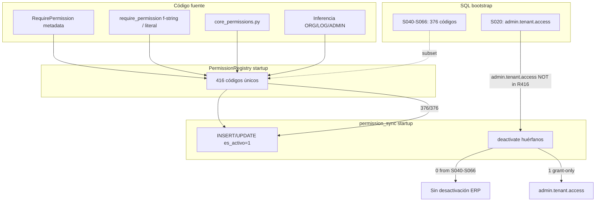

# F12-E2B3U — RBAC Permission Catalog Consistency Audit

**Fecha:** 2026-06-28  
**Modo:** Verificación objetiva — **sin cambios de código ni commits**  
**Objetivo:** Validar si el riesgo R-T01 (F12-E2B3T) existe en el estado actual del repo  
**Método:** Extracción automatizada + carga real de `create_application()` + `populate_permission_registry()`

---

## 1. Conclusión ejecutiva

| Pregunta | Respuesta |
|----------|-----------|
| ¿R-T01 (284 desactivaciones masivas post-S040–S066)? | **No reproducible** con el código actual |
| ¿Registry startup vs SQL S040–S066? | **416 ⊃ 376** — intersección completa; **0 solo-SQL** |
| ¿Riesgo operativo ERP en producción code-first? | **Bajo** — permisos API permanecen `es_activo=1` |
| ¿Riesgo residual confirmado? | **Sí, acotado:** `admin.tenant.access` (S020, grant-only, no en registry) |
| ¿Intervenir ahora? | **No** |
| Prioridad | **P2** — optimización / alineación documental futura |

**Hallazgo clave:** La métrica histórica **113 API / 284 solo-SQL** (`RUNTIME_DEPENDENCY_MATRIX.md`, `RUNTIME_RBAC_AUDIT.md`) es **obsoleta**. Contaba solo literales estáticos en `require_permission("...")` y **omitió** permisos registrados vía `f"{MODULE}.{RECURSO}.{accion}"`, `RequirePermission({...})` y scan de rutas en startup.

---

## 2. Metodología de medición

### 2.1 Fuentes analizadas

| Fuente | Método |
|--------|--------|
| **PermissionRegistry (runtime)** | `clear()` → `create_application()` → `populate_permission_registry(app)` |
| **Código estático** | Grep `RequirePermission({... codigo ...})` + `require_permission("literal")` + `core_permissions.py` |
| **SQL S040–S066** | Regex `'modulo.recurso.accion'` en 27 scripts (`S040`–`S066`, excl. `S067`) |
| **SQL S020 / S030** | Revisión manual complementaria |
| **Sync deactivate** | Lectura `should_deactivate_permiso()` en `permission_catalog_sync_core.py` |

### 2.2 Script de verificación (temporal, fuera del repo)

Ejecutado: `C:\Users\Carlos\AppData\Local\Temp\rbac_audit_e2b3u.py`  
Datos: `C:\Users\Carlos\AppData\Local\Temp\e2b3u_audit_data.json`

---

## 3. Respuestas (1–10)

### 1. ¿Cuántos permisos existen actualmente en el PermissionRegistry?

| Métrica | Conteo | Notas |
|---------|-------:|-------|
| **Registry completo al startup** | **416** | Fuente autoritativa para `sync_permissions()` |
| Grep estático (literales + RequirePermission) | 117 | Subestima ~299 códigos |
| Core estáticos incluidos | 2 | `core.app.acceder`, `admin.platform.access` |

**Desglose del registry (416):**

- Permisos declarados en endpoints (`RequirePermission`, `require_permission` con f-strings, scan `__permission_codigo__`)
- Permisos inferidos ORG/LOG/ADMIN (rutas sin dependencia explícita)
- Core de `register_core_permissions()`

**Evidencia:** conteo post-`populate_permission_registry` en auditoría 2026-06-28; alineado con `LEGACY_TENANT_REPAIR_PLAN.md` (tenants legacy con **416** permisos activos post-sync).

---

### 2. ¿Cuántos permisos existen únicamente en los scripts SQL?

| Comparación | Solo en SQL | Solo en código |
|-------------|------------:|---------------:|
| **Registry startup vs S040–S066** | **0** | **40** |
| Grep estático vs S040–S066 (métrica legacy) | **283** | **24** |
| S020/S030 vs registry | **1** (`admin.tenant.access`) | — |

**Interpretación:**

- Contra el registry real: **ningún** permiso de S040–S066 queda huérfano → el sync **no los desactivaría**.
- La cifra **283** refleja análisis estático incompleto, no el estado runtime.

---

### 3. Matriz completa

#### 3.1 Resumen numérico

| Categoría | Cantidad | % sobre SQL |
|-----------|-------:|------------:|
| En código (registry) **y** SQL S040–S066 | **376** | 100% |
| Solo en código (registry, no en S040–S066) | **40** | — |
| Solo en SQL S040–S066 (no en registry) | **0** | 0% |

#### 3.2 Permisos solo en código (40) — sync hará INSERT

| Prefijo | Cant. | Ejemplos | Origen |
|---------|------:|----------|--------|
| `admin.*` | 11 | `admin.usuario.leer`, `admin.rol.crear`, `admin.usuario.reset_password` | Platform API (no en seeds ERP) |
| `tenant.*` | 9 | `tenant.cliente.*`, `tenant.conexion.*`, `tenant.branding.leer` | Tenant/SaaS API |
| `prc.*` | 8 | `prc.lista_precio.*`, `prc.promocion.*` | Módulo PRC sin script S04x dedicado |
| `bdg.*` | 6 | `bdg.presupuesto.*`, `bdg.presupuesto_detalle.*` | Endpoints BDG |
| `tax.*` | 3 | `tax.libro.*` | Endpoints TAX |
| `modulos.*` | 2 | `modulos.menu.leer`, `modulos.menu.administrar` | Catálogo menú/módulos |
| `core.*` | 1 | `core.app.acceder` | `core_permissions.py` (S030 equivalente) |

#### 3.3 Permisos en código y SQL (376) — por prefijo de módulo

| Prefijo | En ambos | Módulo |
|---------|-------:|--------|
| `inv` | 52 | Inventario |
| `mfg` | 38 | Manufactura |
| `log` | 36 | Logística |
| `pur` | 32 | Compras |
| `sls` | 28 | Ventas |
| `hcm` | 28 | RRHH |
| `fin` | 16 | Finanzas |
| `org` | 24 | Organización |
| `wms` | 24 | WMS |
| `crm` | 20 | CRM |
| `qms` | 20 | Calidad |
| `mnt` | 16 | Mantenimiento |
| `mps` | 16 | MPS |
| `mrp` | 16 | MRP |
| `pos` | 16 | POS |
| `invbill` | 12 | Facturación inv. |
| `svc` | 12 | Servicios |
| `tkt` | 12 | Tickets |
| `dms` | 12 | Documentos |
| `bi` | 8 | BI |
| `cst` | 8 | Costos |
| `wfl` | 8 | Workflow |
| `pm` | 6 | Proyectos |
| `aud` | 2 | Auditoría |
| Otros | resto | — |

*(376 códigos — lista completa en artefacto temporal `e2b3u_audit_data.json`, clave `both`.)*

#### 3.4 Permisos solo en SQL S040–S066

**Ninguno** respecto al PermissionRegistry al startup.

#### 3.5 Permiso solo en SQL fuera de S040–S066 (S020)

| Código | Script | En registry | PROTECTED sync CP |
|--------|--------|:-----------:|:-----------------:|
| `admin.tenant.access` | S020 | ❌ | ❌ |
| `admin.platform.access` | S020 | ✅ | ✅ |
| `core.app.acceder` | S030 | ✅ | ✅ |
| `tenant.branding.leer` | S030 | ✅ | — |

---

### 4. Clasificación de permisos "solo SQL"

#### 4.1 Los 283 de la métrica legacy (grep estático vs S040–S066)

| Clasificación | Cantidad | Justificación |
|---------------|-------:|---------------|
| **Válido — ya en código** | **283** | Todos presentes en registry startup vía `require_permission(f"...")` o `RequirePermission`; falso positivo del grep |
| Obsoleto | 0 | Ninguno identificado como código muerto en BD sin endpoint |
| Seed histórico | 0 | N/A en este bucket |
| Debe migrarse a código | 0 | Ya migrados implícitamente |
| Debe permanecer solo SQL | 0 | Sync los mantiene activos |

**Ejemplo verificado:** `fin.asiento.registrar` — en S056 y en registry (`endpoints_asientos.py` usa `require_permission(f"{MODULE_CODE}.{RESOURCE_CODE}.registrar")`).

#### 4.2 `admin.tenant.access` (único solo-SQL real vs registry)

| Clasificación | Justificación |
|---------------|---------------|
| **Seed histórico** | Creado en S020 para menú SYS_ADMIN / grants `ADMIN_TENANT` |
| **Válido (grant-only)** | Documentado en `RUNTIME_RBAC_AUDIT.md`; no usado en `require_permission` de API |
| **Riesgo sync** | Si existe en BD y corre startup CP → **desactivación** (`should_deactivate` = true) |
| Recomendación futura | Añadir a `PROTECTED_PERMISSION_CODIGOS` o registrar en `core_permissions.py` (roadmap P2, no implementar aquí) |

---

### 5. ¿Existe evidencia real de que el startup desactive permisos necesarios?

| Tipo de evidencia | Resultado |
|-------------------|-----------|
| **Análisis estático del algoritmo** | Confirmado: cualquier código BD ∉ registry y ∉ PROTECTED → `es_activo=0` |
| **Diff registry vs S040–S066** | **0** códigos SQL elegibles para desactivación masiva |
| **Documentación previa (284)** | Basada en conteo **113** — **no reproducible** hoy |
| **Evidencia runtime en repo** | `LEGACY_TENANT_REPAIR_PLAN.md`: tenants con **416** permisos activos (no ~93) |
| **Evidencia de desactivación ERP** | **No encontrada** para códigos con endpoint activo |

**Desactivación confirmada (acotada):**

- `admin.tenant.access` si S020 se ejecutó previamente
- Permisos manuales/huérfanos en BD no declarados en código
- Códigos legacy con typo respecto al registry

**No confirmada:**

- Desactivación masiva de FIN/INV/MFG/etc. tras S040–S066 + startup

---

### 6. ¿Algún permiso funcional del Frontend corre riesgo hoy?

| Área Frontend | Permisos API | Riesgo hoy |
|---------------|--------------|------------|
| **Módulos ERP** (INV, FIN, ORG, …) | Todos en registry (376/376 SQL) | **No** — sync mantiene `es_activo=1` |
| **Platform admin** (`admin.usuario.*`, `admin.rol.*`) | En registry (40 code-only) | **No** — sync inserta/activa |
| **Tenant SaaS** (`tenant.cliente.*`, `tenant.conexion.*`) | En registry | **No** |
| **Branding** (`tenant.branding.leer`) | En registry + S030 | **No** |
| **Menú SYS_ADMIN** (`admin.tenant.access`) | Grant-only, no API | **Riesgo bajo** — desactivación no bloquea API; puede afectar grants en `rol_permiso` si se usaban (query filtra `p.es_activo=1`) |
| **Menú UI vía `rol_menu_permiso`** | Tabla separada | **No directo** — sync no toca `rol_menu_permiso` |

**Nota:** El bloqueo operativo documentado en `RUNTIME_RBAC_AUDIT.md` (**`rol_permiso` vacío post-onboarding**) es independiente del sync de catálogo y sigue siendo el riesgo real de acceso denegado en admin API — no por desactivación de permisos ERP.

---

### 7. ¿El riesgo R-T01 es Confirmado / Parcialmente confirmado / No reproducible?

**Veredicto: Parcialmente confirmado**

| Aspecto R-T01 | Estado |
|---------------|--------|
| Mecanismo de desactivación de huérfanos BD | **Confirmado** (código) |
| 284 desactivaciones tras S040–S066 | **No reproducible** (registry ⊃ SQL) |
| Impacto en permisos ERP usados por API | **No reproducible** hoy |
| Impacto en grant-only S020 | **Confirmado** (`admin.tenant.access`) |
| Documentación 113/284 desactualizada | **Confirmado** |

---

### 8. Si desplegara hoy en producción

| Escenario de despliegue | Riesgo operativo real | Deuda técnica |
|---------------------------|----------------------|---------------|
| **Solo startup sync** (sin S040–S066) | Bajo — 416 permisos insertados/activos | Media — grants onboarding pendientes |
| **S040–S066 + startup** | **Bajo para ERP** — 0 desactivaciones catálogo | Alta — seeds redundantes, ~416 UPDATEs/arranque |
| **S020 + startup** | Bajo-medio — pierde `admin.tenant.access` activo | Media — desalineación menú vs API |
| **Onboarding sin `rol_permiso`** | **Alto** — 403 en admin API | Conocido, no es R-T01 |

**Conclusión:** El riesgo catastrófico de R-T01 es **deuda técnica documental**, no un fallo operativo inminente del catálogo ERP. El riesgo operativo real sigue siendo **onboarding sin grants**, no desactivación masiva por sync.

---

### 9. ¿Es recomendable intervenir ahora?

**No**

**Justificación:**

1. El escenario de **284 desactivaciones** no se reproduce con el registry actual (**416** códigos).
2. Los **376** permisos SQL S040–S066 están **100% cubiertos** por código; el sync los **reactiva** (`es_activo=1`), no los elimina.
3. El único huérfano relevante (`admin.tenant.access`) es **grant-only** sin uso en `require_permission` de API.
4. Intervenir prematuramente (p. ej. deshabilitar deactivate, re-ejecutar seeds) introduciría cambios sin beneficio inmediato medible.
5. Las mejoras pertinentes (PROTECTED ampliado, deprecar S040–S066 en pipeline, diff antes de UPDATE) encajan en **optimización planificada** (P2).

---

### 10. Prioridad final

## **P2 — intervenir durante optimización futura**

| Prioridad | Aplica a R-T01 hoy | Motivo |
|-----------|:------------------:|--------|
| P0 — inmediato | ❌ | No hay desactivación masiva reproducible |
| P1 — antes de producción | ❌ | Catálogo ERP consistente code↔SQL |
| **P2 — optimización futura** | **✅** | PROTECTED `admin.tenant.access`, actualizar docs 113→416, deprecar S040–S066 en PROD, skip/hash CP |
| P3 — deuda aceptable | Parcial | UPDATE redundante cada arranque (eficiencia, no corrección) |

---

## 4. Tabla de clasificación de hallazgos

| ID | Hallazgo | Clasificación |
|----|----------|---------------|
| H-U01 | Registry startup 416 ⊃ SQL 376 | **Correcto** |
| H-U02 | 0 permisos solo-SQL S040–S066 vs registry | **Correcto** — invalida R-T01 masivo |
| H-U03 | Métrica legacy 113/284 en docs bootstrap | **Riesgo Medio** — documentación engañosa |
| H-U04 | Grep estático subestima registry (~117 vs 416) | **Mejorable** — herramientas de auditoría |
| H-U05 | `admin.tenant.access` desactivable | **Riesgo Bajo** — grant-only |
| H-U06 | 40 permisos code-only sin seed SQL | **Correcto** — sync los inserta |
| H-U07 | `permisos_usuario_service` filtra `es_activo=1` | **Correcto** — amplifica impacto si hubiera desactivación |
| H-U08 | Onboarding sin `rol_permiso` | **Riesgo Alto** — distinto de R-T01 |
| H-U09 | UPDATE incondicional ~416/arranque | **Mejorable** — eficiencia (P2/P3) |

---

## 5. Corrección de documentación desalineada

| Documento | Afirmación obsoleta | Estado real (2026-06-28) |
|-----------|---------------------|--------------------------|
| `RUNTIME_DEPENDENCY_MATRIX.md` §C | 113 API, 284 solo-SQL | **416 registry, 0 solo-SQL** |
| `RUNTIME_RBAC_AUDIT.md` §3 | 284 solo en SQL | **0** vs registry |
| `F12_E2B3T` (R-T01) | Desactivación seeds masivos | **Parcial** — mecanismo sí, escala 284 no |

---

## 6. Diagrama de consistencia

---

## 7. Roadmap futuro (referencia — NO implementar)

1. Actualizar `RUNTIME_DEPENDENCY_MATRIX.md` y `RUNTIME_RBAC_AUDIT.md` con conteos registry-runtime.
2. Añadir `admin.tenant.access` a PROTECTED o `CORE_STATIC_PERMISSIONS` (P2).
3. Marcar S040–S066 como deprecated en pipeline PROD code-first (P2).
4. Auditoría de grants onboarding (`rol_permiso`) — riesgo operativo real (P0/P1 separado de R-T01).

---

## 8. Límites de la auditoría

- No se ejecutó sync contra BD real en este informe; conclusión basada en diff código + algoritmo + evidencia documental (416 permisos en tenants legacy).
- No se analizó Frontend bundle por códigos hardcodeados; se infiere riesgo vía contrato API backend.
- Artefacto de datos completo: `%TEMP%\e2b3u_audit_data.json` (fuera del repo).

---

*Auditoría F12-E2B3U — RBAC Permission Catalog Consistency. Solo verificación; sin modificaciones al proyecto.*
