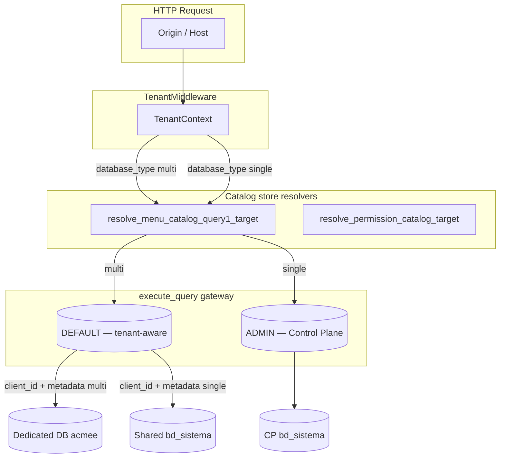
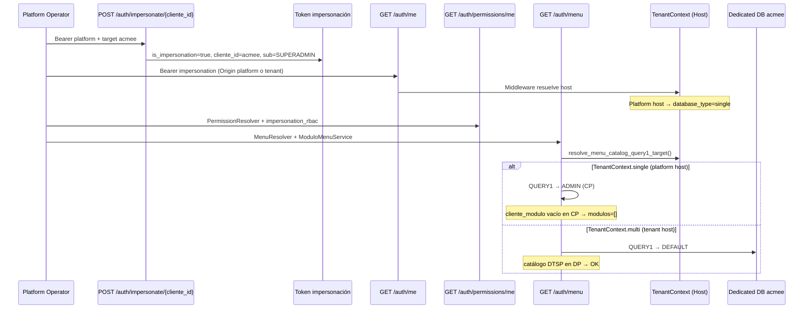

# F12-E2B3V — Dedicated Platform Read Routing Audit

**Fecha:** 2026-06-28  
**Modo:** Solo auditoría — **sin cambios de código, commits ni refactor**  
**Caso observado:** Cliente Dedicated `acmee` — Tenant Admin OK; Platform Admin e Impersonation con dashboard vacío (0 módulos, 0 usuarios)  
**Objetivo:** Determinar exactamente por qué Platform Admin e Impersonation no leen la misma información que Tenant Admin

---

## 1. Conclusión ejecutiva

| Pregunta | Respuesta |
|----------|-----------|
| ¿Tenant Admin funciona? | **Sí** — request con Origin/subdominio del tenant → `TenantContext.database_type=multi` → lecturas en **Dedicated DB (DP)** |
| ¿Platform Admin muestra ceros? | **Sí, explicable** — KPIs del dashboard usan `ClienteService.obtener_estadisticas` con **`usuario` en ADMIN (CP)**; identidad Dedicated vive en **DP** |
| ¿Impersonation menú vacío? | **Sí, explicable** — catálogo menú (QUERY 1) usa `resolve_menu_catalog_query1_target()` basado en **TenantContext del request**, no en `tipo_instalacion` del tenant impersonado |
| Clasificación principal | **A) Routing** + **D) Platform Services** + **F) Catalog store context bug** |
| ¿Dedicated routing ocurre en Platform? | **Parcial** — Superadmin usuarios/auditoría **sí** (F12-E2B3N); stats tenant y menú impersonation **no** |

**Causa raíz en una frase:** El stack Platform/Impersonation sigue resolviendo lecturas contra **Control Plane (ADMIN / contexto `single`)** o contra el **TenantContext del host HTTP (platform)**, mientras Tenant Admin resuelve contra **Dedicated Data Plane (DEFAULT + `client_id` + `multi`)** donde están `usuario`, `cliente_modulo` (réplica DTSP) y menú.

---

## 2. Arquitectura de routing (referencia)



| `DatabaseConnection` | Resolución | Uso típico |
|---------------------|------------|------------|
| **ADMIN** | Siempre CP (`DB_ADMIN_*`) | `cliente`, `cliente_conexion`, catálogo global shared |
| **DEFAULT** | `get_connection_for_tenant(client_id)` | Identity, ERP, réplica DTSP en Dedicated |

| `IdentityScope` | Cuándo | Efecto SQL |
|-----------------|--------|------------|
| **ROW_SCOPED** | Shared / platform host | Inyecta `cliente_id` en filtros |
| **ENGINE_SCOPED** | Dedicated engine | **No** inyecta `cliente_id` (aislamiento por motor) |

**Archivos clave:** `routing.py`, `queries_async.py`, `query_helpers.py`, `menu_catalog_store.py`, `permission_catalog_store.py`, `platform_global_query_intent.py`

---

## 3. Dashboard Platform — respuestas 1–10

### 3.1 ¿Qué endpoint construye el Dashboard Platform del cliente?

**No existe un BFF único.** El frontend compone el drill-down del tenant desde varios endpoints documentados en `PLATFORM_DASHBOARD_FRONTEND_CONTRACT.md`:

| Widget / dato | Endpoint | Handler |
|---------------|----------|---------|
| Cabecera cliente (razón social, plan, `tipo_instalacion`) | `GET /api/v1/clientes/{cliente_id}/` | `obtener_cliente` |
| **KPIs tarjetas** (usuarios, módulos, conexiones) | `GET /api/v1/clientes/{cliente_id}/estadisticas/` | `obtener_estadisticas_cliente` |
| Listado módulos activos | `GET /api/v1/cliente-modulo/cliente/{cliente_id}/` | `listar_modulos_activos_cliente` |
| Listado usuarios (tabla) | `GET /api/v1/superadmin/usuarios/clientes/{cliente_id}/usuarios/` | `list_usuarios_por_cliente` |
| Conexiones BD | `GET /api/v1/conexiones/clientes/{cliente_id}/` | `listar_conexiones_cliente` |
| Provisioning Dedicated | `GET /api/v1/clientes/{cliente_id}/provisioning-status/` | `obtener_provisioning_status` |
| Auditoría opcional | `GET /api/v1/superadmin/auditoria/estadisticas/?cliente_id=...` | `get_estadisticas_auditoria` |

**Archivos presentation:**  
`endpoints_clientes.py`, `endpoints_cliente_modulo.py`, `endpoints_usuarios.py`, `endpoints_conexiones.py`, `endpoints_auditoria.py`

---

### 3.2 ¿Qué servicios utiliza?

| Endpoint | Servicio | Módulo |
|----------|----------|--------|
| `/clientes/{id}/` | `ClienteService.obtener_cliente_por_id` | tenant |
| `/clientes/{id}/estadisticas/` | **`ClienteService.obtener_estadisticas`** | tenant |
| `/cliente-modulo/cliente/{id}/` | `ClienteModuloService.obtener_modulos_activos_cliente` | modulos |
| `/superadmin/usuarios/clientes/{id}/usuarios/` | **`SuperadminUsuarioService.get_usuarios_globales`** | superadmin |
| `/conexiones/clientes/{id}/` | `ConexionService.obtener_conexiones_cliente` | tenant |
| Auditoría tenant-scoped | `SuperadminAuditoriaService.obtener_estadisticas` | superadmin |

**No hay capa Repository DDD.** Persistencia vía `execute_query` / `execute_update` directo.

---

### 3.3 ¿Qué repositorios utiliza?

**Ninguno** en el sentido repository pattern. Gateway único: `app/infrastructure/database/queries_async.py`.

Excepciones infra relacionadas: `tenant_provisioning_repository.py` (provisioning state, solo ADMIN).

---

### 3.4–3.8 Tabla de consultas del dashboard Platform (cliente Dedicated `acmee`)

#### A) `GET /clientes/{id}/estadisticas/` → `ClienteService.obtener_estadisticas`

| # | Tabla | `connection_type` | `client_id` | `identity_scope` | Engine final | Dedicated OK |
|---|-------|-------------------|-------------|-------------------|--------------|:------------:|
| 1 | `cliente` (existencia) | ADMIN | `None` | default | **CP** | ✅ (metadata) |
| 2 | **`usuario`** (COUNT activos/inactivos) | ADMIN | `None` | default | **CP** | ❌ **usuarios en DP** |
| 3 | `cliente_modulo` (COUNT) | ADMIN | `None` | default | **CP** | ⚠️ **réplica DTSP en DP** |
| 4 | `cliente_conexion` (COUNT) | ADMIN | `None` | default | **CP** | ✅ (metadata conexión) |

**Código:**

```654:658:app/modules/tenant/application/services/cliente_service.py
        usuarios_result = await execute_query(
            text(usuarios_query).bindparams(cliente_id=cliente_id),
            connection_type=DatabaseConnection.ADMIN,
            client_id=None
        )
```

**Efecto en acmee:** `total_usuarios=0`, `total_usuarios_inactivos=0` aunque DP tenga usuarios.

---

#### B) `GET /cliente-modulo/cliente/{id}/` → `ClienteModuloService`

| Tabla | `connection_type` | `client_id` | Engine | Dedicated OK |
|-------|-------------------|-------------|--------|:------------:|
| `cliente_modulo` (+ JOIN `modulo`) | ADMIN | `None` | **CP** | ⚠️ |

**Patrón:** todas las queries del servicio usan `DatabaseConnection.ADMIN, client_id=None`.

Si el provisioning Dedicated pobló `cliente_modulo` **solo en DP** (DTSP S6/S7) y no en CP → listado vacío / count 0 en Platform.

---

#### C) `GET /superadmin/usuarios/clientes/{id}/usuarios/` → `SuperadminUsuarioService` ✅

| Tabla | Helper | `connection_type` | `client_id` | `identity_scope` | Engine |
|-------|--------|-------------------|-------------|------------------|--------|
| `usuario` | `kwargs_platform_global_read(client_id=...)` | DEFAULT | acmee UUID | ENGINE_SCOPED | **DP** |
| `rol`, `usuario_rol` | idem | DEFAULT | acmee UUID | ENGINE_SCOPED | **DP** |
| `cliente` (metadata embed) | `kwargs_control_plane_read()` | ADMIN | — | ENGINE_SCOPED | CP |

**Routing Dedicated:** detecta `tipo_instalacion == "dedicated"` → `database_type = "multi"` → `get_connection_for_tenant` → DP.

**Nota:** Si el frontend muestra **0 usuarios**, probablemente consume **`/estadisticas/`** (KPI) y no el listado superadmin (que sí rutearía bien).

---

#### D) Otros endpoints dashboard

| Endpoint | Tablas | Engine | Notas |
|----------|--------|--------|-------|
| `/clientes/{id}/` | `cliente` | CP (ADMIN) | ✅ |
| `/conexiones/clientes/{id}/` | `cliente_conexion` | CP (ADMIN) | ✅ metadata |
| `/superadmin/auditoria/estadisticas/?cliente_id=` | `auth_audit_log` | **DP** (platform global read) | ✅ post F12-G3 |
| | `log_sincronizacion_usuario` | CP (ADMIN) | CP-only |

---

### 3.9 ¿El routing Dedicated realmente ocurre?

| Flujo Platform | ¿Routing Dedicated? | Evidencia |
|----------------|---------------------|-----------|
| KPI `estadisticas` usuarios | **No** | Hardcoded ADMIN |
| KPI `estadisticas` módulos | **No** (lee CP) | Hardcoded ADMIN |
| Listado usuarios superadmin | **Sí** | F12-E2B3N |
| Auditoría auth por tenant | **Sí** | `kwargs_platform_global_read` |
| Listado módulos cliente-modulo | **No** | ADMIN only |

**Conclusión:** Platform **no** lee uniformemente Dedicated; **permanece en Shared/CP** en servicios tenant/modulos no migrados.

---

## 4. Impersonation — respuesta 11 (flujo completo)

### 4.1 Diagrama de secuencia



---

### 4.2 Paso a paso con routing

| Paso | Componente | Archivo | Routing / decisión |
|------|------------|---------|-------------------|
| 1 | `POST /auth/impersonate/{cliente_id}/` | `endpoints.py` ~727 | Emite JWT 120m, `is_impersonation`, `cliente_id`=target, `sub`=operador SYSTEM |
| 2 | Selección empresa | `ImpersonationService.seleccionar_empresa_impersonacion` | Actualiza `empresa_id` en token |
| 3 | `GET /auth/me/` | `endpoints.py` ~855 | `build_user_with_roles`; impersonation: lookup identity en **contexto del host** |
| 4 | `get_current_active_user` | `deps.py` ~325 | `database_type = tenant_context.database_type` del **request**, no del JWT tenant |
| 5 | Permisos impersonados | `impersonation_rbac.py` | `rol_permiso` en DEFAULT; **`permiso.codigo` en ADMIN** (bug dedicated path) |
| 6 | `GET /auth/permissions/me` | `endpoints.py` ~1131 | `PermissionResolver` + `resolve_rbac_database_type()` → IdentityScope del **host** |
| 7 | `GET /auth/menu` | `endpoints.py` ~1235 | `resolve_menu_cliente_id_for_session` → JWT acmee ✅ |
| 8 | Menu QUERY 1 | `modulo_menu_service.py` ~1074 | `resolve_menu_catalog_query1_target(cliente_id)` usa **`try_get_tenant_context()`**, no metadata acmee |
| 9 | Menu QUERY 2 | idem ~1153 | `rol_menu_permiso` en DEFAULT + `client_id` → **DP** ✅ |
| 10 | Impersonation menu path | `menu_resolver.py` ~81 | `obtener_menu_impersonacion_tenant` → ADMIN_TENANT RMP directo |

---

### 4.3 Tabla de consultas Impersonation (Dedicated acmee, Origin Platform)

| Operación | Tabla(s) | connection_type | client_id | identity_scope | Engine | Problema |
|-----------|----------|-----------------|-----------|----------------|--------|----------|
| Identity lookup | `usuario` | DEFAULT | host-dependent | scope host | CP o DP | Operador SYSTEM puede no existir en DP → 401 |
| Impersonation permisos (ids) | `rol`, `rol_permiso` | DEFAULT | acmee | default | **DP** | OK |
| Impersonation permisos (códigos) dedicated | **`permiso`** | **ADMIN** | None | default | **CP** | ❌ catálogo permiso en DP |
| Menu QUERY 1 (platform host) | `cliente_modulo`, `modulo`, `modulo_menu` | **ADMIN** | None | default | **CP** | ❌ réplica en DP |
| Menu QUERY 2 | `rol_menu_permiso` | DEFAULT | acmee | default | **DP** | OK si RMP seeded |
| `_get_required_permissions_by_modulo` | `permiso` | ADMIN | None | default | CP | ⚠️ |

**Código crítico — permiso catalog en impersonation dedicated:**

```193:196:app/core/auth/impersonation_rbac.py
    rows = await execute_query(
        sql_codigos,
        connection_type=DatabaseConnection.ADMIN,
    )
```

vs path normal en `permisos_usuario_service.py` que usa `resolve_permission_catalog_target()` → DEFAULT en multi.

**Código crítico — database_type en deps impersonation:**

```326:329:app/api/deps.py
            tenant_context = try_get_tenant_context()
            database_type = (
                tenant_context.database_type if tenant_context else "single"
            )
```

**Código crítico — catalog store:**

```18:21:app/core/authorization/menu_catalog_store.py
    ctx = try_get_tenant_context()
    if ctx is not None and ctx.database_type == "multi":
        return DatabaseConnection.DEFAULT, cliente_id
    return DatabaseConnection.ADMIN, None
```

No consulta `get_connection_metadata_async(cliente_id)` cuando el operador está en host Platform.

---

## 5. Comparación Tenant Admin vs Platform Admin (respuesta 12)

| Dimensión | Tenant Admin (acmee subdomain) | Platform Admin / Impersonation (platform host) | Divergencia |
|-----------|----------------------------------|-----------------------------------------------|-------------|
| **HTTP Origin** | `https://acmee.*` | `https://platform.*` | Middleware → distinto `TenantContext` |
| **`TenantContext.database_type`** | `multi` | `single` (SYSTEM/platform) | **Raíz menu/scope** |
| **Login identity** | Usuario tenant en DP | Operador SYSTEM en CP | Distinto store |
| **Menú endpoint canónico** | `GET /auth/menu` o `/modulos-menus/me/` | `GET /auth/menu` (impersonation) | Mismo endpoint, distinto routing QUERY1 |
| **Menu QUERY 1 engine** | **DP** (DEFAULT) | **CP** (ADMIN) con platform host | **Catálogo vacío** |
| **Menu QUERY 2 engine** | DP | DP | Alineado |
| **Permisos usuario** | `permisos_usuario_service` + catalog store | Impersonation: ADMIN_TENANT `rol_permiso` | Impersonation no usa `usuario_rol` del admin |
| **Permiso catálogo lookup** | `resolve_permission_catalog_target` → DP | Impersonation dedicated → **ADMIN** | Códigos vacíos |
| **KPI usuarios dashboard** | N/A (no usa estadisticas CP) | `obtener_estadisticas` → ADMIN | **0 usuarios** |
| **KPI módulos dashboard** | Menú desde DP `cliente_modulo` | `estadisticas` / `cliente-modulo` → ADMIN | **0 módulos** si CP vacío |
| **Listado usuarios superadmin** | N/A | DEFAULT + acmee → DP | **Funcionaría** si UI lo usa |
| **Superadmin bypass menú** | No | Suprimido (`suppress_platform_privileges`) | Impersonation **nunca** eleva menú |

---

## 6. Clasificación del problema (respuesta 13)

| ID | Tipo | ¿Aplica? | Evidencia |
|----|------|:--------:|-----------|
| **A** | Problema de **routing** | **✅ Sí** | `menu_catalog_store` / `permission_catalog_store` dependen de TenantContext del host, no de `tipo_instalacion` del tenant objetivo |
| **B** | Problema de **IdentityScope** | **⚠️ Parcial** | `resolve_rbac_database_type()` deriva scope del host; impersonation usa `database_type` incorrecto en deps |
| **C** | Problema de **execute_query** | **✅ Sí** | Hardcoded `ADMIN` en `ClienteService.obtener_estadisticas`; `impersonation_rbac` ADMIN para `permiso` |
| **D** | Problema de **Platform Services** | **✅ Sí** | `ClienteService` / `ClienteModuloService` no replican patrón F12-E2B3N (`platform_global_query_intent`) |
| **E** | Problema de **Dashboard** | **⚠️ Parcial** | Composición FE usa `/estadisticas/` como KPI; endpoint no es Dedicated-aware (diseño servicio, no BFF) |
| **F** | **Otro** — split CP/DP DTSP | **✅ Sí** | Datos operativos (usuario, cliente_modulo réplica) en DP; Platform lee CP asumiendo Shared |

**Veredicto:** **A + D + F** como causa principal; **C** como mecanismo; **B** amplifica impersonation.

---

## 7. Inventario servicios Platform sin soporte Dedicated correcto (respuesta 14)

| Servicio | Archivo | Estado Dedicated | Impacto |
|----------|---------|------------------|---------|
| **`ClienteService.obtener_estadisticas`** | `cliente_service.py` | ❌ `usuario` en ADMIN | KPI 0 usuarios |
| **`ClienteModuloService`** (lecturas) | `cliente_modulo_service.py` | ❌ siempre ADMIN | KPI/listado 0 módulos si réplica solo DP |
| **`ModuloMenuService._get_required_permissions_by_modulo`** | `modulo_menu_service.py` | ❌ ADMIN hardcoded | Metadata permisos menú incorrecta en DP |
| **`impersonation_rbac._impersonation_permisos_dedicated`** | `impersonation_rbac.py` | ❌ `permiso` en ADMIN | Permisos impersonation vacíos |
| **`menu_catalog_store`** / **`permission_catalog_store`** | `core/authorization/` | ❌ solo TenantContext | QUERY1 menú / catálogo permiso wrong store cross-host |
| **`deps.get_current_active_user`** (impersonation branch) | `deps.py` | ❌ `database_type` del host | Rama single vs multi incorrecta |
| **`permisos_negocio_service.listar_catalogo_permisos`** | `rbac/` | ❌ ADMIN | UI asignación permisos platform |
| **`menu_permission_resolver`** | `core/authorization/` | ❌ ADMIN | Resolver legacy |
| **`modulo_service`** (CRUD catálogo) | `modulos/` | ❌ ADMIN | OK para CP; no DP |
| **`SuperadminUsuarioService`** | `superadmin_usuario_service.py` | ✅ F12-E2B3N | Usuarios platform OK |
| **`SuperadminAuditoriaService`** (auth stats) | `superadmin_auditoria_service.py` | ✅ parcial | Auth en DP; sync en CP |
| **`ConexionService`** | `conexion_service.py` | ✅ ADMIN by design | Metadata conexión en CP |
| **`ClienteService.obtener_cliente_por_id`** | `cliente_service.py` | ✅ ADMIN by design | Registro tenant en CP |
| **`DedicatedProvisioningQueryService`** | `dedicated_provisioning_query_service.py` | ✅ ADMIN | Estado saga |

---

## 8. Orden de reparación propuesto — menor riesgo (respuesta 15)

**NO IMPLEMENTAR** — solo roadmap.

| Orden | Acción | Riesgo | Justificación |
|------:|--------|--------|---------------|
| **R1** | Alinear `_impersonation_permisos_dedicated` con `resolve_permission_catalog_target()` | **Bajo** | Cambio acotado; mismo patrón que `permisos_usuario_service` |
| **R2** | Extender `resolve_menu_catalog_query1_target(cliente_id)` para consultar `get_connection_metadata_async(cliente_id)` cuando TenantContext ≠ tenant objetivo | **Bajo-Medio** | Fix raíz menú vacío impersonation + cross-host |
| **R3** | Idem `resolve_permission_catalog_target` | **Bajo-Medio** | Consistencia F11 |
| **R4** | `ClienteService.obtener_estadisticas`: rama `tipo_instalacion=dedicated` → COUNT `usuario` vía `kwargs_platform_global_read(client_id)` | **Medio** | KPI dashboard; patrón ya probado en superadmin |
| **R5** | Evaluar `ClienteModuloService` lecturas: CP vs DP réplica para Dedicated (política dual-write vs read-from-DP) | **Medio** | Requiere decisión arquitectónica DTSP |
| **R6** | `deps.py` impersonation: `database_type` desde metadata del JWT `cliente_id`, no TenantContext host | **Medio** | Afecta auth path completo |
| **R7** | `_get_required_permissions_by_modulo` → catalog store | **Medio** | Menú metadata |
| **R8** | Migración restante servicios Platform (permisos_negocio, menu_permission_resolver) | **Medio-Alto** | Superficie amplia |
| **R9** | BFF `GET /superadmin/dashboard` o enriquecer `/estadisticas/` Dedicated-aware | **Bajo** (producto) | Reduce composición FE frágil |
| **R10** | Tests integración: Platform drill-down + impersonation dedicated con Origin platform | — | Regresión |

---

## 9. Explicación del caso `acmee` (síntesis causal)

| Síntoma observado | Causa técnica verificada |
|-------------------|-------------------------|
| Tenant Admin: login, módulos, usuarios, empresa OK | Host tenant → `multi` → DEFAULT → **DP** con DTSP + identity |
| Platform Admin: 0 usuarios | `/estadisticas/` cuenta `usuario` en **ADMIN (CP)** — filas solo en **DP** |
| Platform Admin: 0 módulos | `/estadisticas/` y `/cliente-modulo/` leen `cliente_modulo` en **CP** — réplica operativa en **DP** |
| Impersonation: empresa OK | JWT + selección empresa — no depende de catálogo menú |
| Impersonation: dashboard vacío, "Sin módulos" | `GET /auth/menu` QUERY1 con Origin platform → **ADMIN** → sin filas `cliente_modulo` |
| Impersonation: permisos posiblemente vacíos | `_impersonation_permisos_dedicated` lee `permiso` en CP |

---

## 10. Referencias documentales

| Documento | Relevancia |
|-----------|------------|
| `PLATFORM_DASHBOARD_FRONTEND_CONTRACT.md` | Endpoints dashboard actuales |
| `F12_E2B3N_PLATFORM_GLOBAL_QUERY_INTENT_IMPLEMENTATION.md` | Patrón correcto superadmin (parcial) |
| `DTSP_DEDICATED_TENANT_STORE_PROFILE.md` | Tablas réplica DP incl. `cliente_modulo` |
| `F12_G2_DEDICATED_RUNTIME_DDL_ALIGNMENT.md` | Split CP vs DP |
| `RC-06_RUNTIME_FRONTEND_INTEGRATION_AUDIT.md` | Menú vs API 403 dedicated |

---

## 11. Límites de la auditoría

- No se ejecutaron queries en BD real de `acmee`; conclusiones por **trazado estático de código** y arquitectura documentada.
- No se capturaron traces HTTP en runtime; logs `[MENU_USUARIO] modo=sin_catalogo` serían confirmación operativa.
- No se modificó ningún archivo del sistema.

---

*Auditoría F12-E2B3V — Dedicated Platform Read Routing. Solo lectura.*
