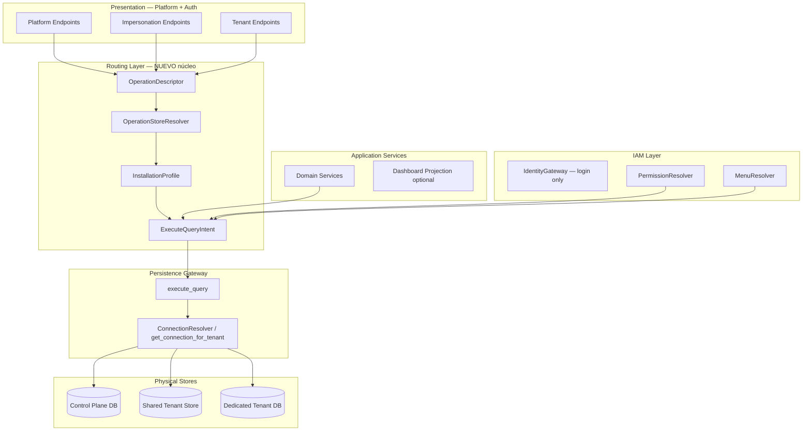
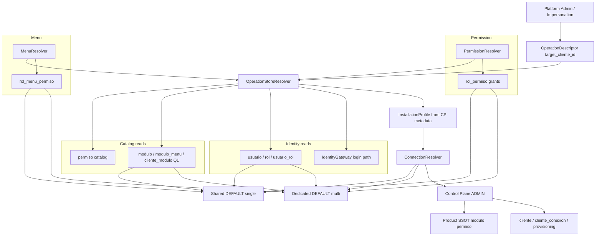

# F13-A1 — Dedicated Platform Compatibility Architecture

**Fecha:** 2026-06-28  
**Modo:** Solo diseño arquitectónico — **sin implementación, commits ni parches**  
**Prerequisitos:** F12-E2B3V, serie F11/F12 Dedicated, modelo canónico hybrid-platform (Etapa 3–5)  
**Objetivo:** Modelo definitivo para que **Platform Admin** e **Impersonation** funcionen con paridad Shared / Dedicated / futuros modos de instalación, **sin depender del Host HTTP** para routing de datos

---

## 1. Principios de diseño (no negociables)

| # | Principio | Implicación |
|---|-----------|-------------|
| P1 | **Modo no cambia ownership** (D4 canónico) | Shared vs Dedicated cambia **dónde** persiste, no **quién** es dueño |
| P2 | **Un solo algoritmo de resolución de store** | Ningún servicio Platform elige `ADMIN`/`DEFAULT` por convención local |
| P3 | **Target tenant explícito** | Toda operación Platform cross-tenant declara `target_cliente_id` |
| P4 | **Host ≠ store selector** | Origin/subdominio solo resuelve **contexto de login UX**; no decide lecturas Platform |
| P5 | **Sin ramas `if dedicated`** en servicios | La variación vive en **Installation Profile** + **Operation Descriptor** |
| P6 | **Sin bypass ni skip_tenant_validation** en prod | Intención vía `OperationIntent` + `IdentityScope` (patrón F12-E2B3N generalizado) |
| P7 | **Extensible a On-Premise / Cloud privada** | Perfil de instalación es dato de CP, no hardcode |

---

## 2. Respuesta 1 — Información únicamente en Control Plane (CP)

Tablas físicas en BD central (`DatabaseConnection.ADMIN`). **Nunca** replicadas al Data Plane Dedicated como autoridad.

| Tabla / artefacto | Dominio canónico | Por qué solo CP |
|-------------------|------------------|-----------------|
| **`cliente`** | P-01 Tenant Registry | Autoridad SaaS: subdominio, plan, `tipo_instalacion`, estado comercial |
| **`cliente_conexion`** | P-03 Storage Endpoint Metadata | Metadata routing Dedicated; credenciales de resolución |
| **`tenant_provisioning_state`** (y saga markers) | P-11 Provisioning State | Orquestación lifecycle Dedicated |
| **`log_sincronizacion_usuario`** | P-10 Platform sync audit | Operación cross-tenant CP-only |
| **`sistema_config`** | P-12 Global System Configuration | Parámetros globales producto |
| **Catálogo producto maestro (SSOT)** | P-05–P-08 | Definición global: **`modulo`**, **`modulo_seccion`**, **`modulo_menu`**, **`modulo_rol_plantilla`**, seeds S010 |
| **`permiso` (catálogo code-first SSOT)** | P-07 | Sync startup CP; fuente declarativa del producto |
| **Operadores Platform (`usuario` SYSTEM)** | P-09 | Identidad operador en cliente SYSTEM |
| **IAM Session Store (MVP ADR-002-A)** | I-03–I-05 | `user_session`, `token_family`, `refresh_tokens` centralizados |
| **Platform audit cross-tenant** | P-10 | Accesos operador, provisioning events (no confundir con `auth_audit_log` tenant) |

**Regla:** Si la pregunta es *«¿qué tenants existen y cómo se conectan?»* o *«¿qué es el producto?»* → **solo CP**.

---

## 3. Respuesta 2 — Información únicamente en Dedicated Data Plane (DP)

Presente en BD tenant Dedicated (`DEFAULT` + metadata multi). **Ausente** del CP como filas operativas (salvo réplicas inversas prohibidas).

| Tabla / dominio | Por qué solo DP (Dedicated) |
|-----------------|----------------------------|
| **ERP completo** (`org_*`, `inv_*`, …) | Negocio tenant aislado físicamente |
| **`usuario`** (tenant users) | Identity store tenant |
| **`rol`**, **`usuario_rol`** | RBAC tenant |
| **`rol_permiso`**, **`rol_menu_permiso`** | Grants operativos tenant |
| **`org_empresa`**, **`cfg_codigo_secuencia`** | Operación tenant post-provisioning |
| **`auth_audit_log`** (tenant) | IAM audit tenant (F12-G3) |
| **`bootstrap_applied`** (DP) | Idempotencia seeds Dedicated |
| **Réplicas DTSP operativas** | Copias **de lectura/escritura tenant** de catálogo (ver §4) |

**Shared mode:** mismas tablas existen en el **mismo almacén físico** que CP, pero el algoritmo las clasifica como **tenant_data plane** — no como CP.

---

## 4. Respuesta 3 y 4 — Información en ambos lados (CP + DP)

Tablas con **mismo nombre lógico**, distinto rol físico según modo.

| Tabla | SSOT (autoridad) | Réplica | Sync | Dirección | Notas |
|-------|------------------|---------|------|-----------|-------|
| **`modulo`** | **CP** (producto) | **DP** (DTSP) | Provisioning S6 catálogo | **CP → DP** | Read-only en DP salvo personalización futura |
| **`modulo_seccion`** | CP | DP | S6 | CP → DP | Idem |
| **`modulo_menu`** | CP | DP | S6 | CP → DP | Menús producto + SYS_ADMIN |
| **`permiso`** | **CP** (code-first sync) | **DP** | Dedicated Permission Catalog Sync (S6) | **CP → DP** | Resolver lectura tenant usa DP en Dedicated |
| **`cliente_modulo`** | **CP** (decisión comercial Platform) | **DP** (runtime menú/licencia) | Activación módulo + provisioning | **CP → DP** | Platform **escribe** CP; pipeline **materializa** DP |
| **`cliente_auth_config`** | CP (registro) | DP (runtime auth policy) | Onboarding / update | **CP → DP** | Política auth efectiva en tenant store |
| **Branding (`cliente` campos)** | CP (registro tenant) | — | N/A | **ninguna** | Lectura Platform desde CP; tenant UI puede cachear |

**Prohibido en arquitectura objetivo:** sync **DP → CP** de grants (`rol_permiso`, `usuario_rol`) — el tenant opera en DP; Platform **lee** DP vía resolver, no replica grants al CP.

---

## 5. Respuesta 5 — Arquitectura oficial Platform Dashboard

### 5.1 Modelo de lectura unificado

Toda lectura Platform sobre un tenant `T` usa:

```
OperationDescriptor(
  target_cliente_id = T,
  operation_plane   = control_plane | tenant_data,
  resource          = usuarios | modulos | ...
)
→ OperationStoreResolver.resolve(descriptor)
→ ExecuteQueryIntent
```

**Nunca:** «siempre ADMIN» ni «si TenantContext.multi entonces…».

### 5.2 Matriz de lectura por recurso

| Recurso dashboard | Plano | Shared — store | Dedicated — store | Endpoint actual |
|-------------------|-------|----------------|-------------------|-----------------|
| **Registro tenant** (razón social, plan, `tipo_instalacion`) | CP | ADMIN | ADMIN | `GET /clientes/{id}/` |
| **Conexiones BD** | CP | ADMIN | ADMIN | `GET /conexiones/clientes/{id}/` |
| **Provisioning state** | CP | ADMIN | ADMIN | `GET /clientes/{id}/provisioning-status/` |
| **Branding** | CP (campos en `cliente`) | ADMIN | ADMIN | `GET /clientes/{id}/` / branding |
| **Usuarios** (listado + COUNT) | tenant_data | DEFAULT + `client_id=T`, ROW_SCOPED | DEFAULT + `client_id=T`, ENGINE_SCOPED | superadmin usuarios ✅; **estadísticas ❌ hoy** |
| **Módulos activos** (listado + COUNT) | tenant_data (operativo) | DEFAULT/shared | DEFAULT/dedicated DP | **cliente-modulo ❌ hoy (ADMIN)** |
| **Roles / grants** | tenant_data | DEFAULT | DEFAULT | vía superadmin / futuro BFF |
| **Permisos catálogo** | tenant_data (efectivo) + CP (SSOT producto) | DEFAULT + ADMIN según operación | DP permiso + CP SSOT | RBAC admin UI |
| **Empresas (`org_empresa`)** | tenant_data | DEFAULT | DEFAULT | drill-down futuro |
| **Estadísticas KPI** | **compuesto** | Agregación vía resolver por sub-recurso | Idem | `GET /clientes/{id}/estadisticas/` |
| **Auditoría auth tenant** | tenant_data | DEFAULT | DEFAULT (DP) | superadmin auditoría ✅ parcial |
| **Auditoría sync** | CP | ADMIN | ADMIN | superadmin auditoría |

### 5.3 Contrato objetivo del endpoint KPI

`GET /clientes/{id}/estadisticas/` debe **delegar** en el mismo resolver que superadmin usuarios:

| KPI | Fuente objetivo |
|-----|-----------------|
| `total_usuarios` | `tenant_data` → COUNT `usuario` |
| `modulos_activos` | `tenant_data` → COUNT `cliente_modulo` WHERE activo |
| `conexiones_bd` | `control_plane` → COUNT `cliente_conexion` |
| Metadatos cliente | `control_plane` → `cliente` |

**Paridad Shared/Dedicated:** idéntica semántica; cambia solo `InstallationProfile.engine_kind`.

### 5.4 BFF opcional (fase tardía)

`GET /superadmin/tenants/{id}/dashboard-summary` como **proyección** — no sustituye el resolver; lo consume internamente.

---

## 6. Respuesta 6 — Arquitectura oficial Impersonation

### 6.1 Precedencia de contexto (por tipo de decisión)

| Decisión | Prevalece (orden) | No usar |
|----------|-------------------|---------|
| **¿Qué tenant opero?** | 1) JWT `cliente_id` (impersonation) 2) `resolve_session_cliente_id` | Host platform |
| **¿Qué store físico?** | **`OperationStoreResolver(target_cliente_id)`** | `TenantContext.database_type` del host |
| **¿ROW vs ENGINE scope?** | Derivado de **InstallationProfile** del target | Host |
| **¿Permisos efectivos?** | ADMIN_TENANT grants en **tenant_data** store del target | Superadmin bypass |
| **¿Menú QUERY 1 catálogo?** | tenant_data store del **target** | Host |
| **¿Menú QUERY 2 RMP?** | tenant_data store del **target** | — |
| **¿Identity lookup operador?** | CP SYSTEM (login) separado de **tenant_data** reads | Mezclar stores |
| **Host HTTP** | Solo validación CORS / cookie domain | Routing SQL |

### 6.2 Regla de oro Impersonation

> **El tenant impersonado es el `target_cliente_id` del JWT.  
> Todas las lecturas tenant-scoped usan el Installation Profile de ese UUID, independientemente del Origin.**

### 6.3 Flujo JWT impersonation

```
POST /auth/impersonate/{cliente_id}
  → JWT: is_impersonation, cliente_id=target, sub=SYSTEM operator
  → Redis parent session (transversal)

GET /auth/* con token impersonation
  → SessionContext.target_cliente_id = JWT.cliente_id
  → OperationStoreResolver usa target_cliente_id (NO host)
  → suppress_platform_privileges (sin elevación superadmin)
```

---

## 7. Respuesta 7 — Flujos correctos por operación

### 7.1 `GET /auth/me`

| Paso | Store | Resolver input |
|------|-------|----------------|
| Validar token | Transversal CP | Session store ADR-002-A |
| Cargar operador | CP SYSTEM o tenant según **login origin** | IdentityGateway (login path) |
| En impersonation: enriquecer claims | JWT | Token LBAC; **no** recalcular permisos aquí |
| `cliente_id` en response | JWT target si impersonation | session_scope |

**Nota:** `/auth/me` **no** ejecuta agregaciones dashboard; solo identidad de sesión.

### 7.2 `GET /auth/permissions/me`

```
target = SessionContext.target_cliente_id (JWT impersonation > user > request)
profile = OperationStoreResolver.get_installation_profile(target)
if impersonation:
  effective = ADMIN_TENANT rol_permiso ⋈ permiso  @ tenant_data(profile)
else:
  effective = usuario_rol path @ tenant_data(profile)
permiso catalog lookup @ tenant_data(profile)  // NUNCA ADMIN en Dedicated
```

### 7.3 `GET /auth/menu`

```
target = resolve_menu_cliente_id (JWT en impersonation)
profile = OperationStoreResolver.get_installation_profile(target)

QUERY 1 (catálogo + cliente_modulo):
  intent = tenant_data(profile, tables=[modulo*, cliente_modulo])

QUERY 2 (rol_menu_permiso):
  intent = tenant_data(profile)
  impersonation → permisos_rol_id = ADMIN_TENANT (sin usuario_rol operador)

Permission metadata por modulo:
  intent = tenant_data(profile, table=permiso)
```

### 7.4 Platform Dashboard (drill-down tenant T)

| Operación | Flujo |
|-----------|-------|
| Header cliente | `control_plane(T)` |
| KPI usuarios | `tenant_data(T)` COUNT usuario |
| KPI módulos | `tenant_data(T)` COUNT cliente_modulo |
| Listado usuarios | `tenant_data(T)` — patrón superadmin F12-E2B3N |
| Listado módulos | `tenant_data(T)` JOIN modulo* |
| Conexiones | `control_plane(T)` |

### 7.5 Superadmin Usuarios

**Ya alineado parcialmente (F12-E2B3N).** Objetivo: migrar a `OperationStoreResolver` formal — mismo comportamiento, API unificada.

### 7.6 ClienteModulo (Platform)

| Operación | Escritura | Lectura Platform |
|-----------|-----------|------------------|
| Activar/desactivar módulo | **CP** (decisión comercial) + evento **CP→DP** | **tenant_data(T)** para UI operativa |
| Validar licencia | tenant_data(T) | tenant_data(T) |

### 7.7 Estadísticas

Compone agregaciones vía **múltiples OperationDescriptors** — no un solo `ADMIN` block.

---

## 8. Respuesta 8 — Algoritmo oficial único de resolución

### 8.1 Componente: `OperationStoreResolver`

**Ubicación objetivo:** `app/core/tenant/operation_store_resolver.py` (nuevo módulo normativo; **diseño only**)

### 8.2 Entradas

```text
OperationDescriptor:
  target_cliente_id: UUID          # obligatorio para tenant-scoped
  operation_plane: control_plane | tenant_data
  tables: set[str]                # opcional; validación policy
  session_kind: tenant_session | platform_operator | impersonation
  session_target_cliente_id: UUID | None  # JWT override
```

**Regla:** `session_target_cliente_id` (JWT impersonation) **fusiona** con `target_cliente_id` del descriptor; deben coincidir o 403.

### 8.3 Algoritmo (pseudocódigo normativo)

```text
function resolve(descriptor) -> ExecuteQueryIntent:

  # Paso 1 — Installation Profile (SIEMPRE desde CP metadata del target)
  meta = get_connection_metadata_async(descriptor.target_cliente_id)
  profile = InstallationProfile.from_metadata(meta)
  # profile.engine_kind ∈ { shared_single, dedicated_multi, control_plane_only }
  # profile.tipo_instalacion ∈ { shared, dedicated, ... future }

  # Paso 2 — Operation plane
  if descriptor.operation_plane == control_plane:
    return ExecuteQueryIntent(
      connection_type = ADMIN,
      client_id = None,
      identity_scope = ENGINE_SCOPED,      # platform global read
      operation_class = control_plane,
      engine = CP,
    )

  # Paso 3 — tenant_data plane
  if profile.engine_kind == shared_single:
    return ExecuteQueryIntent(
      connection_type = DEFAULT,
      client_id = descriptor.target_cliente_id,
      identity_scope = ROW_SCOPED,
      operation_class = tenant_data,
      engine = SHARED_TENANT_STORE,
    )

  if profile.engine_kind == dedicated_multi:
    return ExecuteQueryIntent(
      connection_type = DEFAULT,
      client_id = descriptor.target_cliente_id,
      identity_scope = ENGINE_SCOPED,
      operation_class = tenant_data,
      engine = DEDICATED_TENANT_STORE(meta),
    )

  fail_closed(DEDICATED_ROUTE_FAIL_CLOSED)  # RI-39
```

**Salida unificada `ExecuteQueryIntent`:** reemplaza combinaciones ad hoc de `kwargs_platform_global_read`, `menu_catalog_store`, `permission_catalog_store`.

### 8.4 Derivaciones

| Campo | Derivación |
|-------|------------|
| `connection_type` | CP → ADMIN; tenant_data → DEFAULT |
| `client_id` | CP → None; tenant_data → target_cliente_id |
| `database_type` (legacy) | shared_single → `"single"`; dedicated_multi → `"multi"` |
| `identity_scope` | ROW_SCOPED vs ENGINE_SCOPED según profile |
| `engine` | Resultado físico de `get_connection_for_tenant` |

**Host HTTP:** no aparece en el algoritmo.

---

## 9. Respuesta 9 — Componentes que deben dejar de decidir routing

| Componente actual | Problema | Rol objetivo |
|-------------------|----------|--------------|
| **`menu_catalog_store.resolve_menu_catalog_query1_target`** | Usa `TenantContext` del host | **Eliminar decisión** → delegar a `OperationStoreResolver` |
| **`permission_catalog_store.resolve_permission_catalog_target`** | Idem | Idem |
| **`TenantContext.database_type` en servicios** | Proxy del host | Solo middleware **login tenant**; no Platform reads |
| **`deps.py` impersonation `database_type`** | Host context | Usar `InstallationProfile` del JWT target |
| **`ClienteService.obtener_estadisticas`** | Hardcoded ADMIN | Componer OperationDescriptors |
| **`ClienteModuloService` lecturas** | Hardcoded ADMIN | tenant_data descriptor |
| **`impersonation_rbac._impersonation_permisos_dedicated`** | permiso en ADMIN | tenant_data descriptor |
| **`ModuloMenuService._get_required_permissions_by_modulo`** | ADMIN hardcoded | tenant_data descriptor |
| **`platform_global_query_intent.py`** | Helper parcial | **Absorbido** por ExecuteQueryIntent (mantener compat shim temporal en migración) |
| **`query_helpers._is_dedicated_tenant_context`** | Host-derived | Usar intent.identity_scope del resolver |
| **Servicios con `if tipo_instalacion == dedicated`** | Anti-patrón P5 | Reemplazar por profile.engine_kind |

**Permanece válido:**

| Componente | Rol |
|------------|-----|
| `get_connection_metadata_async` | Fuente Installation Profile |
| `get_connection_for_tenant` | Apertura engine físico |
| `execute_query` gateway | Ejecución; no decide política |
| `IdentityGateway` (login) | Lookup credenciales — separado de Platform reads |
| `session_scope.resolve_session_cliente_id` | Operativo ERP + JWT tenant |

---

## 10. Respuesta 10 — Arquitectura objetivo (visión)

### 10.1 Capas



### 10.2 Invariantes runtime

1. **Toda query tenant-scoped** lleva `ExecuteQueryIntent` producido por resolver.
2. **Platform nunca infiere store desde Host.**
3. **Dedicated fail-closed (RI-39)** permanece en ConnectionResolver.
4. **Catálogo producto SSOT = CP; runtime tenant = tenant_data store del profile.**
5. **Impersonation = tenant_admin efectivo del target**, sin elevación menú superadmin.

### 10.3 Extensión futura modos

Nuevo modo = nuevo valor en `InstallationProfile.engine_kind` + reglas en resolver — **sin tocar** Platform endpoints.

---

## 11. Respuesta 11 — Mapa completo Platform → stores



**Leyenda flujo lectura KPI Platform tenant T Dedicated:**

```
PA → OD(T, tenant_data, usuario) → OSR → DEFAULT → DPD
PA → OD(T, control_plane, cliente) → OSR → ADMIN → CP
```

---

## 12. Respuesta 12 — Componentes a modificar (posteriores)

### P0 — Paridad funcional Platform/Impersonation (bloqueante producción Dedicated)

| Componente | Cambio |
|------------|--------|
| **Nuevo `OperationStoreResolver` + `ExecuteQueryIntent`** | Núcleo algoritmo §8 |
| **`menu_catalog_store`** | Delegar a resolver |
| **`permission_catalog_store`** | Delegar a resolver |
| **`impersonation_rbac`** | permiso lookup vía tenant_data intent |
| **`deps.py`** | `database_type` desde InstallationProfile target JWT |
| **`ClienteService.obtener_estadisticas`** | Agregaciones vía resolver |
| **`ClienteModuloService` (reads)** | tenant_data intent |
| **`ModuloMenuService._get_required_permissions_by_modulo`** | tenant_data intent |

### P1 — Consolidación Platform + contratos

| Componente | Cambio |
|------------|--------|
| **`SuperadminUsuarioService`** | Migrar kwargs → ExecuteQueryIntent |
| **`SuperadminAuditoriaService`** | Idem; eliminar ADMIN inline residual |
| **`PermissionResolver`** | Unificar catalog target vía resolver |
| **`MenuResolver`** | Eliminar dependencia indirecta TenantContext |
| **`platform_global_query_intent.py`** | Deprecar → shim sobre ExecuteQueryIntent |
| **Tests integración** | Platform drill-down + impersonation @ platform Origin |
| **Documentación FE** | `PLATFORM_DASHBOARD_FRONTEND_CONTRACT` alineado |

### P2 — Optimización y evolución

| Componente | Cambio |
|------------|--------|
| **BFF dashboard-summary** | Proyección única opcional |
| **`permisos_negocio_service`** | Catalog reads vía resolver |
| **`menu_permission_resolver`** | Idem |
| **Pipeline CP→DP `cliente_modulo`** | Evento explícito post-activación (observabilidad) |
| **`query_helpers._is_dedicated_tenant_context`** | Basado en intent, no host |
| **GLOBAL_TABLES review** | Alinear con §2–4 |

---

## 13. Respuesta 13 — Roadmap de implementación por fases

Cada fase: **pequeña**, **probable independiente**, **mínimo riesgo regresión Shared**.

### Fase F13-1 — Núcleo resolver (sin migrar servicios)

| Entregable | Verificación |
|------------|--------------|
| `OperationStoreResolver` + tipos `InstallationProfile`, `ExecuteQueryIntent`, `OperationDescriptor` | Unit tests: shared/dedicated/fail-closed matrices |
| Paridad con `get_connection_metadata_async` existente | Golden tests vs routing.py |

**Riesgo:** Bajo — código nuevo sin wire-up.

---

### Fase F13-2 — Catalog stores (menú + permiso)

| Entregable | Verificación |
|------------|--------------|
| `menu_catalog_store` → resolver | Integration: Tenant Admin Dedicated sin regresión |
| `permission_catalog_store` → resolver | Unit + integration permisos_usuario_service |

**Riesgo:** Medio — afecta auth/menu; **no** tocar Platform aún.

---

### Fase F13-3 — Impersonation parity

| Entregable | Verificación |
|------------|--------------|
| `impersonation_rbac` permiso path | E2E impersonation @ platform Origin → menú no vacío |
| `deps.py` profile from JWT target | `/auth/permissions/me` count > 0 Dedicated |

**Riesgo:** Medio — solo impersonation path.

---

### Fase F13-4 — Platform KPI estadísticas

| Entregable | Verificación |
|------------|--------------|
| `ClienteService.obtener_estadisticas` refactor | Dedicated acmee: usuarios/módulos > 0 |
| Shared regression smoke | Tenant existente sin cambio counts |

**Riesgo:** Medio — endpoint FE crítico.

---

### Fase F13-5 — ClienteModulo reads Platform

| Entregable | Verificación |
|------------|--------------|
| Lecturas Platform → tenant_data intent | `GET /cliente-modulo/cliente/{id}/` Dedicated |
| Escrituras permanecen CP + pipeline CP→DP | Activación módulo smoke |

**Riesgo:** Medio — validar sync CP→DP existente.

---

### Fase F13-6 — Superadmin consolidation

| Entregable | Verificación |
|------------|--------------|
| Migrar superadmin services a ExecuteQueryIntent | Paridad respuestas F12-E2B3N |
| Eliminar kwargs duplicados | Lint / deprecation markers |

**Riesgo:** Bajo-Medio — ya parcialmente correcto.

---

### Fase F13-7 — Menu metadata + PermissionResolver cleanup

| Entregable | Verificación |
|------------|--------------|
| `_get_required_permissions_by_modulo` | Menu items required_permissions Dedicated |
| PermissionResolver unified | RC smoke tenant + impersonation |

**Riesgo:** Bajo.

---

### Fase F13-8 — Contrato y observabilidad

| Entregable | Verificación |
|------------|--------------|
| Actualizar docs FE + OpenAPI notes | Review producto |
| Métricas: `operation_store_resolver_engine_kind` | Dashboard ops |
| BFF opcional | FE adoption gradual |

**Riesgo:** Bajo.

---

### Criterios de aceptación globales (Definition of Done F13)

| # | Criterio |
|---|----------|
| AC-1 | Platform drill-down Dedicated: KPI usuarios/módulos = Tenant Admin |
| AC-2 | Impersonation @ platform Origin: `/auth/menu` módulos ≠ [] |
| AC-3 | Shared tenants: cero regresión en suite RC existente |
| AC-4 | Ningún servicio Platform nuevo con `connection_type=ADMIN` hardcoded para tenant_data |
| AC-5 | Host change no altera counts (test: mismo token, distinto Origin) |

---

## 14. Relación con auditorías previas

| Auditoría | Cómo responde F13-A1 |
|-----------|----------------------|
| **F12-E2B3V** | Causa raíz (host vs target) → eliminada por §8–9 |
| **F12-E2B3N** | `platform_global_query_intent` → precursor absorbido en ExecuteQueryIntent |
| **F11 catalog stores** | Generalizados; dejan de usar TenantContext |
| **DTSP / F12-G*** | Réplicas DP validadas; CP→DP sync explícito §4 |
| **Modelo canónico Etapa 3** | Tablas §2–4 alineadas a P-*/T-* domains |

---

## 15. Anti-patrones explícitamente prohibidos

| Anti-patrón | Por qué |
|-------------|---------|
| `if tipo_instalacion == "dedicated"` en servicios | Duplica policy; rompe extensibilidad |
| `skip_tenant_validation=True` en prod Platform | Bypass; usar OperationIntent |
| Leer `usuario` tenant desde ADMIN | Viola split físico Dedicated |
| Usar Host `TenantContext` para Platform reads | Causa F12-E2B3V |
| Dual-write bidireccional CP↔DP grants | Corrompe SSOT tenant |
| Hacks temporales «solo estadísticas» | Deuda; usar resolver único |

---

## 16. Límites del documento

- **No** incluye DDL ni migraciones SQL.
- **No** redefine IAM Session Store centralizado (ADR-002-A MVP permanece).
- **No** implementa BFF; solo lo posiciona en P2.
- **No** modifica contratos ERP tenant-scoped (ORG/INV session scope intacto).

---

*Diseño F13-A1 — Dedicated Platform Compatibility Architecture. Documento normativo objetivo; implementación en fases F13-1…F13-8.*
