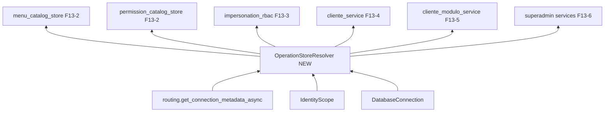

# F13-B1 — OperationStoreResolver Implementation Planning

**Fecha:** 2026-06-28  
**Modo:** Solo planificación — **sin implementación, commits ni cambios de código**  
**Referencias:** F13-A1 (diseño objetivo), F12-E2B3V (diagnóstico — no repetido)  
**Alcance:** Determinar el **primer** cambio de implementación — fase **F13-1**

---

## 1. Respuestas ejecutivas (1–10)

### 1. ¿Cuál es el primer componente que debe modificarse?

**No se modifica ningún componente de runtime existente en F13-1.**

El primer entregable de implementación es la **creación del núcleo nuevo**:

| Componente | Acción F13-1 |
|------------|--------------|
| **`OperationStoreResolver`** | **Crear** (`app/core/tenant/operation_store_resolver.py`) |
| **`OperationDescriptor`**, **`InstallationProfile`**, **`ExecuteQueryIntent`** | **Crear** (`app/core/tenant/operation_store_types.py`) |

Es el **primer cambio** del roadmap F13-A1 §13 (F13-1: *«Núcleo resolver — sin migrar servicios»*).

**Interpretación operativa:** el “primer componente” del programa de migración es el **resolver + tipos**; los consumidores (`menu_catalog_store`, servicios Platform, etc.) vienen **después** (F13-2+).

---

### 2. ¿Por qué ese componente debe ser el primero?

| Razón | Detalle |
|-------|---------|
| **Fundamento único** | F13-A1 §8 centraliza `connection_type`, `client_id`, `identity_scope`, `database_type` y `operation_class` en un solo algoritmo; sin él, F13-2…F13-8 replicarían policy ad hoc |
| **Riesgo mínimo** | Código **aditivo** sin wire-up → **cero** cambio de comportamiento en producción |
| **Validación aislada** | Unit tests + golden tests contra metadata existente (`get_connection_metadata_async`) sin tocar auth, menú ni dashboard |
| **Desacople del Host** | El resolver usa **`target_cliente_id` + metadata CP**; corregir F12-E2B3V requiere este contrato antes de tocar servicios |
| **Orden normativo F13-A1** | F13-1 explícitamente precede catalog stores (F13-2), impersonation (F13-3) y Platform KPIs (F13-4) |

---

### 3. ¿Qué componentes dependen de él?

**Dependientes directos (fases posteriores — consumen `ExecuteQueryIntent`):**

| Fase | Componente | Uso del resolver |
|------|------------|------------------|
| F13-2 | `menu_catalog_store.py` | QUERY1 menú |
| F13-2 | `permission_catalog_store.py` | Catálogo permiso tenant |
| F13-3 | `impersonation_rbac.py` | Lookup `permiso` + profile JWT |
| F13-3 | `deps.py` (rama impersonation) | `database_type` legacy |
| F13-4 | `cliente_service.py` (`obtener_estadisticas`) | KPIs tenant_data |
| F13-5 | `cliente_modulo_service.py` (reads) | Listado módulos Platform |
| F13-6 | `superadmin_usuario_service.py`, `superadmin_auditoria_service.py` | Sustitución `platform_global_query_intent` |
| F13-7 | `modulo_menu_service.py`, `permission_resolver.py` | Metadata menú / permisos |
| Futuro | `platform_global_query_intent.py` | Shim → deprecación |

**Dependencias del resolver (ya existentes — F13-1 las consume, no las modifica):**

| Upstream | Rol |
|----------|-----|
| `routing.get_connection_metadata_async` | Installation metadata |
| `routing.INSTALLATION_MODE_DEDICATED`, `DEDICATED_ROUTE_FAIL_CLOSED` | Fail-closed RI-39 |
| `routing.OPERATION_CLASS_*` | Clasificación gateway |
| `identity_scope.IdentityScope` | ROW_SCOPED / ENGINE_SCOPED |
| `connection_async.DatabaseConnection` | ADMIN / DEFAULT |



---

### 4. ¿Puede implementarse sin romper Shared?

**Sí.**

| Garantía F13-1 | Mecanismo |
|----------------|-----------|
| Sin wire-up | Ningún import del resolver en servicios productivos |
| Sin cambio HTTP | Middleware, endpoints y `execute_query` callers intactos |
| Tests aislados | Solo `tests/unit/test_operation_store_resolver.py` |
| Shared path cubierto | Matriz unit: `operation_plane=tenant_data` + metadata shared → `DEFAULT`, `ROW_SCOPED`, `client_id=target` |
| Dedicated path cubierto | Matriz unit: metadata dedicated → `DEFAULT`, `ENGINE_SCOPED` |
| Regresión CI | Suite existente sin cambios en archivos de producción |

**Condición:** F13-1 **no** debe incluir sustitución de `menu_catalog_store` ni ningún servicio — eso es F13-2+.

---

### 5. ¿Qué archivos exactos se modificarán?

#### Archivos **nuevos** (F13-1)

| Archivo | Contenido |
|---------|-----------|
| `app/core/tenant/operation_store_types.py` | Enums/dataclasses: `OperationPlane`, `SessionKind`, `EngineKind`, `OperationDescriptor`, `InstallationProfile`, `ExecuteQueryIntent`; método `to_execute_query_kwargs()` |
| `app/core/tenant/operation_store_resolver.py` | `OperationStoreResolver.resolve()` async; `InstallationProfile.from_metadata()`; validación impersonation target |
| `tests/unit/test_operation_store_resolver.py` | Matriz shared/dedicated/control_plane/fail-closed + golden parity |

#### Archivos **opcionales** (solo si se exporta API pública)

| Archivo | Cambio |
|---------|--------|
| `app/core/tenant/__init__.py` | Re-export opcional de tipos (sin obligatoriedad F13-1) |

#### Archivos de **test reutilizados** (sin modificar en F13-1, solo import)

| Archivo | Uso |
|---------|-----|
| `tests/integration/helpers/hybrid_mock_metadata.py` | `build_shared_metadata`, `build_dedicated_metadata` |

#### **Cero** archivos de producción existentes modificados en F13-1

---

### 6. ¿Qué NO debe modificarse todavía?

| Categoría | Archivos / áreas — prohibidos en F13-1 |
|-----------|----------------------------------------|
| **Catalog stores** | `menu_catalog_store.py`, `permission_catalog_store.py` |
| **Platform services** | `cliente_service.py`, `cliente_modulo_service.py`, `conexion_service.py` |
| **Superadmin** | `superadmin_usuario_service.py`, `superadmin_auditoria_service.py`, `platform_global_query_intent.py` |
| **Auth / impersonation** | `impersonation_rbac.py`, `deps.py`, `auth_runtime_scope.py` |
| **Menu / RBAC** | `modulo_menu_service.py`, `permission_resolver.py`, `menu_resolver.py` |
| **Gateway** | `queries_async.py`, `query_helpers.py`, `routing.py` (salvo import desde resolver) |
| **Presentation** | Todos los `endpoints*.py` |
| **Frontend contract docs** | Sin cambios contractuales |
| **Bootstrap / DDL** | Sin cambios SQL |

**Regla:** F13-1 termina cuando el resolver existe, está testeado y **nadie lo llama** en runtime productivo.

---

### 7. ¿Cuál será el criterio de validación?

#### Definition of Done — F13-1

| ID | Criterio | Verificación |
|----|----------|--------------|
| V-01 | `OperationStoreResolver.resolve()` implementa algoritmo F13-A1 §8.3 | Code review vs pseudocódigo |
| V-02 | `control_plane` → `ADMIN`, `client_id=None`, `ENGINE_SCOPED`, `operation_class=control_plane` | Unit test |
| V-03 | Shared `tenant_data` → `DEFAULT`, `client_id=target`, `ROW_SCOPED`, `database_type=single` | Unit test |
| V-04 | Dedicated `tenant_data` → `DEFAULT`, `client_id=target`, `ENGINE_SCOPED`, `database_type=multi` | Unit test |
| V-05 | Dedicated metadata incompleta → excepción `DEDICATED_ROUTE_FAIL_CLOSED` | Unit test |
| V-06 | **Golden parity:** intent equivalente a `resolve_permission_catalog_target(target)` para shared/dedicated **sin** TenantContext | Tabla comparativa en test |
| V-07 | **Golden parity:** intent equivalente a `kwargs_control_plane_read()` para plane CP | Unit test |
| V-08 | `ExecuteQueryIntent.to_execute_query_kwargs()` compatible con firma `execute_query` | Unit test kwargs keys |
| V-09 | Impersonation: `session_target_cliente_id ≠ target_cliente_id` → error explícito | Unit test |
| V-10 | **Cero** diff en servicios productivos (grep: ningún import de resolver fuera de tests) | CI / grep gate |
| V-11 | `pytest tests/unit/test_operation_store_resolver.py` verde | CI |
| V-12 | Suite CI completa sin regresión | CI pipeline |

**No aplica en F13-1:** validación manual HTTP, E2E Dedicated, smoke Platform (reservado F13-2+).

---

### 8. ¿Qué riesgos existen?

| ID | Riesgo | Severidad | Mitigación en planificación |
|----|--------|-----------|----------------------------|
| R-B1-01 | **Deriva vs `routing.py`** — duplicar lógica `database_type` | Medio | `InstallationProfile.from_metadata()` delega reglas existentes; golden tests con mismos mocks que `test_f11_permission_catalog_routing` |
| R-B1-02 | **API prematura** — tipos incorrectos bloquean F13-2 | Medio | Incluir `to_execute_query_kwargs()` alineado a `execute_query` actual; revisar F12-E2B3N kwargs |
| R-B1-03 | **Scope CP global reads** — confundir `ENGINE_SCOPED` en control_plane | Bajo | Documentar en docstring: CP platform read = ENGINE_SCOPED sin filtro ContextVar (igual F12-E2B3N) |
| R-B1-04 | **Import circular** resolver ↔ routing | Bajo | Resolver solo importa funciones/constants de routing, no services |
| R-B1-05 | **Equipo implementa wire-up en mismo PR** | Alto | Gate review: F13-1 PR **solo** archivos §5; rechazar diffs en catalog stores |
| R-B1-06 | **Tests flaky** por metadata async real | Bajo | Mock `get_connection_metadata_async` en unit tests (patrón `hybrid_mock_metadata`) |
| R-B1-07 | **SYSTEM client_id** edge case | Bajo | Unit test explícito: target SYSTEM → control_plane o error documentado |

---

### 9. ¿Qué pruebas manuales validarán esta fase?

**Ninguna prueba manual HTTP es requerida para F13-1.**

| Tipo | F13-1 | Desde fase |
|------|:-----:|------------|
| Unit tests automatizados | **Sí** | F13-1 |
| CI regression | **Sí** | F13-1 |
| Smoke Shared HTTP | No | F13-2 (primer wire-up catalog) |
| Smoke Dedicated `acmee` Platform | No | F13-4 |
| Impersonation @ platform Origin | No | F13-3 |

**Justificación:** sin wire-up, no hay comportamiento observable en runtime; validación manual comenzaría a **introducir ruido** y mezclar fases.

**Checklist manual opcional post-merge F13-1 (solo verificación proceso):**

- [ ] Confirmar que arranque app (`uvicorn`) no cambia logs RBAC/routing
- [ ] Confirmar grep: `OperationStoreResolver` solo en `app/core/tenant/` y `tests/`

---

### 10. Plan técnico de implementación — F13-1

#### 10.1 Objetivo de la fase

Entregar el **contrato normativo de resolución de store** listo para consumo en F13-2, **sin alterar** ningún flujo productivo.

#### 10.2 Entregables

| # | Entregable | Criterio |
|---|------------|----------|
| E1 | `operation_store_types.py` | Tipos inmutables + `to_execute_query_kwargs()` |
| E2 | `operation_store_resolver.py` | `resolve(descriptor) -> ExecuteQueryIntent` async |
| E3 | `test_operation_store_resolver.py` | Cobertura V-01…V-09 |
| E4 | Docstring módulo | Referencia F13-A1 §8 + RI-39 |

#### 10.3 Diseño de tipos (`operation_store_types.py`)

```text
OperationPlane: control_plane | tenant_data

SessionKind: tenant_session | platform_operator | impersonation

EngineKind: shared_single | dedicated_multi

OperationDescriptor:
  target_cliente_id: UUID
  operation_plane: OperationPlane
  tables: frozenset[str] | None = None          # reservado policy F13-8
  session_kind: SessionKind = tenant_session
  session_target_cliente_id: UUID | None = None

InstallationProfile:
  cliente_id: UUID
  tipo_instalacion: str
  engine_kind: EngineKind
  database_type: str          # legacy "single" | "multi"
  metadata: dict | None       # passthrough routing

ExecuteQueryIntent:
  connection_type: DatabaseConnection
  client_id: UUID | None
  identity_scope: IdentityScope
  operation_class: str
  engine_kind: EngineKind
  database_type: str

  def to_execute_query_kwargs(self) -> dict:
      # keys: connection_type, client_id, identity_scope, operation_class
```

#### 10.4 Algoritmo resolver (`operation_store_resolver.py`)

**Pasos de implementación (orden interno PR):**

| Paso | Acción |
|------|--------|
| 1 | Validar descriptor: `target_cliente_id` obligatorio si `tenant_data` |
| 2 | Validar impersonation: `session_target_cliente_id` debe coincidir con `target_cliente_id` si presente |
| 3 | Si `operation_plane == control_plane` → retornar intent CP (sin llamar metadata) |
| 4 | `meta = await get_connection_metadata_async(target_cliente_id, OPERATION_CLASS_TENANT_DATA)` |
| 5 | `profile = InstallationProfile.from_metadata(target_cliente_id, meta)` — reutilizar reglas `_validate_dedicated_route_metadata` vía metadata ya validada en routing |
| 6 | Mapear `profile.engine_kind` → intent tenant_data (shared vs dedicated) |
| 7 | Exponer `resolve_database_type(profile) -> str` helper para F13-3 |

**Función pública principal:**

```python
async def resolve_operation_store(
    descriptor: OperationDescriptor,
) -> ExecuteQueryIntent: ...
```

Alias de clase opcional: `OperationStoreResolver.resolve = resolve_operation_store`.

#### 10.5 Matriz de tests (`test_operation_store_resolver.py`)

| Caso | Input | Expected intent |
|------|-------|-----------------|
| T-01 | CP plane, any target | ADMIN, client_id=None, ENGINE_SCOPED |
| T-02 | tenant_data, shared metadata | DEFAULT, ROW_SCOPED, client_id=target |
| T-03 | tenant_data, dedicated metadata | DEFAULT, ENGINE_SCOPED, client_id=target |
| T-04 | tenant_data, dedicated incomplete metadata | raises DEDICATED_ROUTE_FAIL_CLOSED |
| T-05 | impersonation mismatch JWT/target | raises ValidationError |
| T-06 | Golden: shared catalog equivalent | intent == mapping of `resolve_permission_catalog_target` **sin** TenantContext — usar metadata mock directo |
| T-07 | Golden: dedicated catalog equivalent | idem |
| T-08 | `to_execute_query_kwargs` keys | subset of execute_query accepted params |

**Fixtures:** reutilizar `build_shared_metadata` / `build_dedicated_metadata` de `tests/integration/helpers/hybrid_mock_metadata.py`.

**Mock:** `@patch("app.core.tenant.operation_store_resolver.get_connection_metadata_async")`.

#### 10.6 Secuencia del PR F13-1

```mermaid
gantt
    title F13-1 PR interno
    dateFormat X
    axisFormat %s

    section Tipos
    operation_store_types.py     :0, 1
    section Resolver
    operation_store_resolver.py  :1, 2
    section Tests
    unit test matrix             :2, 3
    section Gate
    grep no wire-up              :3, 4
    CI full                      :4, 5
```



| Orden commit lógico | Contenido |
|--------------------|-----------|
| 1 | Tipos + docstrings |
| 2 | Resolver + imports routing |
| 3 | Unit tests completos |
| 4 | (Opcional) nota en F13-A1 changelog — **fuera de alcance B1 si no se pide** |

#### 10.7 Criterio de merge

- [ ] Solo archivos §5 (nuevos + tests)
- [ ] V-01…V-12 cumplidos
- [ ] Review arquitectura: algoritmo = F13-A1 §8.3 verbatim
- [ ] Sin `if dedicated` en servicios — policy solo en `InstallationProfile.from_metadata`

#### 10.8 Puerta a F13-2

F13-2 **primer wire-up productivo** permitido únicamente cuando F13-1 está mergeado y:

1. `menu_catalog_store.resolve_menu_catalog_query1_target(cliente_id)` se reimplementa como:

   ```text
   intent = await resolve_operation_store(
     OperationDescriptor(target_cliente_id=cliente_id, operation_plane=tenant_data)
   )
   return intent.connection_type, intent.client_id
   ```

2. Misma sustitución en `permission_catalog_store`.

**Ese wire-up NO forma parte de F13-1.**

---

## 2. Resumen decisión F13-B1

| Pregunta | Respuesta one-liner |
|----------|---------------------|
| **Primer cambio** | **Crear** `OperationStoreResolver` + tipos (no modificar runtime existente) |
| **Por qué primero** | Fundamento único, riesgo cero, desbloquea F13-2…F13-8 |
| **Dependientes** | Catalog stores, impersonation, Platform services, superadmin |
| **Shared safe** | Sí — aditivo, sin wire-up |
| **Archivos** | 3 nuevos (+ tests); 0 producción tocados |
| **No tocar aún** | Todo lo listado en §6 |
| **Validación** | Unit + golden + CI; sin manual HTTP |
| **Riesgos** | Deriva routing, wire-up prematuro |
| **Manual** | Ninguno en F13-1 |
| **Plan F13-1** | §10 |

---

## 3. Referencias

| Documento | Uso en B1 |
|-------------|-----------|
| `F13_A1_DEDICATED_PLATFORM_COMPATIBILITY_ARCHITECTURE.md` | Algoritmo §8, roadmap F13-1 §13 |
| `F12_E2B3V_DEDICATED_PLATFORM_READ_ROUTING_AUDIT.md` | Contexto problema (no re-auditado) |
| `F12_E2B3N_PLATFORM_GLOBAL_QUERY_INTENT_IMPLEMENTATION.md` | Compat kwargs `execute_query` |
| `tests/unit/test_f11_permission_catalog_routing.py` | Patrón golden parity |

---

*Planificación F13-B1 — OperationStoreResolver. Sin implementación.*
