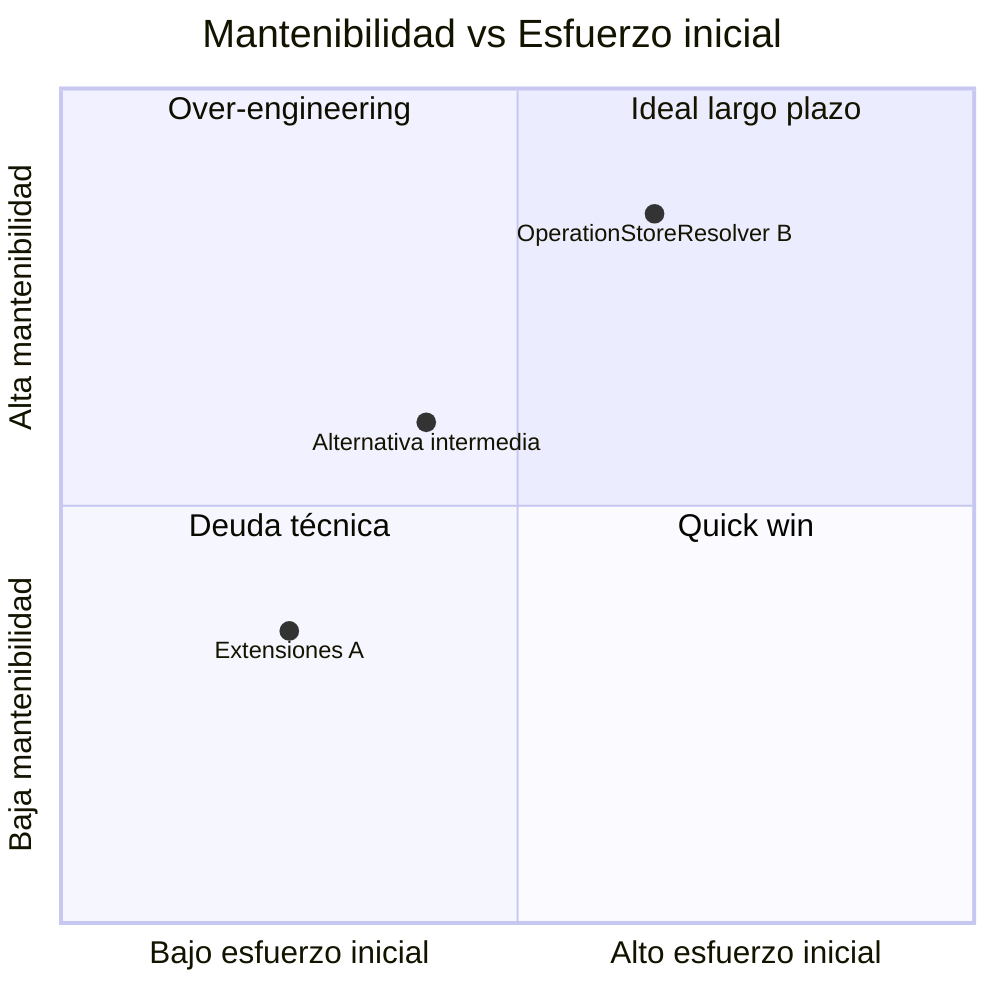

# F13-B2 — OperationStoreResolver Necessity Review

**Fecha:** 2026-06-28  
**Modo:** Solo revisión arquitectónica — **sin implementación, commits ni cambios de código**  
**Referencias:** F12-E2B3N, F12-E2B3V, F13-A1, F13-B1 (no re-auditadas)  
**Pregunta central:** ¿Es **necesario** crear `OperationStoreResolver`, o basta extender la infraestructura actual?

---

## 1. Conclusión anticipada (respuesta 7)

| Veredicto | Formulación |
|-----------|-------------|
| **Necesidad estricta (bugfix acmee)** | **No** — la paridad Dedicated Platform puede lograrse con extensiones acotadas a componentes existentes |
| **Necesidad arquitectónica (sostenibilidad F13)** | **Sí** — el modelo actual no expresa `operation_plane` ni desacopla el store del Host de forma normativa |
| **Recomendación única** | **Continuar con OperationStoreResolver** — con condición: **absorber** `platform_global_query_intent` y catalog stores; **no** coexistir como tercer patrón paralelo |

---

## 2. Respuesta 1 — Problemas que NO resuelve `platform_global_query_intent`

`platform_global_query_intent.py` (F12-E2B3N) resuelve un subconjunto acotado: **Superadmin cross-tenant** con `identity_scope=ENGINE_SCOPED` y kwargs para `execute_query`.

| Problema (F12-E2B3V / F13-A1) | ¿Lo resuelve `platform_global_query_intent`? | Por qué no |
|-------------------------------|:--------------------------------------------:|------------|
| Menú impersonation vacío @ Origin platform | **No** | No interviene en `menu_catalog_store`; catalog stores usan **`TenantContext` del host**, no este módulo |
| KPI `obtener_estadisticas` cuenta `usuario` en ADMIN | **No** | `ClienteService` no usa estos kwargs; hardcode ADMIN |
| `ClienteModuloService` lecturas Platform en ADMIN | **No** | Fuera de alcance superadmin |
| `impersonation_rbac` lee `permiso` en ADMIN (Dedicated) | **No** | Path impersonation no usa `kwargs_platform_global_read` para catálogo permiso |
| `database_type` impersonation desde **host** (`deps.py`) | **No** | `auth_runtime_scope` deriva scope de `IdentityGateway` → `TenantContext`, no de metadata del JWT target |
| Decisión **CP vs tenant_data** en un mismo endpoint compuesto | **No** | Solo entrega kwargs; el caller debe saber si la tabla es CP o tenant_data |
| **`target_cliente_id` sin Host** para catalog/menu | **Parcial** | `kwargs_platform_global_read(client_id=T)` enruta DEFAULT, pero **no** sustituye catalog stores; superadmin ya lo usa; menú/RBAC no |
| Validación impersonation (`session_target` vs target) | **No** | Sin contrato de sesión |
| Futuros modos de instalación | **No** | Sin `InstallationProfile`; caller infiere `database_type` manualmente (ej. superadmin lee `tipo_instalacion` del cliente) |
| Módulos fuera superadmin (tenant, modulos, auth) | **No** | Nombre y ubicación (`superadmin/application/`) acotan adopción mental a Platform Admin |

**Resumen:** F12-E2B3N corrige **intención de filtro ContextVar** en servicios superadmin ya migrados. **No** corrige el bug raíz Host-vs-target ni unifica decisiones fuera de superadmin.

---

## 3. Respuesta 2 — Problemas que NO resuelven solo IdentityScope + execute_query kwargs + routing

La primitiva **existe** para construir la solución; **no** constituye por sí sola una **política aplicada**.

| Pieza existente | Qué aporta | Qué no decide |
|-----------------|------------|---------------|
| **`IdentityScope`** | ROW_SCOPED vs ENGINE_SCOPED en SQL filter | Qué store físico; no sustituye metadata del **target** |
| **`execute_query` kwargs** | Transporte de intención al gateway | El **servicio** elige kwargs — riesgo de ADMIN hardcoded |
| **`routing.get_connection_metadata_async(cliente_id)`** | Installation profile **independiente del Host** | Nadie lo invoca hoy en catalog stores ni `deps` impersonation |
| **`get_connection_for_tenant`** | Apertura engine | Solo después de que kwargs/connection_type ya fueron elegidos |

| Problema | ¿Resoluble solo combinando primitivas? | Qué falta |
|----------|:--------------------------------------:|-----------|
| Catalog store Host vs target | **Sí, técnicamente** | **Llamada explícita** a `get_connection_metadata_async(cliente_id)` en `menu_catalog_store` / `permission_catalog_store` (~15 líneas async c/u) |
| Impersonation permiso ADMIN | **Sí** | Usar catalog target corregido o kwargs tenant_data |
| Platform KPI usuarios | **Sí** | Patrón ya probado: `kwargs_platform_global_read(client_id)` como superadmin |
| Política **única** anti-regresión | **No automáticamente** | Sin contrato central, cada servicio **recompone** la primitiva distinto |
| `operation_plane=control_plane` vs `tenant_data` | **No normativo** | Cada developer elige ADMIN vs DEFAULT ad hoc |
| `resolve_rbac_database_type()` impersonation | **No** | Sigue ligado a `TenantContext` del host vía `IdentityGateway` |

**Conclusión:** Las primitivas **permiten** implementar Dedicated Platform **sin** nuevo módulo, pero **no previenen** la dispersión que produjo F12-E2B3V (15+ call sites, 3 mecanismos paralelos: kwargs, catalog tuple, hardcoded ADMIN).

---

## 4. Respuesta 3 — Código que se duplicaría con OperationStoreResolver

### 4.1 Duplicación **evitable** (mala)

Si F13-1 crea `OperationStoreResolver` **sin** retirar F12-E2B3N:

| Lógica duplicada | Ubicación actual | Ubicación nueva |
|------------------|------------------|-----------------|
| ADMIN + ENGINE_SCOPED + control_plane | `kwargs_control_plane_read` | `ExecuteQueryIntent` CP branch |
| DEFAULT + client_id + ENGINE_SCOPED | `kwargs_platform_global_read` | Intent tenant_data dedicated |
| DEFAULT + client_id + ROW_SCOPED | superadmin + permisos path shared | Intent tenant_data shared |
| `multi → DEFAULT, client_id` | `menu_catalog_store`, `permission_catalog_store` | Resolver tenant_data branch |
| `database_type` single/multi | `SuperadminUsuarioService` manual + `IdentityGateway` | `InstallationProfile` |

**Estimación:** ~60–90 líneas de **policy duplicada** en producción si coexisten ambos patrones durante migración larga.

### 4.2 Duplicación **aceptable** (wrapper fino)

| Componente | Rol post-absorción |
|------------|-------------------|
| `kwargs_platform_global_read` | **Shim deprecated** → `intent.to_execute_query_kwargs()` |
| `resolve_menu_catalog_query1_target` | **Thin wrapper** 3 líneas sobre resolver |
| `resolve_permission_catalog_target` | Idem |

### 4.3 Duplicación **no evitable** (delegación)

| Lógica | Permanece en |
|--------|--------------|
| Metadata fetch, RI-39 fail-closed | `routing.py` (resolver **delega**, no reimplementa) |
| Apertura engine / pool | `get_connection_for_tenant`, `connection_async` |
| Tenant filter SQL | `query_helpers.py` |

**Conclusión:** El resolver **duplica policy** solo si se implementa **en paralelo** a F12-E2B3N y catalog stores sin plan de absorción. Con migración F13-6, duplicación neta → **cero** (consolidación).

---

## 5. Respuesta 4 — Beneficios concretos vs reutilizar infraestructura existente

| Beneficio OperationStoreResolver | ¿Infraestructura actual? |
|----------------------------------|--------------------------|
| **Un algoritmo normativo** (F13-A1 §8) | Requiere documentación + disciplina manual |
| **`operation_plane` explícito** (CP vs tenant_data) | Caller infiere por tabla — errores recurrentes |
| **Host-independent by construction** | Posible con `get_connection_metadata_async`, pero **no enforced** |
| **Superficie de test única** (matriz golden) | Tests dispersos (`test_f11_*`, superadmin, hybrid) |
| **Impersonation target validation** centralizada | Repartida en session_scope + deps |
| **Extensibilidad modos futuros** (`EngineKind` enum) | N `if tipo_instalacion` en servicios |
| **Onboarding desarrollador** | 3 patrones a aprender vs 1 descriptor |
| **Alineación F13 roadmap** F13-2…F13-8 | Parches ad hoc por fase sin contrato |

| Beneficio reutilizar infra existente | OperationStoreResolver |
|--------------------------------------|------------------------|
| **Menos archivos nuevos hoy** | +2 módulos + tests |
| **Menor curva inmediata** | Abstracción nueva |
| **F12-E2B3N ya mergeado** | Requiere migración/shim |
| **Fix mínimo acmee** (catalog async) | Overhead F13-1 sin wire-up |

---

## 6. Respuesta 5 — Alternativa con menor cantidad de código

### Alternativa mínima (sin OperationStoreResolver)

| Paso | Cambio | LOC aprox. |
|------|--------|------------|
| A1 | `menu_catalog_store` + `permission_catalog_store`: async; `meta = await get_connection_metadata_async(cliente_id)`; if `database_type==multi` → DEFAULT else ADMIN | ~40 |
| A2 | `impersonation_rbac`: permiso lookup vía catalog target corregido | ~15 |
| A3 | `deps.py`: `database_type` desde metadata JWT `cliente_id` | ~20 |
| A4 | `cliente_service.obtener_estadisticas`: COUNT usuario/módulos vía `kwargs_platform_global_read` | ~30 |
| A5 | `cliente_modulo_service` reads: idem o catalog helper | ~25 |

**Total estimado:** ~130 LOC en **6 archivos existentes**, **0 módulos nuevos**.

**Limitaciones alternativa mínima:**

- `platform_global_query_intent` sigue en `superadmin/application/` — acoplamiento semántico incorrecto para tenant/auth
- Sin `operation_plane` — mezcla CP/tenant_data sigue siendo responsabilidad del developer
- Regresiones futuras: nuevo endpoint Platform puede olvidar A1–A5
- `auth_runtime_scope` / `IdentityGateway` siguen host-centric salvo parche adicional

### Alternativa intermedia (menor código que F13-1 puro)

Renombrar/extender **`platform_global_query_intent` → `operation_query_intent.py`** en `app/core/tenant/` con:

- `async resolve_tenant_data_kwargs(cliente_id) -> dict`
- `kwargs_control_plane_read` (existente)

**LOC:** ~80 en 1 archivo movido + fixes catalog. **Sin** `OperationDescriptor` completo.

**Trade-off:** Menos expresivo que F13-A1; no modela `session_kind` impersonation.

---

## 7. Respuesta 6 — Comparación A vs B

| Criterio | **A) Arquitectura actual + extensiones** | **B) OperationStoreResolver (F13-1+)** |
|----------|------------------------------------------|----------------------------------------|
| **Mantenibilidad** | Media-baja — policy en N archivos; grep para auditorías | **Alta** — un módulo normativo + shims finos |
| **Complejidad cognitiva** | Baja inmediata (parches locales) | Media inicial; **baja** tras adopción completa |
| **Riesgo implementación** | **Bajo** — cambios acotados, wire-up inmediato | Bajo F13-1 (sin wire-up); **medio** migración F13-2…F13-6 |
| **Riesgo regresión futura** | **Alto** — nuevo servicio puede hardcodear ADMIN | **Bajo** — descriptor obligatorio en guía F13 |
| **Cantidad archivos (steady state)** | ~6–10 tocados repetidamente | **+2 nuevos**, luego **−1** (absorber platform_global_query_intent) |
| **Compatibilidad Shared** | **Alta** — cambios localizados | **Alta** — matriz unit shared en resolver |
| **Compatibilidad Dedicated** | **Alta** si A1–A5 completos | **Alta** — diseño explícito F13-A1 |
| **Facilidad pruebas** | Tests por parche; sin golden global | **Matriz central** + golden vs catalog/kwargs |
| **Time-to-fix acmee** | **Más rápido** (1–2 PRs) | Más lento (F13-1 sin efecto UX; fix visible F13-2+) |
| **Alineación F13-A1 principios** | Parcial (sigue Host en IdentityGateway) | **Completa** |
| **Deuda si se abandona a medias** | Parches permanentes | Shims deprecated sin migración F13-6 |

---

## 8. Respuesta 7 — Recomendación arquitectónica única

### Decisión: **Continuar con OperationStoreResolver**

**No** porque sea la única forma técnica de corregir acmee.  
**Sí** porque es la forma **sostenible** de cumplir F13-A1 sin acumular parches equivalentes ya visibles en F12-E2B3N + catalog stores + `cliente_service` + impersonation.

### Condiciones obligatorias (evitar duplicación F13-B2 §4.1)

| # | Condición |
|---|-----------|
| C1 | F13-1 permanece **sin wire-up** (F13-B1 intacto) |
| C2 | F13-6 **depreca** `platform_global_query_intent` → shim sobre `ExecuteQueryIntent` |
| C3 | Catalog stores F13-2 **no reimplementan** lógica; solo delegan al resolver |
| C4 | **No** añadir `if dedicated` en servicios — solo `resolve(descriptor)` |
| C5 | Si urgencia producto **P0 acmee** antes de F13-2: permitido **hotfix A1** temporal **solo** catalog stores async — luego **revertir duplicación** en F13-2 delegando al resolver |

### Qué **no** hacer

| Anti-decisión | Motivo |
|---------------|--------|
| **Cancelar F13-1** y solo extender kwargs | Reproduce dispersión; F12-E2B3V volverá en nuevo servicio Platform |
| **Crear OperationStoreResolver** y **mantener** kwargs como patrón paralelo indefinido | Duplicación §4.1; dos fuentes de verdad |
| **Cancelar F13-A1** entero | Pierde contrato Host-independent y operation_plane |

### Alternativa intermedia aceptable si el equipo rechaza módulo nuevo

**Solo** si hay restricción estricta de “cero archivos nuevos”: mover lógica a `app/core/tenant/operation_query_intent.py` (evolución de platform_global_query_intent) con API async `resolve_tenant_read_intent(cliente_id)`. **Funcionalmente equivalente** al resolver; **semanticamente** es OperationStoreResolver con otro nombre y menos tipos.

En ese caso: **Cancelar F13-1 como archivo `operation_store_resolver.py`**, **Continuar F13 como concepto** en módulo unificado renombrado.

---

## 9. Matriz decisión final

| Pregunta | Respuesta |
|----------|-----------|
| ¿Necesario para bugfix? | **No** — alternativa A (~130 LOC) suficiente |
| ¿Necesario para arquitectura F13? | **Sí** — o equivalente renombrado en `operation_query_intent` |
| ¿Duplicación inevitable? | **No** — solo si coexistencia sin plan F13-6 |
| **Recomendación** | **Continuar OperationStoreResolver** + absorción F12-E2B3N |

---

## 10. Impacto en roadmap

| Documento | Ajuste |
|-----------|--------|
| F13-B1 | **Válido** — F13-1 sin wire-up se mantiene |
| F13-A1 | **Válido** — añadir nota F13-B2: resolver **absorbe** platform_global_query_intent |
| F13-2 | Primer wire-up; si hotfix A1 previo, F13-2 **reemplaza** parche catalog por delegación |
| F13-6 | Obligatorio: eliminar duplicación kwargs |

---

## 11. Referencias cruzadas (sin re-auditar)

| ID | Uso en B2 |
|----|-----------|
| F12-E2B3N | Límites de `platform_global_query_intent` §2 |
| F12-E2B3V | Síntomas que Alternativa A corrige; causa Host-vs-target §3 |
| F13-A1 | Contrato objetivo OperationStoreResolver §5–6 |
| F13-B1 | Plan F13-1; condición C1 §8 |

---

*Revisión F13-B2 — OperationStoreResolver Necessity. Sin implementación.*
