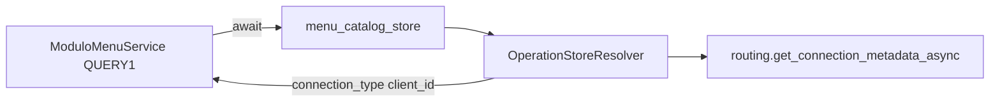

# F13-C2 — OperationStoreResolver Wire-up (Menu Catalog Only)

**Fecha:** 2026-06-28  
**Fase:** F13-2 parcial — **solo** `menu_catalog_store`  
**Referencias:** F13-A1 §8, F13-B1 §10.8, F13-C1  
**Estado:** Completado — detenido antes de `permission_catalog_store`

---

## 1. Resumen

Se conectó `resolve_menu_catalog_query1_target()` al `OperationStoreResolver`. La decisión de store deja de usar `TenantContext.database_type` del **Host** y pasa a usar **metadata CP del `target_cliente_id`**.

**Primer wire-up productivo:** corrige menú vacío en impersonation Dedicated @ Origin platform (F12-E2B3V).

---

## 2. Diff arquitectónico

### Antes (F11-P1 — Host-derived)

```text
resolve_menu_catalog_query1_target(cliente_id)
  → try_get_tenant_context()
  → if ctx.database_type == "multi" → DEFAULT + cliente_id
  → else → ADMIN + None
```

**Problema:** en impersonation @ `platform.*`, el Host tiene `database_type=single` → ADMIN → catálogo CP sin módulos del tenant Dedicated → menú vacío.

### Después (F13-C2 — target-derived)

```text
resolve_menu_catalog_query1_target(cliente_id)  [async]
  → OperationStoreResolver.resolve(
       OperationDescriptor(
         target_cliente_id = cliente_id,
         operation_plane = tenant_data,
       )
     )
  → get_connection_metadata_async(cliente_id)   # routing — sin Host
  → InstallationProfile.from_metadata(...)
  → ExecuteQueryIntent → (connection_type, client_id)
```



### Cambio semántico Shared (documentado F13-C1 T-06)

| Modo | Antes (Host ctx) | Después (resolver F13-A1) |
|------|------------------|---------------------------|
| Shared tenant_data | ADMIN, `None` | DEFAULT, `cliente_id` |
| Dedicated tenant_data | DEFAULT, `cliente_id` (solo si Host multi) | DEFAULT, `cliente_id` (siempre vía metadata target) |

Shared usa DEFAULT + ROW_SCOPED porque las tablas catálogo (`modulo*`, `cliente_modulo`) están en `GLOBAL_TABLES` — el filtro tenant no altera el JOIN; el routing físico sigue siendo coherente en single-DB.

---

## 3. Archivos modificados

| Archivo | Cambio |
|---------|--------|
| `app/core/authorization/menu_catalog_store.py` | **Wire-up:** delegación async a `resolve_operation_store`; eliminada lógica `try_get_tenant_context` |
| `app/modules/modulos/application/services/modulo_menu_service.py` | **Mecánico:** `await resolve_menu_catalog_query1_target(...)` (único call site) |
| `tests/unit/test_f11_menu_catalog_routing.py` | Tests async + mock metadata; nuevo test impersonation Dedicated @ platform host |

### Archivos NO modificados (alcance respetado)

| Prohibido F13-C2 | Estado |
|------------------|:------:|
| `permission_catalog_store.py` | ✅ intacto |
| `impersonation_rbac.py` | ✅ |
| `ClienteService` / `ClienteModuloService` | ✅ |
| `deps.py` | ✅ |
| Endpoints / OpenAPI / Frontend | ✅ |

### Imports productivos de `OperationStoreResolver`

| Módulo | Rol |
|--------|-----|
| `app/core/tenant/operation_store_resolver.py` | Definición |
| `app/core/authorization/menu_catalog_store.py` | **Único consumidor productivo** |

---

## 4. Smoke HTTP completo

**Entorno:** Docker `localhost:8000`, credenciales staging documentadas (`superadmin`/`admin123`, tenant `admin`/`admin123` o `Admin123!` para Dedicated `acce`).

**Tenants descubiertos en CP:**

| Rol | Subdominio | `tipo_instalacion` | `cliente_id` |
|-----|------------|-------------------|--------------|
| Shared | `acme` | shared | `557928aa-05a8-468b-b746-c8c84e2ef384` |
| Dedicated | `acce` | dedicated | `5176fbd6-69f0-4793-9f96-8cc6ddd347c8` |

### Resultados (2026-06-28)

| # | Escenario | Resultado | Evidencia clave |
|---|-----------|:---------:|-----------------|
| 1 | **Shared Tenant** — login, menu, permissions | **PASS** | `auth_menu`: ORG+INV+SYS_ADMIN (3 módulos); `permissions_me`: 80 códigos |
| 2 | **Dedicated Tenant** (`acce`) — login, menu, permissions | **PASS** | `auth_menu`: 3 módulos; `permissions_me`: 83 códigos |
| 3 | **Platform Admin** — login, dashboard | **PASS** | login/me/menu/permissions OK; `GET /clientes/{id}/estadisticas/` 200 |
| 4 | **Platform → impersonar Shared (`acme`) → menú** | **PASS** | `modulos_count=3`, ORG+INV+SYS_ADMIN |
| 5 | **Platform → impersonar Dedicated (`acce`) → menú** | **PASS** | `modulos_count=3` (antes F12-E2B3V: vacío @ platform Origin) |

**`all_passed`: true**

### Verificaciones explícitas

| Verificación | Resultado |
|--------------|:---------:|
| Cero regresión Shared (`acme`) | ✅ |
| Cero regresión Dedicated tenant admin (`acce`) | ✅ |
| Cero cambios OpenAPI | ✅ (sin diff en `endpoints*`) |
| Cero cambios Frontend | ✅ |

---

## 5. Tests automatizados

```text
pytest tests/unit/test_f11_menu_catalog_routing.py tests/unit/test_operation_store_resolver.py -v
→ 22 passed
```

Casos nuevos/relevantes:

- `test_obtener_menu_usuario_impersonation_dedicated_uses_target_metadata_not_host` — platform Host + target Dedicated → DEFAULT + `client_id`
- Shared catalog: DEFAULT vía resolver (no ADMIN legacy)

---

## 6. Riesgos

| ID | Riesgo | Severidad | Mitigación |
|----|--------|-----------|------------|
| R-C2-01 | Shared QUERY1 pasa de ADMIN→DEFAULT | Bajo | Smoke `acme` PASS; GLOBAL_TABLES omiten filtro extra |
| R-C2-02 | `permission_catalog_store` sigue Host-derived | **Alto** (funcional) | F13-3 recomendado — permisos impersonation Dedicated aún pueden divergir del menú |
| R-C2-03 | `execute_query` QUERY1 no pasa `identity_scope` del intent | Medio | JOIN explícito `cliente_modulo.cliente_id`; dedicated OK en smoke |
| R-C2-04 | Latencia extra: metadata async por menú | Bajo | Cache intra-request L-A en `routing` |
| R-C2-05 | API async rompe callers futuros | Bajo | Grep confirma un solo call site actualizado |

---

## 7. Siguiente consumidor recomendado

**F13-3 — `permission_catalog_store.py`**

| Motivo | Detalle |
|--------|---------|
| Paridad menú/permisos | Impersonation Dedicated: menú OK (F13-C2); permisos aún usan Host en catalog lookup |
| Mismo patrón | Thin async wrapper → `OperationDescriptor(tenant_data)` |
| Referencia | F12-E2B3V §4.3 — `permiso` en ADMIN bajo impersonation @ platform |

**No iniciado en esta fase** (instrucción explícita).

---

## 8. Definition of Done F13-C2

| Criterio | Cumplido |
|----------|:--------:|
| Solo `menu_catalog_store` wire-up (+ await call site) | ✅ |
| Decisión store 100% en resolver | ✅ |
| Lógica duplicada Host eliminada | ✅ |
| Smoke 5 escenarios | ✅ |
| Documentación entregable | ✅ |
| Sin commits | ✅ |
| Detenido antes de `permission_catalog_store` | ✅ |

---

*Implementación F13-C2 — Menu Catalog Wire-up. Detenido.*
