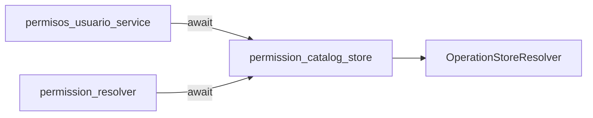

# F13-C3 — OperationStoreResolver Wire-up (Permission Catalog Only)

**Fecha:** 2026-06-28  
**Fase:** F13-3 parcial — **solo** `permission_catalog_store`  
**Referencias:** F13-A1 §8, F13-C2 (menú), F12-E2B3V  
**Estado:** Completado — sin commits

---

## 1. Resumen

Se eliminó la última decisión de store basada en `TenantContext` del **Host** en `permission_catalog_store`. La resolución delega en `OperationStoreResolver`, igual que `menu_catalog_store` (F13-C2).

**Efecto principal:** impersonation Dedicated @ Origin platform resuelve catálogo `permiso` en **DP del target**, no en ADMIN del host.

---

## 2. Diff arquitectónico

### Antes (F11-P3 — Host-derived)

```text
resolve_permission_catalog_target(cliente_id)
  → try_get_tenant_context()
  → if ctx.database_type == "multi" → DEFAULT + cliente_id
  → else → ADMIN + None
```

### Después (F13-C3 — target-derived)

```text
resolve_permission_catalog_target(cliente_id)  [async]
  → resolve_operation_store(
       OperationDescriptor(
         target_cliente_id = cliente_id,
         operation_plane = tenant_data,
       )
     )
  → return intent.connection_type, intent.client_id
```



---

## 3. Archivos modificados

| Archivo | Cambio |
|---------|--------|
| `app/core/authorization/permission_catalog_store.py` | Wire-up async → `OperationStoreResolver`; eliminado `try_get_tenant_context` |
| `app/modules/rbac/application/services/permisos_usuario_service.py` | `await resolve_permission_catalog_target(...)` |
| `app/core/authorization/permission_resolver.py` | `await resolve_permission_catalog_target(...)` |
| `tests/unit/test_f11_permission_catalog_routing.py` | Tests async + mock metadata; nuevo caso platform host / target dedicated |

### No modificados (alcance respetado)

| Prohibido | Estado |
|-----------|:------:|
| `menu_catalog_store.py` | ✅ |
| `impersonation_rbac.py` | ✅ |
| `ClienteService` | ✅ |
| `execute_query`, `routing`, `query_helpers`, TD-08 | ✅ |
| Endpoints / OpenAPI / Frontend | ✅ |

### Consumidores productivos de `OperationStoreResolver`

| Módulo | Desde |
|--------|-------|
| `menu_catalog_store.py` | F13-C2 |
| `permission_catalog_store.py` | **F13-C3** |

---

## 4. Tests unitarios

```text
pytest tests/unit/test_f11_permission_catalog_routing.py tests/unit/test_f11_menu_catalog_routing.py -v
→ 15 passed
```

### Caso nuevo F13-C3

`test_resolve_permission_catalog_platform_host_target_dedicated_uses_target_metadata`:

- `TenantContext` = platform/shared (Host)
- `cliente_id` target = Dedicated
- Mock metadata dedicated → **DEFAULT + target UUID**

---

## 5. Smoke HTTP

**Entorno:** Docker `http://localhost:8000`

| # | Escenario | Resultado |
|---|-----------|:---------:|
| 1 | Shared `acme` — login, menu, permissions | **PASS** (80 permisos) |
| 2 | Dedicated `acce` — login, menu, permissions | **PASS** (83 permisos) |
| 3 | Platform admin — login, dashboard | **PASS** |
| 4 | Impersonation Shared — permissions | **PASS** (80 códigos) |
| 5 | Impersonation Dedicated — permissions | **PASS** (83 códigos) |

**`all_passed`: true**

Impersonation Dedicated incluye menú (3 módulos) — coherente con F13-C2 + F13-C3.

---

## 6. Cambio semántico Shared (documentado)

| Modo | Antes (Host ctx) | Después (resolver F13-A1) |
|------|------------------|-----------------------------|
| Shared catálogo permiso | ADMIN, `None` | DEFAULT, `cliente_id` |
| Dedicated catálogo permiso | DEFAULT solo si Host multi | DEFAULT, `cliente_id` vía metadata target |

Smoke Shared sin regresión (permissions + menu OK).

---

## 7. Riesgos residuales

| ID | Riesgo | Notas |
|----|--------|-------|
| R-C3-01 | `impersonation_rbac.py` sin wire-up | Fuera de alcance; path alternativo de permisos impersonation |
| R-C3-02 | Duplicación temporal menú + permiso wrappers | Absorción futura F13-6 |
| R-C3-03 | Otros `qmark_sql_text` en RBAC | TD-08 (F13-D2 cubrió `PermisoService.obtener_permisos_por_rol`) |

---

## 8. Siguiente paso recomendado (no iniciado)

| Fase | Componente |
|------|------------|
| F13-4 | `ClienteService.obtener_estadisticas` — KPIs tenant_data |
| F13-3 (auth) | `impersonation_rbac` + `deps.py` — `database_type` desde Installation Profile target |

---

## 9. Definition of Done F13-C3

| Criterio | Cumplido |
|----------|:--------:|
| Solo permission catalog wire-up (+ await call sites) | ✅ |
| Delegación 100% OperationStoreResolver | ✅ |
| Tests permission catalog actualizados | ✅ |
| Caso platform host / target dedicated | ✅ |
| Smoke 5 escenarios HTTP 200 | ✅ |
| Sin commits | ✅ |

---

*Implementación F13-C3 — detenido.*
