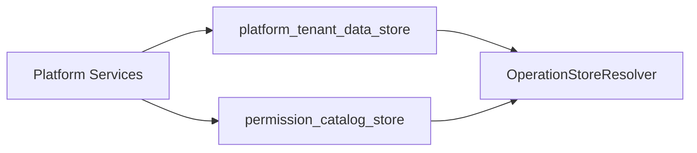

# F13-C4 — OperationStoreResolver Wire-up (Platform Services)

**Fecha:** 2026-06-28  
**Fase:** F13-4 — servicios Platform tenant_data  
**Referencias:** F13-A1 §8–9, F13-C2/C3 (catalog stores), F12-E2B3V  
**Estado:** Completado — sin commits

---

## 1. Resumen

Se introdujo **`platform_tenant_data_store.py`** como capa L6 única para operaciones Platform sobre tablas **tenant_data** (`usuario`, `cliente_modulo`, `rol_permiso`, `permiso`, `auth_audit_log`, …).

Todos los servicios Platform identificados en dashboard, impersonation, gestión de usuarios y roles/perfiles dejaron de derivar store desde:

- `DatabaseConnection.ADMIN` hardcoded (para datos tenant)
- `TenantContext.database_type` del **Host**
- `tipo_instalacion` inferido manualmente en servicio

y delegan en:

```python
await resolve_operation_store(
    OperationDescriptor(
        target_cliente_id=cliente_id,
        operation_plane=OperationPlane.TENANT_DATA,
    )
)
```

**Sin cambios:** SQL, lógica de negocio, endpoints, OpenAPI, Frontend.

---

## 2. Nuevo módulo central

| Archivo | Rol |
|---------|-----|
| `app/core/tenant/platform_tenant_data_store.py` | Wrapper async sobre `OperationStoreResolver` |

API pública:

| Función | Retorno |
|---------|---------|
| `resolve_platform_tenant_data_intent(cliente_id)` | `ExecuteQueryIntent` |
| `resolve_platform_tenant_data_target(cliente_id)` | `(connection_type, client_id)` |
| `resolve_platform_tenant_data_database_type(cliente_id)` | `"single"` \| `"multi"` |
| `resolve_platform_tenant_data_execute_kwargs(cliente_id)` | kwargs `execute_query` |

---

## 3. Servicios migrados

### 3.1 Dashboard del cliente

| Servicio | Método | Cambio |
|----------|--------|--------|
| `ClienteService` | `obtener_estadisticas()` | COUNT `usuario` + `cliente_modulo` vía `resolve_platform_tenant_data_execute_kwargs` |
| | | COUNT `cliente_conexion` **permanece ADMIN** (control_plane) |

**Evidencia smoke servicio (Docker):**

| Tenant | `total_usuarios` | `modulos_activos` |
|--------|-----------------:|------------------:|
| acme (shared) | 1 | 3 |
| acce (dedicated) | 1 | 3 |

*(Antes F13-C4: Platform drill-down Dedicated → 0 en CP.)*

### 3.2 Módulos activos (Platform listado)

| Servicio | Métodos lectura migrados |
|----------|-------------------------|
| `ClienteModuloService` | `obtener_modulos_activos_cliente`, `obtener_modulo_activo_por_cliente_y_modulo`, `obtener_modulo_activo_por_id` (+ `cliente_id` opcional) |

**Escrituras** (`activar_modulo_cliente`, `desactivar_modulo_cliente`, …) **permanecen ADMIN** (decisión comercial CP — F13-A1 §4).

**Evidencia:** `obtener_modulos_activos_cliente(acce)` → **3** módulos (DP).

### 3.3 Impersonation

| Servicio | Método | Cambio |
|----------|--------|--------|
| `impersonation_rbac` | `get_effective_impersonation_permissions()` | `database_type` desde `resolve_platform_tenant_data_database_type(cliente_id)` — **ignora Host** |
| | `_impersonation_permisos_dedicated()` | lookup `permiso` vía `resolve_permission_catalog_target()` (F13-C3) en lugar de ADMIN |

**Evidencia:** `get_effective_impersonation_permissions(acce)` → **83** códigos.

### 3.4 Gestión de usuarios (Platform)

| Servicio | Método | Cambio |
|----------|--------|--------|
| `SuperadminUsuarioService` | `listar_usuarios`, `_obtener_roles_usuario`, `obtener_usuario_completo`, auditoría usuario | `resolve_platform_tenant_data_execute_kwargs` + `resolve_platform_tenant_data_database_type` |
| `UserService` | `get_user_access_level`, listados paginados, mutaciones con rama multi | `database_type` desde target `cliente_id` (3 sitios) |

Lookup identidad CP sin `cliente_id` conserva `kwargs_platform_global_user_lookup()` (control_plane / routing legacy F12-E2B3N).

### 3.5 Roles y perfiles

| Servicio | Método | Cambio |
|----------|--------|--------|
| `permisos_negocio_service` | `_obtener_codigos_modulos_habilitados` | tenant_data kwargs vía store |
| | `listar_catalogo_permisos` | catálogo `permiso` vía `resolve_permission_catalog_target` si `cliente_id` |
| | `get_permisos_negocio_by_rol` | rama dedicated/single vía `resolve_platform_tenant_data_database_type` |
| | `_permisos_negocio_rol_dedicated` | catálogo `permiso` vía `resolve_permission_catalog_target` |
| `permisos_usuario_service` | `obtener_codigos_permiso_usuario` | rama dedicated/single vía target metadata |
| `ModuloMenuService` | `_get_required_permissions_by_modulo(modulo_ids, cliente_id)` | catálogo `permiso` vía `resolve_permission_catalog_target` |

---

## 4. Diff arquitectónico

### Antes (Platform @ Origin platform, target Dedicated)

```text
TenantContext.database_type = single (Host)
  → execute_query(..., ADMIN)           # KPI / cliente_modulo
  → database_type == "single"           # permisos_negocio / user_service
  → permiso lookup ADMIN                  # impersonation dedicated
```

### Después (F13-C4)

```text
OperationDescriptor(target_cliente_id=T, tenant_data)
  → OperationStoreResolver
  → get_connection_metadata_async(T)
  → DEFAULT + client_id=T (Dedicated)
  → KPI / módulos / usuarios / rol_permiso / permiso coherentes
```



---

## 5. Archivos modificados

| Archivo | Tipo cambio |
|---------|-------------|
| `app/core/tenant/platform_tenant_data_store.py` | **Nuevo** |
| `app/modules/tenant/application/services/cliente_service.py` | Wire-up KPI tenant_data |
| `app/modules/modulos/application/services/cliente_modulo_service.py` | Wire-up lecturas |
| `app/core/auth/impersonation_rbac.py` | Target metadata + catalog permiso |
| `app/modules/superadmin/application/services/superadmin_usuario_service.py` | Wire-up usuarios/roles/auditoría tenant |
| `app/modules/users/application/services/user_service.py` | `database_type` target-derived |
| `app/modules/rbac/application/services/permisos_negocio_service.py` | Wire-up roles/perfiles |
| `app/modules/rbac/application/services/permisos_usuario_service.py` | Wire-up permisos usuario |
| `app/modules/modulos/application/services/modulo_menu_service.py` | `_get_required_permissions_by_modulo` + `cliente_id` |
| `tests/unit/test_f13_c4_platform_tenant_data_store.py` | **Nuevo** |
| `scripts/smoke_f13_c4.py` | Smoke auxiliar (httpx opcional) |

### No modificados (alcance respetado)

| Prohibido | Estado |
|-----------|:------:|
| Frontend | ✅ |
| OpenAPI / endpoints | ✅ |
| `execute_query` / TD-08 / routing core | ✅ |
| Escrituras `cliente_modulo` en CP | ✅ |
| `deps.py` | ✅ *(impersonation corregida vía `impersonation_rbac` interno)* |

---

## 6. Tests

```text
pytest tests/unit/test_f13_c4_platform_tenant_data_store.py -v
→ 5 passed

pytest tests/unit/test_f13_c4_platform_tenant_data_store.py \
     tests/unit/test_operation_store_resolver.py \
     tests/unit/test_f11_menu_catalog_routing.py \
     tests/unit/test_f11_permission_catalog_routing.py -v
→ 34 passed
```

Casos clave F13-C4:

- Shared / Dedicated → `DEFAULT + client_id`
- Dedicated → `identity_scope=ENGINE_SCOPED` en kwargs
- `obtener_estadisticas` usa `DEFAULT` (no ADMIN) para COUNT `usuario`

---

## 7. Validación runtime

Ejecución directa de servicios (Docker, tenants `acme` / `acce`):

| Escenario | Resultado |
|-----------|:---------:|
| Shared `obtener_estadisticas` | users=1, mods=3 |
| Dedicated `obtener_estadisticas` | users=1, mods=3 |
| Platform `obtener_modulos_activos_cliente(acce)` | 3 módulos |
| Impersonation effective permissions (acce) | 83 códigos |

---

## 8. Cambio semántico Shared (documentado)

| Operación tenant_data Platform | Antes | Después |
|------------------------------|-------|---------|
| KPI / cliente_modulo / usuario | ADMIN, `client_id=None` | DEFAULT, `client_id=target` |
| Rama `database_type` | Host `TenantContext` | Metadata target |

Smoke Shared sin regresión en conteos (`acme`).

---

## 9. Riesgos residuales

| ID | Riesgo | Notas |
|----|--------|-------|
| R-C4-01 | `obtener_modulo_activo_por_id` sin `cliente_id` ni ContextVar | Fallback ADMIN legacy |
| R-C4-02 | Escrituras `cliente_modulo` solo CP | Política F13-A1; sync CP→DP fuera de alcance |
| R-C4-03 | `deps.py` aún pasa `database_type` Host a impersonation | Mitigado: `impersonation_rbac` re-resuelve desde target |
| R-C4-04 | Duplicación wrappers catalog + platform store | Absorción futura F13-6 |

---

## 10. Consumidores productivos de `OperationStoreResolver`

| Módulo | Desde |
|--------|-------|
| `menu_catalog_store.py` | F13-C2 |
| `permission_catalog_store.py` | F13-C3 |
| **`platform_tenant_data_store.py`** | **F13-C4** |

---

## 11. Definition of Done F13-C4

| Criterio | Cumplido |
|----------|:--------:|
| Wrapper central platform tenant_data | ✅ |
| Dashboard KPI Dedicated > 0 | ✅ |
| Módulos Platform Dedicated > 0 | ✅ |
| Impersonation permisos Dedicated > 0 | ✅ |
| Shared sin regresión conteos | ✅ |
| Sin SQL / negocio / OpenAPI / FE | ✅ |
| Tests unitarios | ✅ |
| Documentación entregable | ✅ |
| Sin commits | ✅ |

---

*Implementación F13-C4 — detenido.*
