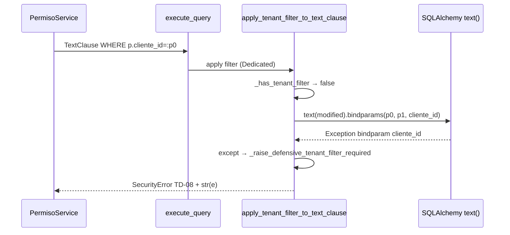

# F13-D1 — TD-08 Dedicated Query Audit — `obtener_permisos_por_rol`

**Fecha:** 2026-06-28  
**Modo:** Solo auditoría — **sin implementación, commits ni cambios de código**  
**Alcance:** Una consulta — `PermisoService.obtener_permisos_por_rol()`  
**Síntoma reproducible:** Dedicated → Administración → Roles → Permisos → `SecurityError` TD-08 + mensaje SQLAlchemy sobre `cliente_id`

---

## 1. Consulta SQL completa

**Ubicación:** `app/modules/rbac/application/services/permiso_service.py` líneas 412–422.

### SQL fuente (legacy `?`)

```sql
SELECT
    p.permiso_id, p.cliente_id, p.rol_id, p.menu_id,
    p.puede_ver, p.puede_crear, p.puede_editar, p.puede_eliminar,
    p.puede_exportar, p.puede_imprimir, p.puede_aprobar, p.permisos_extra,
    p.fecha_creacion, p.fecha_actualizacion,
    m.nombre AS menu_nombre, m.ruta AS menu_url, m.icono AS menu_icono
FROM rol_menu_permiso p
INNER JOIN modulo_menu m ON p.menu_id = m.menu_id
WHERE p.cliente_id = ? AND p.rol_id = ?
ORDER BY m.orden;
```

### SQL efectivo tras `qmark_sql_text(query, (cliente_id, rol_id))`

`qmark_sql_text` (F12-E2B3K) reemplaza `?` por nombres genéricos `:p0`, `:p1`:

```sql
SELECT
    p.permiso_id, p.cliente_id, p.rol_id, p.menu_id,
    p.puede_ver, p.puede_crear, p.puede_editar, p.puede_eliminar,
    p.puede_exportar, p.puede_imprimir, p.puede_aprobar, p.permisos_extra,
    p.fecha_creacion, p.fecha_actualizacion,
    m.nombre AS menu_nombre, m.ruta AS menu_url, m.icono AS menu_icono
FROM rol_menu_permiso p
INNER JOIN modulo_menu m ON p.menu_id = m.menu_id
WHERE p.cliente_id = :p0 AND p.rol_id = :p1
ORDER BY m.orden;
```

**Bind params:** `p0 = cliente_id`, `p1 = rol_id`.

### Invocación gateway

```python
permisos = await execute_query(
    qmark_sql_text(query, (cliente_id, rol_id)),
)
```

**Nota:** no se pasa `client_id=` ni `identity_scope=` a `execute_query`.

---

## 2. ¿La tabla `rol_menu_permiso` tiene `cliente_id`?

**Sí.**

Definición ORM (`app/infrastructure/database/tables.py`):

| Columna | Tipo | Nullable |
|---------|------|----------|
| `permiso_id` | UUID PK | NO |
| **`cliente_id`** | UUID FK → `cliente.cliente_id` | **NO** |
| `rol_id` | UUID FK | NO |
| `menu_id` | UUID FK | NO |
| `puede_*`, `permisos_extra`, `fecha_creacion` | … | … |

Constraint: `UniqueConstraint('cliente_id', 'rol_id', 'menu_id', name='UQ_rol_menu')`.

**No es tabla global:** `rol_menu_permiso` **no** está en `GLOBAL_TABLES` (`query_helpers.py`) — el gateway **debe** validar aislamiento tenant en Dedicated.

**Defecto colateral (fuera TD-08):** el SELECT incluye `p.fecha_actualizacion`, columna **ausente** en `RolMenuPermisoTable` ORM. Tras corregir TD-08 podría aparecer error SQL distinto.

---

## 3. ¿La consulta usa `execute_query()`?

**Sí.**

Ruta:

```text
PermisoService.obtener_permisos_por_rol
  → execute_query(TextClause)          # queries_async.py
  → _prepare_text_clause_for_gateway
  → apply_tenant_filter_to_text_clause  # query_helpers.py (TD-08)
  → session.execute(query)
```

Endpoint: `GET /permisos/roles/{rol_id}/permisos/` → `endpoints_permisos.py` → `PermisoService.obtener_permisos_por_rol(cliente_id=current_user.cliente_id, rol_id=rol_id)`.

---

## 4. ¿Qué intenta hacer exactamente TD-08?

**TD-08** (ADR-006 / RI-40): en tenant **Dedicated** (`TenantContext.database_type == "multi"` o `tipo_instalacion == "dedicated"`), toda query sobre tablas **no globales** debe demostrar filtro tenant antes de ejecutarse.

Mecanismo en `apply_tenant_filter_to_text_clause`:

| Paso | Acción |
|------|--------|
| 1 | Detectar Dedicated vía `_is_dedicated_tenant_context()` |
| 2 | Inferir tabla principal → `rol_menu_permiso` (FROM) |
| 3 | Si no es `GLOBAL_TABLES`, verificar filtro existente con `_has_tenant_filter()` |
| 4 | Si **no** detecta filtro → inyectar `AND cliente_id = :cliente_id` defensivamente |
| 5 | Si Dedicated y la inyección/validación falla → `SecurityError` (`DEFENSIVE_TENANT_FILTER_REQUIRED`) |

**Intención de seguridad:** evitar lecturas cross-tenant en BD Dedicated físicamente aislada cuando el SQL no declara explícitamente `cliente_id`.

En Shared el mismo fallo de detección puede pasar desapercibido (TD-08 no eleva a `SecurityError` en el `except`).

---

## 5. ¿Por qué intenta enlazar un parámetro inexistente?

### Causa raíz: falso negativo en `_has_tenant_filter`

La query **sí filtra por tenant** en SQL:

```sql
WHERE p.cliente_id = :p0 AND p.rol_id = :p1
```

Pero `_has_tenant_filter()` solo reconoce patrones literales:

```python
# query_helpers.py ~570-576
f"{tenant_column}\\s*=\\s*:cliente_id"   # cliente_id = :cliente_id
f"{tenant_column}\\s*=\\s*:client_id"
# + literales UUID
```

**No reconoce:**

| Patrón presente | ¿Detectado? |
|-----------------|:-----------:|
| `p.cliente_id = :p0` | **No** — param `:p0`, no `:cliente_id` |
| `p.cliente_id = :cliente_id` | **Sí** — substring `cliente_id = :cliente_id` |

Por tanto TD-08 asume “sin filtro” y entra al path defensivo.

### Cadena de error observada



El mensaje **`This text() construct doesn't define a bound parameter named 'cliente_id'`** es la **excepción SQLAlchemy subyacente** capturada en:

```python
except Exception as e:
    if _is_dedicated_tenant_context():
        _raise_defensive_tenant_filter_required(table_name, str(e))
```

No significa que la tabla carezca de `cliente_id`; significa que el **re-intento defensivo** de reconstruir el `TextClause` falló al mezclar params `:p0`/`:p1` con un `:cliente_id` inyectado.

---

## 6. Clasificación del problema

| Capa | ¿Culpable? | Evidencia |
|------|:----------:|-----------|
| **SQL semántico** | Parcial | Filtro tenant **correcto en intención** (`p.cliente_id = ?`); naming `:p0` incompatible con detector |
| **`permiso_service.py`** | **Principal** | Usa `qmark_sql_text` → `:p0`/`:p1`; no pasa `client_id=` a `execute_query`; diverge de `RolService` (mismo dominio) |
| **`execute_query`** | No | Comportamiento esperado: aplica filtro TextClause en gateway |
| **`query_helpers` / TD-08** | **Contribuyente** | `_has_tenant_filter` demasiado estricto; Dedicated convierte fallo bind en `SecurityError` |
| **Metadata tabla** | No | `cliente_id` existe y es NOT NULL |
| **routing** | No | Dedicated enruta a DP; el error ocurre **antes** de ejecutar SQL |
| **Otro** | — | Duplicación `PermisoService` vs `RolService.obtener_permisos_por_rol` (este último usa `:cliente_id` nombrado y funciona) |

**Veredicto:** problema **primario de servicio (SQL/param naming)** amplificado por **política TD-08 en `query_helpers`**.

---

## 7. Corrección mínima (no implementada)

### Opción A — Solo `permiso_service.py` (recomendada, menor diff)

Alinear con `RolService.obtener_permisos_por_rol` / `SELECT_PERMISOS_POR_ROL`:

1. Sustituir `qmark_sql_text(..., (cliente_id, rol_id))` por `text(...).bindparams(cliente_id=..., rol_id=...)`.
2. En el WHERE usar `:cliente_id` y `:rol_id` (p. ej. `p.cliente_id = :cliente_id`).
3. Pasar `client_id=cliente_id` a `execute_query(...)`.

Con `rmp.cliente_id = :cliente_id`, `_has_tenant_filter` detecta el filtro → TD-08 **no re-inyecta** → query ejecuta con el predicado ya presente.

**LOC estimadas:** ~5–10 en un solo archivo.

### Opción B — Solo `query_helpers.py`

Extender `_has_tenant_filter` para aceptar:

- columnas calificadas: `(\\w+\\.)?cliente_id\\s*=\\s*:\\w+`
- o predicado explícito ya presente en WHERE con alias

**Pros:** beneficia todas las TextClause legacy. **Contras:** cambio transversal; más riesgo de regresión.

### Opción C — SQLAlchemy Core

Migrar a `select(RolMenuPermisoTable)...where(...)` — TD-08 Core path usa `_select_has_explicit_tenant_predicate` (patrón ya probado en menú F11).

### No recomendado

| Acción | Motivo |
|--------|--------|
| `skip_tenant_validation=True` | Viola RI-40 |
| `identity_scope=ENGINE_SCOPED` sin revisión | Bypass filtro; solo válido si policy lo autoriza |
| Marcar `rol_menu_permiso` como global | Falso — tabla tenant-scoped |

### Referencia contrastante (mismo dominio, sin bug TD-08)

`RolService.obtener_permisos_por_rol` (`rol_service.py` ~998):

```python
resultados = await execute_query(
    text(SELECT_PERMISOS_POR_ROL).bindparams(
        rol_id=rol_id,
        cliente_id=current_client_id,
    ),
    client_id=current_client_id,
)
```

SQL canonical (`rbac_queries.py`):

```sql
WHERE rmp.rol_id = :rol_id AND rmp.cliente_id = :cliente_id
```

---

## 8. Resumen ejecutivo

| Pregunta | Respuesta |
|----------|-----------|
| 1. SQL completo | §1 — SELECT JOIN `rol_menu_permiso` + `modulo_menu`, filtro `p.cliente_id` + `p.rol_id` |
| 2. ¿Tiene `cliente_id`? | **Sí** (NOT NULL, UQ) |
| 3. ¿Usa `execute_query`? | **Sí** |
| 4. ¿Qué hace TD-08? | Exige filtro tenant detectable en Dedicated; re-inyecta si no lo ve |
| 5. ¿Por qué bind inexistente? | `_has_tenant_filter` no ve `:p0`; re-intento defensivo falla en SQLAlchemy |
| 6. ¿Dónde está el bug? | **`permiso_service` + `query_helpers`** (detector) |
| 7. Fix mínimo | **Opción A:** `:cliente_id` nombrado + `client_id=` en `execute_query` |

---

## 9. Trazabilidad

| Documento | Relación |
|-----------|----------|
| TD-08 / ADR-006 | Política fail-closed Dedicated |
| F12-E2B3K | Introducción `qmark_sql_text` → params `:p0`… |
| F11 menu TD-08 tests | Patrón Core con predicado explícito |
| `RolService.obtener_permisos_por_rol` | Implementación hermana correcta |

---

*Auditoría F13-D1 — sin implementación.*
