# F13-E1 — Auditoría de paridad RBAC Shared vs Dedicated

**Fecha:** 2026-06-28  
**Modo:** Solo auditoría — **sin implementación, commits ni cambios de código**  
**Síntoma:** Tenant Dedicated recién creado muestra **0 acciones marcadas** en Administración → Roles → Permisos; tenant Shared recién creado muestra las acciones correctamente.  
**Entorno verificado:** Docker local (`bd_caxis_saas` en host SQL Server, backend `localhost:8000`).

---

## 1. Alcance y nota sobre `rol_menu`

El alcance solicita comparar `rol`, `rol_permiso`, `rol_menu` y `rol_menu_permiso`.

**No existe tabla física `rol_menu`.** En el esquema actual, la relación rol↔menú vive únicamente en `rol_menu_permiso` (constraint `UQ_rol_menu` sobre `(cliente_id, rol_id, menu_id)`). En este informe, **«rol_menu»** se interpreta como el vínculo rol–menú materializado en `rol_menu_permiso`.

Las **«acciones marcadas»** de la UI (ver, crear, editar, eliminar, exportar, imprimir, aprobar) corresponden a las columnas `puede_*` de `rol_menu_permiso`, servidas por:

```text
GET /api/v1/permisos/roles/{rol_id}/permisos/
  → endpoints_permisos.get_permissions_for_role
  → PermisoService.obtener_permisos_por_rol(cliente_id, rol_id)
```

*(Endpoint alterno `GET /roles/{rol_id}/permisos-negocio/` opera sobre `rol_permiso` + catálogo `permiso` — no es la matriz de acciones de menú.)*

---

## 2. Tenants de referencia

| Código | Subdominio | Modo | `cliente_id` | Fecha creación (CP) |
|--------|------------|------|--------------|---------------------|
| CLI001 | acme | shared | `557928AA-05A8-468B-B746-C8C84E2EF384` | (existente) |
| CLI016 | acce | dedicated | `5176FBD6-69F0-4793-9F96-8CC6DDD347C8` | 2026-06-27 |
| CLI019 | acmee | dedicated | `8B0D7BD1-764C-4BC5-ADB4-C2D4A26195CD` | 2026-06-28 *(más reciente)* |

CLI019 confirma el comportamiento de un **Dedicated recién creado** con provisioning completo.

---

## 3. Conteos comparativos (evidencia SQL — 2026-06-28)

Consultas ejecutadas vía `get_db_connection` contra CP (`DatabaseConnection.ADMIN`) y DP (`DatabaseConnection.DEFAULT`, `client_id=` del tenant).

### 3.1 Shared — CLI001 / acme

| Store | `rol` | `rol_permiso` | `rol_menu_permiso` | `cliente_modulo` | `ADMIN_TENANT` → `rol_menu_permiso` |
|-------|------:|--------------:|-------------------:|-----------------:|------------------------------------:|
| CP/ADMIN | 3 | 143 | 30 | 3 | **18** |
| DP/DEFAULT | 3 | 143 | 30 | 3 | **18** |

Shared escribe y lee el **mismo store** (CP ≡ DP). Suma de flags `puede_*` del rol admin: **72** (18 menús × acciones activas).

### 3.2 Dedicated — CLI016 / acce y CLI019 / acmee

| Store | `rol` | `rol_permiso` | `rol_menu_permiso` | `cliente_modulo` | `ADMIN_TENANT` → `rol_menu_permiso` |
|-------|------:|--------------:|-------------------:|-----------------:|------------------------------------:|
| **CP/ADMIN** | **0** | **0** | **0** | **0** | **0** |
| **DP/DEFAULT** | **3** | **146** | **30** | **3** | **18** |

Dedicated: CP contiene solo registro de `cliente` (registry). **Todo RBAC operativo vive en DP.** Suma de flags `puede_*` del rol admin en DP: **72** — **paridad numérica con Shared**.

### 3.3 Dedicated recientes (muestra ampliada)

Todos los Dedicated activos creados en la ventana 2026-06-25…2026-06-28 con provisioning completado presentan en **DP**: `rol_menu_permiso` total = 30, admin = 18. **Ninguno** tiene filas RBAC en CP.

### 3.4 Simulación de lectura mal enrutada

```text
execute_query(..., client_id=ACCE, connection_type=ADMIN) → rol_menu_permiso ADMIN_TENANT = 0
execute_query(..., client_id=ACCE, connection_type=DEFAULT) → rol_menu_permiso ADMIN_TENANT = 18
```

**Evidencia directa:** leer tablas tenant-scoped en CP para un Dedicated devuelve **cero filas**, aunque DP esté correctamente poblado.

---

## 4. Proceso que **genera** los datos (escritura)

### 4.1 Shared

| Paso | Método responsable | Store |
|------|-------------------|-------|
| 1 | `ClienteService.crear_cliente()` → `ClienteOnboardingService.crear_cliente_con_onboarding()` | CP (`DatabaseConnection.ADMIN`, transacción única) |
| 2 | `ClienteOnboardingService._insertar_roles_base()` | CP |
| 3 | `OnboardingRbacService.bootstrap_cliente_rbac(session, …)` | CP |
| 3a | `OnboardingRbacService.activar_modulos_base_cliente()` → INSERT `cliente_modulo` | CP |
| 3b | `OnboardingRbacService.bootstrap_global_grants_admin_tenant()` → INSERT `rol_permiso` globales | CP |
| 3c | `OwnerSyncService.sync_modules_for_owner()` → por módulo: | CP |
| | `OwnerSyncService._sync_rol_permiso_module()` | CP |
| | **`OwnerSyncService._sync_rol_menu_permiso_module()`** | CP |

### 4.2 Dedicated

| Paso | Método responsable | Store |
|------|-------------------|-------|
| 1 | `ClienteService.crear_cliente()` → **`ClienteService._crear_cliente_dedicated_provisioning()`** | CP: **solo** `ClienteOnboardingService._insertar_cliente()` |
| 2 | Saga: `DedicatedProvisioningOrchestrator._step_apply_catalogs()` → **`DedicatedCatalogSeedService.run_catalog_seed()`** (S6: catálogo `modulo`, `modulo_menu`, `permiso`, …) | DP |
| 3 | Saga: `DedicatedProvisioningOrchestrator._step_seed_tenant()` → **`DedicatedTenantSeedService.run_tenant_seed()`** | DP |
| 4 | Paso `seed_tenant_rbac`: **`execute_tenant_seed_step(..., step_code="seed_tenant_rbac")`** → **`OnboardingRbacService.bootstrap_cliente_rbac(session, …)`** | DP |
| 4a–4c | Misma cadena OwnerSync que Shared (`activar_modulos_base_cliente`, `bootstrap_global_grants_admin_tenant`, **`OwnerSyncService._sync_rol_menu_permiso_module()`**) | DP |

**Insert de acciones UI (`puede_ver=1`, `puede_crear=1`, …):** exclusivamente **`OwnerSyncService._sync_rol_menu_permiso_module()`** (SELECT desde `modulo_menu` ⋈ `cliente_modulo`, INSERT idempotente en `rol_menu_permiso`).

**Verificación post-seed Dedicated:** `tenant_seed_profiles._row_expectations_for_profile()` exige mínimos en `rol` (3), `org_empresa`, `usuario`, `cfg_codigo_secuencia` — **no** valida conteos de `rol_permiso` ni `rol_menu_permiso`. El fail-closed operativo en seed RBAC lo aporta `OwnerSyncService.sync_module_for_owner()` vía `OWNER_SYNC_ZERO_GRANTS` si un módulo no produce grants.

---

## 5. Proceso que **lee** los datos (UI Roles → Permisos)

| Capa | Método responsable | Tabla principal |
|------|-------------------|-----------------|
| HTTP | `endpoints_permisos.get_permissions_for_role` | — |
| Servicio | **`PermisoService.obtener_permisos_por_rol(cliente_id, rol_id)`** | `rol_menu_permiso` ⋈ `modulo_menu` |
| Gateway | `execute_query(..., client_id=cliente_id)` | Resuelve DP en Dedicated vía metadata target |
| Validación previa | `RolService.obtener_rol_por_id(rol_id)` | `rol` — depende de ContextVar / routing |

### 5.1 Bug de lectura documentado (F13-D1) — Dedicated pre-F13-D2

Antes del fix F13-D2, `PermisoService.obtener_permisos_por_rol()` usaba `qmark_sql_text` → parámetros `:p0`/`:p1`. `_has_tenant_filter()` en `query_helpers.py` **no reconocía** `p.cliente_id = :p0` → TD-08 elevaba **`SecurityError`** en Dedicated **antes de ejecutar SQL**. Shared no fallaba con la misma severidad.

**Estado actual del código auditado:** F13-D2 aplicó `text().bindparams(cliente_id=…, rol_id=…)` + `client_id=` en `execute_query` — patrón alineado con `RolService.obtener_permisos_por_rol`.

### 5.2 Routing CP vs DP

| Escenario | Resultado Dedicated |
|-----------|---------------------|
| Lectura `rol_menu_permiso` en **DP** con `client_id` target | **18 filas** admin (acciones presentes) |
| Lectura `rol_menu_permiso` en **CP** (ADMIN hardcoded o sin metadata target) | **0 filas** |
| TD-08 + `qmark_sql_text` (pre-F13-D2) | **SecurityError** — UI sin datos |

---

## 6. Clasificación de causa raíz

| Hipótesis | Veredicto | Evidencia |
|-----------|:---------:|-----------|
| **A) Onboarding no insertó datos** | **Descartada** | DP de CLI016, CLI019 y resto de Dedicated recientes: `rol_menu_permiso`=30, admin=18, flags=72 — **paridad con Shared**. Seed RBAC invoca la misma cadena `OnboardingRbacService` + `OwnerSyncService._sync_rol_menu_permiso_module()` en sesión DP. |
| **B) Lectura incorrecta** | **Confirmada (contribuyente principal del síntoma UI)** | `PermisoService.obtener_permisos_por_rol()` pre-F13-D2: TD-08 bloqueaba ejecución (F13-D1). Retorno temprano `[]` si `RolService.obtener_rol_por_id()` no resuelve rol en el store correcto. |
| **C) Routing incorrecto** | **Confirmada (condición estructural Dedicated)** | RBAC tenant-scoped **no existe en CP** (conteos 0). Cualquier `execute_query` sobre `rol` / `rol_permiso` / `rol_menu_permiso` sin enrutar a DP devuelve vacío. Simulación ADMIN+`client_id` → 0 filas vs DEFAULT → 18. |
| **D) Combinación** | **Veredicto final** | **Arquitectura CP/DP (C)** expone datos RBAC solo en DP; **lectura UI (B)** fallaba adicionalmente por TD-08 / posible store equivocado. **No es fallo de seed (A).** |

---

## 7. Métodos responsables (referencia exacta)

### Escritura — Shared y Dedicated (misma lógica RBAC; distinto store/sesión)

| Responsabilidad | Método |
|-----------------|--------|
| Orquestación onboarding Shared | `ClienteOnboardingService.crear_cliente_con_onboarding()` |
| Orquestación provisioning Dedicated (solo cliente en CP) | `ClienteService._crear_cliente_dedicated_provisioning()` |
| Catálogo previo Dedicated (S6) | `DedicatedCatalogSeedService.run_catalog_seed()` |
| Seed tenant Dedicated (S7) | `DedicatedTenantSeedService.run_tenant_seed()` |
| Paso RBAC Dedicated | `execute_tenant_seed_step(..., step_code="seed_tenant_rbac")` |
| Bootstrap RBAC común | `OnboardingRbacService.bootstrap_cliente_rbac()` |
| Activación módulos | `OnboardingRbacService.activar_modulos_base_cliente()` |
| Grants API (`rol_permiso`) | `OwnerSyncService._sync_rol_permiso_module()` |
| **Grants UI acciones (`rol_menu_permiso`)** | **`OwnerSyncService._sync_rol_menu_permiso_module()`** |
| Orquestación por módulo | `OwnerSyncService.sync_module_for_owner()` / `OwnerSyncService.sync_modules_for_owner()` |

### Lectura — UI Roles → Permisos

| Responsabilidad | Método |
|-----------------|--------|
| Endpoint HTTP | `get_permissions_for_role` en `endpoints_permisos.py` |
| **Consulta matriz acciones** | **`PermisoService.obtener_permisos_por_rol()`** |
| Validación rol previa | `RolService.obtener_rol_por_id()` |
| Gateway / routing | `execute_query()` + `get_connection_metadata_async()` (vía `client_id`) |
| Política TD-08 | `apply_tenant_filter_to_text_clause()` / `_has_tenant_filter()` en `query_helpers.py` |

---

## 8. Diagrama causal

```mermaid
flowchart TB
    subgraph Shared["Shared (CLI001)"]
        S1["crear_cliente_con_onboarding"] --> S2["bootstrap_cliente_rbac @ CP"]
        S2 --> S3["_sync_rol_menu_permiso_module @ CP"]
        S3 --> S4["18 filas admin CP"]
        S4 --> S5["PermisoService → execute_query @ CP"]
        S5 --> S6["UI: acciones visibles"]
    end

    subgraph Dedicated["Dedicated (CLI016/CLI019)"]
        D1["_crear_cliente_dedicated_provisioning @ CP"] --> D2["solo fila cliente CP"]
        D2 --> D3["run_tenant_seed → seed_tenant_rbac @ DP"]
        D3 --> D4["_sync_rol_menu_permiso_module @ DP"]
        D4 --> D5["18 filas admin DP"]
        D5 --> D6{"Lectura UI"}
        D6 -->|"DEFAULT + client_id (post F13-D2)"| D7["18 filas → acciones OK"]
        D6 -->|"ADMIN / CP o TD-08 pre-D2"| D8["0 filas o SecurityError → UI vacía"]
    end
```



---

## 9. Resumen ejecutivo

| Pregunta | Respuesta |
|----------|-----------|
| ¿Dedicated inserta menos filas RBAC que Shared? | **No** — en DP hay paridad (`rol_menu_permiso` admin = 18, acciones = 72). |
| ¿Por qué CP Dedicated muestra 0? | **Diseño F4-08:** RBAC operativo no se replica en CP; solo registry `cliente`. |
| ¿Por qué la UI muestra 0 acciones? | **Lectura/routing (B+C):** endpoint `PermisoService.obtener_permisos_por_rol()` debe ejecutar contra **DP**; lectura en **CP** devuelve 0; pre-F13-D2 TD-08 bloqueaba Dedicated antes del SELECT. |
| ¿Es fallo de onboarding? | **No (A descartada).** |
| Clasificación | **D — Combinación:** split CP/DP **(C)** + defecto de lectura TD-08/param naming **(B)**. |

---

## 10. Trazabilidad

| Documento | Relación |
|-----------|----------|
| F13-D1 | Auditoría TD-08 en `PermisoService.obtener_permisos_por_rol` |
| F13-D2 | Fix param naming + `client_id=` (no re-auditado aquí; estado de código verificado) |
| F13-A1 / F4-08 | Dedicated: registry CP + tenant data DP |
| `tenant_seed_profiles.py` | Expectativas de filas sin `rol_menu_permiso` |

---

**Fin F13-E1 — detenerse aquí. Sin implementación. Sin commits.**
