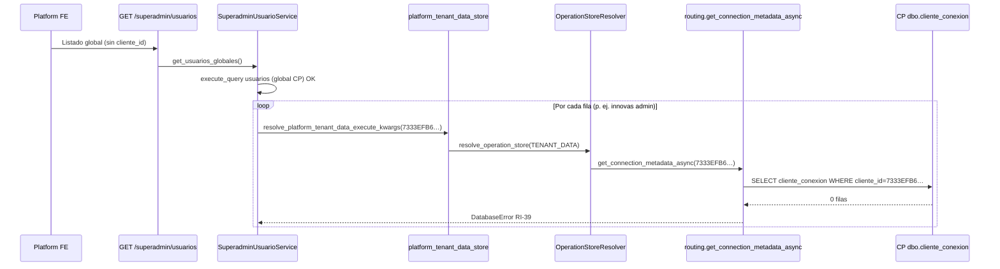

# F13-E2 — Auditoría de resolución de metadata para Platform

**Fecha:** 2026-06-28  
**Modo:** Solo auditoría — **sin implementación, commits ni cambios de código**  
**Síntoma:** Platform puede obtener un cliente Dedicated funcional (p. ej. `acmee`), pero `get_connection_metadata_async()` falla con:

> `Tenant … dedicated (RI-39): Storage Endpoint ausente o credenciales inválidas en cliente_conexion.`

**Entorno verificado:** Docker local (`fastapi_backend`, CP `bd_caxis_saas` vía `DatabaseConnection.ADMIN`).

**Referencias:** F13-C4 (`platform_tenant_data_store.py`), F13-A1 §8 (RI-39 fail-closed), `routing.py` metadata resolution.

---

## Respuestas formales (7 preguntas)

### 1. ¿A qué cliente pertenece el UUID `7333EFB6-CBCA-4559-88C9-BFB85A187A0A`?

| Campo | Valor |
|-------|-------|
| **cliente_id** | `7333EFB6-CBCA-4559-88C9-BFB85A187A0A` |
| **codigo_cliente** | `CLI006` |
| **razon_social** | INNOVAS Corporation S.A.C. |
| **subdominio** | `innovas` |
| **tipo_instalacion** | `dedicated` |
| **es_activo** | `true` |

**Evidencia SQL (CP / ADMIN):**

```sql
SELECT cliente_id, codigo_cliente, razon_social, subdominio, tipo_instalacion, es_activo
FROM dbo.cliente
WHERE cliente_id = '7333EFB6-CBCA-4559-88C9-BFB85A187A0A';
```

---

### 2. ¿Qué registro existe en `cliente_conexion` para ese cliente?

**Ninguno.** La consulta devuelve **0 filas**.

```sql
SELECT conexion_id, cliente_id, servidor, puerto, nombre_bd,
       es_conexion_principal, es_activo
FROM dbo.cliente_conexion
WHERE cliente_id = '7333EFB6-CBCA-4559-88C9-BFB85A187A0A';
-- Resultado: (vacío)
```

Consecuencia directa en routing:

- `_query_connection_metadata_from_db_async(client_id)` → `None` (sin fila principal activa).
- Fallback lee `cliente.tipo_instalacion = 'dedicated'`.
- RI-39 fail-closed → `DatabaseError` con mensaje observado.

**Reproducción Python (Docker, 2026-06-28):**

```
get_connection_metadata_async(innovas) → FAIL
  "Tenant 7333efb6-… dedicated (RI-39): metadata de conexión no disponible para Installation Mode dedicated."
  (tras intento previo: "Storage Endpoint ausente o credenciales inválidas en cliente_conexion.")
```

---

### 3. Comparación con el cliente Dedicated funcional (`acmee`)

| Aspecto | **innovas** (CLI006) | **acmee** (CLI019) |
|---------|----------------------|---------------------|
| `cliente_id` | `7333EFB6-CBCA-4559-88C9-BFB85A187A0A` | `8B0D7BD1-764C-4BC5-ADB4-C2D4A26195CD` |
| `tipo_instalacion` | `dedicated` | `dedicated` |
| Filas `cliente_conexion` | **0** | **1** |
| `servidor` | — | `host.docker.internal` |
| `puerto` | — | `1433` |
| `nombre_bd` | — | `erp_cli019` |
| `es_conexion_principal` | — | `true` |
| `es_activo` | — | `true` |
| Credenciales encriptadas | — | presentes (`has_user=1`, `has_pass=1`) |
| `get_connection_metadata_async` | **FAIL (RI-39)** | **OK** (`database_type=multi`) |
| `resolve_platform_tenant_data_execute_kwargs` | **FAIL** | **OK** (`DEFAULT` + `client_id=acmee`) |

**Registro `cliente_conexion` acmee (evidencia):**

| conexion_id | servidor | nombre_bd | es_conexion_principal | es_activo |
|-------------|----------|-----------|----------------------|-----------|
| `A0BA15F3-7B1E-4584-9D92-4B312E76B327` | `host.docker.internal` | `erp_cli019` | `true` | `true` |

**Conclusión:** `acmee` cumple el contrato RI-39 (Dedicated + Storage Endpoint completo en CP). `innovas` está marcado `dedicated` en `cliente` pero **nunca recibió** fila en `cliente_conexion` (provisioning incompleto u onboarding legacy).

---

### 4. ¿Platform intenta listar usuarios de todos los tenants y uno tiene metadata incompleta?

**Sí**, cuando `GET /api/v1/superadmin/usuarios/` se invoca **sin** query param `cliente_id`.

Flujo en `SuperadminUsuarioService.get_usuarios_globales()`:

1. **Listado principal** (`COUNT` + `SELECT usuario`): usa `kwargs_platform_global_read()` → lectura global en store compartido CP (sin resolver metadata por tenant en esta fase). **Esta fase no falla.**
2. **Por cada fila devuelta**, el servicio enriquece con:
   - `_obtener_roles_usuario(usuario_id, usuario_cliente_id)` → `resolve_platform_tenant_data_execute_kwargs(cliente_id)` (**F13-C4**)
   - `UsuarioService.get_user_level_info(...)` → `resolve_platform_tenant_data_database_type(cliente_id)` (**F13-C4**)

Si alguna fila tiene `usuario.cliente_id` apuntando a un Dedicated **sin** `cliente_conexion` (p. ej. `innovas`), la resolución de metadata del **target de esa fila** dispara RI-39 y el endpoint completo falla.

**Usuario innovas visible en listado global:**

| usuario_id | cliente_id | nombre_usuario |
|------------|------------|----------------|
| `E88B1332-24B7-4C2C-8EC2-4D06E1D6739F` | `7333EFB6-CBCA-4559-88C9-BFB85A187A0A` | `admin` |

**Dedicated activos sin `cliente_conexion` (cc_count=0) — evidencia parcial:**

| subdominio | codigo | cc_count |
|------------|--------|----------|
| acmess | CLI008 | 0 |
| acmessss | CLI010 | 0 |
| dg238629d38 | DG238629 | 0 |
| diagb914dd89 | DIAGB914DD | 0 |
| **innovas** | **CLI006** | **0** |
| prueba | CLI012 | 0 |

*(Otros Dedicated activos tienen `cc_count=1`: acce, acces, access, acmec, acmee, acmesss, acte, innovass.)*

**Con `?cliente_id=<uuid>`:** el servicio resuelve metadata del filtro **antes** del COUNT; si el filtro es `innovas`, falla de inmediato; si es `acmee`, funciona.

---

### 5. ¿El UUID corresponde al cliente impersonado o a otro?

**Corresponde a otro cliente**, salvo que la impersonación activa sea explícitamente sobre `innovas` (subdominio `innovas`, CLI006).

| Contexto típico | UUID en error | ¿Coincide con impersonación? |
|-----------------|---------------|------------------------------|
| Impersonación sobre `acmee` (`8B0D7BD1-…`) | `7333EFB6-…` (innovas) | **No** |
| Impersonación sobre `acce` (`5176FBD6-…`) | `7333EFB6-…` | **No** |
| Listado global sin filtro | Cualquier fila con Dedicated sin endpoint | **No** — error por `usuario.cliente_id` de la fila, no por JWT de impersonación |

El JWT de impersonación define el **Host** operativo ERP; `get_usuarios_globales` **no** usa Host para enriquecer roles/niveles: usa el `cliente_id` **de cada fila** (`usuario.cliente_id`). Por tanto el error puede aparecer aunque el operador esté impersonando un tenant sano (`acmee`).

---

### 6. Cadena exacta de llamadas

```text
GET /api/v1/superadmin/usuarios/
  │  (opcional: ?cliente_id=…; sin filtro → todos los clientes)
  ▼
app/modules/superadmin/presentation/endpoints_usuarios.py
  list_usuarios_global()
  ▼
SuperadminUsuarioService.get_usuarios_globales(cliente_id=None|UUID, …)
  │
  ├─ [Fase A — listado] tenant_query_kwargs =
  │     cliente_id presente → resolve_platform_tenant_data_execute_kwargs(cliente_id)
  │     sin cliente_id      → kwargs_platform_global_read()
  │   execute_query(COUNT + SELECT usuario)  → CP / global store
  │
  └─ [Fase B — por cada fila usuario_row]
        usuario_cliente_id = usuario_row['cliente_id']   ← p. ej. 7333EFB6-… (innovas)
        ▼
        SuperadminUsuarioService._obtener_roles_usuario(usuario_id, usuario_cliente_id)
          ▼
        resolve_platform_tenant_data_execute_kwargs(usuario_cliente_id)
          (app/core/tenant/platform_tenant_data_store.py — F13-C4)
          ▼
        resolve_operation_store(
            OperationDescriptor(
                target_cliente_id = usuario_cliente_id,
                operation_plane = TENANT_DATA,
            ))
          (app/core/tenant/operation_store_resolver.py)
          ▼
        get_connection_metadata_async(target_cliente_id, OPERATION_CLASS_TENANT_DATA)
          (app/core/tenant/routing.py)
          ├─ _query_connection_metadata_from_db_async()
          │     SELECT cliente_conexion ⋈ cliente
          │     WHERE cliente_id = target AND es_conexion_principal = 1 AND es_activo = 1
          │     Conexión: DatabaseConnection.ADMIN (CP)
          │     innovas → 0 filas → None
          ├─ Fallback: lee cliente.tipo_instalacion = 'dedicated'
          └─ _raise_dedicated_route_fail_closed(client_id, "Storage Endpoint ausente…")
                internal_code: DEDICATED_ROUTE_FAIL_CLOSED (RI-39)
        ▼
        DatabaseError → HTTP 500 en endpoint (o propagado vía handle_service_errors)

Paralelo en la misma iteración:
  UsuarioService.get_user_level_info(usuario_id, usuario_cliente_id)
    → resolve_platform_tenant_data_database_type(cliente_id)
    → get_installation_profile → get_connection_metadata_async (misma falla)
```

**Diagrama simplificado:**



---

### 7. Clasificación de causa

| Opción | Veredicto | Justificación |
|--------|-----------|---------------|
| **A. Bug de F13-C4** | **Descartado** | F13-C4 delega correctamente en `OperationStoreResolver` con `target_cliente_id` de la fila. Con metadata válida (`acmee`) el resolver retorna `DEFAULT` + `client_id` sin error. No hay desvío hacia Host ni ADMIN incorrecto para tenant_data. |
| **B. Metadata inconsistente** | **Confirmado (causa raíz de datos)** | `cliente.tipo_instalacion = dedicated` sin fila `cliente_conexion` en CP viola RI-39. Afecta a innovas y a otros Dedicated con `cc_count=0`. |
| **C. Datos corruptos** | **Parcial / secundario** | No hay evidencia de fila corrupta (credenciales inválidas, JSON roto); el problema es **ausencia** de registro, coherente con provisioning incompleto o tenants legacy, no corrupción de una fila existente. |
| **D. Endpoint consulta clientes incorrectos** | **Confirmado (causa de exposición en Platform)** | El listado global enriquece **cada** fila resolviendo metadata del `usuario.cliente_id`, incluyendo Dedicated sin endpoint. Un solo tenant inconsistente tumba todo el listado. |
| **E. Otro** | **Amplificador: interacción B+D post-F13-C4** | Antes de F13-C4, `_obtener_roles_usuario` ya resolvía conexión por cliente; F13-C4 **centraliza** la misma obligación RI-39 vía `OperationStoreResolver`, haciendo el fail-closed **sistemático** en todos los servicios Platform migrados. No introduce lógica errónea; **expone** tenants CP inconsistentes en flujos cross-tenant. |

### Clasificación final recomendada

**Primaria: B + D** (metadata inconsistente en CP + diseño de listado global que resuelve store por fila sin tolerancia a targets inválidos).

**Secundaria: E** — efecto amplificador post-F13-C4, no defecto del wire-up en sí.

**No es A ni C como causa principal.**

---

## Síntesis ejecutiva

1. El UUID del error es **innovas (CLI006)**, un Dedicated **sin** Storage Endpoint en `cliente_conexion`.
2. **acmee** demuestra el camino feliz: misma modalidad Dedicated, metadata CP completa, resolver OK.
3. El fallo en `GET /superadmin/usuarios` sin filtro ocurre al procesar la fila del usuario `admin` de innovas, **no** necesariamente al tenant impersonado.
4. `get_connection_metadata_async()` y RI-39 actúan **correctamente** (fail-closed); el problema es **datos CP incompletos** combinado con un **endpoint global** que asume resolvibilidad para todo `usuario.cliente_id`.

---

## Archivos revisados (trazabilidad)

| Archivo | Rol en la cadena |
|---------|------------------|
| `app/api/v1/api.py` | Montaje `prefix="/superadmin/usuarios"` |
| `app/modules/superadmin/presentation/endpoints_usuarios.py` | `list_usuarios_global` |
| `app/modules/superadmin/application/services/superadmin_usuario_service.py` | `get_usuarios_globales`, `_obtener_roles_usuario` |
| `app/modules/superadmin/application/platform_global_query_intent.py` | `kwargs_platform_global_read` |
| `app/core/tenant/platform_tenant_data_store.py` | F13-C4 wrapper |
| `app/core/tenant/operation_store_resolver.py` | `resolve_operation_store` → metadata |
| `app/core/tenant/routing.py` | `get_connection_metadata_async`, RI-39, `_query_connection_metadata_from_db_async` |
| `app/modules/users/application/services/user_service.py` | `get_user_access_level` / `get_user_level_info` |
| `app/infrastructure/database/tables.py` | Esquema `cliente_conexion` (`usuario_encriptado`, `password_encriptado`) |

---

## Restricciones de este entregable

- Sin implementación de fixes.
- Sin commits.
- Sin documentos adicionales fuera de este archivo.

**Estado:** Auditoría F13-E2 completada.
