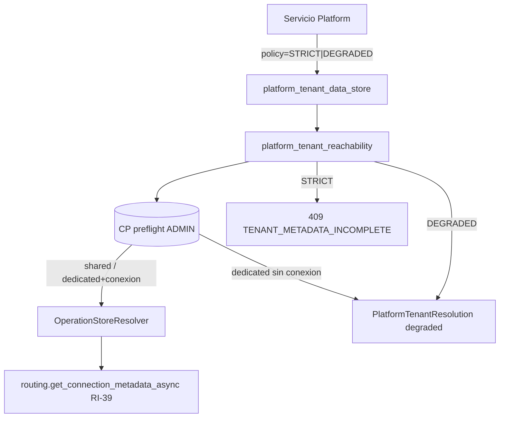

# F13-F1 — Arquitectura de tolerancia a tenants inconsistentes en Platform

**Fecha:** 2026-06-28  
**Modo:** Solo diseño arquitectónico — **sin implementación, commits ni parches**  
**Prerequisitos:** F13-E2 (síntoma y cadena), F13-C4 (wire-up Platform), F13-A1 §8–10 (RI-39, OperationStoreResolver)  
**Problema:** Tenants con `tipo_instalacion = dedicated` y **sin** fila válida en `cliente_conexion` (p. ej. `innovas` / CLI006) provocan `DEDICATED_ROUTE_FAIL_CLOSED` (RI-39) y **tumban operaciones Platform cross-tenant** que enriquecen filas con metadata del target.

---

## 1. Principio rector

| Capa | Política | Motivo |
|------|----------|--------|
| **ConnectionResolver / `routing.py`** | **Siempre fail-closed (RI-39)** | Un Dedicated no puede enrutar silenciosamente a shared ni abrir DP sin Storage Endpoint. **No se relaja.** |
| **Platform (L6)** | **Política dual: STRICT vs DEGRADED** | Platform Admin debe **ver** tenants inconsistentes en CP, pero **no** debe fallar un listado global por un solo target roto. |
| **ERP / Impersonación activa** | **Siempre fail-closed** | Entrar al tenant implica operación real sobre tenant_data; sin metadata no hay sesión segura. |

**Regla de oro:** RI-39 protege **routing físico**; F13-F1 define **proyección Platform** sobre targets no alcanzables.

---

## 2. Respuesta 1 — Endpoints Platform **fail-closed**

Operaciones donde **no** tiene sentido degradar: el operador **requiere** acceso efectivo al tenant_data store o inicia una sesión que dependerá de él.

### 2.1 Autenticación e impersonación

| Endpoint / operación | Veredicto | Comportamiento esperado |
|----------------------|:---------:|-------------------------|
| `POST /api/v1/auth/impersonate/{cliente_id}/` | **FAIL-CLOSED** | 409 `TENANT_METADATA_INCOMPLETE` — no emitir JWT de impersonación |
| Selección empresa post-impersonación (`org_empresa` en DP) | **FAIL-CLOSED** | Misma familia de error si DP inaccesible |
| Login tenant vía subdominio (IdentityGateway) | **FAIL-CLOSED** | RI-39 existente |
| `GET /auth/me`, menú RBAC en sesión impersonation activa | **FAIL-CLOSED** | Si el target era alcanzable al inicio, no aplica; si metadata se corrompe en caliente → 503/409, no menú vacío silencioso |

### 2.2 Mutaciones tenant_data

| Dominio | Ejemplos | Veredicto |
|---------|----------|:---------:|
| Usuarios Platform | crear/editar/bloquear usuario en tenant | **FAIL-CLOSED** |
| RBAC Platform | asignar roles, permisos negocio | **FAIL-CLOSED** |
| Módulos (escritura comercial CP→DP pipeline) | activar/desactivar módulo cuando requiere materialización DP | **FAIL-CLOSED** en paso DP |
| Provisioning Dedicated | saga steps, test conexión, rotación credenciales | **FAIL-CLOSED** |

### 2.3 Drill-down **mono-target** que exige DP íntegro

| Endpoint | Veredicto | Notas |
|----------|:---------:|-------|
| `GET /superadmin/usuarios/?cliente_id={id}` | **FAIL-CLOSED** *(estructurado)* | El filtro declara intención explícita sobre **ese** tenant → 409 con mensaje accionable, no HTTP 500 genérico |
| `GET /superadmin/usuarios/{usuario_id}` (detalle mono-tenant) | **FAIL-CLOSED** | Roles/niveles requieren DP |
| `GET /clientes/{id}/estadisticas/` | **FAIL-CLOSED** *(estructurado)* | Ver §4 — respuesta degradada **documentada** (200 + payload parcial) es alternativa aceptable si se adopta contrato F13-F2; por defecto normativo aquí: **409** salvo evolución OpenAPI acordada |
| Permisos / menú admin sobre rol concreto en tenant unreachable | **FAIL-CLOSED** | |

### 2.4 Criterio de clasificación fail-closed

Un endpoint es **fail-closed** si cumple **cualquiera**:

1. Emite credenciales (JWT, refresh, impersonation).
2. Escribe en tenant_data (INSERT/UPDATE/DELETE).
3. El contrato OpenAPI promete **datos completos** del tenant_data para **un único** `target_cliente_id` explícito en path o query obligatoria.
4. Un fallo silencioso induciría **decisión operativa incorrecta** (p. ej. impersonar tenant inexistente en DP).

---

## 3. Respuesta 2 — Endpoints Platform **fail-soft (DEGRADED)**

Operaciones **cross-tenant** o **enriquecimiento opcional** donde el valor principal está en CP o en identidad básica, y el DP es **complemento**.

### 3.1 Listados globales Superadmin

| Endpoint | Veredicto | Degradación |
|----------|:---------:|-------------|
| `GET /api/v1/superadmin/usuarios/` **sin** `cliente_id` | **FAIL-SOFT** | Listar filas CP/global; roles/niveles vacíos o null por fila unreachable |
| `GET /api/v1/superadmin/auditoria/…` global | **FAIL-SOFT** | Logs CP completos; enriquecimiento usuario/tenant opcional degradado |
| Búsquedas cross-tenant con paginación | **FAIL-SOFT** | Misma regla por fila |

### 3.2 Catálogo CP puro

| Endpoint | Veredicto | Degradación |
|----------|:---------:|-------------|
| `GET /api/v1/clientes/` | **FAIL-SOFT** *(anotación)* | Ya es CP-only; **añadir** indicador de reachability por fila — no omitir tenant |
| `GET /api/v1/clientes/{id}/` | **FAIL-SOFT** *(anotación)* | Registro CP completo + `tenant_data_reachability` |
| `GET /clientes/{id}/provisioning-status/` | **FAIL-SOFT** | CP; coherente con estado incompleto |
| `GET /conexiones/clientes/{id}/` | **FAIL-SOFT** | Lista vacía + estado incompleto (no 500) |

### 3.3 Dashboard compuesto (futuro / agregados)

| Recurso | Veredicto |
|---------|:---------:|
| KPI agregado N tenants (tarjetas resumen Platform home) | **FAIL-SOFT** — excluir unreachable del sumatorio, contabilizar en `skipped_tenants` |
| Drill-down tile **por tenant** desde dashboard | **FAIL-CLOSED** al abrir detalle (navegación explícita) |

### 3.4 Criterio de clasificación fail-soft

Un endpoint es **fail-soft** si:

1. Itera **≥2 targets** potenciales o **0..N** sin target obligatorio.
2. La **autoridad primaria** de la respuesta es **CP** (`cliente`, auditoría sync, registry).
3. El enriquecimiento tenant_data es **best-effort** (roles, KPIs, permisos efectivos en listado).

---

## 4. Respuesta 3 — Comportamiento por superficie cuando **un** tenant tiene metadata inválida

Escenario de referencia: listado global incluye `innovas` (Dedicated sin `cliente_conexion`) y `acmee` (Dedicated sano). El operador impersona `acmee`.

### 4.1 Listado de usuarios (`GET /superadmin/usuarios/`)

| Fase | Comportamiento |
|------|----------------|
| **Sin `cliente_id`** | **FAIL-SOFT global.** HTTP 200. Filas de tenants sanos con roles/niveles completos. Filas de tenants unreachable: identidad CP (`usuario_id`, `correo`, `cliente_id`, `cliente` embebido desde CP) + `roles: []`, `access_level: null`, `enrichment_degraded: true`, `tenant_reachability: "metadata_incomplete"`. |
| **Con `cliente_id` = unreachable** | **FAIL-CLOSED estructurado.** HTTP 409 `TENANT_METADATA_INCOMPLETE` — mensaje: «Configuración incompleta: Storage Endpoint ausente en cliente_conexion». |
| **Con `cliente_id` = reachable** | Sin cambio (comportamiento actual F13-C4). |

**No** abortar todo el listado por una fila innovas mientras se impersona acmee (F13-E2 §5).

### 4.2 Listado de clientes (`GET /clientes/`)

| Comportamiento |
|----------------|
| **FAIL-SOFT por anotación.** HTTP 200. **Todos** los clientes visibles (incl. innovas). |
| Campo nuevo recomendado en `ClienteRead` (F13-F2): `tenant_data_reachability: reachable \| metadata_incomplete \| metadata_invalid`. |
| Dedicated sin conexión → `metadata_incomplete`. UI: badge **«Configuración incompleta»**. |
| **No omitir** — Platform debe gestionar y completar provisioning. |

### 4.3 Dashboard (vista Platform)

| Vista | Comportamiento |
|-------|----------------|
| **Home / resumen multi-tenant** | FAIL-SOFT: contadores solo sobre tenants `reachable`; meta `{ skipped: 6, reasons: [...] }`. |
| **Detalle tenant seleccionado** | Si unreachable → panel CP + banner «Configuración incompleta»; KPIs DP omitidos o `null`; acciones impersonar/provisionar deshabilitadas en FE según código. |
| **Tiles por módulo/usuarios** | Misma regla que estadísticas (§4.4). |

### 4.4 Estadísticas (`GET /clientes/{id}/estadisticas/`)

| Target | Comportamiento |
|--------|----------------|
| **Reachable** | Sin cambio (F13-C4). |
| **Unreachable** | **FAIL-CLOSED estructurado** con contrato enriquecido (recomendado F13-F2): HTTP **409** *o* HTTP **200** con payload parcial CP-only: `total_conexiones: 0`, `usuarios_activos: null`, `modulos_activos: null`, `tenant_data_reachability: metadata_incomplete`, `platform_warnings: [...]`. **Preferencia normativa F13-F1:** 409 para evitar KPIs engañosos en cero; 200 degradado solo si FE ya consume warnings. |

### 4.5 Impersonación (`POST /auth/impersonate/{cliente_id}/`)

| Target | Comportamiento |
|--------|----------------|
| **Unreachable** | **FAIL-CLOSED.** HTTP 409 `TENANT_METADATA_INCOMPLETE`. Mensaje claro; **no** JWT. |
| **Reachable** | Sin cambio. |
| **Listado global concurrente** | Impersonación sobre acmee **no** debe verse afectada por existencia de innovas en CP. |

---

## 5. Respuesta 4 — Omitir, estado incompleto, warnings

### 5.1 Decisión normativa única

| Pregunta | Política F13-F1 |
|----------|-----------------|
| ¿Omitir el tenant? | **No** en listados CP (clientes, usuarios identidad). Omitir ocultaría deuda operativa. |
| ¿Estado «Configuración incompleta»? | **Sí** — campo `tenant_data_reachability = metadata_incomplete` + copy UI «Configuración incompleta». |
| ¿Warning en respuesta? | **Sí** en operaciones **fail-soft** — envelope `platform_warnings[]` a nivel respuesta; opcionalmente flags por fila. |

### 5.2 Taxonomía de reachability (canónica)

| Valor | Condición CP | Efecto Platform |
|-------|--------------|-----------------|
| `reachable` | Metadata resuelve; DP/shared accesible | Operación normal |
| `metadata_incomplete` | `tipo_instalacion = dedicated` y sin `cliente_conexion` principal activa | DEGRADED o 409 según endpoint |
| `metadata_invalid` | Fila existe pero credenciales ausentes/corruptas (RI-39 desencriptación) | Igual que incomplete; mensaje distinto para soporte |
| `provisioning_pending` | `tenant_provisioning_state` indica saga incompleta | DEGRADED; FE muestra «Aprovisionamiento en curso» |
| `not_applicable` | Shared con fallback RD-08 válido | Reachable para Platform |

### 5.3 Formato `platform_warnings` (contrato objetivo)

```json
{
  "platform_warnings": [
    {
      "code": "TENANT_METADATA_INCOMPLETE",
      "severity": "warning",
      "cliente_id": "7333EFB6-CBCA-4559-88C9-BFB85A187A0A",
      "subdominio": "innovas",
      "message": "Configuración incompleta: Storage Endpoint ausente en cliente_conexion.",
      "affected_resource": "tenant_data",
      "affected_row_count": 1
    }
  ]
}
```

- **Fail-soft:** HTTP 200 + warnings.
- **Fail-closed estructurado:** HTTP 409 + `detail` + mismo `internal_code`.
- **Nunca** HTTP 500 por RI-39 en Platform cuando la política es DEGRADED o 409 estructurado.

---

## 6. Respuesta 5 — Política única para todo Platform

### 6.1 Modelo: `PlatformTenantResolutionPolicy`

Dos modos exhaustivos — **sin** ramas ad hoc por servicio:

| Modo | Uso | Si target unreachable |
|------|-----|------------------------|
| **`STRICT`** | Impersonación, mutaciones, drill-down mono-target, cualquier emisión de credenciales | Propagar error estructurado (`TENANT_METADATA_INCOMPLETE` / `TENANT_METADATA_INVALID`) — **no** capturar en servicio |
| **`DEGRADED`** | Listados cross-tenant, enriquecimiento best-effort, anotaciones CP | Retornar `PlatformTenantResolution` sin `ExecuteQueryIntent`; servicio proyecta defaults + warnings |

### 6.2 Matriz resumen Platform → política

| Superficie | Scope | Política |
|------------|-------|----------|
| Usuarios global | Cross | **DEGRADED** |
| Usuarios filtrados por `cliente_id` | Mono | **STRICT** |
| Clientes listado/detalle | CP + anotación | **DEGRADED** (preflight CP, sin DP) |
| Estadísticas cliente | Mono | **STRICT** (409 o 200 parcial acordado) |
| Módulos activos listado Platform | Mono | **STRICT** |
| Impersonación | Mono | **STRICT** |
| Auditoría global | Cross | **DEGRADED** |
| RBAC lectura admin rol | Mono | **STRICT** |
| KPI dashboard agregado | Cross | **DEGRADED** |

### 6.3 Invariantes

1. **Ningún servicio Platform** llama `get_connection_metadata_async` directamente — solo vía capa L6.
2. **`routing.py` no conoce** STRICT/DEGRADED — RI-39 intacto.
3. **Shared** no regresa: preflight CP marca `reachable` sin fila `cliente_conexion`.
4. **Dedicated sano** idem vía metadata existente.
5. Warnings **agregados** en presentation o proyector BFF; servicios devuelven DTO con flags.

---

## 7. Respuesta 6 — Punto único de implementación

### 7.1 Ubicación normativa

**Módulo nuevo (delgado):** `app/core/tenant/platform_tenant_reachability.py`  
**Integración:** extendido desde `app/core/tenant/platform_tenant_data_store.py` (F13-C4) — **única puerta L6** para servicios Platform.

**No** duplicar `try/except` en:

- `SuperadminUsuarioService`
- `ClienteService`
- `UserService`
- `impersonation_rbac`
- etc.

### 7.2 API objetivo (diseño)

```python
# platform_tenant_reachability.py

class TenantReachabilityStatus(str, Enum):
    REACHABLE = "reachable"
    METADATA_INCOMPLETE = "metadata_incomplete"
    METADATA_INVALID = "metadata_invalid"
    PROVISIONING_PENDING = "provisioning_pending"

class PlatformResolutionPolicy(str, Enum):
    STRICT = "strict"
    DEGRADED = "degraded"

@dataclass(frozen=True)
class PlatformTenantResolution:
    cliente_id: UUID
    status: TenantReachabilityStatus
    intent: ExecuteQueryIntent | None          # None si unreachable
    profile: InstallationProfile | None
    error_code: str | None                   # p. ej. TENANT_METADATA_INCOMPLETE
    operator_message: str | None             # copy FE / 409 detail

async def assess_platform_tenant_reachability(cliente_id: UUID) -> PlatformTenantResolution:
    """Preflight CP (cliente + cliente_conexion) — evita excepción RI-39 en DEGRADED."""

async def resolve_platform_tenant(
    cliente_id: UUID,
    *,
    policy: PlatformResolutionPolicy = PlatformResolutionPolicy.STRICT,
) -> PlatformTenantResolution:
    """
    STRICT + unreachable → raise CustomException 409 (mapper único).
    DEGRADED + unreachable → resolution sin intent.
    REACHABLE → delega OperationStoreResolver (comportamiento F13-C4 actual).
    """
```

### 7.3 Flujo



### 7.4 Preflight CP (sin excepciones)

Consulta única recomendada (ADMIN):

```sql
SELECT c.tipo_instalacion,
       c.es_activo,
       (SELECT COUNT(*)
        FROM dbo.cliente_conexion cc
        WHERE cc.cliente_id = c.cliente_id
          AND cc.es_activo = 1
          AND cc.es_conexion_principal = 1) AS principal_count
FROM dbo.cliente c
WHERE c.cliente_id = :cliente_id;
```

| Resultado | Status |
|-----------|--------|
| Sin fila cliente | Propagar `NotFoundError` existente |
| `shared` / `onpremise` / `hybrid` | `reachable` → resolver |
| `dedicated` + `principal_count = 0` | `metadata_incomplete` |
| `dedicated` + `principal_count ≥ 1` | resolver; si RI-39 por credenciales → `metadata_invalid` |

**Ventaja:** DEGRADED **no invoca** RI-39; STRICT convierte el status en 409 **antes** de abrir DP.

### 7.5 Shim de compatibilidad F13-C4

Funciones actuales permanecen como alias **STRICT** (sin cambio semántico default):

| Función actual | Comportamiento post-F13-F2 |
|----------------|----------------------------|
| `resolve_platform_tenant_data_execute_kwargs(cid)` | `resolve_platform_tenant(cid, policy=STRICT).intent` |
| Nueva: `resolve_platform_tenant_data_execute_kwargs_degraded(cid)` | DEGRADED — retorna `None` + status |
| Nueva: `resolve_platform_tenant_resolution(cid, policy=…)` | API general |

Servicios cross-tenant migran a **una línea** con policy explícita; **cero** try/except local.

---

## 8. Respuesta 7 — Implementación de menor impacto arquitectónico

### 8.1 Alcance mínimo (F13-F2 propuesto)

| # | Cambio | Impacto |
|---|--------|---------|
| 1 | Crear `platform_tenant_reachability.py` (~120 LOC) | Nuevo; aislado |
| 2 | Extender `platform_tenant_data_store.py` (+policy, shims) | Punto único L6 |
| 3 | `SuperadminUsuarioService.get_usuarios_globales` — bucle enriquecimiento con `DEGRADED` | Corrige síntoma F13-E2 |
| 4 | Mapper 409 central (`TENANT_METADATA_INCOMPLETE`) en excepciones existentes | Sin nueva clase si `CustomException` basta |
| 5 | Opcional F13-F2b: campo `tenant_data_reachability` en schemas Platform | OpenAPI; FE badge |

**Sin tocar:** `routing.py`, `operation_store_resolver.py`, ERP modules, SQL, migraciones BD.

### 8.2 Compatibilidad Shared / Dedicated

| Modo | Preflight | Resolver | DEGRADED |
|------|-----------|----------|----------|
| **Shared** | `reachable` inmediato | DEFAULT + ROW_SCOPED | Enriquecimiento normal |
| **Dedicated OK** | `reachable` | DEFAULT + ENGINE_SCOPED | Normal |
| **Dedicated roto** | `metadata_incomplete` | **No llamado** | Filas degradadas / 409 STRICT |

### 8.3 Orden de rollout sugerido

1. **F13-F2a** — reachability + `SuperadminUsuarioService` global (hotfix arquitectónico).
2. **F13-F2b** — `ClienteRead.tenant_data_reachability` + warnings envelope.
3. **F13-F2c** — impersonación pre-check STRICT explícito (mensaje 409 vs error genérico org).
4. **F13-F2d** — estadísticas contrato 409/200 parcial (decisión FE).

### 8.4 Anti-patrones prohibidos

| Anti-patrón | Por qué |
|-------------|---------|
| Relajar RI-39 en `routing.py` | Dedicated enrutaría a shared silenciosamente |
| `try/except DatabaseError` en cada servicio | Duplicación; mensajes inconsistentes |
| Omitir tenants en listado CP | Oculta deuda operativa |
| Fallback KPI `0` sin flag | Indistinguible de tenant vacío sano |
| Usar `TenantContext` Host para saltar unreachable | Viola F13-A1 P4 |

### 8.5 Tests golden (Definition of Done diseño → implementación)

| Caso | STRICT | DEGRADED |
|------|--------|----------|
| Shared acme | intent OK | intent OK |
| Dedicated acmee | intent OK | intent OK |
| Dedicated innovas | 409 INCOMPLETE | status incomplete, intent None |
| Global usuarios mix | N/A | 200, warnings, fila innovas degradada |
| Impersonate innovas | 409 | N/A |

---

## 9. Relación con documentos F13

| Documento | Relación |
|-----------|----------|
| **F13-E2** | Evidencia del bug de exposición; motivación DEGRADED en listado usuarios |
| **F13-C4** | Punto de integración L6; shims STRICT preservan wire-up |
| **F13-A1 §8.3, §10.2** | RI-39 permanece en ConnectionResolver; Platform añade capa proyección |
| **F13-F2** *(futuro)* | Implementación de este diseño |

---

## 10. Restricciones de este entregable

- Sin implementación de código.
- Sin commits.
- Sin documentos adicionales fuera de este archivo.

**Estado:** Arquitectura F13-F1 completada — detenido.
