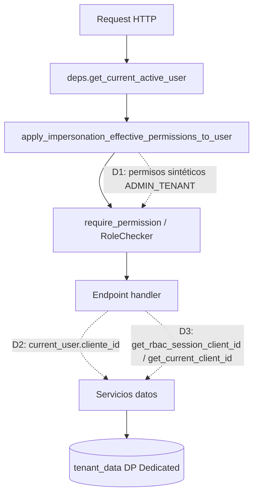

# F13-G1 — Auditoría de paridad funcional Platform Impersonation vs Tenant

**Fecha:** 2026-06-28  
**Modo:** Solo auditoría — **sin implementación, commits ni parches**  
**Alcance:** Comparar **Tenant Admin autenticado directamente** vs **Platform Admin impersonando** el **mismo cliente Dedicated** (p. ej. `acmee` / `acce`) en tres dominios UI: usuarios, roles/permisos, catálogos `cat_*`.  
**Referencias:** F13-E1 (RBAC Dedicated/Shared), F13-D1/D2 (TD-08 `rol_menu_permiso`), F13-C4 (store routing), F13-E2 (Platform global vs tenant), docs FE `docs/frontend/org/etapa-a/INTEGRACION_ETAPA_A.md`.

---

## 0. Premisas de la auditoría

| Premisa | Detalle |
|---------|---------|
| **Flujo Tenant** | Login directo del administrador del tenant (JWT `user_type=tenant_admin`, `sub`=usuario tenant, `cliente_id`=target, `empresa_id` tras selección). |
| **Flujo Platform impersonando** | `POST /api/v1/auth/impersonate/{cliente_id}/` → JWT con `is_impersonation=true`, `cliente_id`=target, `user_type=tenant_admin` efectivo, `sub`=operador platform (`SUPERADMIN_USERNAME`). UI tenant servida **en host del tenant** (subdominio destino). |
| **Flujo Platform sin impersonar** | Consola Platform usa rutas **`/superadmin/*`** y **`/catalogos-globales/*`** — **fuera de paridad** con Tenant Admin; se menciona solo como fuente de confusión FE. |
| **Paridad esperada** | Mismos endpoints tenant + mismos datos observables cuando el `cliente_id` operativo y el store resuelto son idénticos. |

---

## Caso 1 — Gestión de usuarios

### 1.1 Listado

| Pregunta | Tenant Admin | Platform impersonando |
|----------|--------------|------------------------|
| **1. Endpoint Tenant** | `GET /api/v1/usuarios/` | — |
| **2. Endpoint Platform impersonando** | — | `GET /api/v1/usuarios/` *(misma ruta tenant; no `/superadmin/usuarios/`)* |
| **3. ¿Exactamente los mismos?** | **Sí** (ruta, método, query params, schema `PaginatedUsuarioResponse`) |
| **4. Servicios backend** | `endpoints.list_usuarios` → `UsuarioService.get_usuarios_paginated(cliente_id=current_user.cliente_id, …)` → `resolve_platform_tenant_data_database_type` + `execute_query` (DP si Dedicated) | **Idéntica cadena** |
| **5. ¿Dónde diverge?** | Tras `get_current_active_user` en `app/api/deps.py` | Ver §1.4 |
| **6. Clasificación** | **Servicio / autorización** (permisos efectivos); posible **routing** si `current_user.cliente_id` ≠ tenant JWT | |
| **7. Primer punto exacto de divergencia** | `app/api/deps.py` → `apply_impersonation_effective_permissions_to_user()` (ContextVar permisos impersonados) **antes** de entrar al handler | |

**Notas:**

- Listado usa `current_user.cliente_id`, **no** `get_rbac_session_client_id` / `require_session_cliente_id`.
- En Dedicated, `get_usuarios_paginated` omite filtro SQL `cliente_id` cuando `database_type=multi` (ENGINE_SCOPED) — igual para ambos flujos si el `cliente_id` de routing es el target.
- **`GET /superadmin/usuarios/`** (Platform sin impersonar) es otro contrato (`UsuarioSuperadminRead`, store CP global + enriquecimiento por fila) — **no comparable** con Tenant Admin.

### 1.2 Edición

| Pregunta | Tenant Admin | Platform impersonando |
|----------|--------------|------------------------|
| **1. Endpoint** | `PUT /api/v1/usuarios/{usuario_id}/` | `PUT /api/v1/usuarios/{usuario_id}/` |
| **3. ¿Mismos?** | **Sí** |
| **4. Servicios** | `UsuarioService.actualizar_usuario(cliente_id=current_user.cliente_id, …)` | **Idem** |
| **5. Divergencia** | Autorización vía `require_permission` + identidad operador distinta en auditoría | |
| **6. Clasificación** | **Servicio (autorización)** | |
| **7. Primer punto** | `deps.py` → `apply_impersonation_effective_permissions_to_user` | |

### 1.3 Perfiles asignados (roles del usuario)

| Pregunta | Tenant Admin | Platform impersonando |
|----------|--------------|------------------------|
| **1. Endpoints Tenant** | `GET /api/v1/usuarios/{usuario_id}/roles/` · `POST /api/v1/usuarios/{usuario_id}/roles/{rol_id}/` · `DELETE …/roles/{rol_id}/` | — |
| **2. Platform impersonando** | — | **Mismos tres endpoints** |
| **3. ¿Mismos?** | **Sí** (rutas) |
| **4. Servicios** | `resolve_role_list_scope` → `UsuarioService.obtener_roles_de_usuario` / `asignar_rol_a_usuario` / `revocar_rol_de_usuario` con filtro `empresa_id` según scope | **Idem** |
| **5. Divergencia** | Scope de listado/asignación; identidad del actor | Ver abajo |
| **6. Clasificación** | **Servicio** (`company_scope`) + **autorización** | |
| **7. Primer punto** | `company_scope.is_platform_operator()` retorna **`False` cuando `payload.is_impersonation`** → `resolve_role_list_scope` **no** entra en rama `tenant_wide=True` (L206–207 `company_scope.py`) | |

**Divergencia de scope (perfiles visibles):**

| Condición | Tenant Admin ERP | Platform impersonando |
|-----------|------------------|------------------------|
| `empresa_id` en JWT | Obligatorio tras selección | Igual tras selección empresa post-impersonación |
| `resolve_role_list_scope` | `tenant_wide=False`, filtra `usuario_rol.empresa_id` | **Mismo** (impersonación **no** es `platform_operator`) |
| Sin `empresa_id` | `403 MISSING_SESSION_EMPRESA` | **Mismo** |

Si impersonación ocurre **antes** de seleccionar empresa, ambos flujos fallan igual en endpoints que exigen scope empresa; no es divergencia Tenant vs Platform, sino sesión incompleta.

**Divergencia adicional (actor):** JWT `sub` = operador platform; Tenant Admin `sub` = usuario tenant real → distinto `usuario_id` en auditoría, mismo efecto RBAC si permisos impersonados cubren la acción.

---

## Caso 2 — Roles y permisos

### 2.1 Listado de roles

| Pregunta | Tenant Admin | Platform impersonando |
|----------|--------------|------------------------|
| **1. Endpoint Tenant** | `GET /api/v1/roles/` (paginado) · `GET /api/v1/roles/all-active/` | — |
| **2. Platform impersonando** | — | **Mismos** |
| **3. ¿Mismos?** | **Sí** |
| **4. Servicios** | `get_rbac_session_client_id` → `require_session_cliente_id` (JWT impersonado) → `RolService.obtener_roles_paginados(cliente_id=session_client_id)` | **Idem** |
| **5. Divergencia** | Mínima si JWT `cliente_id` = target | Autorización impersonada |
| **6. Clasificación** | **Servicio (autorización)** en gate; datos **alineados** si session scope correcto | |
| **7. Primer punto (autorización)** | `deps.py` → `apply_impersonation_effective_permissions_to_user` | |

**Observación positiva:** roles listados usan **`get_rbac_session_client_id`** (`rbac_deps.py`), patrón correcto para impersonación (prioriza JWT tenant, no fila SYSTEM del operador).

### 2.2 Permisos marcados (matriz menú — acciones UI)

| Pregunta | Tenant Admin | Platform impersonando |
|----------|--------------|------------------------|
| **1. Endpoint canónico UI** | `GET /api/v1/permisos/roles/{rol_id}/permisos/` | — |
| **2. Platform impersonando** | — | **Mismo** *(evidencia F13-E1, F13-D2)* |
| **3. ¿Mismos?** | **Sí** (ruta); **no** garantizado mismo `cliente_id` interno vs mutaciones |
| **4. Servicios** | `PermisoService.obtener_permisos_por_rol(cliente_id=current_user.cliente_id, rol_id)` → SQL `rol_menu_permiso` ⋈ `modulo_menu` con `client_id=cliente_id` | **Idem** |
| **5. Divergencia** | Lectura usa `current_user.cliente_id`; escritura (`PUT …/menus/{menu_id}/`) usa `get_current_client_id()` | Inconsistencia **presentation** |
| **6. Clasificación** | **Routing / presentation** (fuente de `cliente_id`); históricamente **consulta SQL + TD-08** (F13-D1, corregido F13-D2); **datos** si store mal resuelto (F13-E1) | |
| **7. Primer punto exacto (datos)** | `endpoints_permisos.py` **L198**: `cliente_id=current_user.cliente_id` — **no** `require_session_cliente_id` ni `get_current_client_id()` | |

**Endpoint alterno (no usado por UI de acciones marcadas):**

| Endpoint | Servicio | Resolución `cliente_id` |
|----------|----------|-------------------------|
| `GET /api/v1/roles/{rol_id}/permisos/` | `RolService.obtener_permisos_por_rol` | `get_current_client_id()` ✓ |

→ **Dos rutas backend distintas** para “permisos de rol”; la UI oficial (F13-E1) usa la que depende de `current_user.cliente_id`.

**Origen de datos (Dedicated sano, post F13-D2):**

| Tabla | Store |
|-------|-------|
| `rol_menu_permiso` | tenant_data → **DP** (`execute_query` + `client_id=target`) |
| `modulo_menu` | mismo store en JOIN |
| Conteo UI | Derivado en FE de filas `puede_*` del GET anterior |

**Síntoma histórico “0 acciones” (F13-E1):** no era impersonación vs tenant, sino **lectura Dedicated en store incorrecto** + TD-08; con cliente_id correcto y F13-D2, Tenant e impersonación deberían coincidir.

### 2.3 Conteo de permisos

| Pregunta | Respuesta |
|----------|-----------|
| **Endpoint** | No hay endpoint de conteo dedicado; FE cuenta items/flags del `GET /permisos/roles/{rol_id}/permisos/` |
| **Paridad** | Hereda paridad del §2.2 |
| **Divergencia** | Misma que §2.2 |
| **Clasificación** | **Frontend (contrato derivado)** + **presentation** |
| **Primer punto** | `endpoints_permisos.py` L198 |

**Catálogo permisos negocio (pantalla auxiliar):**

| Endpoint | `cliente_id` usado |
|----------|-------------------|
| `GET /api/v1/permisos-catalogo/` | `current_user.cliente_id` |
| `GET /api/v1/roles/{rol_id}/permisos-negocio/` | `current_user.cliente_id` |

Servicio: `permisos_negocio_service` + `resolve_platform_tenant_data_execute_kwargs` / `resolve_permission_catalog_target` (F13-C3).

### 2.4 Origen de datos — resumen

| Capa | Tenant Admin | Platform impersonando | ¿Idéntico? |
|------|--------------|------------------------|:----------:|
| **Gate HTTP** (`require_permission`) | `permisos_usuario_service` / `usuario_rol` | `impersonation_rbac` → `ADMIN_TENANT` `rol_permiso` sintético | **No** |
| **Listado roles** | DP vía `session_client_id` | DP vía JWT impersonado | **Sí** |
| **Matriz menú** | DP `rol_menu_permiso` | DP si `current_user.cliente_id`=target | **Condicional** |
| **Permisos negocio** | DP `rol_permiso` + catálogo | Idem | **Condicional** |

**Clasificación global Caso 2:** combinación **servicio (autorización impersonada)** + **presentation (cliente_id inconsistente)** + **datos/routing** si Dedicated lee store erróneo.

**Primer punto global del request (autorización):** `deps.py` L325–336 `apply_impersonation_effective_permissions_to_user`.  
**Primer punto en lectura de permisos marcados (datos):** `endpoints_permisos.py` L198.

---

## Caso 3 — Catálogos `cat_*` (moneda, país, departamento, provincia, distrito)

### 3.1 Lectura tenant (ERP)

| Recurso | Endpoint Tenant |
|---------|-----------------|
| Moneda | `GET /api/v1/catalogos/monedas` |
| País | `GET /api/v1/catalogos/paises` |
| Departamento | `GET /api/v1/catalogos/departamentos` |
| Provincia | `GET /api/v1/catalogos/provincias` |
| Distrito | `GET /api/v1/catalogos/distritos` |

**Montaje:** `api.py` → `prefix="/catalogos"`.

### 3.2 Platform impersonando

| Pregunta | Respuesta |
|----------|-----------|
| **Endpoints** | **Los mismos** `/api/v1/catalogos/*` cuando la UI tenant se usa bajo JWT impersonado |
| **¿Mismos que Tenant?** | **Sí** (ruta y schema `*Read`) |
| **Servicios** | `CatalogosService.list_*` → `execute_query(..., client_id=current_user.cliente_id)` |
| **Store Dedicated** | Tablas en `GLOBAL_TABLES` (`query_helpers.py`) — sin filtro fila `cliente_id`, pero **conexión física** resuelta por metadata del `client_id` pasado → **DP del tenant** |
| **Divergencia** | `client_id=current_user.cliente_id` en presentation — **no** `require_session_cliente_id` |
| **Clasificación** | **Presentation / routing** |
| **Primer punto** | `catalogos/presentation/endpoints.py` L25, L33, L43, L56, L70 — `client_id=current_user.cliente_id` |

### 3.3 Platform **sin** impersonar (consola Platform)

| Recurso | Endpoint | ¿Mismo? |
|---------|----------|:-------:|
| Moneda | `GET /api/v1/catalogos-globales/monedas?cliente_id=…` | **No** |
| País | `GET /api/v1/catalogos-globales/paises?…` | **No** |
| … | … | **No** |

**Servicios:** `CatalogosGlobalesService` (CRUD, paginación `PaginatedCat*Response`, `@require_super_admin()`).

**Clasificación:** **Frontend (contrato distinto)** si Platform Admin administra catálogos **sin** impersonar y consume `/catalogos-globales/*`.

### 3.4 Paridad impersonando vs Tenant — tabla consolidada

| # | Pregunta | Tenant | Platform impersonando |
|---|----------|--------|------------------------|
| 1 | Endpoint Tenant | `/catalogos/{recurso}` | — |
| 2 | Endpoint Platform | — | `/catalogos/{recurso}` |
| 3 | ¿Mismos? | **Sí** (impersonación en UI tenant) |
| 4 | Servicios | `CatalogosService` | **Idem** |
| 5 | Divergencia | Si `current_user.cliente_id` ≠ tenant JWT → conexión a **otro** engine (p. ej. shared/SYSTEM) → listas vacías o datos ajenos | |
| 6 | Clasificación | **Routing / presentation**; **onboarding** si `cat_*` no provisionados en DP | |
| 7 | Primer punto | `catalogos/presentation/endpoints.py` — binding `current_user.cliente_id` | |

---

## 4. Mapa de divergencias transversales



| ID | Punto | Afecta | Clasificación |
|----|-------|--------|---------------|
| **D1** | `deps.py` → impersonation RBAC ContextVar | Todos los casos (gate) | **Servicio / autorización** |
| **D2** | Endpoints que usan `current_user.cliente_id` sin `require_session_cliente_id` | Usuarios listado, permisos GET, catálogos, permisos-catalogo | **Presentation / routing** |
| **D3** | Endpoints que usan `get_rbac_session_client_id` o `get_current_client_id()` | Roles listado; permisos PUT | Paridad **mejor** bajo impersonación |
| **D4** | `company_scope.is_platform_operator` + `is_impersonation` | Perfiles/roles por empresa | **Servicio** (comportamiento intencional: impersonación = tenant_admin, no platform_operator) |
| **D5** | Platform sin impersonar → `/superadmin/*`, `/catalogos-globales/*` | Toda gestión desde consola Platform | **Frontend (contrato distinto)** |

---

## 5. Respuestas ejecutivas por dominio

### 5.1 ¿Por qué no es “exactamente el mismo comportamiento”?

| Dominio | Causa principal | ¿Es bug de impersonación o diseño? |
|---------|-----------------|-------------------------------------|
| **Usuarios** | Permisos HTTP evaluados contra **`ADMIN_TENANT` sintético**, no contra `usuario_rol` del admin tenant | **Diseño** (impersonation_rbac); datos iguales si `cliente_id` routing correcto |
| **Roles listado** | Patrón session scope **correcto** | Paridad **alta** |
| **Permisos marcados** | **`current_user.cliente_id`** en GET vs **`get_current_client_id()`** en PUT; riesgo store Dedicated | **Presentation + routing** (F13-E1/D2 ya documentan síntoma 0 acciones) |
| **Catálogos** | Mismo endpoint, mismo riesgo **`current_user.cliente_id`**; Platform sin impersonar usa **API distinta** | **Presentation / FE** |

### 5.2 Primer punto exacto global (toda petición impersonada)

```text
app/api/deps.py
  get_current_active_user()
    → apply_impersonation_effective_permissions_to_user()
        → get_effective_impersonation_permissions(cliente_id)
            → impersonation_rbac (ADMIN_TENANT rol_permiso, no usuario_rol del operador)
```

A partir de aquí, **`require_permission`** deja de ser idéntico al Tenant Admin autenticado con su propio `usuario_rol`.

### 5.3 Primer punto exacto en lectura de datos (permisos marcados y catálogos)

```text
Presentation pasa current_user.cliente_id
  ≠ require_session_cliente_id(JWT impersonado) usado en roles
```

Archivos:

- `app/modules/rbac/presentation/endpoints_permisos.py` L197–199  
- `app/modules/catalogos/presentation/endpoints.py` L25–70  
- `app/modules/rbac/presentation/endpoints_permisos_catalogo.py` L44  

Contraste con patrón correcto ya aplicado en:

- `app/modules/rbac/presentation/rbac_deps.py` → `get_rbac_session_client_id`  
- `endpoints_permisos.py` L122–135 (solo **PUT** permisos menú)

---

## 6. Matriz de clasificación (pregunta 6)

| Caso | Subcaso | routing | servicio | SQL | onboarding | datos | frontend | otro |
|------|---------|:-------:|:--------:|:---:|:----------:|:-----:|:--------:|:----:|
| 1 Usuarios | Listado | ○ | ● | ○ | ○ | ○ | ○ | auth deps ● |
| 1 Usuarios | Edición | ○ | ● | ○ | ○ | ○ | ○ | auth deps ● |
| 1 Usuarios | Perfiles/roles | ○ | ● | ○ | ○ | ○ | ○ | scope ● |
| 2 Roles | Listado | ○ | ○ | ○ | ○ | ○ | ○ | — |
| 2 Permisos | Marcados / conteo | ● | ○ | ●† | ○ | ● | ● | dual endpoint ○ |
| 2 Permisos | Origen | ● | ● | ○ | ○ | ● | ○ | — |
| 3 cat_* | Lectura impersonando | ● | ○ | ○ | ● | ● | ○ | — |
| 3 cat_* | Platform sin impersonar | ● | ○ | ○ | ● | ● | ● | API distinta |

† TD-08 corregido F13-D2; clasificación histórica **SQL**, no diferencial Tenant vs impersonación.

---

## 7. Conclusión de paridad

| Escenario | Veredicto |
|-----------|-----------|
| **Mismos endpoints tenant bajo impersonación** | **Sí** para los tres dominios auditados (no `/superadmin/*`). |
| **Misma cadena de servicios de datos** | **Casi** — diverge la **capa de autorización** y la **resolución de `cliente_id` en presentation** en permisos GET y catálogos. |
| **Mismos datos observables (Dedicated provisionado)** | **Condicional** — requiere `current_user.cliente_id` = tenant JWT target; roles ya usan session scope explícito. |
| **Causa raíz de no-paridad funcional** | **No** es un segundo stack ERP; es **impersonation RBAC sintético (D1)** + **inconsistencia `current_user.cliente_id` vs session tenant (D2)** + **FE Platform sin impersonar (D5)**. |

---

## 8. Archivos revisados (trazabilidad)

| Archivo | Relevancia |
|---------|------------|
| `app/modules/users/presentation/endpoints.py` | Usuarios CRUD + roles usuario |
| `app/modules/users/application/services/user_service.py` | Paginación Dedicated, roles |
| `app/modules/rbac/presentation/endpoints.py` | Roles paginados |
| `app/modules/rbac/presentation/endpoints_permisos.py` | Permisos menú (GET/PUT) |
| `app/modules/rbac/presentation/rbac_deps.py` | `get_rbac_session_client_id` |
| `app/modules/rbac/application/services/permiso_service.py` | `rol_menu_permiso` |
| `app/modules/catalogos/presentation/endpoints.py` | `cat_*` tenant |
| `app/modules/superadmin/presentation/endpoints_usuarios.py` | Platform global (no impersonación) |
| `app/modules/superadmin/presentation/endpoints_catalogos_globales.py` | Platform cat CRUD |
| `app/api/deps.py` | Impersonation RBAC injection |
| `app/core/auth/impersonation_rbac.py` | Permisos efectivos ADMIN_TENANT |
| `app/core/tenant/company_scope.py` | `is_platform_operator`, `resolve_role_list_scope` |
| `app/core/tenant/session_scope.py` | `require_session_cliente_id` |
| `app/docs/arquitectura/F13_E1_RBAC_SHARED_DEDICATED_PARITY_AUDIT.md` | Origen datos RBAC Dedicated |

---

## 9. Restricciones de este entregable

- Sin propuestas de solución.
- Sin implementación.
- Sin commits.
- Sin documentos adicionales fuera de este archivo.

**Estado:** Auditoría F13-G1 completada — detenido.
