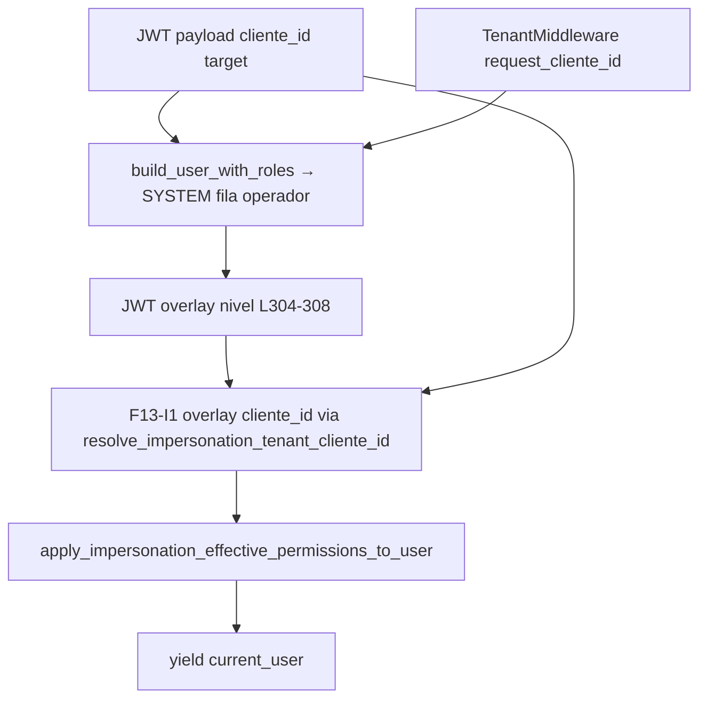

# F13-I1 — Decisión arquitectónica: overlay de `current_user.cliente_id` en impersonación

**Fecha:** 2026-06-25  
**Estado:** **DECIDIDO** — decisión única, no alternativas.  
**Prerequisitos:** F13-A1 … F13-H2 (causa raíz demostrada; no re-auditada aquí).  
**Restricciones de este entregable:** sin implementación, sin cambios de código, sin commits.

---

## Problema (1 línea)

En impersonación @ host platform, `current_user.cliente_id` queda en **SYSTEM** (fila operador) mientras el JWT lleva el tenant target; los endpoints IAM que bindan `current_user.cliente_id` leen el store incorrecto (F13-H1, F13-H2).

---

## Decisión única

| Dimensión | Decisión |
|-----------|----------|
| **Punto de overlay** | **`get_current_active_user()` en `app/api/deps.py`**, inmediatamente **después** de `build_user_with_roles` y del bloque que aplica claims JWT de nivel (`access_level`, `user_type`, `is_super_admin`, ~L304–308), e **inmediatamente antes** de `apply_impersonation_effective_permissions_to_user` (~L325). |
| **Función reutilizada** | `resolve_impersonation_tenant_cliente_id(payload, user_cliente_id=…, request_cliente_id=…)` — misma prioridad que session scope y RBAC impersonado (`impersonation_rbac.py` L50–82); **no** nuevo algoritmo. |
| **Guarda** | Solo si `is_impersonation_effective_tenant_session(payload)` es verdadero (`effective_scope=tenant`). |
| **Forma de implementación (futura)** | **Opción A — modificar `current_user.cliente_id`** en el objeto `UsuarioReadWithRoles` ya construido. **No** campo adicional. **No** otro mecanismo. |

---

## 1. ¿Cuál es el punto recomendado?

**`get_current_active_user()` en `deps.py`** (ítems 2 y 3 de la lista de candidatos — mismo sitio).

Ubicación normativa en la cadena:

```
build_user_with_roles(...)     → identidad desde fila BD (SYSTEM operador)
JWT overlay nivel (L304–308) → ya existe
► OVERLAY cliente_id ◄         → DECISIÓN F13-I1 (nuevo, aquí)
apply_impersonation_effective_permissions_to_user(...)
yield usuario_completo
```

---

## 2. ¿Por qué ese punto tiene menor impacto?

| Criterio | `deps.py` (`get_current_active_user`) | Descartados |
|----------|----------------------------------------|-------------|
| **Superficie de cambio** | Un único gateway ya usado por casi todos los endpoints vía `Depends(get_current_active_user)` | `build_user_with_roles`: acoplaría JWT al builder de identidad BD; `user_context`: objeto distinto (`CurrentUserContext`), no es el que consumen handlers |
| **Precedente en código** | Mismo archivo ya sobrescribe claims JWT sobre el objeto construido (L304–308) y ya concentra lógica impersonación (L325–336) | Duplicar overlay en `user_builder` + `user_context` = dos puntos |
| **Reutilización** | Invoca resolver **existente** alineado a ORG/session scope | Nuevo campo `effective_cliente_id` obligaría migrar decenas de handlers + schema OpenAPI |
| **Alcance del guard** | Solo requests con JWT impersonación tenant; cero ejecución en platform normal o tenant admin | Migración masiva de presentation a `require_session_cliente_id` (opción “otro punto”) = impacto módulo a módulo |
| **Caller único productivo** | `build_user_with_roles` solo es invocado desde `deps.py` en runtime productivo (grep codebase) | Mover overlay al builder igualmente centraliza en deps si solo hay un caller, pero mezcla capas L6 identidad BD + claims JWT |

**Conclusión:** el menor impacto es **un overlay post-build en el único compositor HTTP de `current_user`**, reutilizando el resolver ya canonizado para impersonación.

---

## 3. ¿Qué contratos existentes NO se rompen?

| Contrato | Motivo |
|----------|--------|
| **Platform normal** | Guard `is_impersonation_effective_tenant_session` falso → sin overlay → `current_user.cliente_id` sigue SYSTEM. |
| **Tenant Admin** | Sin claim `is_impersonation`; fila usuario ya coincide con JWT → overlay no altera valor. |
| **Shared (login directo)** | Idem tenant admin. |
| **Dedicated (login directo)** | Idem; `_resolve_cliente_id` ya devuelve tenant de fila/contexto. |
| **JWT** | Sin cambio de emisión ni claims; solo lectura posterior en deps. |
| **Session Scope** | `require_session_cliente_id` / `resolve_session_cliente_id` siguen con prioridad JWT impersonación independiente; ORG/INV/RBAC deps no dependen de que `current_user.cliente_id` sea SYSTEM. |
| **OperationStoreResolver** | No participa en construcción de `current_user`; routing sigue keyed por `client_id` pasado a `execute_query` — tras overlay, endpoints IAM alineados al target OSR esperado. |
| **RBAC (require_permission)** | Sigue usando ContextVar / permisos efectivos impersonados; `apply_impersonation_effective_permissions_to_user` permanece después del overlay. |
| **Menús** | `resolve_menu_cliente_id_for_session` ya prioriza JWT impersonación; comportamiento estable o convergente si algún path leyera `current_user.cliente_id`. |

**Identidad de operador para auditoría:** `usuario_id`, `sub`, `impersonated_by`, `impersonated_by_username` en JWT **no** se modifican; solo el campo de tenant de datos en el DTO de sesión.

---

## 4. ¿Qué contratos sí cambiarían?

| Contrato | Cambio |
|----------|--------|
| **Semántica de `current_user.cliente_id` en impersonación** | De “fila operador (SYSTEM)” a “tenant impersonado (JWT target)” para todo consumidor de `Depends(get_current_active_user)`. |
| **`ERP_BACKEND_STANDARDS_V4.md` §3.7 (redacción actual)** | El párrafo que documenta que `current_user.cliente_id` **puede** quedar en SYSTEM durante impersonación pasa a ser **histórico**; post F13-I1 implementado, el DTO refleja tenant JWT en impersonación tenant-effective. La regla ERP “datos vía `require_session_cliente_id`” **permanece** como norma para módulos operativos. |
| **`impersonation_rbac.py` docstring L59–61** | Texto “no `current_user.cliente_id` (operador SYSTEM)” queda obsoleto para permisos/menú tras overlay; implementación futura puede simplificar paso explícito si `user.cliente_id` ya es target. |
| **Observabilidad / logs DEBUG** | Mensajes que imprimen `current_user.cliente_id` en impersonación mostrarán tenant target, no SYSTEM. |
| **Tests que aseran `current_user.cliente_id == SYSTEM` bajo impersonación** | Deben actualizarse a tenant JWT o a inspeccionar `payload` / `impersonated_by`. |

**Alcance explícito fuera de esta decisión:** Imp-A (host tenant, operador ausente en DP) **no** se corrige con overlay; sigue siendo fallo de auth previo al endpoint (F13-H1).

---

## 5. ¿Cuáles son los riesgos?

| Riesgo | Severidad | Nota |
|--------|-----------|------|
| **Regresión de confusión identidad vs datos ERP** | Media | Desarrolladores nuevos podrían usar `current_user.cliente_id` en módulos ERP pese a §3.7; mitigación documental + lint/review, no relajación del estándar ERP. |
| **Orden deps incorrecto** | Alta si mal implementado | Overlay debe ir **antes** de `apply_impersonation_effective_permissions_to_user` y **después** de build; permisos en build con SYSTEM se reemplazan en apply (comportamiento actual). |
| **Divergencia overlay vs session_scope** | Media | Bug en guard o payload → dos `cliente_id` distintos; pruebas de paridad obligatorias (§6). |
| **Falsa sensación de paridad en Imp-A** | Baja | Host acmee + impersonación sigue sin `build_user_with_roles` si operador no está en DP. |
| **Auditoría cross-tenant (`AuditService.registrar_tenant_access`)** | Baja | Usa `CurrentUserContext` previo a build (L253–262), no el objeto final yield; overlay no altera ese registro. |

---

## 6. ¿Cuáles serían las pruebas obligatorias posteriores?

1. **Paridad F13-H1 (Imp-B @ platform host):** EP1 permisos = 18, EP2 monedas coherente con DP target, EP3 roles usuario ≥ 1 — tenant acmee Dedicated provisionado.
2. **Platform sin impersonación:** `current_user.cliente_id == SUPERADMIN_CLIENTE_ID`; endpoints superadmin sin regresión.
3. **Tenant Admin Dedicated + Shared:** sin impersonación; `current_user.cliente_id` = tenant; EP1–EP3 baseline intacto.
4. **Session scope independiente:** `require_session_cliente_id` / `get_rbac_session_client_id` retornan JWT target con `source=jwt_impersonation` — igual con o sin overlay (no regresión ORG/INV).
5. **RBAC impersonado:** menú `/auth/menu` no vacío; `require_permission` en acciones ADMIN_TENANT del target.
6. **OperationStoreResolver / Dedicated routing:** servicios IAM con `client_id` derivado de `current_user` tras overlay resuelven `erp_cliNNN`, no `bd_caxis_saas`.
7. **JWT / impersonación lifecycle:** iniciar, seleccionar empresa, finalizar impersonación; claims `impersonated_by` intactos en auditoría.
8. **Regresión unitaria:** guard no activa sin `is_impersonation`; no activa con `effective_scope` ≠ tenant.

---

## 7. ¿La implementación debe ser A, B o C?

**Opción A — modificar `current_user.cliente_id`** (única autorizada).

**Rationale definitiva:**

- Los consumidores afectados (IAM: usuarios, permisos, catálogos, permisos-catalogo — F13-G1, F13-E1) **ya** leen `current_user.cliente_id`; overlay in-place corrige el síntoma en el gateway sin tocar N endpoints.
- **Opción B** (`effective_cliente_id`) duplicaría `require_session_cliente_id` en el DTO de usuario, rompería contrato OpenAPI/FE y exigiría migración dual indefinida — impacto mayor, prohibido por criterio F13-I1.
- **Opción C** (solo migrar presentation a session deps, sin overlay) es el end-state normativo ERP §3.7 pero **no** es el punto de menor impacto para cerrar D2 IAM; queda como deuda separada en módulos ERP que aún violen §3.7, no sustituto de esta decisión.

---

## Puntos evaluados y descartados (tabla cerrada)

| # | Punto | Veredicto |
|---|-------|-----------|
| 1 | `build_user_with_roles()` | **Descartado** — mezcla resolución BD (IdentityGateway) con claims JWT; viola separación ya usada en deps para nivel LBAC. |
| 2 | `get_current_active_user()` | **ELEGIDO** |
| 3 | `deps.py` post-build pre-yield | **ELEGIDO** (mismo que 2) |
| 4 | `user_context.py` | **Descartado** — no produce `UsuarioReadWithRoles`; duplicaría overlay sin alcanzar handlers. |
| 5 | Otro (migración masiva presentation) | **Descartado** — mayor impacto; no es overlay en un punto. |

---

## Diagrama de decisión



---

## Referencias normativas cruzadas

| Documento | Relación |
|-----------|----------|
| F13-H2 | Causa raíz: overlay ausente post-build en deps |
| F13-H1 | Síntoma runtime EP1–EP3 |
| F13-G1 | D2 — endpoints IAM bind `current_user.cliente_id` |
| F13-A1 §6.3 | JWT impersonation + session target |
| `ERP_BACKEND_STANDARDS_V4.md` §3.4, §3.7 | Session scope canónico ERP; overlay IAM no sustituye `{codigo}_deps` |

---

## Mandato de implementación (futuro — fuera de F13-I1)

Cuando se autorice código:

1. Un solo bloque en `get_current_active_user` tras L308.
2. Guard `is_impersonation_effective_tenant_session`.
3. Asignación `usuario_completo.cliente_id = resolve_impersonation_tenant_cliente_id(...)`.
4. Tests §6 en verde antes de cutover.
5. Actualizar §3.7 y docstrings listados en §4 (documentación, no código en este ticket).

---

**Fin F13-I1.** Decisión cerrada. Sin implementación. Sin commits.
