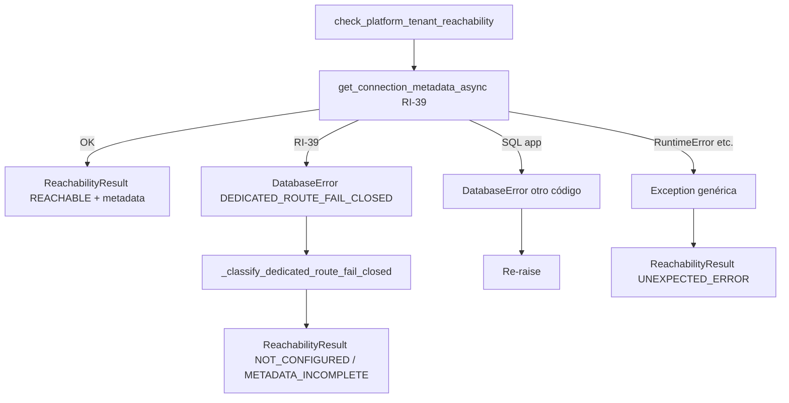

# F13-J1 — Infraestructura Platform Fail-Soft (reachability)

**Fecha:** 2026-06-25  
**Prerequisitos:** F13-F1 (arquitectura STRICT/DEGRADED), F13-C4 (wire-up L6 OSR), RI-39 (`DEDICATED_ROUTE_FAIL_CLOSED`)  
**Estado:** **IMPLEMENTADO** — componente reutilizable únicamente; **sin wire-up de servicios**.

---

## Objetivo

Entregar el preflight de alcanzabilidad tenant_data definido en F13-F1 §7 como módulo aislado, reutilizable por F13-J2+ sin alterar comportamiento observable actual.

**Alcance J1:**

| Incluido | Excluido (fases posteriores) |
|----------|------------------------------|
| `app/core/tenant/platform_tenant_reachability.py` | Migración de servicios Platform |
| Tests unitarios golden | `platform_tenant_data_store.py` (policy STRICT/DEGRADED) |
| Clasificación de errores RI-39 | Cambios en `OperationStoreResolver` |
| | Cambios en `routing.py` / RI-39 |
| | OpenAPI / schemas `tenant_data_reachability` |

---

## Archivos creados

| Archivo | Rol |
|---------|-----|
| `app/core/tenant/platform_tenant_reachability.py` | API pública de preflight |
| `tests/unit/test_f13_j1_platform_tenant_reachability.py` | Validación golden J1 |

**Sin modificar:** `SuperadminUsuarioService`, `ClienteService`, dashboard, auditoría, `PlatformStore`, `routing.py`, OSR.

---

## API pública

### `ReachabilityStatus`

```python
class ReachabilityStatus(str, Enum):
    REACHABLE = "reachable"
    METADATA_INCOMPLETE = "metadata_incomplete"
    NOT_CONFIGURED = "not_configured"
    UNEXPECTED_ERROR = "unexpected_error"
```

| Status | Significado operativo |
|--------|----------------------|
| `REACHABLE` | `get_connection_metadata_async` resolvió metadata válida; DP alcanzable vía routing actual |
| `NOT_CONFIGURED` | Dedicated sin Storage Endpoint / sin `cliente_conexion` principal / credenciales inválidas |
| `METADATA_INCOMPLETE` | Metadata CP inconsistente con installation mode (p. ej. `database_type` incompatible) |
| `UNEXPECTED_ERROR` | Excepción no clasificada como metadata RI-39 (p. ej. fallo de cache); **no** errores SQL de app |

### `ReachabilityResult`

```python
@dataclass(frozen=True, slots=True)
class ReachabilityResult:
    cliente_id: UUID
    status: ReachabilityStatus
    metadata: Optional[Dict[str, Any]] = None      # solo si REACHABLE
    internal_code: Optional[str] = None            # p. ej. DEDICATED_ROUTE_FAIL_CLOSED
    message: Optional[str] = None                  # detail RI-39 o excepción inesperada
```

### `check_platform_tenant_reachability()`

```python
async def check_platform_tenant_reachability(
    cliente_id: UUID,
    *,
    operation_class: str = OPERATION_CLASS_TENANT_DATA,
) -> ReachabilityResult:
    ...
```

**Delegación:** llama `get_connection_metadata_async(cliente_id, operation_class)` — RI-39 intacto.

**Política de captura:**

| Origen | Comportamiento |
|--------|----------------|
| Metadata resuelta OK | `REACHABLE` + `metadata` poblado |
| `DatabaseError` con `internal_code == DEDICATED_ROUTE_FAIL_CLOSED` | Clasificar → `NOT_CONFIGURED` o `METADATA_INCOMPLETE`; **no re-raise** |
| Otro `DatabaseError` (p. ej. `DB_QUERY_ERROR`) | **Re-raise** — error SQL real, no metadata |
| `CustomException`, RBAC, negocio | **No capturados** — propagan |
| `Exception` genérica no-`DatabaseError` | `UNEXPECTED_ERROR` + log warning |

---

## Clasificación RI-39 → status

Función interna `_classify_dedicated_route_fail_closed(exc)` inspecciona `exc.detail` (case-insensitive):

| Tokens en `detail` | Status |
|--------------------|--------|
| `storage endpoint ausente`, `no disponible para installation mode dedicated`, `credenciales inválidas` / `invalidas` | `NOT_CONFIGURED` |
| `campos ausentes`, `database_type=`, `no puede enrutar` | `METADATA_INCOMPLETE` |
| Otros `DEDICATED_ROUTE_FAIL_CLOSED` | `METADATA_INCOMPLETE` (default conservador) |

**Nota J1 vs F13-F1 §7.4:** F13-F1 diseña preflight CP SQL para evitar invocar RI-39 en modo DEGRADED. J1 implementa la capa mínima sobre `get_connection_metadata_async` (captura controlada de RI-39). El preflight CP sin excepciones queda reservado para evolución en J2/J3 si se adopta.

---

## Diagrama de flujo (J1)



---

## Invariantes preservados

1. **RI-39 fail-closed** en `routing.py` — sin cambios.
2. **OperationStoreResolver** — sin cambios; servicios siguen usando OSR como hoy.
3. **Operaciones tenant_data directas** — siguen fallando igual (RI-39 → excepción).
4. **Ningún servicio** importa aún el módulo J1 — cero impacto observable en runtime.

---

## Tests (Definition of Done J1)

Archivo: `tests/unit/test_f13_j1_platform_tenant_reachability.py`

| Caso | Mock | Assert |
|------|------|--------|
| Shared válido | `build_shared_metadata` | `REACHABLE`, `database_type=single` |
| Dedicated válido | `build_dedicated_metadata` | `REACHABLE`, `database_type=multi`, `servidor` presente |
| Dedicated sin `cliente_conexion` | RI-39 «Storage Endpoint ausente…» | `NOT_CONFIGURED`, `metadata=None` |
| Metadata inconsistente | RI-39 «database_type='single'… dedicated» | `METADATA_INCOMPLETE` |
| Error SQL app | `DB_QUERY_ERROR` | `pytest.raises(DatabaseError)` — no swallow |
| Error inesperado | `RuntimeError` | `UNEXPECTED_ERROR` |

**Ejecución:**

```bash
python -m pytest tests/unit/test_f13_j1_platform_tenant_reachability.py -v
```

**Resultado:** 6 passed.

---

## Relación con F13-F1 y fases siguientes

| Documento / fase | Relación |
|------------------|----------|
| **F13-F1 §7** | Diseño normativo; J1 entrega subconjunto (`check_*` + status/result) |
| **F13-J2** *(siguiente)* | Primer wire-up: `SuperadminUsuarioService.get_usuarios_globales` con policy DEGRADED |
| **F13-F2** | Extensión `platform_tenant_data_store.py` + mapper 409 STRICT + OpenAPI flags |

### Uso previsto (J2+ — no implementado)

```python
# Patrón DEGRADED (futuro)
resolution = await check_platform_tenant_reachability(cliente_id)
if resolution.status != ReachabilityStatus.REACHABLE:
    # proyectar fila degradada; no abortar listado global
    ...
else:
    kwargs = resolve_platform_tenant_data_execute_kwargs(cliente_id)
    ...
```

---

## Restricciones de este entregable

- Sin commits.
- Sin migración de servicios.
- Sin cambios de routing, OSR, RI-39 ni contratos HTTP.

**Estado:** F13-J1 completado — detenido. F13-J2 realizará wire-up en `SuperadminUsuarioService`.
