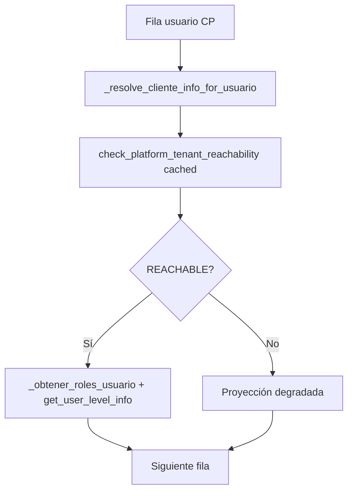

# F13-J2 — Wire-up fail-soft: listado global Superadmin usuarios

**Fecha:** 2026-06-25  
**Prerequisitos:** F13-J1 (`platform_tenant_reachability`), F13-F1 (política DEGRADED), F13-C4 (OSR wire-up), F13-E2 (síntoma innovas)  
**Estado:** **IMPLEMENTADO** — primer consumidor productivo de reachability; **sin** migración de otros servicios.

---

## Objetivo

Evitar que un tenant Dedicated incompleto (sin `cliente_conexion` válida) derribe `GET /api/v1/superadmin/usuarios/` **sin** `cliente_id`, degradando únicamente el enriquecimiento DP por fila afectada.

**Invariantes preservados:**

| Área | Comportamiento |
|------|----------------|
| RI-39 / `routing.py` | Sin cambios — fail-closed |
| `OperationStoreResolver` | Sin cambios |
| Listado **con** `cliente_id` | FAIL-CLOSED (STRICT) — sin fail-soft |
| Impersonación, dashboard, auditoría, KPIs | Sin cambios |
| SQL listado CP | Sin cambios |

---

## Archivos modificados

| Archivo | Cambio |
|---------|--------|
| `app/modules/superadmin/application/services/superadmin_usuario_service.py` | Preflight reachability + proyección degradada en bucle global |
| `app/modules/superadmin/presentation/schemas.py` | Campos opcionales de degradación en `UsuarioSuperadminRead` |
| `tests/unit/test_f13_j2_platform_fail_soft_superadmin_usuarios.py` | Golden tests J2 |

**Sin modificar:** `ClienteService`, dashboard, auditoría, `PlatformStore`, OSR, endpoints (salvo schema OpenAPI derivado).

---

## Condición de activación fail-soft

```python
use_fail_soft_enrichment = cliente_id is None
```

| Modo | `cliente_id` query | Política enriquecimiento |
|------|-------------------|--------------------------|
| Listado global cross-tenant | `None` | **DEGRADED** — `check_platform_tenant_reachability` por fila |
| Drill-down / filtro mono-tenant | UUID explícito | **STRICT** — flujo F13-C4 sin preflight degradado |

---

## Flujo por fila (listado global)



### 1. Preflight (solo global)

```python
reachability = await check_platform_tenant_reachability(usuario_cliente_id)
```

Cache `Dict[UUID, ReachabilityResult]` por request — un tenant con N usuarios resuelve reachability una sola vez.

### 2. REACHABLE — sin cambio observable

Flujo idéntico a F13-C4:

- `_obtener_roles_usuario`
- `UsuarioService.get_user_level_info`
- Campos de degradación **omitidos** del JSON de respuesta

### 3. No REACHABLE — proyección degradada

**No** se invoca enriquecimiento DP. **No** se lanza excepción. **No** se omite la fila.

| Campo | Valor degradado |
|-------|-----------------|
| `roles` | `[]` |
| `access_level` | `null` |
| `is_super_admin` | `false` |
| `user_type` | `"user"` |
| `tenant_data_reachability` | status J1 (`not_configured`, `metadata_incomplete`, …) |
| `tenant_data_available` | `false` |
| `enrichment_degraded` | `true` |
| `tenant_data_internal_code` | p. ej. `DEDICATED_ROUTE_FAIL_CLOSED` |
| `tenant_data_message` | detail RI-39 / mensaje reachability |

Identidad CP intacta: `usuario_id`, `correo`, `cliente_id`, objeto `cliente` embebido desde ADMIN.

---

## Estrategia de compatibilidad OpenAPI

Campos nuevos en `UsuarioSuperadminRead` — **todos opcionales**:

- `tenant_data_reachability`
- `tenant_data_available`
- `enrichment_degraded`
- `tenant_data_internal_code`
- `tenant_data_message`

`access_level` pasa a `Optional[int]` para permitir `null` en filas degradadas.

**Serialización:** `_serialize_usuario_for_global_list` elimina las claves de degradación cuando `enrichment_degraded` no es `true`, de modo que tenants sanos (Shared / Dedicated válido) mantienen el mismo shape JSON que antes de J2.

---

## Helpers añadidos (servicio)

| Método | Rol |
|--------|-----|
| `_get_reachability_for_global_enrichment` | Cache + delegación J1 |
| `_build_usuario_superadmin_read_from_row` | Construcción unificada reachable/degradada |
| `_serialize_usuario_for_global_list` | Omite metadata auxiliar si no degradada |

---

## Validaciones (Definition of Done)

| # | Caso | Resultado esperado | Test |
|---|------|-------------------|------|
| 1 | Shared reachable | Roles/niveles completos; sin campos degradación | `test_global_shared_reachable_sin_campos_degradacion` |
| 2 | Dedicated válido | Idem | `test_global_dedicated_valid_sin_campos_degradacion` |
| 3 | Dedicated sin `cliente_conexion` en listado mixto | HTTP 200 implícito; fila presente degradada; otras filas enriquecidas | `test_global_dedicated_sin_conexion_degradado_no_aborta` |
| 4 | Mono-tenant unreachable | `DatabaseError` RI-39 — fail-closed | `test_mono_tenant_unreachable_sigue_fail_closed` |
| 5 | Mono-tenant no invoca reachability | Preflight J1 no llamado | `test_mono_tenant_no_usa_fail_soft_enrichment` |
| 6 | Impersonación | Sin cambios en auth/deps | N/A — fuera de alcance J2 |

**Ejecución:**

```bash
python -m pytest tests/unit/test_f13_j2_platform_fail_soft_superadmin_usuarios.py -v
```

**Resultado:** 5 passed.

---

## Ejemplo respuesta degradada (fragmento)

```json
{
  "usuario_id": "…",
  "cliente_id": "…",
  "cliente": { "subdominio": "innovas", "tipo_instalacion": "dedicated", "…": "…" },
  "nombre_usuario": "admin",
  "correo": "admin@innovas.example",
  "roles": [],
  "access_level": null,
  "enrichment_degraded": true,
  "tenant_data_reachability": "not_configured",
  "tenant_data_available": false,
  "tenant_data_internal_code": "DEDICATED_ROUTE_FAIL_CLOSED",
  "tenant_data_message": "Storage Endpoint ausente en cliente_conexion."
}
```

---

## Relación con fases F13

| Fase | Alcance |
|------|---------|
| **F13-J1** | Infraestructura `check_platform_tenant_reachability` |
| **F13-J2** *(este)* | Wire-up `SuperadminUsuarioService.get_usuarios_globales` global |
| **Futuro** | Clientes listado anotación, auditoría global, KPI dashboard |

---

## Restricciones de este entregable

- Sin commits.
- Sin dashboard, auditoría, KPIs, `ClienteService`.
- Detenido tras J2.

**Estado:** F13-J2 completado.
