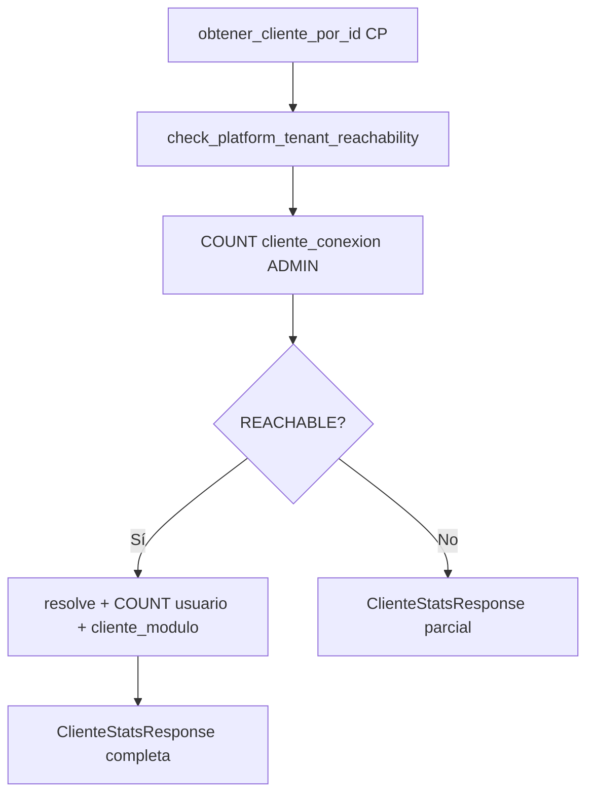

# F13-J3 — Wire-up fail-soft: Dashboard Platform (`ClienteService.obtener_estadisticas`)

**Fecha:** 2026-06-25  
**Prerequisitos:** F13-J1 (reachability), F13-J2 (patrón DEGRADED), F13-C4 (OSR wire-up KPIs), F13-F1 §4.4  
**Estado:** **IMPLEMENTADO** — único consumidor dashboard; **sin** migración de auditoría ni usuarios.

---

## Objetivo

Evitar que `GET /api/v1/clientes/{cliente_id}/estadisticas/` falle con RI-39 cuando el tenant Dedicated no tiene Storage Endpoint configurado, devolviendo **HTTP 200** con estadísticas parciales (CP intacto + métricas tenant_data en `null`).

---

## Archivos modificados

| Archivo | Cambio |
|---------|--------|
| `app/modules/tenant/application/services/cliente_service.py` | Preflight reachability en `obtener_estadisticas` |
| `app/modules/tenant/presentation/schemas.py` | Campos opcionales degradación + `Optional` en KPIs tenant_data |
| `tests/unit/test_f13_j3_platform_fail_soft_dashboard.py` | Golden tests J3 |
| `tests/unit/test_f13_c4_platform_tenant_data_store.py` | Ajuste orden queries CP-first + mock reachability |

**Sin modificar:** `SuperadminUsuarioService`, auditoría, `ClienteModuloService`, OSR, `routing.py`, provisioning/mutaciones.

---

## Flujo `obtener_estadisticas`



### Orden de ejecución (J3)

1. Verificar cliente existe (CP) — sin cambio  
2. **`check_platform_tenant_reachability(cliente_id)`** — nuevo  
3. **Conexiones BD** (`cliente_conexion` en ADMIN) — siempre CP  
4. **Días activo** desde `cliente.fecha_creacion` — siempre CP  
5. Si **no REACHABLE** → respuesta parcial (sin `resolve_platform_tenant_data_execute_kwargs`)  
6. Si **REACHABLE** → flujo F13-C4 exacto (usuarios + módulos vía tenant_data)

---

## Política DEGRADED vs STRICT

| Superficie | Política | Comportamiento unreachable |
|------------|----------|----------------------------|
| `GET /clientes/{id}/estadisticas/` | **DEGRADED** | HTTP 200, KPIs tenant_data `null`, metadata reachability |
| Provisioning, mutaciones, otros métodos `ClienteService` | **STRICT** | RI-39 sin cambios — fuera de alcance J3 |

`obtener_estadisticas` es el **único** método migrado; no existe parámetro `policy` porque el endpoint es exclusivamente dashboard Platform.

---

## Respuesta degradada

### Métricas tenant_data → `null`

| Campo | Degradado |
|-------|-----------|
| `total_usuarios` | `null` |
| `total_usuarios_inactivos` | `null` |
| `modulos_activos` | `null` |
| `modulos_contratados` | `null` |

**No** se usa `0` para evitar confundir tenant vacío sano con tenant unreachable (F13-F1 §4.4).

### Métricas Control Plane — sin alteración

| Campo | Fuente | Degradado |
|-------|--------|-----------|
| `cliente_id`, `razon_social` | `cliente` CP | Valores reales |
| `estado_suscripcion`, `plan_actual` | CP | Valores reales |
| `fecha_creacion`, `ultimo_acceso`, `dias_activo` | CP | Valores reales |
| `conexiones_bd` | `cliente_conexion` ADMIN | Valor real (p. ej. `0` si no hay filas) |
| `tipo_instalacion` | CP | Valor real |

### Metadata opcional (solo cuando degradado)

| Campo | Ejemplo |
|-------|---------|
| `tenant_data_available` | `false` |
| `tenant_data_reachability` | `not_configured` \| `metadata_incomplete` |
| `tenant_data_internal_code` | `DEDICATED_ROUTE_FAIL_CLOSED` |
| `tenant_data_message` | detail RI-39 |

`ClienteStatsResponse` usa `@model_serializer` para **omitir** estas claves cuando `tenant_data_available !== false` — tenants sanos mantienen shape JSON previo.

---

## Respuesta reachable — sin cambio observable

Shared y Dedicated válido: mismos enteros en KPIs tenant_data; sin claves de degradación en JSON serializado.

---

## Validaciones (Definition of Done)

| # | Caso | Assert | Test |
|---|------|--------|------|
| 1 | Shared reachable | KPIs completos; sin metadata degradación | `test_shared_reachable_flujo_completo` |
| 2 | Dedicated válido | Idem + `resolve` invocado | `test_dedicated_valid_flujo_completo` |
| 3 | Dedicated sin `cliente_conexion` | KPIs tenant `null`; CP intacto; `resolve` no invocado | `test_dedicated_sin_conexion_estadisticas_parciales_http200` |
| 4 | Serialización reachable | Sin claves degradación | `test_reachable_serialization_sin_metadata_degradacion` |
| 5 | Serialización degradada | Metadata presente | `test_degraded_serialization_incluye_metadata` |
| 6 | Impersonación | Sin cambios auth/deps | N/A — fuera alcance |
| 7 | Regresión F13-C4 | Wire-up OSR preserved | `test_obtener_estadisticas_uses_tenant_data_store` |

**Ejecución:**

```bash
python -m pytest tests/unit/test_f13_j3_platform_fail_soft_dashboard.py -v
```

**Resultado:** 5 passed.

---

## Ejemplo JSON degradado

```json
{
  "cliente_id": "…",
  "razon_social": "Innovas SA",
  "total_usuarios": null,
  "total_usuarios_inactivos": null,
  "modulos_activos": null,
  "modulos_contratados": null,
  "ultimo_acceso": "2026-05-01T08:00:00",
  "estado_suscripcion": "activo",
  "plan_actual": "enterprise",
  "fecha_creacion": "2025-01-15T10:00:00",
  "dias_activo": 160,
  "conexiones_bd": 0,
  "tipo_instalacion": "dedicated",
  "tenant_data_available": false,
  "tenant_data_reachability": "not_configured",
  "tenant_data_internal_code": "DEDICATED_ROUTE_FAIL_CLOSED",
  "tenant_data_message": "Storage Endpoint ausente en cliente_conexion."
}
```

---

## Relación con fases F13

| Fase | Alcance |
|------|---------|
| **F13-J1** | Infraestructura reachability |
| **F13-J2** | Listado global usuarios Superadmin |
| **F13-J3** *(este)* | KPIs dashboard `obtener_estadisticas` |
| **Futuro** | Auditoría global fail-soft |

---

## Restricciones de este entregable

- Sin commits.
- Sin auditoría ni otros servicios.
- Detenido tras J3.

**Estado:** F13-J3 completado.
