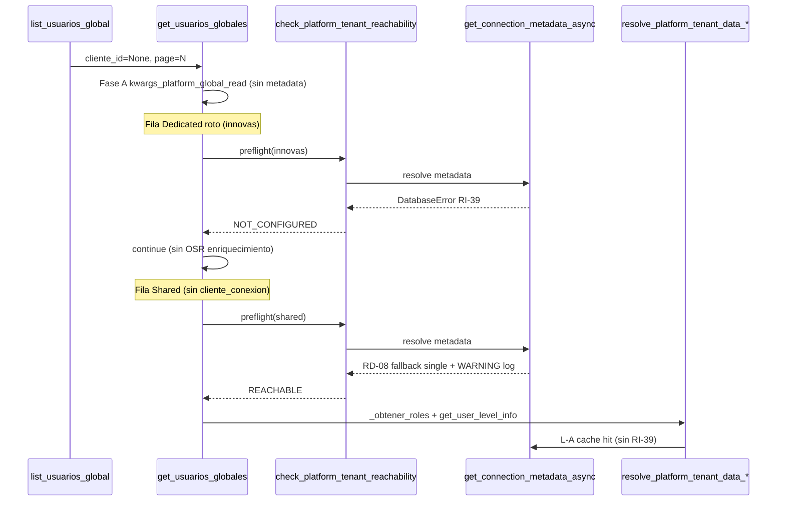

# F13-J4 — Runtime Trace residual Platform Fail-Soft

**Fecha:** 2026-06-25  
**Modo:** Solo auditoría — **sin implementación, sin commits, sin fixes**  
**Síntoma:** Tras F13-J2, `GET /api/v1/superadmin/usuarios/?page=…` responde **HTTP 200**, pero en el mismo request persisten trazas **RI-39** y posteriormente **fallback shared (RD-08)** en logs.  
**Referencias:** F13-J1/J2, F13-C4, F13-E2, F13-K3, `platform_tenant_reachability.py`, `superadmin_usuario_service.py`.

---

## 0. Veredicto ejecutivo

| Pregunta | Respuesta |
|----------|-----------|
| ¿Hay un camino **post-J2** que sigue llamando `get_connection_metadata_async()` para el tenant Dedicated roto? | **Sí, pero es el propio preflight J2** — no un bypass del gate. |
| ¿Hay OSR/`resolve_platform_tenant_data_*` **después** del preflight para ese tenant NOT REACHABLE? | **No** en el flujo global sin `cliente_id` — el bucle hace `continue` en L439–450. |
| ¿Por qué sigue apareciendo RI-39 con HTTP 200? | J2 **captura** `DatabaseError(DEDICATED_ROUTE_FAIL_CLOSED)` en reachability; **no suprime** la resolución routing ni sus efectos observables en log. |
| ¿De dónde sale el fallback shared? | **Otro tenant** (shared sin `cliente_conexion`) en la misma página — reachability REACHABLE + WARNING RD-08 normativo. |

---

## 1. Call graph completo — `GET /api/v1/superadmin/usuarios/?page=…`

Escenario auditado: **listado global** (`cliente_id=None`), página con filas de tenants **mixed** (shared + dedicated válido + dedicated sin Storage Endpoint, p. ej. `innovas`).

```text
HTTP GET /api/v1/superadmin/usuarios/?page=N&limit=M
│
├─ app/api/v1/api.py:440
│     prefix="/superadmin/usuarios"
│
├─ app/modules/superadmin/presentation/endpoints_usuarios.py:73
│     list_usuarios_global()
│     └─ L94: SuperadminUsuarioService.get_usuarios_globales(cliente_id=None, page=…)
│
└─ app/modules/superadmin/application/services/superadmin_usuario_service.py:238
      get_usuarios_globales()
      │
      ├─ [FASE A — listado CP / global store] L354–410
      │     tenant_query_kwargs = kwargs_platform_global_read()     L365
      │     (cliente_id is None → NO OSR, NO metadata por target)
      │     execute_query(COUNT)  L367–370   ENGINE_SCOPED
      │     execute_query(SELECT page) L407–410  ENGINE_SCOPED
      │     Fuente filas: dbo.usuario en store global compartido
      │
      └─ [FASE B — bucle por fila] L416–472
            use_fail_soft_enrichment = (cliente_id is None)         L415  → True
            │
            per usuario_row (usuario_cliente_id = fila['cliente_id']):
            │
            ├─ (1) _resolve_cliente_info_for_usuario()            L427–431
            │       └─ _fetch_cliente_info_from_admin() L123–125
            │             execute_query(..., kwargs_control_plane_read()) L96–98
            │             Plano: CP / ADMIN — **sin** get_connection_metadata_async
            │
            ├─ (2) PREFLIGHT J2 — solo si global                    L434–438
            │       _get_reachability_for_global_enrichment()       L144–150
            │       └─ check_platform_tenant_reachability(cliente_id)
            │             app/core/tenant/platform_tenant_reachability.py:72
            │             └─ L88: get_connection_metadata_async(cliente_id, TENANT_DATA)
            │                   app/core/tenant/routing.py:326
            │                   └─ _resolve_connection_metadata_uncached() L375+
            │                         Dedicated sin cliente_conexion:
            │                           _raise_dedicated_route_fail_closed() L553–556 / L567–570
            │                           → DatabaseError internal_code=DEDICATED_ROUTE_FAIL_CLOSED
            │                             detail contiene "RI-39"
            │             L94–108: except DatabaseError → ReachabilityResult NOT_CONFIGURED
            │             HTTP no aborta; fila degradada si status != REACHABLE
            │
            ├─ (3a) NOT REACHABLE → proyección degradada + continue   L439–450
            │       **Fin de rama para este tenant** — no entra a (4)
            │
            └─ (3b) REACHABLE → enriquecimiento                       L452–472
                  ├─ (4) _obtener_roles_usuario()                    L453–456
                  │       L512: **await resolve_platform_tenant_data_execute_kwargs(cliente_id)**
                  │             platform_tenant_data_store.py:50–55
                  │             └─ resolve_operation_store() operation_store_resolver.py:99
                  │                   └─ L112: get_connection_metadata_async(target)  [L-A cache hit]
                  │       L507–513: execute_query(roles SQL, **kwargs OSR)
                  │             queries_async._get_connection_context → get_connection_for_tenant()
                  │             routing.py:973 get_connection_metadata_async()  [L-A cache hit]
                  │
                  └─ (5) UsuarioService.get_user_level_info()          L459–462
                        user_service.py:270
                        ├─ get_user_access_level() L286
                        │     L152: resolve_platform_tenant_data_database_type(cliente_id)
                        │           platform_tenant_data_store.py:39–41 → get_installation_profile()
                        │           operation_store_resolver.py:122 get_connection_metadata_async  [cache]
                        └─ is_super_admin() L289
                              L224–229: execute_query(..., client_id=cliente_id)
                              → get_connection_for_tenant() routing.py:973  [cache]
```

### Diagrama secuencia — tenant Dedicated roto vs Shared en la misma página



---

## 2. Invocaciones OSR / `resolve_platform_tenant_data_*` **después** del preflight J2

Condición: `cliente_id=None` (global), fila con `usuario_cliente_id = T`.

| # | ¿Se ejecuta para T NOT REACHABLE? | Archivo | Función | Línea | API invocada |
|---|:----------------------------------:|---------|---------|------:|--------------|
| R1 | **No** — `continue` L450 | — | — | — | — |
| R2 | Solo si REACHABLE | `superadmin_usuario_service.py` | `_obtener_roles_usuario` | **512** | `resolve_platform_tenant_data_execute_kwargs(cliente_id)` |
| R3 | Solo si REACHABLE | `platform_tenant_data_store.py` | `resolve_platform_tenant_data_execute_kwargs` | **54** | `resolve_operation_store()` |
| R4 | Solo si REACHABLE | `operation_store_resolver.py` | `resolve_operation_store` | **112** | `get_connection_metadata_async` |
| R5 | Solo si REACHABLE | `user_service.py` | `get_user_access_level` | **152** | `resolve_platform_tenant_data_database_type` |
| R6 | Solo si REACHABLE | `platform_tenant_data_store.py` | `resolve_platform_tenant_data_database_type` | **40** | `get_installation_profile()` → metadata |
| R7 | Solo si REACHABLE | `user_service.py` | `is_super_admin` | **224–229** | `execute_query(..., client_id=)` → `get_connection_for_tenant` L973 |

**Evidencia unitaria J2:** `test_global_dedicated_sin_conexion_degradado_no_aborta` — para tenant roto, `obtener_roles.await_count == 2` y `get_level.await_count == 2` (solo filas REACHABLE), **no** 3.

```206:213:tests/unit/test_f13_j2_platform_fail_soft_superadmin_usuarios.py
    reachable_calls = [
        u["cliente_id"]
        for u in result["usuarios"]
        if not u.get("enrichment_degraded")
    ]
    assert len(reachable_calls) == 2
    assert obtener_roles.await_count == 2
    assert get_level.await_count == 2
```

---

## 3. Por qué `check_platform_tenant_reachability()` no evitó la llamada

### 3.1 Malentendido de contrato J1/J2

J2 **no evita** la primera resolución de metadata. J1 define reachability como **envoltorio** de `get_connection_metadata_async`:

```87:88:app/core/tenant/platform_tenant_reachability.py
    try:
        metadata = await get_connection_metadata_async(cliente_id, operation_class)
```

Para Dedicated sin Storage Endpoint, esa llamada **debe** ejecutar RI-39 fail-closed (routing intacto). J2 solo:

1. Captura `DEDICATED_ROUTE_FAIL_CLOSED` (L94–108).
2. Evita **enriquecimiento downstream** (roles + access_level) vía `continue` (L439–450).

### 3.2 Qué sí evita J2

| Capa | Evitado para NOT REACHABLE |
|------|----------------------------|
| `_obtener_roles_usuario` → OSR L512 | ✅ |
| `get_user_level_info` → `resolve_platform_tenant_data_database_type` L152 | ✅ |
| `is_super_admin` → `get_connection_for_tenant` vía `client_id=` | ✅ |
| Abort HTTP 500 del endpoint completo | ✅ |

### 3.3 Qué no evita J2 (by design)

| Efecto | Motivo |
|--------|--------|
| Traza RI-39 en routing | La excepción se lanza **dentro** del preflight; routing no tiene modo “silent probe” |
| Log DEBUG reachability | L98–103 solo DEBUG: `[PLATFORM_REACHABILITY] … status=not_configured` |
| Consulta CP `_fetch_cliente_info_from_admin` | Fuera del gate J2; CP-only, no RI-39 |

### 3.4 Cache L-A intra-request

Tras preflight fallido para tenant `T`, **no** hay metadata cacheada REACHABLE para `T`. Las filas REACHABLE **distintas** (`S1`, `S2`) resuelven metadata independientemente → explica **RI-39 (T_dedicated)** seguido de **RD-08 WARNING (T_shared)** en el mismo request sin contradición.

---

## 4. Clasificación del camino residual

| Orden en request | Componente | Dominio | ¿Llama metadata/OSR post-preflight? |
|------------------|------------|---------|:------------------------------------:|
| Preflight fila Dedicated rota | `check_platform_tenant_reachability` | **Reachability gate (J2)** | Es la llamada RI-39 — no es enriquecimiento |
| Preflight fila Shared | idem | Reachability | RD-08 WARNING → REACHABLE |
| Fila Dedicated rota post-preflight | — | — | **Ninguno** |
| Fila Shared REACHABLE | `_obtener_roles_usuario` | **Enriquecimiento de roles** | OSR L512 (cache hit) |
| Fila Shared REACHABLE | `get_user_level_info` | **access_level** (+ is_super_admin) | L152 + L224 |
| Fase A global | `kwargs_platform_global_read` | Listado CP | No |
| `_resolve_cliente_info_for_usuario` | CP lookup | Cliente embebido | No |
| Auditoría / empresa / permisos menú | — | — | **No participan** en este endpoint |

**Categoría del síntoma RI-39 observable:** **Preflight reachability (J1/J2)** — no enriquecimiento residual.

**Categoría del fallback shared observable:** **Preflight + enriquecimiento** de filas **shared** distintas — **permisos/auditoría/empresa no aplican**.

---

## 5. ¿Fail-soft (A) o STRICT (B)?

| Camino | Política actual J2 | Debería ser |
|--------|-------------------|-------------|
| Preflight global (`cliente_id=None`) invoca routing real para cada tenant único | Fail-soft HTTP; routing STRICT (RI-39 se evalúa) | **A)** coherente — el probe **es** fail-soft a nivel HTTP; logs routing son efecto colateral |
| Enriquecimiento roles/access_level tras NOT REACHABLE | Omitido (`continue`) | **A)** — correcto |
| Enriquecimiento roles/access_level tras REACHABLE shared/dedicated sano | OSR + queries tenant_data | **A)** para global; datos opcionales degradables solo cuando unreachable |
| Listado con `?cliente_id=T` (mono-tenant) | Sin preflight L415; L300 OSR **antes** del bucle; RI-39 aborta request | **B)** STRICT — documentado J2 §Condición activación |
| `_obtener_roles_usuario` try/except L529–531 (traga excepciones) | Si algún día se invocara con tenant roto, log ERROR + `roles=[]` sin abort | **Debería ser A** en global — pero J2 evita la invocación; el swallow es residual defensivo |

### Matriz decisión

```text
Global list (?page=, sin cliente_id):
  Dedicated roto  → Preflight: A (degradar fila) | Logs RI-39: efecto lateral no suprimido
  Shared          → Preflight + enrichment: A | RD-08: normativo
  Dedicated sano  → Preflight + enrichment: A (datos completos)

Mono-tenant (?cliente_id=):
  Cualquier T     → B STRICT (fail-closed endpoint)
```

---

## 6. Tabla de evidencia — puntos de metadata en un request global típico

Supuesto: página con 3 usuarios → tenants `{T_shared, T_dedicated_ok, T_dedicated_roto}`.

| Paso | Tenant | `get_connection_metadata_async` | Resultado | OSR post-preflight |
|------|--------|--------------------------------|-----------|-------------------|
| Fase A | — | 0 llamadas | Listado CP | — |
| Preflight | T_shared | 1 | RD-08 WARNING, REACHABLE | Sí (roles + level) |
| Preflight | T_dedicated_ok | 1 | metadata multi OK | Sí |
| Preflight | T_dedicated_roto | 1 | **RI-39** → NOT_CONFIGURED | **No** |
| Enrichment | T_shared | 0 extra (L-A hit) | — | cache |
| Enrichment | T_dedicated_ok | 0 extra (L-A hit) | — | cache |
| Enrichment | T_dedicated_roto | **0** | — | **skip** |

**Total metadata calls:** 3 (una por tenant único en preflight), no `2 + 2×limit` de enriquecimiento qmark legacy (K1) para filas NOT REACHABLE.

---

## 7. Relación con tickets previos

| Ticket | Relación con J4 |
|--------|-----------------|
| **F13-J2** | Gate funcional correcto para HTTP 200; **no** diseñado para silenciar logs routing |
| **F13-C4** | OSR en enriquecimiento L512/L152 — **solo filas REACHABLE** |
| **F13-K3** | RD-08 en filas shared es normativo; distinto de RI-39 dedicated |
| **F13-K2-P1** | Elimina WARNING TD-08 en SQL enriquecimiento; **no** afecta metadata routing |

---

## 8. Respuestas formales (checklist J4)

1. **Call graph:** §1 — endpoint → Fase A CP → bucle → preflight J2 → (degradar | enriquecer).
2. **OSR post-preflight:** §2 — L512, L152, L224; **solo REACHABLE**; **cero** para NOT REACHABLE.
3. **Por qué reachability no evitó la llamada:** §3 — el preflight **es** la llamada; evita downstream, no upstream.
4. **Clasificación:** §4 — RI-39 = preflight; RD-08 = shared; roles + access_level solo REACHABLE.
5. **A vs B:** §5 — global = **A**; mono-tenant = **B**.

---

## 9. Restricciones de este entregable

- Sin implementación.
- Sin commits.
- Sin propuesta de fixes.

**Estado:** Auditoría F13-J4 completada.
