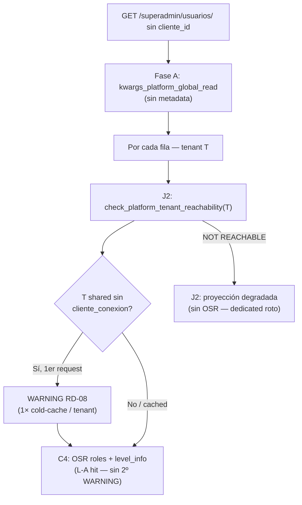

# F13-K3 — Auditoría RD-08 Metadata Resolution

**Fecha:** 2026-06-25  
**Modo:** Solo auditoría — **sin implementación, commits ni cambios de código**  
**Síntoma reportado:** Platform Admin genera numerosos warnings:

```text
[METADATA] No se encontró metadata para cliente XXXXX.
Usando SINGLE-DB como fallback (RD-08).
```

**Referencias:** F13-C4 (OSR wire-up), F13-J1/J2/J3 (reachability fail-soft), F13-K2-P0 (TD-08 SQL — sin tocar routing), F13-E2 (RI-39 vs RD-08), `routing.py` `_resolve_connection_metadata_uncached()`.

**Restricciones:** No proponer implementación. No modificar código.

---

## 0. Resumen ejecutivo

| Hallazgo | Conclusión |
|----------|------------|
| **Qué es RD-08** | Fallback normativo cuando no hay fila `cliente_conexion` principal activa y `cliente.tipo_instalacion ∈ {shared, onpremise, hybrid}` → `database_type=single`. Se emite **WARNING** y se cachea el fallback. |
| **Qué NO es RD-08** | Dedicated sin Storage Endpoint → **RI-39 fail-closed** (`DatabaseError`, sin fallback). Esos casos no generan el warning RD-08. |
| **Origen del warning en código** | Único sitio: `app/core/tenant/routing.py` → `_resolve_connection_metadata_uncached()` L572–576, invocado vía `get_connection_metadata_async()`. |
| **Logs locales analizados** | 17 líneas WARNING en `logs/app.log.{2..5}` (dic-2025). **Ninguna** correlacionada con tráfico `platform.app.local` / endpoints Superadmin; casi todas provienen de **TenantMiddleware** en hosts tenant (`global`, `techcorp`). |
| **Impacto Platform post F13-C4/J2/J3** | F13-C4 **multiplicó** resoluciones metadata por `target_cliente_id` en servicios Platform. F13-J2/J3 **añadieron** preflight `check_platform_tenant_reachability()` (misma cadena). Para tenants **shared**, cada tenant distinto en cold-cache produce **1 warning esperado** — ruido operativo, no fallo funcional. |
| **Severidad global Platform** | **LOW** (shared normativo) / **MEDIUM** (volumen de warnings en listados globales) — **ningún BLOCKER** funcional identificado para RD-08 puro. |

---

## 1. Mecanismo RD-08 (traza única)

```text
Consumidor (servicio / middleware / OSR / reachability)
  ▼
get_connection_metadata_async(client_id, operation_class)
  ├─ L-A route cache hit → retorno sin WARNING
  └─ miss → _resolve_connection_metadata_uncached(client_id)
        ├─ SYSTEM_CLIENT_ID → single (debug, sin WARNING)
        ├─ L-B Redis / memoria hit → retorno sin WARNING
        ├─ _query_connection_metadata_from_db_async() → fila cliente_conexion
        │     └─ si hay fila → metadata completa (sin WARNING RD-08)
        └─ sin fila → lee cliente.tipo_instalacion (CP)
              ├─ dedicated → RI-39 (_raise_dedicated_route_fail_closed) — NO RD-08
              └─ shared|onpremise|hybrid → WARNING RD-08 + fallback single + cache
```

**Implicación normativa (E4 / `02_STORAGE_METADATA_RESOLUTION.md`):** Para Installation Mode `shared`, **no se espera** fila `cliente_conexion` obligatoria. La ausencia de metadata es **estado válido**; el warning describe fallback, no corrupción de datos.

**Nota formato log:** Logs dic-2025 omiten el sufijo `(RD-08)` en el mensaje; el código actual (2026-06) lo incluye. Mismo evento semántico.

---

## 2. Inventario de warnings RD-08 en logs locales

### 2.1 Clientes únicos afectados

| cliente_id | Subdominio (log middleware) | Código | tipo_instalacion | Filas `cliente_conexion` esperadas |
|------------|----------------------------|--------|------------------|-----------------------------------|
| `3fb51816-0a6d-497b-b6eb-66e1f1c84a2b` | `global` | GLOBAL004 | `shared` | 0 (normativo shared) |
| `3d34486f-05a9-4acb-8590-f76cde7a748a` | `techcorp` | TECH003 | `shared` | 0 (normativo shared) |

### 2.2 Correlación log → origen (evidencia directa)

| # | Archivo / línea | Timestamp | cliente_id | Endpoint correlacionado | Capa | Servicio | Método |
|---|-----------------|-----------|------------|-------------------------|------|----------|--------|
| L-01 | `app.log.5:1514` | 2025-12-10 22:00:03 | `3fb51816-…` | `POST /api/v1/auth/refresh/` | Middleware | `TenantMiddleware` | `_resolve_connection_metadata` → `get_connection_metadata_async` |
| L-02 | `app.log.5:1519` | 2025-12-10 22:00:03 | `3fb51816-…` | `GET /api/v1/clientes/branding` | Middleware | idem | idem (request paralelo, cache miss concurrente) |
| L-03 | `app.log.5:2145` | 2025-12-10 22:01:18 | `3d34486f-…` | *(middleware tenant host)* | Middleware | idem | idem |
| L-04 | `app.log.5:5119` | 2025-12-10 22:50:47 | `3d34486f-…` | *(middleware)* | Middleware | idem | idem |
| L-05 | `app.log.5:6134` | 2025-12-10 23:00:50 | `3d34486f-…` | `POST /api/v1/auth/refresh/` + branding concurrente | Middleware | idem | idem |
| L-06 | `app.log.5:6137` | 2025-12-10 23:00:50 | `3d34486f-…` | idem L-05 | Middleware | idem | idem |
| L-07 | `app.log.5:6897` | 2025-12-11 00:04:34 | `3d34486f-…` | `POST /api/v1/auth/refresh/` | Middleware | idem | idem |
| L-08 | `app.log.4:1010` | 2025-12-11 00:12:11 | `3d34486f-…` | *(middleware)* | Middleware | idem | idem |
| L-09 | `app.log.4:6126` | 2025-12-11 09:49:11 | `3d34486f-…` | `GET /api/v1/clientes/branding` | Middleware | idem | idem |
| L-10 | `app.log.4:6131` | 2025-12-11 09:49:11 | `3d34486f-…` | `POST /api/v1/auth/refresh/` | Middleware | idem | idem |
| L-11 | `app.log.4:7110` | 2025-12-11 11:58:08 | `3d34486f-…` | *(middleware)* | Middleware | idem | idem |
| L-12 | `app.log.3:5739` | 2025-12-21 09:55:53 | `3fb51816-…` | *(middleware)* | Middleware | idem | idem |
| L-13 | `app.log.2:752` | 2025-12-30 15:04:11 | `3fb51816-…` | *(middleware)* | Middleware | idem | idem |

**Duplicados mismo segundo (L-01/L-02, L-09/L-10, L-05/L-06):** dos requests HTTP concurrentes al mismo tenant antes de que `connection_cache` / L-A persistan el fallback → **doble WARNING**, mismo resultado funcional.

### 2.3 Brecha de evidencia Platform Admin (2026)

- `logs/app.log.1` (jun-2026): actividad `platform_admin` en `/auth/me` — **sin** líneas RD-08.
- No hay captura local post F13-C4/J2/J3 con correlación explícita `GET /superadmin/usuarios/` → WARNING.
- Los escenarios Platform §3 se documentan por **traza estática de código** (misma cadena `get_connection_metadata_async`).

---

## 3. Escenarios Platform Admin — traza estática

### 3.1 Cadena común post F13-C4

```text
Platform @ Host platform (ContextVar SYSTEM — middleware NO emite RD-08)
  ▼
Servicio Platform con target_cliente_id = T (fila usuario / filtro / KPI)
  ▼
resolve_platform_tenant_data_*  OR  check_platform_tenant_reachability
  ▼
OperationStoreResolver.resolve_operation_store  OR  routing directo (J1)
  ▼
get_connection_metadata_async(T, OPERATION_CLASS_TENANT_DATA)
  ▼
[shared sin cliente_conexion] → WARNING RD-08 → REACHABLE / intent single
```

### 3.2 Matriz por endpoint Platform

| ID | Endpoint | Servicio | Método(s) | cliente_id resuelto | ¿Metadata necesaria? | ¿Falta metadata o solicitud incorrecta? | Evitable sin romper arquitectura | F13 | Severidad |
|----|----------|----------|-----------|---------------------|----------------------|----------------------------------------|----------------------------------|-----|-----------|
| **P-01** | `GET /api/v1/superadmin/usuarios/` (sin `cliente_id`) | `SuperadminUsuarioService` | `get_usuarios_globales` → `_get_reachability_for_global_enrichment` | `usuario_row['cliente_id']` por tenant distinto | **OPTIONAL** (shared) / **REQUIRED** (dedicated: validar RI-39) | Shared: **no falta** — ausencia normativa; solicitud **correcta** pero redundante con `cliente.tipo_instalacion` ya en CP | Preflight reachability podría inferir `shared` desde CP sin `get_connection_metadata_async` para shared puro; OSR seguiría siendo necesario en dedicated | **J2** añade preflight; **C4** enriquecimiento | **MEDIUM** (N tenants × cold cache) |
| **P-02** | idem, filas REACHABLE | `SuperadminUsuarioService` | `_obtener_roles_usuario` | mismo `usuario_cliente_id` | **REQUIRED** (routing tenant_data) / **OPTIONAL** (shared: solo confirma single) | Shared: **no falta** metadata de conexión | L-A deduplica vs P-01 en mismo request; no evitable en dedicated sin OSR | **C4** | **LOW** |
| **P-03** | idem | `UserService` | `get_user_level_info` → `get_user_access_level` / `is_super_admin` | mismo | **OPTIONAL** (shared) | Shared: **no falta** | `database_type` derivable de CP para shared; OSR no necesario si `tipo_instalacion=shared` | **C4** | **LOW** |
| **P-04** | `GET /api/v1/superadmin/usuarios/?cliente_id=T` | `SuperadminUsuarioService` | `get_usuarios_globales` (inicio) | `T` del query | **REQUIRED** (filtrar COUNT/DATA en store correcto) | Shared: **no falta** — fallback correcto | Para shared, CP ya tiene `tipo_instalacion`; resolución full metadata es **OPTIONAL** funcionalmente | **C4** | **LOW** |
| **P-05** | idem | idem | `resolve_platform_tenant_data_execute_kwargs(T)` en COUNT/DATA | `T` | **REQUIRED** (multi) / **OPTIONAL** (single) | Shared: solicitud correcta, warning esperado | idem P-04 | **C4** | **LOW** |
| **P-06** | `GET /api/v1/superadmin/clientes/{id}/usuarios` | `SuperadminUsuarioService` | `get_usuarios_globales(cliente_id=id)` | `id` | Igual P-04/P-05 | Igual | Igual | **C4** | **LOW** |
| **P-07** | `GET /api/v1/clientes/{cliente_id}/estadisticas/` | `ClienteService` | `obtener_estadisticas` → `check_platform_tenant_reachability` | `cliente_id` path | **OPTIONAL** (shared) / **REQUIRED** (dedicated RI-39 gate) | Shared: **no falta** | Preflight J3 duplica semántica OSR para shared; evitable lectura metadata si CP confirma shared | **J3** + **C4** | **LOW** |
| **P-08** | idem, REACHABLE | `ClienteService` | `resolve_platform_tenant_data_execute_kwargs` (KPIs) | `cliente_id` | **REQUIRED** (multi) / **OPTIONAL** (single) | Shared: **no falta** | KPIs shared podrían usar DEFAULT+client_id sin round-trip metadata si profile ya conocido | **C4** + **J3** | **LOW** |
| **P-09** | `GET /superadmin/usuarios/{id}` (drill-down) | `SuperadminUsuarioService` | `obtener_usuario_completo`, `_obtener_roles_usuario`, actividad | `usuario_cliente_id` | **REQUIRED** | Dedicated sin fila: **RI-39**, no RD-08 | No evitable en dedicated sin provisioning CP | **C4**; **K2-P0** solo SQL TD-08 | **MEDIUM** (RI-39); **LOW** (RD-08 shared) |
| **P-10** | Impersonación / RBAC Platform | `impersonation_rbac` | `get_effective_impersonation_permissions` | tenant impersonado | **REQUIRED** | Dedicated: fila CP requerida (RI-39) | No | **C4** | **MEDIUM** (dedicated) / **LOW** (shared RD-08) |
| **P-11** | Módulos activos cliente | `ClienteModuloService` | lecturas migradas F13-C4 | `cliente_id` | **REQUIRED** (multi) / **OPTIONAL** (single) | Shared: **no falta** | CP `tipo_instalacion` suficiente para single | **C4** | **LOW** |
| **P-12** | Roles / permisos negocio Platform | `permisos_negocio_service`, `permisos_usuario_service`, `rol_service` | ramas con `cliente_id` | target tenant | **REQUIRED** (multi) / **OPTIONAL** (single) | Shared: **no falta** | idem P-04 | **C4** | **LOW** |
| **P-13** | Fase A listado global (COUNT/SELECT) | `SuperadminUsuarioService` | `kwargs_platform_global_read()` | — | **UNNECESSARY** invocar metadata | N/A — **no se invoca** OSR/metadata | Correcto: CP global sin metadata por fila en fase A | Pre-C4/C4 diseño | **—** (sin warning) |
| **P-14** | Host `platform.app.local` | `TenantMiddleware` | `_resolve_connection_metadata` | `SYSTEM_CLIENT_ID` | **UNNECESSARY** warning | N/A — rama SYSTEM sin WARNING | N/A | N/A | **—** |

---

## 4. Clasificación agregada REQUIRED / OPTIONAL / UNNECESSARY

### 4.1 REQUIRED (metadata o validación RI-39 genuinamente necesaria)

| Caso | Condición | ¿Metadata realmente falta? |
|------|-----------|----------------------------|
| Dedicated `tenant_data` (OSR → DEFAULT + engine dedicado) | `tipo_instalacion=dedicated` | **Sí** si no hay `cliente_conexion` válida → **RI-39**, no RD-08 |
| Dedicated con fila CP completa | OSR / KPIs / roles | **No** — metadata presente, sin WARNING |
| Shared `tenant_data` vía OSR | Confirmar `EngineKind.SHARED_SINGLE` | **No falta** — ausencia de fila es **normativa**; el servicio **solicita correctamente** pero el WARNING es **semánticamente misleading** |

### 4.2 OPTIONAL (resolución correcta pero derivable sin round-trip L6 completo)

- Todos los targets **`tipo_instalacion=shared`** en P-01–P-08, P-11, P-12.
- `get_user_level_info` / `get_user_access_level` cuando solo necesita bifurcar `single` vs `multi` (P-03).
- Preflight J1/J2/J3 sobre tenants shared ya conocidos en CP (P-01, P-07).

**Evitabilidad arquitectónica (sin implementar):** Sí — usando `cliente.tipo_instalacion` + reglas E4 (`shared → single`) en capa Platform **antes** de `get_connection_metadata_async`, sin eliminar OSR para dedicated. No rompe L6 si dedicated sigue pasando por OSR completo.

### 4.3 UNNECESSARY (invocación evitable o duplicada)

| Caso | Descripción | Evitable |
|------|-------------|----------|
| U-01 | Duplicados concurrentes middleware (L-01/L-02, etc.) | Parcialmente — cache L-B; race pre-set sigue duplicando WARNING |
| U-02 | Segunda resolución mismo request tras L-A hit | **Ya mitigado** — no genera WARNING adicional |
| U-03 | Fase A listado global con `kwargs_platform_global_read` | **No invoca** metadata — correcto |
| U-04 | Reachability + OSR para mismo `T` shared cuando CP ya cargó `ClienteInfo.tipo_instalacion=shared` | Sí — segunda capa redundante para clasificación (P-01 + P-02) |

---

## 5. Cruce F13-C4 / F13-J2 / F13-J3 / F13-K2-P0

| Ticket | ¿Introduce resoluciones metadata nuevas? | Impacto RD-08 Platform |
|--------|------------------------------------------|------------------------|
| **F13-C4** | **Sí — principal** | Todos los servicios Platform `tenant_data` pasan por `OperationStoreResolver` → `get_connection_metadata_async` por **target** (no Host). Antes derivaban `database_type` del Host SYSTEM (`single`) → **no** resolvían metadata por fila en listado global. **Efecto:** multiplicador de WARNING RD-08 = **1 por tenant shared distinto** en cold-cache por sesión Platform. |
| **F13-J2** | **Sí — incremental** | Añade `check_platform_tenant_reachability()` antes del enriquecimiento en listado global. Misma función metadata; L-A deduplica con OSR subsecuente. **No aumenta WARNING** en steady-state mismo request; **sí** garantiza al menos **1** resolución por tenant unreachable evitando OSR posterior (dedicated roto → RI-39, no RD-08). |
| **F13-J3** | **Sí — incremental** | Preflight reachability en dashboard antes de KPIs. Shared → 1 WARNING cold-cache por drill-down estadísticas. Evita OSR cuando NOT REACHABLE (dedicated roto). |
| **F13-K2-P0** | **No** | Solo corrige SQL TD-08 (`bindparams` + `client_id=`). Servicios ya invocaban OSR desde C4; K2-P0 **no añade** call sites metadata. |

**Conclusión cruce:** El volumen de warnings RD-08 en Platform Admin es **atribuible principalmente a F13-C4**. J2/J3 añaden preflight sobre la misma primitiva pero con deduplicación L-A; su aporte neto a WARNING es marginal frente a C4. K2-P0 **no** es factor.

---

## 6. Severidad por caso (solo RD-08)

| ID / grupo | Severidad | Justificación |
|------------|-----------|---------------|
| P-01..P-08, P-11, P-12 (shared, fallback single) | **LOW** | Comportamiento normativo E4; datos correctos; ruido de log |
| P-01 listado global (volumen N tenants) | **MEDIUM** | Observabilidad degradada; dificulta distinguir RD-08 real vs shared masivo |
| Duplicados concurrentes U-01 (middleware) | **LOW** | Sin impacto funcional |
| P-09, P-10 dedicated sin fila | **N/A RD-08** | RI-39 — fuera alcance K3 (F13-E2/J2 degradación) |
| Ausencia fila shared interpretada como “metadata faltante” | **LOW** | Documentación / mensaje WARNING ambiguo — no BLOCKER |
| **BLOCKER** | **Ninguno** identificado para RD-08 puro en Platform | — |
| **HIGH** | **Ninguno** — RD-08 no corrompe routing shared | — |

---

## 7. Respuestas formales (checklist K3)

### 7.1 Por warning de log (§2.2)

Cada línea L-01..L-13: origen **TenantMiddleware** (no Platform Admin), métodos `_resolve_connection_metadata` → `get_connection_metadata_async`, clientes `3fb51816-…` o `3d34486f-…`.

### 7.2 ¿Era necesaria la resolución?

| Contexto log (middleware tenant) | Clasificación |
|----------------------------------|---------------|
| Auth refresh / branding shared | **OPTIONAL** — middleware podría usar registry CP; funcionalmente correcto vía RD-08 |
| Platform P-01..P-12 shared | **OPTIONAL** |
| Platform dedicated tenant_data | **REQUIRED** |

### 7.3 REQUIRED — ¿falta metadata o solicitud incorrecta?

| Modo | Veredicto |
|------|-----------|
| **Shared** | **No falta** metadata de conexión. Solicitud **correcta** según OSR actual; WARNING **sobreinterpreta** ausencia normativa. |
| **Dedicated sin fila** | **Sí falta** Storage Endpoint — RI-39, no RD-08. |

### 7.4 OPTIONAL/UNNECESSARY — ¿evitable `get_connection_metadata_async` / OSR?

| Escenario | Evitable sin romper arquitectura |
|-----------|----------------------------------|
| Shared Platform con `tipo_instalacion` ya en CP | **Sí** — short-circuit L6 usando CP; OSR completo reservado a dedicated |
| Dedicated | **No** — OSR + metadata CP obligatorios |
| Fase A global CP (`kwargs_platform_global_read`) | **Ya evitado** |
| Reachability J2/J3 tras CP conocido shared | **Parcialmente evitable** — redundante con CP |

### 7.5 Cruce F13-C4/J2/J3/K2

Ver §5.

### 7.6 Severidad

Ver §6.

---

## 8. Diagrama — volumen warnings Platform listado global (post C4+J2)



---

## 9. Relación con TD-08 (inventariado, fuera alcance)

Los warnings TD-08 (`qmark_sql_text` sin filtro tenant) son **ortogonales** a RD-08. F13-K2-P0 remedia TD-08 CRITICAL sin alterar resolución metadata. Platform Admin puede exhibir **ambos** tipos de warning en la misma sesión; K3 audita **solo** RD-08.

---

## 10. Restricciones de este entregable

- Sin implementación de fixes.
- Sin commits.
- Sin documentos adicionales fuera de este archivo.

**Estado:** Auditoría F13-K3 completada.
