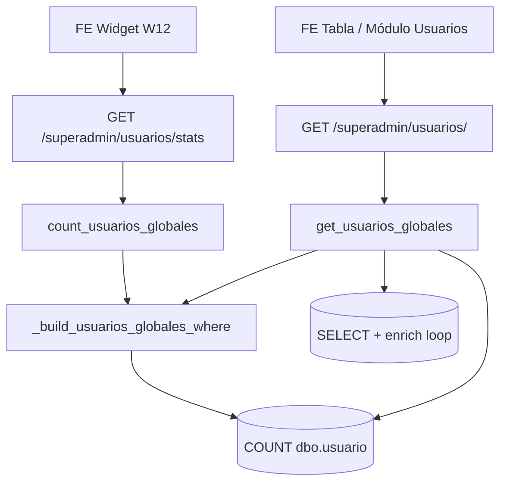

# F13-M1 — Arquitectura: Separación KPI Dashboard vs Enriquecimiento Global

**Fecha:** 2026-06-25  
**Modo:** Solo diseño arquitectónico — **sin implementación, sin commits, sin cambios de logging**  
**Problema:** `GET /api/v1/superadmin/usuarios/?limit=1` se usa como KPI del dashboard, pero ejecuta el flujo completo de listado global enriquecido (COUNT → SELECT → reachability → roles → access_level → is_super_admin), provocando RI-39 observable en bootstrap sin valor funcional para la tarjeta KPI.  
**Referencias:** F13-J4, F13-L2, F13-J2, F12-E2B3N, `PLATFORM_DASHBOARD_FRONTEND_CONTRACT.md` (W12).

---

## 0. Veredicto ejecutivo

| Pregunta | Respuesta |
|----------|-----------|
| ¿Se puede separar KPI de enriquecimiento? | **Sí** — el COUNT ya es una fase independiente; el bucle L416–472 es prescindible para W12. |
| ¿El COUNT puede ejecutarse solo en Control Plane? | **No** — `dbo.usuario` vive en **identity store tenant_data** (shared DEFAULT + `ENGINE_SCOPED`), no en CP ADMIN. |
| ¿El KPI global puede evitar reachability/OSR/roles/level? | **Sí** — para `cliente_id=None` basta reutilizar la fase COUNT actual sin SELECT ni bucle B. |
| Estrategia recomendada | **Nuevo endpoint stats** + extracción interna compartida de WHERE/COUNT; migración FE W12; **compatibilidad total** del listado enriquecido existente. |

---

## 1. Descomposición de `get_usuarios_globales`

**Archivo:** `app/modules/superadmin/application/services/superadmin_usuario_service.py` — método `get_usuarios_globales` (L238–484).

### 1.1 Mapa de fases

```text
get_usuarios_globales(cliente_id, page, limit, filtros…)
│
├─ [PRE] Validación y resolución de contexto          L266–305
│     page/limit bounds
│     if cliente_id: obtener_cliente_por_id (CP)
│     if cliente_id: resolve_platform_tenant_data_database_type → OSR/metadata
│
├─ [BUILD] Construcción WHERE común                   L307–352
│     where_conditions + params (es_eliminado, cliente_id, search, es_activo, proveedor)
│     order_field / order_dir
│
├─ [TOTAL] Obtención del total                        L354–371  ★ KPI
│     COUNT(*) FROM dbo.usuario u WHERE {where_clause}
│     tenant_query_kwargs:
│       cliente_id=None  → kwargs_platform_global_read()
│       cliente_id=UUID  → resolve_platform_tenant_data_execute_kwargs(cliente_id)
│
├─ [LIST] Listado paginado                            L373–410
│     SELECT columnas identidad CP-row FROM dbo.usuario … OFFSET/FETCH
│     mismos tenant_query_kwargs que COUNT
│
└─ [ENRICH] Enriquecimiento por fila                  L412–472  ★ listado enriquecido
      for usuario_row in usuarios_raw:
      ├─ normalización cliente_id (multi/dedicated)   L417–424
      ├─ _resolve_cliente_info_for_usuario → CP       L427–431
      ├─ if global: check_platform_tenant_reachability L434–438  (J2 preflight)
      ├─ if NOT REACHABLE: proyección degradada       L439–450
      └─ if REACHABLE:
            _obtener_roles_usuario → OSR              L453–456
            UsuarioService.get_user_level_info        L459–462
              └─ get_user_access_level → OSR
              └─ is_super_admin → OSR
            _build_usuario_superadmin_read_from_row   L464–471
```

### 1.2 Tabla de correspondencia

| Capacidad | Líneas | Dependencias cross-tenant | Necesaria para KPI W12 |
|-----------|--------|----------------------------|------------------------|
| **Obtención del total** | L354–371 | Solo kwargs de listado (global read o OSR si `cliente_id`) | **Sí** — único dato consumido por W12 (`total_usuarios`) |
| **Listado** | L373–410 | Idem COUNT | **No** — W12 usa `limit=1` pero ignora `usuarios[]` |
| **Enriquecimiento** | L412–472 | reachability, CP embed, OSR, roles, level_info | **No** |

### 1.3 Observación crítica (causa RI-39 en bootstrap)

El servicio **no distingue** intención de llamada. Aunque `limit=1` y el FE solo lee `total_usuarios`, el código **siempre** ejecuta SELECT + bucle de enriquecimiento para las filas devueltas. Con dedicated incompleto en la primera fila del ORDER BY, el preflight J2 invoca `get_connection_metadata_async` aunque el KPI no necesite roles ni niveles.

---

## 2. ¿El COUNT puede ejecutarse completamente en Control Plane?

### 2.1 Respuesta: **No** (con la topología actual)

| Aspecto | Evidencia |
|---------|-----------|
| Tabla | `dbo.usuario` — identity store **tenant_data**, no catálogo CP |
| Global (`cliente_id=None`) | `kwargs_platform_global_read()` → `DatabaseConnection.DEFAULT` + `IdentityScope.ENGINE_SCOPED` (F12-E2B3N §3.1) |
| Mono-tenant (`cliente_id` explícito) | `resolve_platform_tenant_data_execute_kwargs(cliente_id)` → OSR hacia store del target (shared o dedicated) |
| CP (`kwargs_control_plane_read`) | Solo `cliente`, `cliente_conexion`, `log_sincronizacion_usuario` — **no** hay COUNT de usuarios globales en ADMIN |

### 2.2 Matriz store vs operación

| Modo | Store del COUNT | ¿CP puro? | ¿Requiere OSR? |
|------|-----------------|-----------|----------------|
| Global KPI (`cliente_id=None`) | Shared identity DEFAULT | ❌ tenant_data plane | ❌ |
| Filtro shared (`cliente_id`, `database_type=single`) | DEFAULT filtrado | ❌ | ❌ (routing implícito shared) |
| Filtro dedicated (`cliente_id`, `database_type=multi`) | Dedicated DB del target | ❌ | **Sí** |

### 2.3 Implicación de diseño

La separación KPI **no mueve** el COUNT a CP. Elimina fases posteriores al COUNT. El KPI global W12 permanece semánticamente equivalente al COUNT actual sobre el **mismo store compartido** — con la misma limitación preexistente: usuarios que existen **solo** en DP dedicated sin réplica en identity store compartido no entran en `total_usuarios` global (comportamiento actual, no regresión).

---

## 3. ¿El KPI del dashboard puede responder sin enriquecimiento?

### 3.1 Respuesta: **Sí** (caso W12 — global sin `cliente_id`)

Para la tarjeta **Total usuarios globales** (`GET /superadmin/usuarios/?limit=1`, `cliente_id=None`):

| Componente | ¿Necesario para KPI? | Motivo |
|------------|---------------------|--------|
| `check_platform_tenant_reachability` | **No** | KPI no proyecta filas ni enriquece DP |
| `OperationStoreResolver` / `resolve_platform_tenant_data_*` | **No** | COUNT global usa `kwargs_platform_global_read()` sin target tenant |
| `_obtener_roles_usuario` | **No** | No se muestran roles en tarjeta numérica |
| `get_user_level_info` | **No** | No se muestra access_level en tarjeta |
| `is_super_admin` (vía level_info) | **No** | Idem |
| `_resolve_cliente_info_for_usuario` | **No** | No hay filas en respuesta KPI mínima |
| SELECT paginado | **No** | Solo `total_usuarios` del COUNT |

### 3.2 Casos fuera de W12 (no confundir)

| Caso | KPI sin enriquecimiento | Notas |
|------|-------------------------|-------|
| Tabla usuarios recientes dashboard (`limit=100`, sin `cliente_id`) | **No** — requiere listado + enriquecimiento (o diseño alternativo de preview) | Sigue siendo flujo B |
| Usuarios por tenant (`/clientes/{id}/usuarios/?limit=1`) | COUNT sí; enriquecimiento no para número | COUNT mono-tenant puede requerir OSR si dedicated |
| Módulo Usuarios Platform (navegación) | **No** — listado operativo completo | Flujo B intacto |

### 3.3 Contrato mínimo KPI (propuesto)

Equivalente funcional a W12 hoy:

```json
{
  "total_usuarios": 128,
  "pagina_actual": 1,
  "total_paginas": 1
}
```

Opcional: `"usuarios": []` explícito para compatibilidad con parser FE que espera la clave.

---

## 4. Diseño arquitectónico — separación A vs B

### 4.1 Capas conceptuales

```text
┌─────────────────────────────────────────────────────────────────┐
│  A) Dashboard KPI (Platform Admin)                              │
│  Intención: agregado numérico / conteos                         │
│  Plano: identity store (COUNT only)                             │
│  Sin reachability, sin OSR por fila, sin proyección enriquecida │
└─────────────────────────────────────────────────────────────────┘
                              │
                    comparte WHERE builder + COUNT SQL
                              │
┌─────────────────────────────────────────────────────────────────┐
│  B) Listado global enriquecido (Platform Admin)                 │
│  Intención: vista operativa cross-tenant con roles/niveles      │
│  Plano: identity list + CP embed + tenant_data enriquecimiento  │
│  J2 fail-soft en preflight por fila (cliente_id=None)            │
└─────────────────────────────────────────────────────────────────┘
```

### 4.2 Opciones evaluadas

| Opción | Descripción | Riesgo | Recomendación |
|--------|-------------|--------|---------------|
| **O1 — Nuevo endpoint stats** | `GET /superadmin/usuarios/stats` o `/count` | Bajo | **Preferida** |
| **O2 — Query flag** | `?stats_only=true` en endpoint existente | Medio — ambigüedad OpenAPI/semántica `limit` | Alternativa aceptable fase 1 |
| **O3 — BFF dashboard** | `GET /superadmin/dashboard` agrega KPIs | Medio-alto — scope mayor | Roadmap producto (ya auditado) |
| **O4 — Short-circuit interno** | Si `limit=1` y header `X-Intent: kpi`, saltar enrich | Alto — heurística frágil, invisible en contrato | **Descartada** |

### 4.3 Diseño recomendado (O1 + extracción interna)

#### A) Dashboard KPI

| Elemento | Propuesta |
|----------|-----------|
| **Endpoint** | `GET /api/v1/superadmin/usuarios/stats` |
| **Servicio** | `SuperadminUsuarioService.count_usuarios_globales(...)` |
| **Query layer** | `_build_usuarios_globales_where(...)` compartido |
| **Respuesta** | `UsuariosGlobalesStatsResponse` — `{ total_usuarios, filtros_aplicados? }` |
| **Filtros** | Mismos query params de filtro que listado (`search`, `es_activo`, `proveedor_autenticacion`, `cliente_id` opcional) — **sin** `page`/`limit`/`ordenar_por` obligatorios |
| **RBAC** | `@require_super_admin()` — igual que listado |

#### B) Listado global enriquecido

| Elemento | Propuesta |
|----------|-----------|
| **Endpoint** | `GET /api/v1/superadmin/usuarios/` — **sin cambio de comportamiento default** |
| **Servicio** | `get_usuarios_globales` — delega COUNT a método compartido; conserva SELECT + bucle J2 |
| **Semántica** | Única vía canónica para filas enriquecidas, preview tabular, módulo Usuarios |

#### Diagrama de flujo post-separación



---

## 5. Métodos, reutilización, impactos y compatibilidad

### 5.1 Nuevos métodos (service layer)

| Método | Responsabilidad | Nuevo / refactor |
|--------|-----------------|------------------|
| `_build_usuarios_globales_where(...)` | WHERE + params + validación filtros | **Extraído** de L307–341 |
| `_resolve_usuarios_globales_query_kwargs(cliente_id)` | kwargs COUNT/LIST según modo global/mono | **Extraído** de L362–366 |
| `count_usuarios_globales(...)` | Solo PRE + BUILD + COUNT | **Nuevo** |
| `get_usuarios_globales(...)` | Orquesta count + list + enrich | **Refactor** — delega COUNT |

**Ubicación propuesta:** `superadmin_usuario_service.py` (sin nuevo módulo — cohesión con S-U-02).

**Queries reutilizadas:**

- COUNT SQL idéntico (L355–359) — single source via builder.
- WHERE builder compartido — garantiza paridad filtros KPI ↔ listado.
- Sin duplicar lógica `database_type` / filtro dedicated vs shared.

### 5.2 Impacto OpenAPI

| Artefacto | Cambio |
|-----------|--------|
| `GET /superadmin/usuarios/` | **Sin breaking change** — response model `PaginatedUsuarioSuperadminResponse` intacto |
| `GET /superadmin/usuarios/stats` | **Nuevo** — schema `UsuariosGlobalesStatsResponse` |
| `UsuarioSuperadminRead` | Sin cambio |
| Campos degradación J2 | Solo en flujo B |

**Documentación OpenAPI:** marcar en descripción del listado que **KPI de conteo** debe usar `/stats`; desaconsejar `limit=1` como patrón KPI (deprecated soft en docs, no en código fase 1).

### 5.3 Impacto Frontend

| Área | Cambio |
|------|--------|
| **W12 — Tarjeta usuarios globales** | Sustituir `GET /superadmin/usuarios/?limit=1` → `GET /superadmin/usuarios/stats` |
| **Parser respuesta** | Leer `total_usuarios` del schema stats (sin depender de `usuarios[]`) |
| **Bootstrap dashboard** | Elimina 1 invocación con reachability; reduce RI-39 en login |
| **Tabla usuarios recientes** | **Sin cambio** — sigue `GET /superadmin/usuarios/?limit=100` (flujo B) |
| **Módulo Usuarios** | **Sin cambio** |
| **KPI por tenant** | Opcional fase 2: `GET /stats?cliente_id={uuid}` o ruta existente `/clientes/{id}/usuarios/?limit=1` evaluada aparte |

Referencia contrato: actualizar `PLATFORM_DASHBOARD_FRONTEND_CONTRACT.md` §616 y W12 cuando se implemente (fuera de alcance M1).

### 5.4 Compatibilidad hacia atrás

| Consumidor | Compatibilidad |
|------------|----------------|
| Clientes FE no migrados | `GET /superadmin/usuarios/?limit=1` **sigue funcionando** — mismo payload, mismo RI-39 posible |
| Tests unitarios J2 | Sin cambio en tests de listado enriquecido |
| Integraciones externas | Ninguna ruptura — endpoint nuevo es aditivo |
| Semántica `total_usuarios` | **Idéntica** entre stats y listado (mismo COUNT + WHERE) |

**Principio:** additive-only en API; deprecación documental de anti-patrón KPI-vía-listado, no eliminación.

---

## 6. Estrategia de migración — menor riesgo

### Fase 0 — Diseño (este documento)

- Acuerdo arquitectónico A/B.
- Sin código.

### Fase 1 — Extracción interna (backend, sin cambio FE)

| Paso | Acción | Riesgo |
|------|--------|--------|
| 1.1 | Extraer `_build_usuarios_globales_where` + `_resolve_usuarios_globales_query_kwargs` | Bajo — refactor mecánico |
| 1.2 | Extraer `count_usuarios_globales`; `get_usuarios_globales` lo invoca | Bajo — tests existentes J2 validan paridad total |
| 1.3 | Tests unitarios: paridad COUNT entre count method y get_usuarios_globales | Bajo |

**Criterio de salida:** suite J2 verde; cero cambio observable en API.

### Fase 2 — Endpoint stats (backend aditivo)

| Paso | Acción | Riesgo |
|------|--------|--------|
| 2.1 | `GET /superadmin/usuarios/stats` + schema + router | Bajo |
| 2.2 | Tests contractuales stats (global, filtros, mono-tenant) | Bajo |
| 2.3 | OpenAPI + nota deprecación soft en listado | Nulo runtime |

**Criterio de salida:** stats responde `total_usuarios` idéntico a listado con mismos filtros; sin reachability en logs para stats-only.

### Fase 3 — Migración FE dashboard (W12)

| Paso | Acción | Riesgo |
|------|--------|--------|
| 3.1 | FE W12 consume `/stats` | Bajo — campo homónimo |
| 3.2 | Validación E2E bootstrap: ausencia RI-39 post-login (o reducción a flujo `limit=100` tabla) | Medio — tabla recientes sigue enrich |
| 3.3 | Actualizar contrato FE dashboard | Documental |

**Criterio de salida:** bootstrap ya no invoca enrich para tarjeta KPI.

### Fase 4 — Opcional (producto)

| Paso | Acción |
|------|--------|
| 4.1 | BFF `GET /superadmin/dashboard` consolida stats clientes/módulos/usuarios/auditoría |
| 4.2 | Evaluar stats mono-tenant dedicated con OSR solo en COUNT (KPI drill-down) |
| 4.3 | Preview tabular ligero (`include=enrichment|identity_only`) — solo si negocio lo exige |

### Rollback

- Fase 3 reversible: FE vuelve a `limit=1` sin cambio backend.
- Fases 1–2 no alteran contrato existente.

---

## 7. Invariantes preservados

| Invariante | Estado post-diseño |
|------------|-------------------|
| RI-39 fail-closed en routing | Intacto |
| J2 fail-soft en listado global | Intacto en flujo B |
| J2 STRICT mono-tenant (`cliente_id` explícito) | Intacto |
| Paridad filtros COUNT listado ↔ stats | Garantizada por builder compartido |
| Identity store vs CP boundary (F12-E2B3N) | Respetada — COUNT no migrado a CP |

---

## 8. Resumen de decisiones

1. **Separar por intención operativa**, no por optimización heurística de `limit=1`.
2. **KPI = COUNT-only** sobre el mismo store que hoy; **no** en CP.
3. **Nuevo endpoint stats** como vía canónica W12; listado enriquecido permanece en `/superadmin/usuarios/`.
4. **Migración en 3 fases** — refactor interno → API aditiva → FE W12 — con rollback trivial.
5. RI-39 en bootstrap **se reduce** al eliminar enrich en KPI; puede persistir en `limit=100` (tabla recientes) hasta diseño aparte de preview.

---

## 9. Referencias

| Documento | Relación |
|-----------|----------|
| `F13_L2_PLATFORM_BOOTSTRAP_RUNTIME_AUDIT.md` | Síntoma bootstrap W12 |
| `F13_J4_FAIL_SOFT_RUNTIME_TRACE.md` | RI-39 = interior preflight J2 |
| `F13_J2_PLATFORM_FAIL_SOFT_SUPERADMIN_USUARIOS.md` | Alcance fail-soft flujo B |
| `F12_E2B3N_PLATFORM_GLOBAL_QUERY_INTENT_IMPLEMENTATION.md` | Store COUNT global |
| `PLATFORM_DASHBOARD_FRONTEND_CONTRACT.md` | W12, oleada bootstrap |

---

**Fin F13-M1 — sin modificaciones de código, sin commits.**
