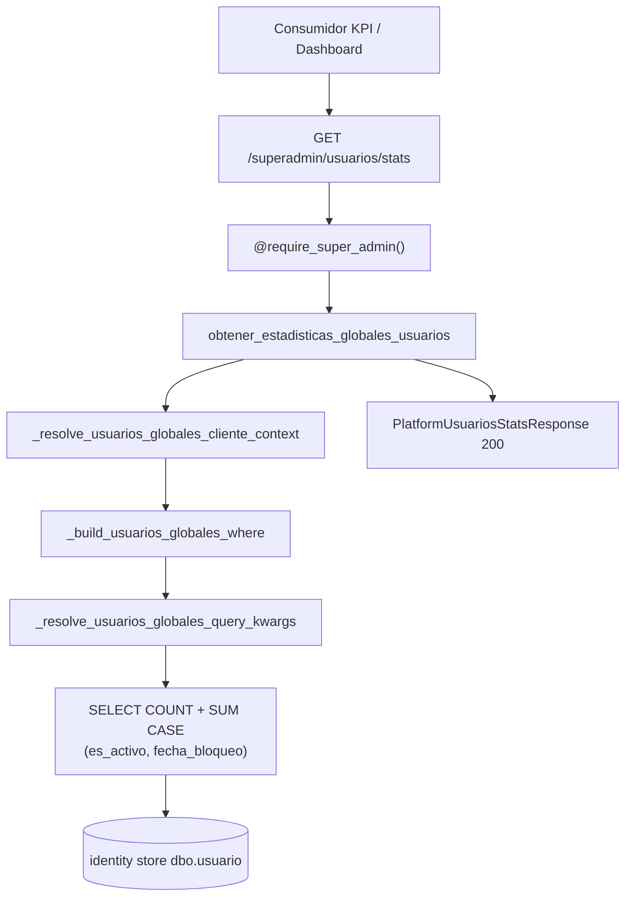

# F13-M3 — Backend: Endpoint agregado de estadísticas globales de usuarios

**Fecha:** 2026-06-25  
**Estado:** **IMPLEMENTADO**  
**Prerequisitos:** F13-M1 (diseño KPI vs enriquecimiento), F13-M2 (extracción `count_usuarios_globales`)  
**Alcance:** Backend exclusivamente — endpoint aditivo, sin cambio de contratos existentes.

---

## 0. Veredicto

| Criterio | Resultado |
|----------|-----------|
| Nuevo endpoint | `GET /api/v1/superadmin/usuarios/stats` |
| Listado enriquecido | **Sin cambio** — `GET /superadmin/usuarios/` intacto |
| J2 / J3 / RI-39 / OSR en stats | **No invocados** en flujo stats |
| Tests M3 + regresión M2/J2 | **17 passed** |
| Commits | **No** (por restricción del ticket) |

---

## 1. Arquitectura

### 1.1 Separación de intenciones (M1)

```text
┌──────────────────────────────────────────────────────────────┐
│  A) Estadísticas KPI (F13-M3)                                │
│  GET /superadmin/usuarios/stats                              │
│  → obtener_estadisticas_globales_usuarios                    │
│  → 1× SELECT agregado (COUNT + SUM CASE)                     │
│  → Sin SELECT paginado, sin bucle J2                         │
└──────────────────────────────────────────────────────────────┘
                              │
                    comparte _build_usuarios_globales_where
                    + _resolve_usuarios_globales_query_kwargs
                              │
┌──────────────────────────────────────────────────────────────┐
│  B) Listado global enriquecido (sin cambio)                  │
│  GET /superadmin/usuarios/                                   │
│  → get_usuarios_globales → COUNT + SELECT + enrich J2        │
└──────────────────────────────────────────────────────────────┘
```

### 1.2 Diagrama Mermaid



---

## 2. Responsabilidades por capa

| Capa | Artefacto | Responsabilidad |
|------|-----------|-----------------|
| Presentation | `endpoints_usuarios.py` → `get_usuarios_globales_stats` | HTTP, query params, RBAC Super Admin, mapeo schema |
| Application | `SuperadminUsuarioService.obtener_estadisticas_globales_usuarios` | Orquestación COUNT-only agregado |
| Shared WHERE | `_build_usuarios_globales_where` (M2) | Paridad filtros con listado |
| Routing store | `_resolve_usuarios_globales_query_kwargs` (M2) | Global read vs OSR mono-tenant |
| Schema | `PlatformUsuariosStatsResponse` | Contrato JSON stats |

---

## 3. Métricas devueltas

| Campo | SQL | Definición |
|-------|-----|------------|
| `total_usuarios` | `COUNT(*)` | Usuarios no eliminados (`es_eliminado = 0`) tras filtros |
| `usuarios_activos` | `SUM(CASE WHEN es_activo = 1 …)` | Subconjunto activo |
| `usuarios_inactivos` | `SUM(CASE WHEN es_activo = 0 …)` | Subconjunto inactivo |
| `usuarios_bloqueados` | `SUM(CASE WHEN fecha_bloqueo IS NOT NULL …)` | Bloqueo por intentos fallidos |

**Semántica bloqueo:** columna `usuario.fecha_bloqueo` (tabla identity store). No implica soft-delete.

---

## 4. Decisiones arquitectónicas

| ID | Decisión | Justificación |
|----|----------|---------------|
| D-M3-01 | Endpoint dedicado `/stats` vs flag en listado | O1 M1 — contrato explícito, OpenAPI claro, evita anti-patrón `limit=1` |
| D-M3-02 | Una query agregada multi-métrica | Una ronda identity store; cumple “solo agregados” |
| D-M3-03 | No reutilizar `get_usuarios_globales()` | Ticket M3 — método independiente |
| D-M3-04 | Reutilizar builders M2 (WHERE, kwargs) | Paridad filtros stats ↔ listado ↔ count |
| D-M3-05 | `total_usuarios` paridad con `count_usuarios_globales` | Mismo WHERE sin `es_activo`; tests verifican equivalencia |
| D-M3-06 | Sin `es_activo` en query params stats | El endpoint expone desglose activo/inactivo |
| D-M3-07 | Ruta `/stats` antes de `/{usuario_id}/` | Evita captura path param por FastAPI |

---

## 5. Relación con F13-M2

| Elemento M2 | Uso en M3 |
|-------------|-----------|
| `_build_usuarios_globales_where` | **Reutilizado** — filtros search, proveedor, cliente_id |
| `_usuarios_globales_where_to_named` | **Reutilizado** — bind params TD-08 |
| `_resolve_usuarios_globales_query_kwargs` | **Reutilizado** — global vs dedicated routing |
| `_resolve_usuarios_globales_cliente_context` | **Reutilizado** — validación cliente mono-tenant |
| `count_usuarios_globales` | **Paridad semántica** — `total_usuarios` equivalente; no invocado en runtime del servicio stats (una sola query) |
| `get_usuarios_globales` | **No tocado** |

---

## 6. Estrategia de compatibilidad

| Consumidor | Comportamiento post-M3 |
|------------|------------------------|
| `GET /superadmin/usuarios/` | Idéntico — paginación, enriquecimiento J2, RI-39 posible en bootstrap |
| `GET /superadmin/usuarios/?limit=1` (KPI legacy) | Sigue funcionando — **desaconsejado** para KPI |
| Nuevo `GET /superadmin/usuarios/stats` | Recomendado para widgets agregados |
| J3 dashboard clientes | Sin cambio |
| OpenAPI listado | Sin cambio de `PaginatedUsuarioSuperadminResponse` |

**Principio:** additive-only. Migración de consumidores vía contrato FE (`F13_M3_FRONTEND_CONTRACT.md`).

---

## 7. Justificación del nuevo endpoint

1. **Elimina RI-39 en bootstrap KPI:** W12 usaba listado con `limit=1` ejecutando reachability/OSR en la primera fila (F13-L2, F13-M1).
2. **Contrato explícito:** respuesta sin `usuarios[]`, sin paginación, sin campos J2 degradados.
3. **Performance:** 1 query agregada vs COUNT + SELECT + N× enriquecimiento.
4. **Desglose operativo:** activos / inactivos / bloqueados en una sola llamada.

---

## 8. Restricciones cumplidas

El flujo stats **no invoca**:

- `check_platform_tenant_reachability()`
- `_obtener_roles_usuario()`
- `UsuarioService.get_user_level_info()` / `get_user_access_level`
- `is_super_admin()` (enrichment path)
- `get_usuarios_globales()`

**No modifica:** routing, `execute_query`, `query_helpers`, OSR core, J2/J3 endpoints.

---

## 9. Tests

**Archivo:** `tests/unit/test_f13_m3_platform_usuarios_stats.py`

| Test | Verifica |
|------|----------|
| `test_stats_returns_all_aggregate_metrics` | 4 campos numéricos |
| `test_stats_empty_result_returns_zeros` | Fail-safe vacío |
| `test_stats_executes_single_aggregate_query_without_pagination` | 1 query, sin OFFSET/FETCH |
| `test_stats_does_not_invoke_enrichment_or_reachability` | Sin reachability/roles/level/list |
| `test_stats_total_parity_with_count_usuarios_globales` | Paridad total con M2 |
| `test_stats_mono_tenant_resolves_osr_kwargs_without_enrichment` | OSR kwargs sin J2 |

**Regresión:**

```bash
python -m pytest tests/unit/test_f13_m3_platform_usuarios_stats.py \
  tests/unit/test_f13_m2_count_usuarios_globales_parity.py \
  tests/unit/test_f13_j2_platform_fail_soft_superadmin_usuarios.py -v
```

---

## 10. Referencias

| Documento | Relación |
|-----------|----------|
| `F13_M1_KPI_ENRICHMENT_ARCHITECTURE.md` | Diseño A/B |
| `F13_M2_INTERNAL_REFACTOR.md` | COUNT extraído |
| `F13_J2_PLATFORM_FAIL_SOFT_SUPERADMIN_USUARIOS.md` | Listado enriquecido |
| `F13_M3_FRONTEND_CONTRACT.md` | Contrato consumidor agnóstico |

---

**Fin F13-M3 — sin commits.**
