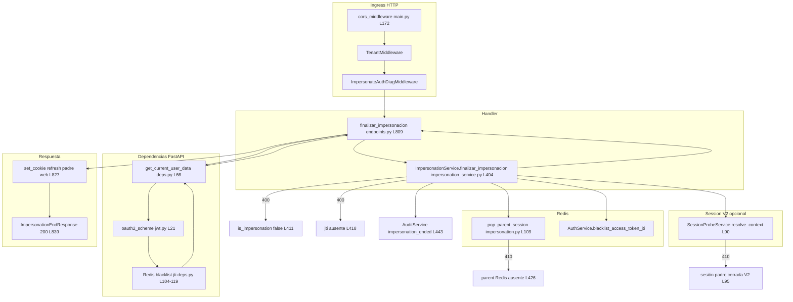
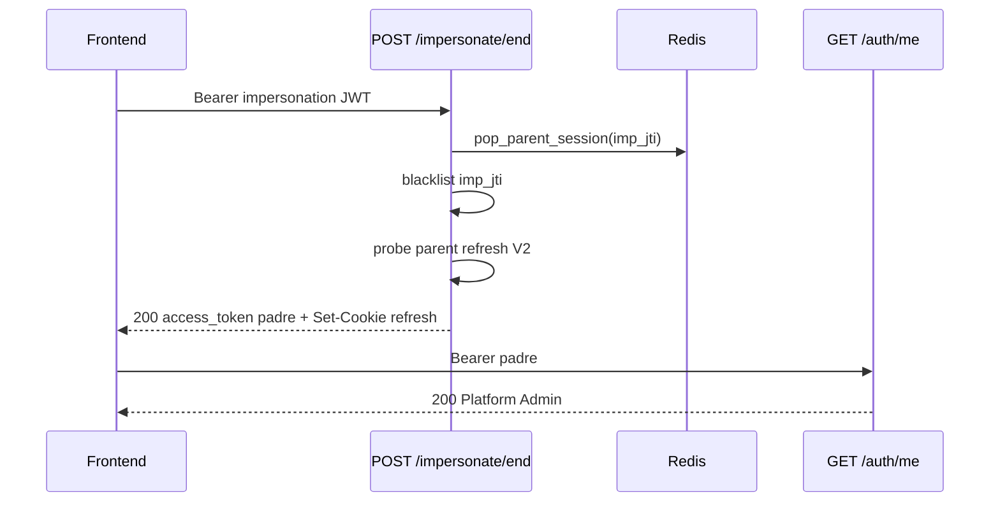

# F13-N1 — Auditoría del flujo de salida de Impersonation

**Fecha:** 2026-06-25  
**Alcance:** `POST /api/v1/auth/impersonate/end/`  
**Modo:** Solo auditoría — **sin implementación, commits ni cambios de código**  
**Síntoma reportado:** HTTP **403** en `impersonate/end`, pero `GET /auth/me`, `GET /auth/permissions/me` y `GET /auth/menu` reconstruyen correctamente la sesión Platform Admin.

---

## 0. Resumen ejecutivo

| Pregunta | Respuesta |
|----------|-----------|
| ¿Quién devuelve 403 en `/impersonate/end/`? | **Nadie en el handler ni en el servicio actual.** La ruta no tiene código que emita 403. |
| ¿Línea exacta del 403? | **No aplica al endpoint auditado.** El único 403 en `main.py` del pipeline HTTP es CORS preflight (`OPTIONS`), L196. |
| ¿Token padre ya restaurado cuando aparece 403? | **No.** La restauración ocurre al final de `ImpersonationService.finalizar_impersonacion` (L457–464), después de `pop_parent_session` y blacklist. Si la request falla en dependencias (401), Redis no se toca. |
| ¿RBAC antes o después de restaurar? | **No se evalúa RBAC** en `/impersonate/end/`. Solo `get_current_user_data` (decode JWT + blacklist). RBAC entra en `/me`, `/permissions/me`, `/menu` vía `get_current_active_user` / `require_erp_session`. |
| ¿El flujo termina exitoso pese al 403? | **La sesión Platform puede quedar operativa sin que `/impersonate/end` haya respondido 200**, gracias al **refresh cookie padre** que no se sustituye al iniciar impersonación. El FE puede reconstruir vía `POST /auth/refresh` + lecturas auth. |
| ¿Conclusión? | Hay **inconsistencia observada vs contrato de código**: el backend define éxito como **200** con tokens padre; un **403 en esta ruta no es producido por la lógica de negocio actual** y apunta a request colateral, CORS preflight, o capa externa. La “recuperación” posterior es coherente con el **fallback por refresh cookie padre**. |

---

## 1. Entry point y dependencias

| Campo | Valor |
|-------|-------|
| Ruta HTTP | `POST /api/v1/auth/impersonate/end/` |
| Montaje | `app/api/v1/api.py` L68–72 → `prefix="/auth"` |
| Handler | `finalizar_impersonacion` — `app/modules/auth/presentation/endpoints.py` L809–839 |
| `response_model` | `ImpersonationEndResponse` |
| Dependencias FastAPI | `Request`, `Response`, `payload: Dict = Depends(get_current_user_data)` |
| **No usa** | `require_super_admin()`, `get_current_active_user`, `require_erp_session`, `require_permission`, `enforce_password_change_policy` |

Contraste con inicio de impersonación (`POST /impersonate/{cliente_id}/`):

| Endpoint | RBAC / usuario BD | Dependencia auth |
|----------|-------------------|------------------|
| `POST /impersonate/{cliente_id}/` | `require_super_admin()` → `get_current_active_user` | Sí — operador debe ser Platform Admin |
| `POST /impersonate/end/` | **Ninguno** | Solo `get_current_user_data` — JWT impersonación válido |

---

## 2. Call graph completo



### 2.1 Cadena por capa (orden de ejecución)

1. **Middleware CORS** (`app/main.py` L172–207): en `OPTIONS` con `Origin` no permitido → **403** `"Origin not allowed"` (L196). En `POST` no bloquea; solo omite headers CORS si origin inválido.
2. **TenantMiddleware**: resuelve `cliente_id` desde Host → ContextVar. **No emite 403.**
3. **ImpersonateAuthDiagMiddleware**: solo logs en paths que contienen `/auth/impersonate`. **No altera status.**
4. **`oauth2_scheme`**: sin `Authorization` → **401** `"Not authenticated"`.
5. **`get_current_user_data`** (`deps.py` L66–168):
   - JWT inválido / sin `sub` → **401**
   - `jti` en blacklist Redis → **401** `"Token revocado"`
   - **No consulta BD, no RBAC, no password-change enforcement**
6. **`ImpersonationService.finalizar_impersonacion`** (`impersonation_service.py` L404–464):
   - Ver tabla §4 (códigos HTTP posibles).
7. **Handler** (`endpoints.py` L824–839):
   - Web: `response.set_cookie` con `parent_refresh_token`
   - Mobile: `refresh_token` en body
   - Retorno **200** + `ImpersonationEndResponse`

---

## 3. Timeline cronológico (estados de sesión)

### 3.1 Antes de impersonación (Platform Admin logueado)

| Artefacto | Estado |
|-----------|--------|
| **Access JWT** | Platform: `user_type=platform_admin`, `cliente_id=SYSTEM`, `is_impersonation` ausente/false, `access_level≥5` |
| **Refresh cookie (web)** | JWT padre del operador; **sin** `is_impersonation` |
| **Redis** | Sin clave `impersonation:parent:{jti}` |

### 3.2 Tras `POST /impersonate/{cliente_id}/` (impersonación activa)

| Artefacto | Estado |
|-----------|--------|
| **Access JWT (Bearer FE)** | Impersonación: `is_impersonation=true`, `cliente_id=<tenant target>`, `sub=superadmin`, `impersonated_by`, `effective_scope=tenant`, TTL 120 min, **sin refresh propio** |
| **Refresh cookie (web)** | **Sin cambio** — sigue siendo el refresh **padre** Platform (no se rota ni borra en `iniciar_impersonacion` / handler L743–787) |
| **Redis** | `impersonation:parent:{imp_jti}` → `{ parent_access_token, parent_refresh_token }` TTL 120 min |

Evidencia: `iniciar_impersonacion` lee cookie padre (L768–769) y la guarda en Redis; el handler de inicio devuelve solo `_access_only_token_response` — **no `set_cookie`**.

### 3.3 Durante `POST /impersonate/end/` (orden interno del servicio)

| Paso | Momento | Access impersonación | Redis parent | Refresh cookie | ¿Padre “restaurado” en cliente? |
|------|---------|----------------------|--------------|----------------|--------------------------------|
| T0 | Request entra | Activo (Bearer imp) | Presente | Padre (sin cambio) | No |
| T1 | `get_current_user_data` OK | Activo | Presente | Padre | No |
| T2 | `pop_parent_session(jti)` | Activo | **Eliminado** | Padre | No (solo servidor lee Redis) |
| T3 | `blacklist_access_token_jti(imp_jti)` | **Revocado** en Redis | Vacío | Padre | No |
| T4 | `_assert_parent_refresh_restorable_v2` | Revocado | Vacío | Padre | No |
| T5 | Audit `impersonation_ended` | Revocado | Vacío | Padre | No |
| T6 | Handler `set_cookie` + body 200 | Revocado | Vacío | **Padre reescrito** (web) | **Sí** — `access_token` padre en body |

**Punto crítico:** si la request **falla antes de T2** (p. ej. 401 en deps), Redis y blacklist de impersonación **no se modifican**. Si falla **entre T2 y T6** (p. ej. 410 en probe), el impersonation access queda blacklisted y Redis vacío, pero el **refresh cookie padre sigue válido** en el navegador.

### 3.4 Después — escenario “403 observado + /me OK” (hipótesis coherente con código)

| Paso | Request | Token usado | Resultado esperado |
|------|---------|-------------|-------------------|
| A | `POST /impersonate/end/` | Bearer impersonación | **No 403 en código actual**; si falla en deps → 401; si falla post-pop → 410 |
| B | `POST /auth/refresh/` (fallback FE o interceptor) | Cookie refresh **padre** | **200** — emite nuevo access Platform (refresh no tiene `is_impersonation`) |
| C | `GET /auth/me/` | Bearer Platform (post-refresh o post-end 200) | **200** — `is_impersonation=false`, `user_type=platform_admin` |
| D | `GET /auth/permissions/me`, `GET /auth/menu` | Idem | **200** — RBAC Platform (`is_super_admin` en payload, `suppress_platform_privileges` no aplica) |

El IAM spec advierte explícitamente: no invocar refresh durante impersonación (FE-20 / §7.13), pero el **cookie padre** no es token de impersonación; el refresh endpoint solo rechaza refresh con claim `is_impersonation=true` (`endpoints.py` L1380–1387).

---

## 4. Códigos HTTP emitidos por el flujo `/impersonate/end/` (código actual)

| Código | Origen | Archivo:Línea | Condición |
|--------|--------|---------------|-----------|
| **401** | `oauth2_scheme` / `get_current_user_data` | `jwt.py` L32–68, `deps.py` L99–119 | Sin Bearer, JWT malformado, `sub` ausente, token revocado (blacklist) |
| **400** | `ImpersonationService` | `impersonation_service.py` L411–414 | `is_impersonation=false` en payload |
| **400** | `ImpersonationService` | `impersonation_service.py` L418–421 | `jti` ausente en token impersonación |
| **410** | `ImpersonationService` | `impersonation_service.py` L426–431 | `pop_parent_session` vacío / sin `parent_access_token` |
| **410** | `ImpersonationService` | `impersonation_service.py` L94–100 | Session V2: probe padre `is_active=false` |
| **200** | Handler | `endpoints.py` L819–839 | Flujo completo OK |
| **500** | Handler catch-all | `endpoints.py` L842–846 | Excepción no HTTPException |
| **403** | — | — | **No hay rama 403 en handler, servicio ni `get_current_user_data`** |

Tests unitarios F11 confirman 410 (no 403) cuando la sesión padre V2 está cerrada: `test_f11_impersonation_end_v2_rejects_closed_parent_session` — `tests/unit/test_iam_sessions_v2_f11_secondary_flows.py` L603–640.

---

## 5. Evaluación RBAC

### 5.1 En `POST /impersonate/end/`

| Mecanismo | ¿Se ejecuta? |
|-----------|--------------|
| `require_super_admin()` | **No** |
| `require_permission` | **No** |
| `get_current_active_user` | **No** |
| `validate_tenant_access` (403 cross-tenant) | **No** — solo vive en `get_current_active_user` (`deps.py` L240–250) |
| `enforce_password_change_policy` | **No** — solo en `get_current_active_user` (`deps.py` L344–351) |
| `impersonation_rbac` / `apply_impersonation_effective_permissions_to_user` | **No** |

**Orden:** RBAC **no interviene** en la salida de impersonación. La única puerta es JWT válido + no revocado + flags `is_impersonation` / `jti`.

### 5.2 En lecturas posteriores (`/me`, `/permissions/me`, `/menu`)

Tras restauración (200 en end o refresh padre):

| Endpoint | Dependencias | RBAC / scope |
|----------|--------------|--------------|
| `GET /auth/me/` | `require_active_password_session_v2_for_me` → `get_current_active_user` | Impersonación excluida del probe V2 (`deps_auth.py` L191–192). Platform: lookup en SYSTEM, `validate_tenant_access` OK para superadmin |
| `GET /auth/permissions/me` | `require_erp_session` + `require_full_session_payload` | `is_super_admin` en JWT Platform → catálogo completo ADMIN (`endpoints.py` L1180–1189) |
| `GET /auth/menu` | `require_erp_session` | `resolve_menu_cliente_id_for_session` + menú Platform (`endpoints.py` L1253–1291) |

Durante impersonación activa, estas mismas rutas usarían rama `impersonation_rbac` (tenant-effective). Tras salida, vuelven a rama Platform.

---

## 6. Mapa de HTTP 403 en el ecosistema impersonación (rutas **distintas** a `/end`)

Por si el 403 observado en DevTools corresponde a otra llamada en el mismo flujo de UI:

| Ruta | Archivo:Línea | Condición | ¿Aplica a salida? |
|------|---------------|-----------|-------------------|
| `OPTIONS` * | `main.py` L196 | CORS preflight, Origin no whitelist | Posible si FE cambia Origin al volver a Platform |
| `POST /auth/refresh/` | `endpoints.py` L1380–1387 | `refresh_payload.is_impersonation=true` | Solo si refresh cookie fuera anómalo; cookie padre normal **no** lleva el claim |
| `POST /auth/empresa/cambiar/` | `endpoints.py` L643–656 | `is_impersonation` en access | No es `/end`; bloqueo explícito durante impersonación |
| `get_current_active_user` | `deps.py` L247–250 | `validate_tenant_access` falla | **No** está en deps de `/end` |
| `require_super_admin` | `rbac.py` L344–347 | Operador no Platform Admin | Solo en **inicio** impersonación |
| `enforce_password_change_policy` | `password_change_enforcement.py` L135–138 | `PASSWORD_CHANGE_REQUIRED` | **No** en `/end` (whitelist W8 incluiría la ruta si usara `get_current_active_user`) |

---

## 7. Estado JWT / access / refresh — matriz resumida

| Fase | Access token (Bearer) | Refresh token (cookie web) | Redis `impersonation:parent:*` |
|------|------------------------|----------------------------|--------------------------------|
| Platform logueado | Padre Platform | Padre Platform | — |
| Impersonando | Hijo impersonación | **Padre Platform (sin rotar)** | `{parent_access, parent_refresh}` |
| End **200 OK** | Padre Platform (body) | Padre Platform (cookie re-set) | — (popped) |
| End falla deps (401) | Impersonación sigue válido* | Padre intacto | Intacto |
| End falla post-pop (410) | Impersonación blacklisted | Padre intacto | Vacío |
| Recuperación vía refresh | Nuevo access Platform | Rotación según V1/V2 | — |

\*Hasta expiración TTL o nuevo intento.

---

## 8. Frontend — ¿dispara nuevas llamadas tras el 403?

El repositorio backend **no contiene** el frontend. Inferencia desde contrato IAM (`IAM_SESSION_MANAGEMENT_V2_BACKEND_SPECIFICATION.md` §7.13, §8.2):

| Comportamiento FE documentado | Efecto si `/end` no devuelve 200 |
|------------------------------|----------------------------------|
| Tras login/impersonate, access en memoria | Tras fallo de `/end`, FE puede conservar access impersonación (inútil) o limpiarlo |
| Web: refresh en cookie HttpOnly **no tocada** en inicio impersonación | **`POST /auth/refresh` sigue siendo viable** con sesión Platform |
| Interceptor 401 → refresh una vez | Puede ejecutar refresh en paralelo o tras error de `/end` |
| No refresh durante impersonación (norma FE) | Si el FE ignora la norma o trata `/end` fallido como “reset”, refresh es el camino natural |

**Conclusión FE (inferida):** Es **plausible** que tras un error en `/end` el cliente invoque `refresh` + `me` + `permissions/me` + `menu`, produciendo sesión Platform correcta **sin** que `/impersonate/end` haya completado 200.

Para confirmar en runtime: correlacionar en DevTools **Response body `detail`** del 403 con la tabla §6 y verificar si existe un `POST /auth/refresh` inmediatamente anterior/posterior con **200**.

---

## 9. Diagrama de secuencia — flujo nominal vs observado

### 9.1 Nominal (contrato backend)



### 9.2 Observado (síntoma 403 + recuperación)

```mermaid
sequenceDiagram
    participant FE as Frontend
    participant END as POST /impersonate/end
    participant REF as POST /auth/refresh
    participant ME as GET /auth/me

    FE->>END: Bearer impersonation JWT
  Note over END: Código actual no emite 403
    END-->>FE: 403 (origen a confirmar: CORS/colateral/infra)
    FE->>REF: Cookie refresh padre Platform
    REF-->>FE: 200 nuevo access Platform
    FE->>ME: Bearer Platform
    ME-->>FE: 200 Platform Admin
```

---

## 10. Punto exacto donde **no** nace un 403 (y dónde buscarlo)

### 10.1 Veredicto sobre `/impersonate/end/`

Tras revisión estática de:

- `app/modules/auth/presentation/endpoints.py` L798–847  
- `app/modules/auth/application/services/impersonation_service.py` L404–464  
- `app/api/deps.py` L66–168  
- Middleware en `app/main.py` L87–207  

**No existe instrucción `HTTP_403_FORBIDDEN` ni `AuthorizationError` en la cadena de `/impersonate/end/`.**

El síntoma **403 + sesión finalmente OK** es explicable como:

1. **Request mal atribuida** en DevTools (otra URL del mismo flujo UI).  
2. **CORS preflight `OPTIONS`** con 403 (`main.py` L196) — el POST real puede no haberse registrado igual.  
3. **Capa externa** (proxy, API gateway, WAF) no presente en este repo.  
4. **Éxito parcial no aplicable a 403** — si el servicio llegara a T2–T3, el código devolvería 410 (V2) o 200, no 403.

### 10.2 Acción de verificación runtime (fuera de alcance implementación)

Con `ENABLE_IMPERSONATE_DIAG=true` y `ENABLE_HTTP_TRACE=true`:

1. Filtrar logs `[IMPERSONATE-AUTH]` y `[{SYSTEM}] ... POST /api/v1/auth/impersonate/end/`  
2. Comparar `status_code` del middleware de logging (`main.py` L227) con el del navegador  
3. Leer `detail` / `error_code` del JSON de error  
4. Confirmar si hay `POST /api/v1/auth/refresh/` adyacente con 200  

---

## 11. Conclusión

1. **`POST /api/v1/auth/impersonate/end/` está diseñado para responder 200** con el access token padre y, en web, restaurar la cookie refresh padre. Los fallos de negocio documentados son **400**, **401**, **410** o **500** — no **403**.

2. **RBAC no participa** en la salida de impersonación; solo validación JWT ligera. La evaluación RBAC ocurre **después**, en las lecturas de perfil/menú/permisos, cuando el cliente ya opera con token Platform.

3. **El token padre no se “restaura” en el cliente antes** de completar el handler con éxito; internamente, `pop_parent_session` ocurre **antes** de devolver tokens, por lo que un fallo tardío deja al servidor sin copia Redis pero **con refresh cookie padre** aún en el navegador.

4. La **paridad funcional observada** (sesión Platform OK tras 403) es **compatible con recuperación vía refresh cookie padre**, no con un `/impersonate/end` exitoso silencioso. El flujo **no termina exitoso por HTTP** si la respuesta real fue 403 en esa URL; termina exitoso **funcionalmente** por un camino alternativo de re-autenticación con la sesión Platform que nunca se invalidó en cookie.

5. **Remediación** (fuera de alcance F13-N1): requiere evidencia runtime del `detail` del 403 y traza FE; el código backend del endpoint en sí no contiene la rama defectuosa que explique 403.

---

## 12. Referencias de código

| Tema | Ubicación |
|------|-----------|
| Handler end | `app/modules/auth/presentation/endpoints.py` L798–847 |
| Servicio finalizar | `app/modules/auth/application/services/impersonation_service.py` L404–464 |
| Redis parent | `app/core/auth/impersonation.py` L88–117 |
| Auth deps | `app/api/deps.py` L66–168 |
| Inicio (contraste RBAC) | `endpoints.py` L727–787, `rbac.py` L276–361 |
| Refresh bloqueado en impersonación | `endpoints.py` L1380–1387 |
| Whitelist password-change | `password_change_enforcement.py` L37–55 |
| IAM contrato FE | `app/docs/iam/IAM_SESSION_MANAGEMENT_V2_BACKEND_SPECIFICATION.md` §7.13, §8 |
| Tests F11 end | `tests/unit/test_iam_sessions_v2_f11_secondary_flows.py` L603–680 |

---

*Auditoría F13-N1 — solo lectura. Sin cambios de código ni commits.*
