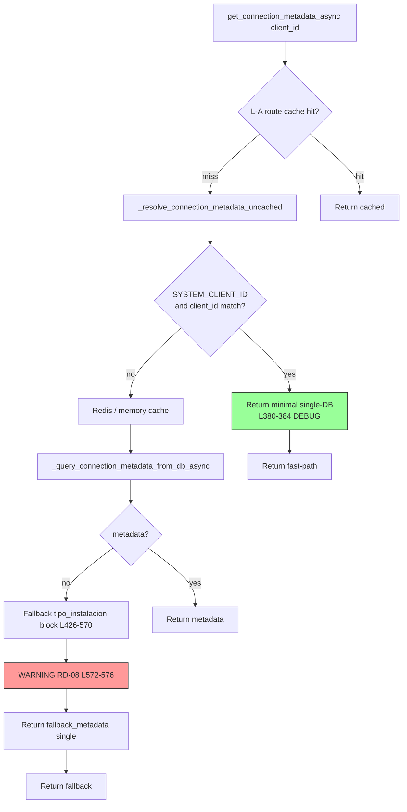
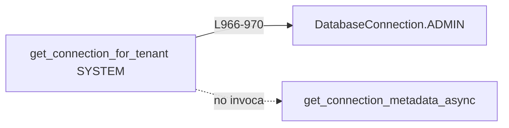

# F13-N2 — Auditoría arquitectónica: resolución de metadata para Platform Owner (SYSTEM)

**Fecha:** 2026-06-25  
**Modo:** Solo auditoría — **sin implementación, commits ni cambios de código**  
**Alcance estricto:** `app/core/tenant/routing.py` y helpers directos (`connection_cache`, `record_metadata_fallback_shared` en `cache.py`)  
**Síntoma runtime:** `[METADATA] No se encontró metadata para cliente 00000000-0000-0000-0000-000000000001. Usando SINGLE-DB como fallback (RD-08).`

**UUID analizado:** `00000000-0000-0000-0000-000000000001` — Platform Owner / cliente SYSTEM (`SUPERADMIN_CLIENTE_ID`).

---

## Resumen de respuestas (7 puntos)

| # | Pregunta | Respuesta |
|---|----------|-----------|
| 1 | ¿Tratado igual que cualquier tenant? | **No** |
| 2 | ¿Excepción explícita Platform Owner? | **Sí** — ver §2 |
| 3 | ¿Pipeline metadata debería ejecutarse? | **B) No — debería existir fast-path** (ya diseñado en código) |
| 4 | ¿Qué origina el warning RD-08? | `_resolve_connection_metadata_uncached` L572–576 |
| 5 | ¿Fallback cambia comportamiento observable? | **No** (en el escenario SYSTEM / single-DB típico) |
| 6 | ¿Sin warning cambiaría algo funcional? | **No** |
| 7 | Clasificación | **B) Optimización arquitectónica** (observabilidad / path redundante) |

---

## 1. ¿El cliente SYSTEM está siendo tratado exactamente igual que cualquier tenant?

### Respuesta: **No**

### Evidencia en `routing.py`

El módulo documenta explícitamente un tratamiento distinto:

```17:20:app/core/tenant/routing.py
FALLBACK:
- Si no hay metadata → Single-DB (bd_sistema)
- Si falla conexión Multi-DB → Single-DB (bd_sistema)
- Si cliente_id es SYSTEM → ADMIN connection
```

**Excepción A — resolución de metadata (fast-path):**

```377:384:app/core/tenant/routing.py
    # Caso especial: SYSTEM siempre usa Single-DB
    if SYSTEM_CLIENT_ID and client_id == SYSTEM_CLIENT_ID:
        logger.debug(f"[METADATA] Cliente {client_id} es SYSTEM, usando Single-DB")
        return {
            "database_type": "single",
            "nombre_bd": settings.DB_DATABASE,
            "tipo_instalacion": "cloud"
        }
```

Condición: `SYSTEM_CLIENT_ID` truthy **y** igualdad UUID estricta con `client_id`.

Constante de módulo:

```50:51:app/core/tenant/routing.py
# Convertir SUPERADMIN_CLIENTE_ID de string a UUID
SYSTEM_CLIENT_ID = UUID(settings.SUPERADMIN_CLIENTE_ID) if settings.SUPERADMIN_CLIENTE_ID else None
```

**Excepción B — router de sesión async (sin metadata):**

```965:970:app/core/tenant/routing.py
    # 2. Para superadmin, usar conexión ADMIN
    if SYSTEM_CLIENT_ID and cliente_id == SYSTEM_CLIENT_ID:
        logger.debug(f"[ROUTER] Cliente {cliente_id} es SuperAdmin, usando conexión ADMIN")
        async with get_db_connection(DatabaseConnection.ADMIN) as session:
            yield session
        return
```

`get_connection_for_tenant()` **no invoca** `get_connection_metadata_async()` cuando el cliente es SYSTEM.

### Corolario sobre el warning observado

El mensaje RD-08 se emite **solo** en la rama genérica de fallback (L572–576), **después** de:

- miss de cache Redis (L386–398),
- miss de cache memoria (L401–406),
- `_query_connection_metadata_from_db_async()` retornando `None` (L410–207),
- bloque de recuperación `tipo_instalacion` (L426–570).

Por tanto, en la ejecución que produjo el warning, la condición L378 **no se cumplió** (`SYSTEM_CLIENT_ID` falsy **o** `client_id ≠ SYSTEM_CLIENT_ID`), **o** el resultado ya estaba cacheado en L-A desde una resolución previa sin fast-path (ver §6).

Arquitectónicamente SYSTEM **no está diseñado** como tenant operativo con `cliente_conexion` dedicada; el warning indica que **en esa ejecución** entró al pipeline genérico de tenant.

---

## 2. ¿Existe alguna excepción explícita para Platform Owner?

### Respuesta: **Sí**

| Ubicación | Función | Comportamiento |
|-----------|---------|----------------|
| `routing.py` L50–51 | Módulo | `SYSTEM_CLIENT_ID` desde `settings.SUPERADMIN_CLIENTE_ID` |
| `routing.py` L377–384 | `_resolve_connection_metadata_uncached` | Fast-path: metadata mínima single-DB, **sin** consulta `cliente_conexion` |
| `routing.py` L965–970 | `get_connection_for_tenant` | Conexión **ADMIN**, bypass total de metadata |
| `routing.py` L843–853 | `get_db_connection_for_current_tenant` | Fuera de contexto → usa `SYSTEM_CLIENT_ID` |
| `routing.py` L953–958 | `get_connection_for_tenant` | Sin contexto tenant → `SYSTEM_CLIENT_ID` |

**No hay** otra excepción SYSTEM dentro de `get_connection_metadata_async()` propiamente dicha: la excepción vive en `_resolve_connection_metadata_uncached()` (invocada en cache miss L-A).

---

## 3. ¿El pipeline de metadata debería ejecutarse para Platform Owner?

### Respuesta: **B) No, debería existir un fast-path**

### Justificación (solo arquitectura existente, sin propuesta de cambio)

1. **Documentación del módulo (L17–20):** SYSTEM se asocia a conexión ADMIN / single-DB, no a resolución `cliente_conexion` por tenant.

2. **Fast-path ya implementado (L377–384):** retorno determinista sin BD tenant-data store metadata — alineado con que SYSTEM es identidad de plataforma en CP, no tenant ERP con Storage Endpoint.

3. **`get_connection_for_tenant` (L965–970):** diseño dual — operaciones que usan el router central **no** pasan por metadata para SYSTEM.

4. **Semántica RD-08 (L358–359):** el fallback shared existe para tenants **shared/legacy sin fila en `cliente_conexion`**. SYSTEM no es un tenant shared más; es el owner de plataforma. Aplicar RD-08 a SYSTEM mezcla semánticas (control plane vs tenant_data).

5. **Consulta `_query_connection_metadata_from_db_async` (L191–195):** exige `cliente_conexion` principal activa. Ausencia de fila para SYSTEM es **esperable**; no es señal de misconfiguración de tenant, sino de que el fast-path debería haber cortocircuitado antes.

**Conclusión arquitectónica:** el diseño vigente **prevé** fast-path; ejecutar el pipeline completo + RD-08 para SYSTEM es **redundante**, no el camino canónico.

---

## 4. ¿Qué origina exactamente el warning RD-08?

| Campo | Valor |
|-------|-------|
| **Función** | `_resolve_connection_metadata_uncached` |
| **Archivo** | `app/core/tenant/routing.py` |
| **Líneas** | **572–576** (log WARNING) + **577** (`record_metadata_fallback_shared()`) |

### Condición exacta (cadena lógica)

El warning se alcanza cuando **todas** estas condiciones son verdaderas en la misma invocación:

1. **L378:** `not (SYSTEM_CLIENT_ID and client_id == SYSTEM_CLIENT_ID)` — fast-path SYSTEM **no** ejecutado.

2. **L386–406:** miss cache Redis y miss cache memoria (`connection_cache.get`).

3. **L410–411:** `metadata = await _query_connection_metadata_from_db_async(client_id)` → **`None`** (sin fila `cliente_conexion` principal activa, o error de desencriptación retornando None L262–263).

4. **L426–570:** bloque fallback `tipo_instalacion`:
   - Si `tipo_instalacion == "dedicated"` sin endpoint válido → **fail-closed RI-39** (L553–556 / L567–570) — **no** llega al warning.
   - Para SYSTEM típico (shared / sin dedicated): continúa.

5. **L566–570:** `not _is_explicit_dedicated(tipo_instalacion_fallback)` — no es dedicated explícito.

6. **L572–576:** se emite el WARNING con `database_type_fallback` (por defecto `"single"`) y `tipo_instalacion_fallback` (por defecto `"shared"` si no hay fila en `cliente`).

### Texto del log

```572:576:app/core/tenant/routing.py
    logger.warning(
        f"[METADATA] No se encontró metadata para cliente {client_id}. "
        f"Usando {database_type_fallback.upper()}-DB como fallback (RD-08). "
        f"tipo_instalacion={tipo_instalacion_fallback}"
    )
```

### Helper asociado

`record_metadata_fallback_shared()` — `app/core/tenant/cache.py` L272–275 — incrementa métrica in-process RD-08 amended.

---

## 5. ¿El fallback SINGLE-DB cambia el comportamiento observable?

### Respuesta: **No** (escenario SYSTEM / single-DB habitual)

### Comparación de payloads

| Campo | Fast-path SYSTEM (L380–384) | Fallback RD-08 single (L578–586) |
|-------|----------------------------|----------------------------------|
| `database_type` | `"single"` | `"single"` (`database_type_fallback`) |
| `nombre_bd` | `settings.DB_DATABASE` | `settings.DB_DATABASE` (si single) |
| `tipo_instalacion` | `"cloud"` | `"shared"` (default) o valor de `cliente.tipo_instalacion` |
| Credenciales multi-DB | ausentes | ausentes (None en single) |

### Por qué no cambia el routing observable

1. Consumidores que usan `database_type == "single"` enrutan a **DEFAULT** / shared identity store — idéntico en ambos casos.

2. `_validate_dedicated_route_metadata` (L98–128) solo fail-closed si `tipo_instalacion == "dedicated"` — ni `"cloud"` ni `"shared"` activan RI-39.

3. `get_connection_for_tenant(SYSTEM)` usa **ADMIN** (L966–970) independientemente del dict devuelto por metadata.

4. El fallback **no inventa** Multi-DB para SYSTEM cuando `tipo_instalacion` no es dedicated.

**Matiz:** diferencia cosmética en `tipo_instalacion` (`cloud` vs `shared`); no altera `database_type` ni connection string single-DB en el código auditado.

---

## 6. Si el warning desapareciera, ¿cambiaría algún comportamiento funcional?

### Respuesta: **No**

Si el warning desaparece porque se toma el fast-path L377–384 (condición SYSTEM satisfecha):

- Mismo `database_type: single`
- Mismo `nombre_bd: settings.DB_DATABASE`
- Se evitan: query ADMIN a `cliente_conexion`, query fallback a `cliente`, log WARNING, incremento métrica RD-08
- Routing efectivo para consumidores de metadata single-DB: **equivalente**

Si desaparece por cache L-A / L-B con fallback ya materializado (L589 + L371): comportamiento ya era el del fallback; solo se suprime el log en invocaciones posteriores.

---

## 7. Clasificación del hallazgo

### Respuesta: **B) Optimización arquitectónica**

| Opción | ¿Aplica? | Motivo |
|--------|----------|--------|
| A) Comportamiento esperado | Parcial | RD-08 **está** diseñado para tenants shared sin metadata; el **resultado** single-DB es coherente |
| **B) Optimización arquitectónica** | **Sí** | Fast-path SYSTEM existe (L377–384) pero el warning demuestra ejecución del pipeline genérico — ruido operativo + trabajo CP innecesario |
| C) Defecto arquitectónico | No | No hay enrutamiento incorrecto a Multi-DB ni fail-closed indebido; el fallback converge al mismo single-DB |

### Justificación

- **No es defecto funcional:** el fallback RD-08 para SYSTEM produce el mismo plano de datos single-DB que el fast-path en condiciones normales (§5).
- **No es purely “esperado”:** la arquitectura del propio `routing.py` distingue SYSTEM de tenants y define fast-path explícito; ver el warning con UUID SYSTEM indica **desalineación path vs diseño**, no ausencia anómala de `cliente_conexion` en un tenant ERP.
- **Es optimización pendiente (conceptual):** garantizar que SYSTEM **siempre** tome L377–384 (o equivalente en L-A) evitaría consultas CP, warnings RD-08 y métricas fallback compartidas atribuibles al Platform Owner.

### Hipótesis de por qué el fast-path no evitó el warning (evidencia, sin implementar)

| Hipótesis | Evidencia en código |
|-----------|---------------------|
| `SYSTEM_CLIENT_ID is None` al evaluar L378 | L51: string vacío en `SUPERADMIN_CLIENTE_ID` → `SYSTEM_CLIENT_ID = None`; middleware puede aun así usar UUID fijo L288 en `middleware.py` (fuera de alcance pero explica UUID en log) |
| `client_id` ≠ `SYSTEM_CLIENT_ID` (tipos/valores) | L378 exige igualdad UUID; mismatch → pipeline genérico |
| Cache L-A devuelve fallback previo sin re-evaluar SYSTEM | `get_connection_metadata_async` L361–367 retorna binding cacheado antes de `_resolve`; primera vez aún pasa por `_resolve` |

**Nota de alcance:** esta auditoría **no** verifica valor runtime de `SUPERADMIN_CLIENTE_ID` en Docker; solo constata que el warning **requiere** haber saltado L378 en esa invocación de `_resolve_connection_metadata_uncached`.

---

## Diagrama — flujos SYSTEM vs tenant genérico





---

## Call graph acotado (funciones auditadas)

```text
get_connection_metadata_async(client_id, operation_class)
├── get_cached_route_binding()          [routing.py L361]
├── _resolve_connection_metadata_uncached(client_id)   [L369]
│   ├── [SYSTEM] fast-path L377-384
│   ├── get_cached (Redis)              [L390, infra externa]
│   ├── connection_cache.get()          [L401, cache.py L58]
│   ├── _query_connection_metadata_from_db_async()  [L410]
│   │   └── get_db_connection(ADMIN) + SELECT cliente_conexion JOIN cliente
│   ├── connection_cache.set()          [L414, L589]
│   ├── _validate_dedicated_route_metadata()  [L423, L541, L566]
│   ├── _raise_dedicated_route_fail_closed()    [L553, L567]
│   ├── logger.warning RD-08            [L572]  ← origen del síntoma
│   └── record_metadata_fallback_shared()     [L577, cache.py L272]
├── _validate_dedicated_route_metadata()  [L370]
└── set_cached_route_binding()          [L371]

get_connection_for_tenant(cliente_id=SYSTEM)
└── get_db_connection(ADMIN)            [L968] — bypass metadata
```

---

## Referencias de código (alcance N2)

| Artefacto | Rol |
|-----------|-----|
| `app/core/tenant/routing.py` | Resolución metadata, fast-path SYSTEM, warning RD-08 |
| `app/core/tenant/cache.py` | `connection_cache`, `record_metadata_fallback_shared` |
| `app/core/config.py` L51 | `SUPERADMIN_CLIENTE_ID` → `SYSTEM_CLIENT_ID` |

---

**Fin F13-N2 — solo auditoría. Sin modificaciones de código ni commits.**
