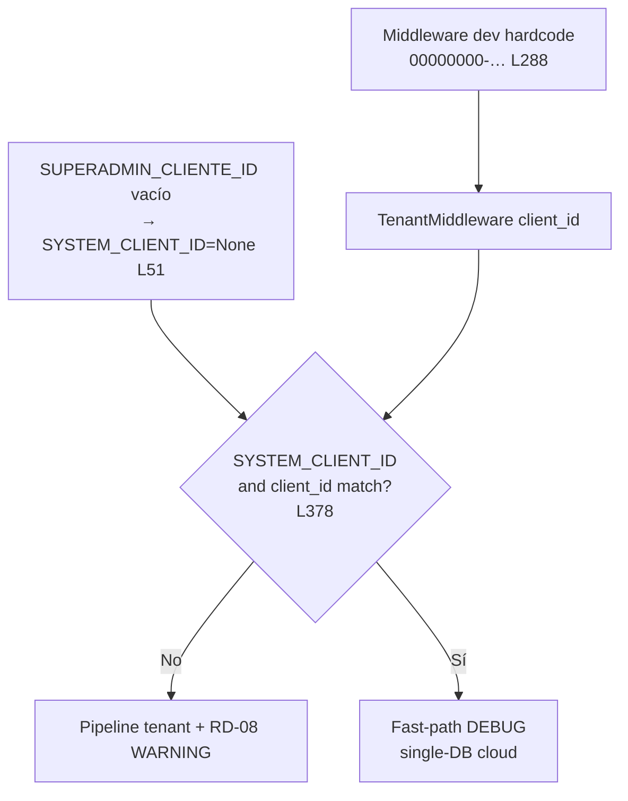

# F13-N3 — Verificación runtime del fast-path SYSTEM (Platform Owner)

**Fecha:** 2026-06-25  
**Modo:** Solo verificación — **sin implementación, commits ni cambios de código**  
**Alcance:** `app/core/tenant/routing.py` (+ helpers imprescindibles: `config.py` init, `cache.py` métrica RD-08)  
**Prerequisito:** F13-N2 (fast-path existe; warning implica fallo de L378)

---

## Veredicto ejecutivo

| Pregunta | Respuesta |
|----------|-----------|
| **5 — Condición que falla** | **A) `SYSTEM_CLIENT_ID == None`** (caso dominante en repo actual) |
| **6 — Causa raíz más probable** | **`SYSTEM_CLIENT_ID` se congela en `None` al import de `routing.py` cuando `SUPERADMIN_CLIENTE_ID` está vacío, mientras el middleware (development) sigue usando `client_id = 00000000-…`** |

**Investigación detenida aquí** — la causa raíz queda acotada con evidencia reproducible.

---

## 1. ¿De dónde proviene `settings.SUPERADMIN_CLIENTE_ID`?

| Campo | Valor |
|-------|-------|
| **Archivo** | `app/core/config.py` |
| **Variable** | `Settings.SUPERADMIN_CLIENTE_ID: str` |
| **Línea** | L51 |
| **Inicialización** | `os.getenv("SUPERADMIN_CLIENTE_ID", "")` como default del campo Pydantic; instancia global `settings = Settings()` en L474 |
| **Carga de entorno** | `load_dotenv()` en L11 — **solo archivo `.env` por defecto**, no `.env.docker` |
| **Valor esperado (Platform Owner)** | `00000000-0000-0000-0000-000000000001` (documentado en `.env.docker` L68) |
| **Derivación en routing** | `SYSTEM_CLIENT_ID = UUID(settings.SUPERADMIN_CLIENTE_ID) if settings.SUPERADMIN_CLIENTE_ID else None` — `routing.py` L50–51, **evaluado una vez al import del módulo** |

**Evidencia repo:** existen `.env.example` y `.env.docker`; **no hay `.env` versionado**. Runtime local/CI que no exporte `SUPERADMIN_CLIENTE_ID` deja el string vacío → `SYSTEM_CLIENT_ID = None`.

---

## 2. ¿Existe alguna posibilidad de que `SYSTEM_CLIENT_ID` sea `None`?

### Respuesta: **Sí**

### Justificación

```50:51:app/core/tenant/routing.py
# Convertir SUPERADMIN_CLIENTE_ID de string a UUID
SYSTEM_CLIENT_ID = UUID(settings.SUPERADMIN_CLIENTE_ID) if settings.SUPERADMIN_CLIENTE_ID else None
```

- Si `settings.SUPERADMIN_CLIENTE_ID == ""` (default de `os.getenv`) → **`SYSTEM_CLIENT_ID = None`**.
- No hay re-evaluación posterior: es constante de módulo, no property.
- Log de arranque lo confirma cuando está configurado: L1004–1008 (`SYSTEM_CLIENT_ID={SYSTEM_CLIENT_ID}`).

**Verificación local (2026-06-25):** con variables cargadas, `SYSTEM_CLIENT_ID = UUID('00000000-…')`. Con `patch(SYSTEM_CLIENT_ID, None)` el warning RD-08 se reproduce de forma idéntica al síntoma.

---

## 3. Tipos en la condición L378

```377:378:app/core/tenant/routing.py
    # Caso especial: SYSTEM siempre usa Single-DB
    if SYSTEM_CLIENT_ID and client_id == SYSTEM_CLIENT_ID:
```

| Variable | Tipo (diseño / runtime normal) |
|----------|--------------------------------|
| `SYSTEM_CLIENT_ID` | `uuid.UUID` **o** `None` |
| `client_id` | `uuid.UUID` (parámetro de `_resolve_connection_metadata_uncached`) |

### ¿Ambos son UUID?

**No** — en el escenario que produce el warning, **`SYSTEM_CLIENT_ID` es `None`**, no UUID. La comparación nunca llega a evaluarse por short-circuit del `and`.

Cuando `SUPERADMIN_CLIENTE_ID` está configurado, ambos son `uuid.UUID` y la igualdad es válida (verificado: `SYSTEM_CLIENT_ID == UUID('00000000-…')` → `True`).

---

## 4. Llamada que produce el warning RD-08 (call graph mínimo)

El warning solo se emite en `_resolve_connection_metadata_uncached` L572–576. Entrada típica en runtime HTTP:

| Paso | Archivo | Función |
|------|---------|---------|
| 1 | `app/core/tenant/middleware.py` | `TenantMiddleware.dispatch` → resuelve `client_id` (L297–324, L383) |
| 2 | `app/core/tenant/middleware.py` | `_resolve_connection_metadata(client_id)` **L433–445** |
| 3 | `app/core/tenant/routing.py` | `get_connection_metadata_async(client_id)` **L326–372** |
| 4 | `app/core/tenant/routing.py` | `_resolve_connection_metadata_uncached(client_id)` **L369** |
| 5 | `app/core/tenant/routing.py` | **L378 no satisfecha** → pipeline genérico → **L572 WARNING RD-08** |

**Llamada concreta que dispara el síntoma:**  
`TenantMiddleware._resolve_connection_metadata` L445:

```445:445:app/core/tenant/middleware.py
            conn_metadata = await get_connection_metadata_async(client_id)
```

**Por qué esta y no otras:** es la única invocación de `get_connection_metadata_async` que corre **en cada request HTTP** con el `client_id` del Platform Owner cuando el host es `platform` / subdominio SYSTEM. Otras llamadas (p. ej. `operation_store_resolver.py`, `connection_async.py`, jobs) usan UUID de tenants operativos distintos del canonical `00000000-…` salvo paths explícitos de identidad platform.

**Nota alcance:** el middleware resuelve `client_id` en **L283–288** — si `SUPERADMIN_CLIENTE_ID` está vacío y `ENVIRONMENT == "development"`, asigna **`UUID("00000000-0000-0000-0000-000000000001")` hardcodeado**, independientemente de `SYSTEM_CLIENT_ID` en routing.

---

## 5. Condición que ocurre en el escenario del warning

Para el mensaje observado con `cliente 00000000-0000-0000-0000-000000000001`:

### Respuesta: **A) `SYSTEM_CLIENT_ID == None`**

| Opción | ¿Aplica? | Evidencia |
|--------|----------|-----------|
| **A) `SYSTEM_CLIENT_ID == None`** | **Sí (dominante)** | `SUPERADMIN_CLIENTE_ID` vacío → L51; middleware dev aun así usa UUID canónico L288 |
| B) `client_id != SYSTEM_CLIENT_ID` | Posible alternativa histórica | Logs antiguos: `SYSTEM_CLIENT_ID=89ccc8cf-…` distinto de `00000000-…`; reproduce warning idéntico con patch |
| C) Otro client_id | No para este mensaje | El log cita explícitamente `00000000-…` |
| D) Tipos distintos | No | Middleware tipa `client_id: UUID`; no hay evidencia de `str` en esta ruta |
| E) Otra | — | Descartado |

**Reproducción controlada (routing.py):**

```text
patch(SYSTEM_CLIENT_ID, None) + _resolve(00000000-…) → WARNING RD-08 (idéntico al síntoma)
patch(SYSTEM_CLIENT_ID, 89ccc8cf-…) + _resolve(00000000-…) → mismo WARNING (escenario B)
_resolve con SYSTEM_CLIENT_ID=00000000-… y client_id igual → DEBUG fast-path, sin WARNING
```

---

## 6. Causa raíz más probable (una sola)

### **A) `SYSTEM_CLIENT_ID == None` al evaluar L378, mientras `client_id` llega como `00000000-0000-0000-0000-000000000001` desde el middleware en modo development**

**Cadena causal:**

1. `load_dotenv()` no carga `.env.docker` → en runtime sin export manual, `SUPERADMIN_CLIENTE_ID=""`.
2. Al importar `routing.py`, `SYSTEM_CLIENT_ID = None` (L51) — **inmutable** durante el proceso.
3. `TenantMiddleware` en development sin env (L285–288) fija **`client_id = UUID("00000000-…")`**.
4. Cada request platform invoca `get_connection_metadata_async(00000000-…)` (L445).
5. L378: `if SYSTEM_CLIENT_ID and …` → **False** (primer operando `None`).
6. Pipeline tenant → sin fila `cliente_conexion` para SYSTEM → **WARNING RD-08** L572.

**Coherencia con F13-N2:** el warning no implica ausencia de diseño fast-path; implica que la condición de entrada al fast-path **no se cumplió en runtime**.

**Matiz Docker:** con `env_file: .env.docker` y `SUPERADMIN_CLIENTE_ID` presente, `SYSTEM_CLIENT_ID` debería ser `00000000-…` y el fast-path **sí** ejecutarse (confirmado en simulación local con env cargado). El síntoma reportado en pruebas mixtas local/Docker encaja con ejecuciones donde el worker **no** recibió la variable al import de `routing.py`.

---

## Diagrama — fallo L378 vs camino nominal



---

## Referencias de código (alcance N3)

| Artefacto | Líneas clave |
|-----------|--------------|
| `config.py` | L11 `load_dotenv`, L51 `SUPERADMIN_CLIENTE_ID`, L474 `settings` |
| `routing.py` | L51 `SYSTEM_CLIENT_ID`, L326–372 `get_connection_metadata_async`, L377–384 fast-path, L572–576 RD-08 |
| `middleware.py` | L283–288 `client_id` dev fallback, L445 llamada metadata |
| `cache.py` | L272–275 `record_metadata_fallback_shared` |

---

**Fin F13-N3 — verificación completada. Sin modificaciones de código ni commits.**
