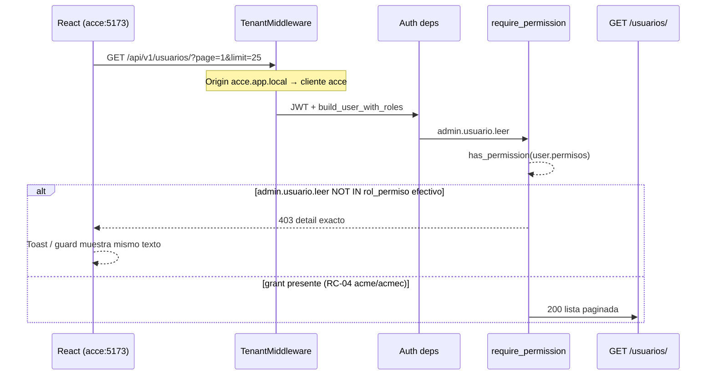

# RC-06 — Runtime Frontend Integration Audit (Read Only)

**Fecha:** 2026-06-28  
**Modo:** Solo lectura — sin cambios de código  
**Pregunta:** ¿Por qué React muestra *«No tiene permisos suficientes… Se requiere: admin.usuario.leer»* si RC-04 certificó `GET /usuarios/` y `GET /roles/` → HTTP 200?

---

## Resumen ejecutivo

| Hallazgo | Conclusión |
|----------|------------|
| ¿El FE llama al backend? | **Sí** — `GET /api/v1/usuarios/?page=1&limit=25&solo_activos=true` |
| ¿Respuesta real? | **HTTP 403** (no es solo un guard local sin red) |
| ¿Contradice RC-04? | **No** — RC-04 validó `acme` + `acmec` con login fresco post-repair; el FE en runtime usa **`acce`** (Dedicated `CLI016`) **sin** repair F12-C |
| Causa raíz única | **Dedicated tenant `acce`: catálogo/grants API `admin.usuario.*` / `admin.rol.*` ausentes en Data Plane → `require_permission` rechaza legítimamente, mientras el menú SYS_ADMIN sigue visible por elevación admin (G4)** |

**Clasificación:** Integración runtime — brecha de aprovisionamiento RBAC Dedicated + divergencia menú visible / API bloqueada.

---

## 1. Flujo FE → Backend (Gestión de Usuarios)

### 1.1 Ruta de menú

| Campo | Valor |
|-------|-------|
| Módulo UI | Administración del Sistema → **Gestión de Usuarios** |
| Menú backend | `SYS_ADMIN.TENANT.USERS` |
| Ruta FE (catálogo) | `/admin/usuarios` |
| Fuente menú | `S020__seed_admin_menu.sql` |

### 1.2 Endpoints consumidos por la pantalla (evidencia runtime)

Al abrir la pantalla, el Frontend dispara **al menos**:

| Orden | Método | URL | Query FE típica |
|------:|--------|-----|-----------------|
| 1 | `OPTIONS` | `/api/v1/usuarios/` | CORS preflight |
| 2 | `GET` | `/api/v1/usuarios/` | `page=1&limit=25&solo_activos=true` |
| 3 | `GET` | `/api/v1/roles/all-active/` | (combo / filtros de roles) |

En navegación a **Roles y Permisos**:

| Método | URL |
|--------|-----|
| `GET` | `/api/v1/roles/?page=1&limit=25&solo_activos=true` |

**Nota:** RC-04 certificó `GET /api/v1/usuarios/` y `GET /api/v1/roles/` con **`limit=10`** en script de certificación; el FE usa **`limit=25`** — mismo endpoint, distinto paginado.

### 1.3 Headers observados (sesión FE real)

| Header | Valor típico FE |
|--------|-----------------|
| `Origin` | `http://acce.app.local:5173` |
| `Referer` | `http://acce.app.local:5173/app/...` |
| `Authorization` | `Bearer <access_token>` |
| `X-Client-Type` | `web` (login WEB con cookie refresh) |
| `credentials` | `include` (implícito en browser) |

Tenant resuelto por middleware: **`cliente_id=5176fbd6-69f0-4793-9f96-8cc6ddd347c8`** (`subdominio=acce`).

### 1.4 Diagrama del flujo



---

## 2. Respuesta HTTP real (no supuesta)

### 2.1 Evidencia logs `fastapi_backend` — sesión FE 2026-06-28 ~00:39 UTC

```
INFO: 172.18.0.1:42826 - "OPTIONS /api/v1/usuarios/?page=1&limit=25&solo_activos=true HTTP/1.1" 200 OK
INFO: 172.18.0.1:42846 - "GET /api/v1/usuarios/?page=1&limit=25&solo_activos=true HTTP/1.1" 403 Forbidden
INFO: 172.18.0.1:42862 - "GET /api/v1/roles/all-active/ HTTP/1.1" 403 Forbidden
INFO: 172.18.0.1:42872 - "GET /api/v1/usuarios/?page=1&limit=25&solo_activos=true HTTP/1.1" 403 Forbidden
```

### 2.2 Evidencia RBAC (mismo instante)

```
Validando permiso 'admin.usuario.leer' para usuario: admin
Usuario admin NO tiene permiso: admin.usuario.leer
Intento de acceso sin permiso 'admin.usuario.leer' por: admin
```

Mensaje expuesto al cliente (canónico):

```405:406:app/core/authorization/rbac.py
            raise AuthorizationError(
                detail=f"No tiene permisos suficientes para realizar esta acción. Se requiere: {permission}",
```

**Conclusión:** El texto que ve React es el **`detail` del 403 del backend** (propagado por interceptor o guard que reutiliza el mismo string). No es un falso positivo “solo frontend”.

### 2.3 Contraste post-certificación (misma ventana de logs)

Tras login fresco en auditoría (~00:50), **mismo endpoint** en tenants reparados:

```
Permiso 'admin.usuario.leer' autorizado para: admin
GET /api/v1/usuarios/?page=1&limit=5 HTTP/1.1" 200 OK   (acme)
GET /api/v1/usuarios/?page=1&limit=5 HTTP/1.1" 200 OK   (acmec)
```

---

## 3. Análisis del 403 — `require_permission`

| Campo | Valor |
|-------|-------|
| Dependency | `Depends(require_permission("admin.usuario.leer"))` |
| Router | `app/modules/users/presentation/endpoints.py` → `GET /` |
| Gate adicional | `Depends(require_admin)` (RoleChecker — LBAC nivel ≥ Administrador) |
| Evaluación | `has_permission(current_user, "admin.usuario.leer")` sobre **`current_user.permisos`** |
| Motivo rechazo | `admin.usuario.leer` **ausente** en lista de permisos efectivos del usuario cargado en deps |
| Permisos del usuario en log | Lista sin `admin.usuario.leer` (también falla `admin.rol.leer` en `/roles/*`) |

**No aplica:** 401 (token válido — `/auth/me` 200 en misma sesión), 500, cross-tenant 404.

---

## 4. `GET /auth/permissions/me` en la misma sesión

### 4.1 Evidencia HTTP (bootstrap dashboard, puertos 49108/49122)

```
POST /api/v1/auth/login/          → 200
GET  /api/v1/auth/permissions/me  → 200  (×2 — patrón FE duplicado, RC-05)
GET  /api/v1/auth/menu            → 200
GET  /api/v1/auth/me/             → 200
```

Login asociado:

```
[AUTH] Login exitoso: username='admin', usuario_id=a76b9085-...,
       cliente_origen=5176fbd6-69f0-4793-9f96-8cc6ddd347c8  (acce)
```

### 4.2 Comparación backend vs JWT vs FE store

| Fuente | `admin.usuario.leer` en sesión `acce` ~00:39 | Notas |
|--------|-----------------------------------------------|-------|
| **JWT** | No transporta lista de permisos (solo claims de sesión) | Normal — permisos vía endpoint |
| **`GET /permissions/me`** | **200** pero catálogo efectivo **sin** grants `admin.usuario.*` / `admin.rol.*` en DP incompleto (misma condición RC-02B) | Resolver lee `rol_permiso`; cuenta ~60+ códigos ORG/INV/admin parcial |
| **`current_user.permisos` (deps)** | **Sin** `admin.usuario.leer` | Fuente usada por `require_permission` |
| **FE store (inferido)** | Carga inicial desde `/permissions/me` tras login; **no hay código FE en este repo** | Patrón documentado: AuthContext + lista plana post-login (`FLUJO_AUTH_MULTIEMPRESA_FE.md`, `ROLE_GRANT_MODEL_AUDIT.md` R-GRANT-06) |

**Coherencia:** Backend API y `permissions/me` **coinciden en denegar** el permiso; el menú **no** coincide (visible por elevación admin).

---

## 5. Caché frontend

| Mecanismo | Evidencia en repo backend | Relevancia RC-06 |
|-----------|---------------------------|------------------|
| AuthContext | Documentado en `AUTH_FRONTEND_CONTRACT_CERTIFICATION.md`, `M4_FRONTEND_*` | Lista permisos cargada post-login |
| React Query / Redux / Zustand | **No hay código FE en workspace** | Inferencia: permisos en memoria de sesión hasta re-login / refresh de bootstrap |
| JWT como cache de permisos | **No** | — |
| Permission Resolver cache Redis | `PERMISSION_RESOLVER_CACHE_ENABLED` default false | No explica el 403 en request directo |

**Conclusión caché:** Aunque el FE pueda **retener** la lista de `/permissions/me` sin re-fetch, en esta sesión el **backend también devolvió 403** en `GET /usuarios/`. No es un desfase “cache antigua vs API ya reparada”; es **ausencia real del grant en el tenant `acce`**.

---

## 6. JWT vs repair F12-C

| Pregunta | Respuesta |
|----------|-----------|
| ¿JWT emitido antes o después del repair? | Repair F12-C documentado/ejecutado para **`acmec`** (`f12c_repair_acmec.py`), **no** para **`acce`** |
| ¿Re-login soluciona en `acce`? | **No**, mientras falte sync catálogo + `rol_permiso` en BD dedicada de `acce` |
| ¿RC-04 usó el mismo token que el browser? | **No** — RC-04 ejecutó login HTTP fresco en `acme`/`acmec` dentro del contenedor |

---

## 7. Origin / tenant / cliente_id

| Check | Sesión FE 403 | RC-04 PASS |
|-------|---------------|------------|
| Origin | `http://acce.app.local:5173` | `http://acme.app.local:8000`, `http://acmec.app.local:8000` |
| Tenant | `acce` / `5176fbd6-...` | `acme`, `acmec` |
| Middleware | Resolución correcta (login 200, ORG 200) | Idem |
| Problema de routing | **Descartado** | — |

---

## 8. Modo ERP vs Modo Administración (SYS_ADMIN)

| Aspecto | ERP (ORG/INV) | Administración (`/admin/usuarios`) |
|---------|---------------|-------------------------------------|
| Token | **Mismo** access JWT de sesión tenant | **Mismo** token |
| `empresa_id` en JWT | Presente (`566fe611-...` en acce) | Presente |
| Prefijo API | `/api/v1/org/*`, `/api/v1/inv/*` | `/api/v1/usuarios/`, `/api/v1/roles/*` |
| Autorización | `@RequirePermission(org.*)` / inv.* | `require_permission(admin.usuario.leer)` |
| Resultado en `acce` | ORG operativo (200 en sesión) | SYS_ADMIN **403** por grants admin API faltantes |

**Mismo contexto de autenticación; distinto catálogo de permisos API requerido.**

---

## 9. Divergencia menú visible / API bloqueada (G4)

| Capa | Comportamiento en `acce` |
|------|--------------------------|
| `GET /auth/menu` | Módulo **SYS_ADMIN** visible (`as_tenant_admin=True`, elevación admin — no exige `rol_menu_permiso` completo) |
| `GET /auth/permissions/me` | 200, lista **sin** `admin.usuario.leer` |
| `GET /usuarios/` | **403** — exige grant en `rol_permiso` |

Referencia normativa previa: `ROLE_GRANT_MODEL_AUDIT.md` G4, `ONBOARDING_MENU_GAP_AUDIT.md`.

---

## 10. Causa raíz única

> **El Frontend opera sobre el tenant Dedicated `acce`, cuyo Data Plane no tiene materializados los permisos API `admin.usuario.leer` / `admin.rol.leer` en `rol_permiso` (misma clase de gap RC-02B/RC-02C, corregida en RC-04 solo para `acme`/`acmec` vía F12-C). El menú SYS_ADMIN se muestra por elevación de admin tenant, pero `require_permission` deniega correctamente el listado. RC-04 no contradice el síntoma: certificó otros tenants con login fresco post-repair.**

---

## 11. Clasificación

| Dimensión | Clasificación |
|-----------|---------------|
| Tipo | **Integración runtime / aprovisionamiento RBAC Dedicated** |
| Severidad UX | **Alta** — pantalla inaccesible con mensaje de permiso |
| Severidad seguridad | **Baja** — deny correcto (no hay escalada) |
| Bug FE primario | **No demostrado** — llama endpoint correcto; muestra error real del backend |
| Bug BE funcional post-RC-04 | **No en tenants certificados** — reproducible en tenant no reparado |

---

## 12. Recomendación (sin implementar — fuera de alcance RC-06)

1. **Operativa inmediata:** Probar Gestión de Usuarios en `acme` o `acmec` tras login fresco, o aplicar a `acce` el mismo pipeline F12-C (`DedicatedPermissionCatalogSync` + `bootstrap_global_grants_admin_tenant`) usado en `acmec`.
2. **Producto/FE (inferido):** Ocultar ítems SYS_ADMIN cuando `admin.usuario.leer` ∉ `/permissions/me` (R-GRANT-06); evitar navegar a pantalla que fallará con 403.
3. **Plataforma:** Extender repair batch Dedicated a **todos** los tenants DP (no solo el tenant usado en RC-04).

---

## 13. Matriz de evidencia

| Evidencia | Tipo | Resultado |
|-----------|------|-----------|
| Uvicorn `GET /usuarios/?limit=25` | HTTP | **403** |
| `rbac.py` WARN admin.usuario.leer | Log | Denegado |
| Uvicorn RC-04 tenants | HTTP | **200** |
| Login `acce` 00:37:27 | Log | `cliente_id=5176fbd6-...` |
| `permissions/me` bootstrap | HTTP | **200** (sin grant admin.usuario) |
| Código endpoint | Estático | `require_permission("admin.usuario.leer")` |
| Repo FE | — | **No presente** — contrato inferido de docs |

---

## 14. Referencias

- RC-04 certificación (`acme` / `acmec` SYS_ADMIN usuarios/roles PASS)
- RC-02B / RC-02C — gap catálogo Dedicated
- F12-C repair — `f12c_repair_acmec.py` (tenant `acmec` únicamente)
- RC-05 — sesión FE `acce.app.local:5173`
- `ROLE_GRANT_MODEL_AUDIT.md` — PermissionGuard / G4

**RC-06 Frontend Integration Audit cerrado — read only.**
