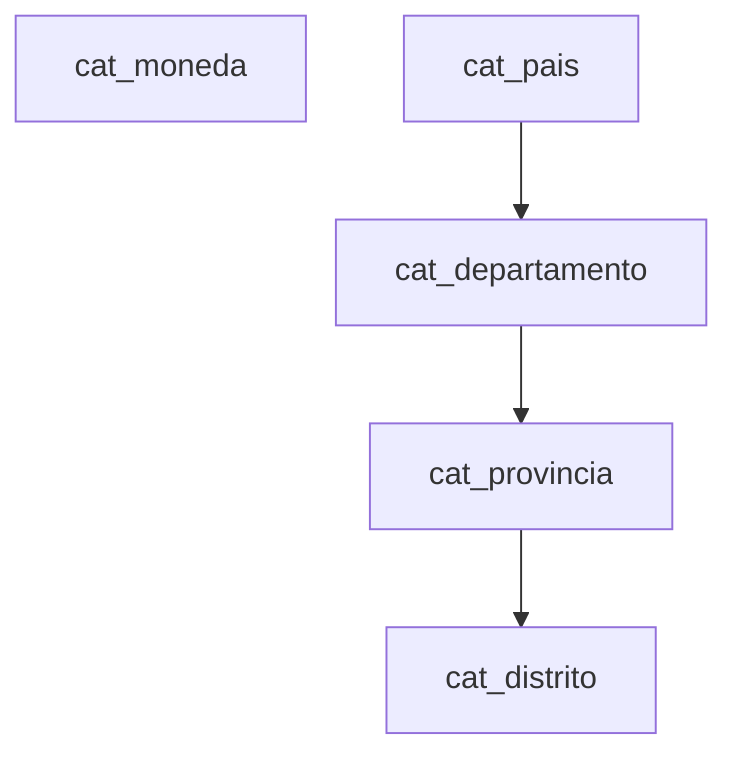

# 01 — Inventario de Catálogos Product Reference

**Fecha:** 2026-07-02  
**Modo:** Solo auditoría — sin cambios de código  
**Alcance:** `cat_moneda`, `cat_pais`, `cat_departamento`, `cat_provincia`, `cat_distrito`  
**Fuente canónica DDL:** `app/bootstrap_v2/01_schema/V010__tablas_bd_erp_completo.sql` (líneas 58–148)  
**Fuente canónica ORM:** `app/infrastructure/database/tables_erp/tables_org.py` (líneas 33–95)

---

## 1. Contexto normativo

| Atributo | Valor |
|----------|-------|
| Clasificación arquitectónica | **Product Reference** (Platform) — ADR-011 |
| Ubicación física | BD ERP (`V010`) — **no** en `V020__tablas_bd_central.sql` actual |
| `cliente_id` | **Ausente** — tablas globales |
| Tenant filter | Exentas vía `GLOBAL_TABLES` en `query_helpers.py` |
| Réplica dedicated | Tablas creadas vacías en onboarding (ADR-011 Alternativa A) |

---

## 2. Resumen comparativo

| Tabla | PK | Tipo PK | Soft delete | `es_activo` | Columnas auditoría | UNIQUE adicionales |
|-------|-----|---------|-------------|-------------|-------------------|-------------------|
| `cat_moneda` | `moneda_id` | `UNIQUEIDENTIFIER` | Sí (`es_activo=0`) | Sí | **Ninguna** | `UQ_moneda_codigo (codigo)` |
| `cat_pais` | `pais_id` | `UNIQUEIDENTIFIER` | Sí | Sí | **Ninguna** | `UQ_pais_iso2 (codigo_iso2)` |
| `cat_departamento` | `departamento_id` | `UNIQUEIDENTIFIER` | Sí | Sí | **Ninguna** | — |
| `cat_provincia` | `provincia_id` | `UNIQUEIDENTIFIER` | Sí | Sí | **Ninguna** | — |
| `cat_distrito` | `distrito_id` | `UNIQUEIDENTIFIER` | Sí | Sí | **Ninguna** | `UQ_ubigeo (ubigeo)` |

**Nota:** No existen columnas `created_at`, `updated_at`, `usuario_creacion_id` ni metadata técnica de sincronización en ninguna de las cinco tablas.

---

## 3. Inventario detallado por catálogo

### 3.1 `cat_moneda`

| Campo | Detalle |
|-------|---------|
| **Tabla** | `cat_moneda` |
| **PK** | `moneda_id` |
| **Tipo PK** | `UNIQUEIDENTIFIER` — `PRIMARY KEY DEFAULT NEWID()` |
| **Columnas funcionales** | `codigo` NVARCHAR(3) NOT NULL, `nombre` NVARCHAR(50) NOT NULL, `simbolo` NVARCHAR(5) NOT NULL, `decimales` INT DEFAULT 2 |
| **Columnas de auditoría** | Ninguna |
| **Soft delete** | Sí — `UPDATE … SET es_activo = 0` (sin DELETE físico en servicio) |
| **`es_activo`** | `BIT DEFAULT 1` (DDL V010); ORM: `Boolean, nullable=True, server_default="1"` |
| **Restricciones** | `UQ_moneda_codigo UNIQUE (codigo)` |
| **FK salientes** | Ninguna |
| **FK entrantes** | Múltiples tablas ERP (`org_empresa`, INV, FIN, SLS, PUR, etc.) → `cat_moneda(moneda_id)` |
| **Índices** | `IDX_moneda_activo ON cat_moneda(es_activo)` |

**Clave natural alternativa:** `codigo` (única).

---

### 3.2 `cat_pais`

| Campo | Detalle |
|-------|---------|
| **Tabla** | `cat_pais` |
| **PK** | `pais_id` |
| **Tipo PK** | `UNIQUEIDENTIFIER` — `PRIMARY KEY DEFAULT NEWID()` |
| **Columnas funcionales** | `codigo_iso2` NVARCHAR(2) NOT NULL, `codigo_iso3` NVARCHAR(3) NOT NULL, `nombre` NVARCHAR(100) NOT NULL |
| **Columnas de auditoría** | Ninguna |
| **Soft delete** | Sí — `es_activo = 0` |
| **`es_activo`** | `BIT DEFAULT 1` |
| **Restricciones** | `UQ_pais_iso2 UNIQUE (codigo_iso2)` |
| **FK salientes** | Ninguna |
| **FK entrantes** | `cat_departamento.pais_id`, tablas ERP con dirección geográfica |
| **Índices** | `IDX_pais_activo ON cat_pais(es_activo)` |

**Clave natural alternativa:** `codigo_iso2` (única). `codigo_iso3` no tiene UNIQUE en DDL.

---

### 3.3 `cat_departamento`

| Campo | Detalle |
|-------|---------|
| **Tabla** | `cat_departamento` |
| **PK** | `departamento_id` |
| **Tipo PK** | `UNIQUEIDENTIFIER` — `PRIMARY KEY DEFAULT NEWID()` |
| **Columnas funcionales** | `pais_id` UNIQUEIDENTIFIER NOT NULL, `codigo` NVARCHAR(10) NOT NULL, `nombre` NVARCHAR(100) NOT NULL |
| **Columnas de auditoría** | Ninguna |
| **Soft delete** | Sí — `es_activo = 0` |
| **`es_activo`** | `BIT DEFAULT 1` (V010); ORM: `nullable=False, server_default="1"` |
| **Restricciones** | `FK_depto_pais`: `pais_id → cat_pais(pais_id) ON DELETE NO ACTION` |
| **FK entrantes** | `cat_provincia.departamento_id`, tablas ERP |
| **Índices** | `IDX_depto_pais ON cat_departamento(pais_id)` |

**Clave compuesta lógica (sin UNIQUE en DDL):** `(pais_id, codigo)`.

**Orden de dependencia FK:** requiere `cat_pais` sincronizado previamente.

---

### 3.4 `cat_provincia`

| Campo | Detalle |
|-------|---------|
| **Tabla** | `cat_provincia` |
| **PK** | `provincia_id` |
| **Tipo PK** | `UNIQUEIDENTIFIER` — `PRIMARY KEY DEFAULT NEWID()` |
| **Columnas funcionales** | `departamento_id` UNIQUEIDENTIFIER NOT NULL, `codigo` NVARCHAR(10) NOT NULL, `nombre` NVARCHAR(100) NOT NULL |
| **Columnas de auditoría** | Ninguna |
| **Soft delete** | Sí — `es_activo = 0` |
| **`es_activo`** | `BIT DEFAULT 1` |
| **Restricciones** | `FK_prov_depto`: `departamento_id → cat_departamento(departamento_id) ON DELETE NO ACTION` |
| **FK entrantes** | `cat_distrito.provincia_id`, tablas ERP |
| **Índices** | `IDX_prov_depto ON cat_provincia(departamento_id)` |

**Clave compuesta lógica (sin UNIQUE en DDL):** `(departamento_id, codigo)`.

**Orden de dependencia FK:** requiere `cat_departamento` sincronizado previamente.

---

### 3.5 `cat_distrito`

| Campo | Detalle |
|-------|---------|
| **Tabla** | `cat_distrito` |
| **PK** | `distrito_id` |
| **Tipo PK** | `UNIQUEIDENTIFIER` — `PRIMARY KEY DEFAULT NEWID()` |
| **Columnas funcionales** | `provincia_id` UNIQUEIDENTIFIER NOT NULL, `codigo` NVARCHAR(10) NOT NULL, `nombre` NVARCHAR(100) NOT NULL, `ubigeo` NVARCHAR(6) NOT NULL |
| **Columnas de auditoría** | Ninguna |
| **Soft delete** | Sí — `es_activo = 0` |
| **`es_activo`** | `BIT DEFAULT 1` |
| **Restricciones** | `FK_dist_prov`: `provincia_id → cat_provincia(provincia_id)`; `UQ_ubigeo UNIQUE (ubigeo)` |
| **FK entrantes** | Tablas ERP con `distrito_id` |
| **Índices** | `IDX_dist_prov`, `IDX_dist_ubigeo` |

**Clave natural alternativa:** `ubigeo` (única a nivel global, no por provincia).

**Orden de dependencia FK:** requiere `cat_provincia` sincronizado previamente.

---

## 4. Jerarquía geográfica y orden de sincronización

| Nivel | Tabla | Depende de |
|------:|-------|------------|
| 0 (independiente) | `cat_moneda` | — |
| 1 | `cat_pais` | — |
| 2 | `cat_departamento` | `cat_pais.pais_id` |
| 3 | `cat_provincia` | `cat_departamento.departamento_id` |
| 4 | `cat_distrito` | `cat_provincia.provincia_id` |

`cat_moneda` puede sincronizarse en paralelo con la cadena geográfica.

---

## 5. PK estable para UPSERT — veredicto

| Tabla | PK UUID estable | Evidencia |
|-------|-----------------|-----------|
| `cat_moneda` | **Sí** | `moneda_id UNIQUEIDENTIFIER PK`; servicio CRUD genera `uuid4()` en create — **la PK Platform debe propagarse tal cual al dedicated** |
| `cat_pais` | **Sí** | `pais_id UNIQUEIDENTIFIER PK` |
| `cat_departamento` | **Sí** | `departamento_id UNIQUEIDENTIFIER PK` |
| `cat_provincia` | **Sí** | `provincia_id UNIQUEIDENTIFIER PK` |
| `cat_distrito` | **Sí** | `distrito_id UNIQUEIDENTIFIER PK` |

**Riesgo detectado:** `CatalogosGlobalesService.create_*` asigna `uuid4()` local en cada INSERT. Si Platform y Dedicated crean el mismo catálogo funcional de forma independiente, las PK divergen y las FK ERP (`moneda_id`, `distrito_id`, etc.) en dedicated **no coincidirán** con Platform. La sincronización debe preservar PKs Platform en INSERT/UPSERT.

---

## 6. Diferencias estructurales Platform vs Dedicated

| Aspecto | Platform (shared ERP / V010) | Dedicated (mismo V010 vía `apply_schema_erp_v010`) |
|---------|------------------------------|-----------------------------------------------------|
| DDL base | `V010__tablas_bd_erp_completo.sql` | **Idéntico** — mismo script, mismo checksum en manifiesto |
| Datos iniciales | Poblados manualmente vía Superadmin (sin seed SQL bootstrap) | **Vacío** — `CAT_REFERENCE_TABLES` verifica `min_rows=0` post S6 |
| `V011__cat_ubigeo_es_activo.sql` | Existe en repo pero **no está en `BOOTSTRAP_ORDER` ni manifiesto dedicated** | **No aplicado** en provisioning |
| Índices `IDX_*_activo` (ubigeo) | V010 incluye `IDX_moneda_activo`, `IDX_pais_activo`; ubigeo solo `IDX_depto_pais`, `IDX_prov_depto`, `IDX_dist_*` | Igual que dedicated fresh V010 |
| Índices adicionales V011 | Si V011 se ejecutó manualmente en shared: `IDX_depto_activo`, `IDX_prov_activo`, `IDX_dist_activo` | Ausentes si solo V010 |
| Legacy `1.- TABLAS_BD_CENTRAL.sql` | Documentación legacy incluye `cat_*` | `V020` actual **no** incluye `cat_*` — drift documental |

**Conclusión estructural:** Paridad de **tablas y columnas** entre Platform shared y Dedicated post-onboarding. Divergencia posible solo en **índices opcionales V011** (no funcionales) y en **contenido** (Platform poblado vs Dedicated vacío).

---

## 7. Columnas para comparación en futura sincronización

Extraídas de schemas Create/Update y payloads de servicio (`catalogos_globales_service.py`, `schemas_catalogos_globales.py`).

### `cat_moneda`

| Comparar | No comparar |
|----------|-------------|
| `codigo`, `nombre`, `simbolo`, `decimales`, `es_activo` | `moneda_id` (clave UPSERT, no campo de diff) |

**Nota servicio:** `update_moneda` **no** permite cambiar `codigo` (inmutable post-create en API).

### `cat_pais`

| Comparar | No comparar |
|----------|-------------|
| `codigo_iso2`, `codigo_iso3`, `nombre`, `es_activo` | `pais_id` |

### `cat_departamento`

| Comparar | No comparar |
|----------|-------------|
| `pais_id`, `codigo`, `nombre`, `es_activo` | `departamento_id` |

### `cat_provincia`

| Comparar | No comparar |
|----------|-------------|
| `departamento_id`, `codigo`, `nombre`, `es_activo` | `provincia_id` |

### `cat_distrito`

| Comparar | No comparar |
|----------|-------------|
| `provincia_id`, `codigo`, `nombre`, `ubigeo`, `es_activo` | `distrito_id` |

---

## 8. Seeds y datos bootstrap

| Fuente | Contiene INSERT `cat_*` |
|--------|-------------------------|
| `bootstrap_v2/02_catalog/*` | **No** |
| `bootstrap_v2/04_qa/*` | **No** |
| `DedicatedCatalogSeedService` S6 | Solo RBAC/menú/permisos — **no** datos geográficos/monetarios |
| `catalog_profiles.CAT_REFERENCE_TABLES` | Verificación post-seed: **0 filas esperadas** |

Los catálogos Product Reference se administran exclusivamente vía API Superadmin (`/catalogos-globales/*`) sobre la BD ERP shared.
