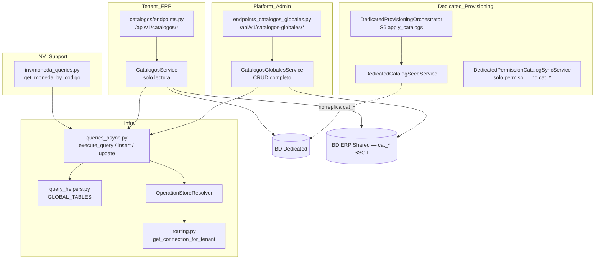

# 02 — Arquitectura Actual de Catálogos Globales

**Fecha:** 2026-07-02  
**Modo:** Solo auditoría — sin cambios de código  
**Alcance:** Servicios, endpoints, queries, routing hybrid, onboarding dedicated

---

## 1. Mapa de componentes



---

## 2. Servicios por catálogo

### 2.1 Administración Platform (CRUD)

| Catálogo | Servicio | Archivo | Operaciones |
|----------|----------|---------|-------------|
| `cat_moneda` | `CatalogosGlobalesService` | `app/modules/superadmin/application/services/catalogos_globales_service.py` | list, contar, get, create, update, deactivate |
| `cat_pais` | idem | idem | idem |
| `cat_departamento` | idem | idem | list, contar, get, create, update, delete (soft) |
| `cat_provincia` | idem | idem | idem |
| `cat_distrito` | idem | idem | idem + filtros cascada geográfica |

**Patrón de acceso a datos:** SQLAlchemy Core (`select`/`insert`/`update`) sobre tablas `tables_erp.tables_org` — **no** hay capa `infrastructure/database/queries/catalogos/`.

### 2.2 Lectura tenant ERP

| Catálogo | Servicio | Archivo | Operaciones |
|----------|----------|---------|-------------|
| Los 5 | `CatalogosService` | `app/modules/catalogos/application/services/catalogos_service.py` | `list_*` únicamente |

### 2.3 Consumo indirecto (módulos ERP)

| Catálogo | Consumidor | Archivo | Operación |
|----------|------------|---------|-----------|
| `cat_moneda` | INV | `app/infrastructure/database/queries/inv/moneda_queries.py` | `get_moneda_by_codigo` |
| `cat_moneda` | INV | `movimiento_proceso_service.py`, `inventario_fisico_aprobacion_service.py` | Resolución `moneda_id` en runtime |
| `cat_moneda` | FIN | `asiento_contable_service.py` | Resolución `moneda_id` en create |
| `cat_*` geo | ORG, SLS, PUR, CRM, etc. | FK en `tables_erp/*` | Referencia por UUID en tablas operativas |

---

## 3. Endpoints existentes

### 3.1 Superadmin — CRUD (`/api/v1/catalogos-globales`)

Montaje: `app/api/v1/api.py` — prefix `/catalogos-globales`, tag `Catálogos Globales (Super Admin)`.

Autorización: `@require_super_admin()` en todos los handlers.

Parámetro transversal: `cliente_id: Optional[UUID]` — si omitido, usa `current_user.cliente_id`.

| Recurso | GET list | GET by id | POST | PUT | DELETE (soft) |
|---------|----------|-----------|------|-----|---------------|
| `/monedas` | Sí (paginado) | **No** | Sí | `/{moneda_id}` | `/{moneda_id}` |
| `/paises` | Sí | **No** | Sí | `/{pais_id}` | `/{pais_id}` |
| `/departamentos` | Sí | **No** | Sí | `/{departamento_id}` | `/{departamento_id}` |
| `/provincias` | Sí | **No** | Sí | `/{provincia_id}` | `/{provincia_id}` |
| `/distritos` | Sí | **No** | Sí | `/{distrito_id}` | `/{distrito_id}` |

**Brecha:** No existen endpoints `GET /{id}` públicos; el servicio sí expone `get_moneda`, `get_pais`, etc. para uso interno post-mutación.

### 3.2 Tenant — lectura (`/api/v1/catalogos`)

Montaje: prefix `/catalogos`, tag `Catálogos`.

Autorización: `get_current_active_user` (sin permiso RBAC granular).

| Endpoint | Método | Filtros |
|----------|--------|---------|
| `/monedas` | GET | `solo_activos` |
| `/paises` | GET | `solo_activos` |
| `/departamentos` | GET | `solo_activos`, `pais_id` |
| `/provincias` | GET | `solo_activos`, `departamento_id` |
| `/distritos` | GET | `solo_activos`, `provincia_id`, `ubigeo` |

**Anti-patrón detectado:** `CatalogosService` y endpoints tenant usan `current_user.cliente_id` directamente — no `require_session_cliente_id`. Impacto en impersonación documentado en otros audits; fuera de alcance cat_* salvo routing de BD.

---

## 4. Queries utilizadas

| Capa | Tipo | Ubicación | Tablas |
|------|------|-----------|--------|
| Superadmin CRUD | SQLAlchemy Core inline en servicio | `catalogos_globales_service.py` | 5 tablas `cat_*` |
| Tenant lectura | SQLAlchemy Core inline | `catalogos_service.py` | 5 tablas `cat_*` |
| INV soporte | SQLAlchemy Core | `moneda_queries.py` | `cat_moneda` |
| Dedicated provisioning | SQL crudo COUNT | `dedicated_catalog_seed_service.py` | verificación `COUNT(*)` en `CAT_REFERENCE_TABLES` |

**No existen** archivos dedicados en `app/infrastructure/database/queries/catalogos/` ni repositorios.

---

## 5. Verificación `execute_query()` y routing Hybrid

### 5.1 Uso de `execute_query`

| Componente | `execute_query` | `execute_insert` | `execute_update` | Routing param |
|------------|-----------------|------------------|------------------|---------------|
| `CatalogosGlobalesService` | Sí (lecturas + count) | Sí (creates) | Sí (updates/deactivate) | `client_id=target` |
| `CatalogosService` | Sí | No | No | `client_id=current_user.cliente_id` |
| `get_moneda_by_codigo` | Sí | No | No | `client_id` explícito |

**Veredicto:** Los tres puntos de acceso runtime usan el pipeline L6 (`queries_async.py`).

### 5.2 Routing Hybrid

| Escenario | Resolución |
|-----------|------------|
| Tenant **shared** + `client_id` | `DatabaseConnection.DEFAULT` → BD ERP compartida |
| Tenant **dedicated** + `client_id` | `DatabaseConnection.DEFAULT` → BD dedicada vía `cliente_conexion` / `get_connection_for_tenant` |
| Tablas `cat_*` | `GLOBAL_TABLES` → **sin** `apply_tenant_filter` por `cliente_id` |
| Dedicated defensive filter | No aplica — tablas globales exentas |

**Implicación para sync futuro:**

- Lectura Platform SSOT: ocurre hoy cuando Superadmin opera **sin** `cliente_id` dedicado → escribe en BD ERP shared (donde residen los `cat_*` globales).
- Lectura tenant dedicated: mismo código, distinta BD física — tablas vacías hasta sync manual.
- **No existe** hoy un `platform_catalog_store` ni lectura cross-plane explícita Platform→Dedicated.

### 5.3 `OperationStoreResolver`

Los servicios `cat_*` **no** usan `resolve_operation_store` directamente. Delegan en `execute_query(client_id=…)` que internamente resuelve conexión.

Referencia de patrón más avanzado (permisos): `permission_catalog_store.py` + `platform_tenant_data_store.py` (F13-C3/C4).

---

## 6. Onboarding Dedicated y existencia de tablas

### 6.1 Pipeline saga

| Step | Servicio | Efecto sobre `cat_*` |
|------|----------|---------------------|
| S4 `apply_schema_erp` | `BootstrapScriptRunner` → `V010` | **Crea** las 5 tablas |
| S6 `apply_catalogs` | `DedicatedCatalogSeedService` | Ejecuta S010–S066 (RBAC/menú/permisos); **no** inserta datos `cat_*` |
| Post S6 | `catalog_profiles.CAT_REFERENCE_TABLES` | Assert `COUNT(*) >= 0` — espera tablas **vacías** |

### 6.2 Verificación post-onboarding

```python
# catalog_profiles.py — expectativa por tabla cat_*
for cat_table in CAT_REFERENCE_TABLES:
    expectations.append((cat_table, 0))
```

**Veredicto:** Las tablas existen estructuralmente correctas en Dedicated tras onboarding. El contenido es **cero filas** por diseño actual.

### 6.3 Sync existente relacionado (no cat_*)

`DedicatedPermissionCatalogSyncService` replica `permiso` desde registry de código → dedicated. Se ejecuta al final de S6 si `DEDICATED_PERMISSION_CATALOG_SYNC_ENABLED=true`. **No cubre** `cat_moneda` ni ubigeo.

---

## 7. SSOT Platform — estado actual

| Documento | Declaración |
|-----------|-------------|
| ADR-011 | Réplica local en provisioning; sync al actualizar producto = **post-MVP** |
| `03_SINGLE_SOURCE_OF_TRUTH.md` | Country/Region/Currency → SSOT Platform; réplica read-only en dedicated |
| `PLATFORM_BACKEND_CAPABILITY_AUDIT.md` | CRUD vía `client_id` tenant — ambigüedad BD central vs ERP |

**Estado operativo observado:**

1. DDL `cat_*` vive en **V010 ERP**, no en V020 central actual.
2. Superadmin administra catálogos contra BD resuelta por `client_id` (típicamente tenant SYSTEM en shared).
3. Dedicated tiene esquema idéntico (V010) pero sin datos.
4. No hay mecanismo de sincronización manual ni automática para `cat_*` hacia dedicated.

---

## 8. Schemas Pydantic (contratos)

| Capa | Archivo | Schemas |
|------|---------|---------|
| Superadmin | `schemas_catalogos_globales.py` | `Cat*Create`, `Cat*Update`, `Cat*Read`, `PaginatedCat*Response` |
| Tenant lectura | `catalogos/presentation/schemas.py` | `MonedaRead`, `PaisRead`, `DepartamentoRead`, `ProvinciaRead`, `DistritoRead` |

Los campos de Create/Update definen el universo de columnas mutables y, por extensión, las columnas relevantes para diff de sincronización (ver `01_CATALOG_INVENTORY.md` §7).

---

## 9. Tests existentes

| Archivo | Cobertura |
|---------|-----------|
| `tests/unit/test_catalogos_globales_listados_pa005.py` | Listados Superadmin, filtros `buscar`, paginación |
| `tests/unit/test_f4_06_dedicated_catalog_seed_service.py` | S6 seed RBAC — verificación tablas `cat_*` vacías |
| `tests/unit/test_dedicated_permission_catalog_sync_service.py` | Solo permisos — no `cat_*` |

**No hay tests** de sincronización ni paridad de datos `cat_*` Platform↔Dedicated.
