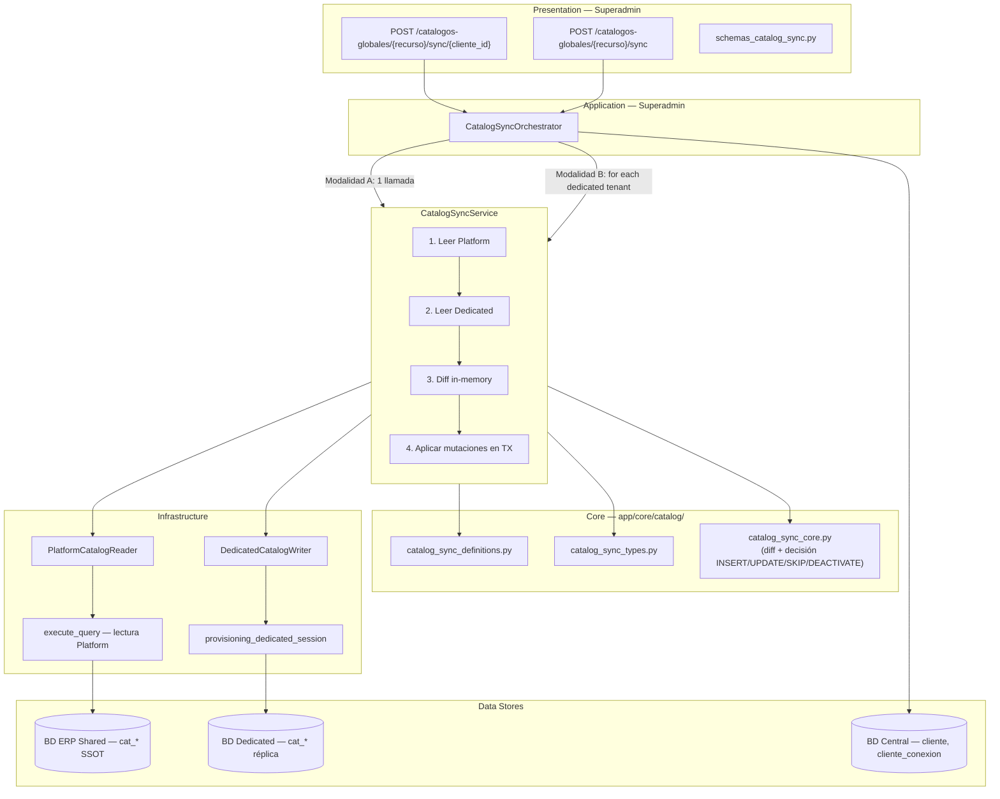

# 05 — Arquitectura de Implementación (Contrato Fase 3)

**Fecha:** 2026-07-02  
**Estado:** Diseño oficial — **sin implementación**  
**Prerequisito:** `01`–`04` en `app/docs/arquitectura/catalog-sync/`  
**Alcance:** Sincronización manual Product Reference Platform → Dedicated (`cat_moneda`, `cat_pais`, `cat_departamento`, `cat_provincia`, `cat_distrito`)

---

## 1. Resumen ejecutivo

| Atributo | Decisión |
|----------|----------|
| Trigger | **Manual** — POST explícito Platform Admin |
| Origen (SSOT) | Tablas `cat_*` en BD ERP shared (V010) |
| Destino | BD dedicada por tenant (`cliente_conexion.database_name`) |
| Motor único | `CatalogSyncService` — una instancia lógica por `(cliente_id, catálogo)` |
| Orquestación | `CatalogSyncOrchestrator` — validaciones CP + iteración modalidad B |
| Persistencia sync | **Ninguna** — sin tablas nuevas, sin metadata, sin checksum almacenado |
| Onboarding | **Sin cambios** — tablas `cat_*` siguen vacías post S6 |

---

## 2. Diagrama arquitectónico definitivo



---

## 3. Separación de responsabilidades

### 3.1 `CatalogSyncService` — motor de sincronización

**Ubicación:** `app/modules/superadmin/application/services/catalog_sync_service.py`

**Responsabilidad única:** Ejecutar la sincronización de **un catálogo** hacia **un cliente Dedicated**.

| Entrada | Salida |
|---------|--------|
| `cliente_id: UUID` | `CatalogSyncResult` (conteos in-memory, sin persistir) |
| `catalog: CatalogKind` (enum fijo de 5 valores) | |
| `database_name: str` (resuelto por orchestrator) | |

**Flujo interno (contrato):**

1. Invocar `PlatformCatalogReader.fetch_all(catalog)` — lectura SSOT.
2. Invocar `DedicatedCatalogWriter.fetch_all(catalog, database_name)` — snapshot destino.
3. Delegar diff y decisiones a `catalog_sync_core.compute_sync_plan(...)`.
4. Ejecutar plan en **una transacción SQL** sobre dedicated vía `DedicatedCatalogWriter.apply_plan(...)`.
5. Retornar `CatalogSyncResult` con conteos `inserted`, `updated`, `skipped`, `deactivated`.

**Prohibiciones:**

- No resolver lista de tenants.
- No validar `tipo_instalacion` (lo hace el orchestrator).
- No conocer HTTP ni FastAPI.
- No escribir en Platform.
- No generar `uuid4()` — INSERT siempre con PK Platform.

---

### 3.2 `CatalogSyncOrchestrator` — orquestación de casos de uso

**Ubicación:** `app/modules/superadmin/application/services/catalog_sync_orchestrator.py`

**Responsabilidad:** Validaciones de Control Plane, resolución de conexión dedicated y delegación al motor.

#### Modalidad A — Sync individual

```
POST /catalogos-globales/{recurso}/sync/{cliente_id}
        ↓
CatalogSyncOrchestrator.sync_one(cliente_id, catalog)
        ↓
  [validaciones CP]
        ↓
CatalogSyncService.run(cliente_id, catalog, database_name)
        ↓
CatalogSyncResult
```

#### Modalidad B — Sync todos

```
POST /catalogos-globales/{recurso}/sync
        ↓
CatalogSyncOrchestrator.sync_all(catalog)
        ↓
  tenants = list_dedicated_clients()   ← única lógica adicional
        ↓
  for tenant in tenants:
        CatalogSyncService.run(tenant.cliente_id, catalog, tenant.database_name)
        ↓
CatalogSyncBatchResult  (agregación in-memory de N CatalogSyncResult)
```

**Regla innegociable:** Modalidad B **no** implementa diff, SQL ni reglas de negocio propias. Solo itera y agrega resultados. Cualquier cambio al algoritmo ocurre exclusivamente en `CatalogSyncService` + `catalog_sync_core`.

**Política de errores modalidad B:**

| Comportamiento | Decisión |
|----------------|----------|
| Fallo en un tenant | Registrar error en resultado del tenant; **continuar** con el siguiente |
| Respuesta HTTP | `200` con `status=partial` si al menos un tenant falló; `status=completed` si todos OK |
| Tenant no dedicated en path individual | `422` antes de invocar motor |

---

## 4. Capas y archivos a implementar (Fase 3)

| Capa | Archivo | Responsabilidad |
|------|---------|-------------------|
| **Core** | `app/core/catalog/catalog_sync_definitions.py` | Enum `CatalogKind`, mapping tabla/PK/columnas compare, FK prerequisitos |
| **Core** | `app/core/catalog/catalog_sync_types.py` | `SyncAction`, `SyncPlanEntry`, `CatalogSyncResult`, `CatalogSyncBatchResult`, Protocols |
| **Core** | `app/core/catalog/catalog_sync_core.py` | Diff determinístico PK + columnas funcionales + `es_activo`; sin I/O |
| **Infrastructure** | `app/infrastructure/catalog/platform_catalog_reader.py` | Lectura SSOT Platform (`execute_query` / SQLAlchemy Core) |
| **Infrastructure** | `app/infrastructure/catalog/dedicated_catalog_writer.py` | Lectura + escritura dedicated (`provisioning_dedicated_session`) |
| **Application** | `catalog_sync_service.py` | Motor — compone reader + core + writer |
| **Application** | `catalog_sync_orchestrator.py` | Validación CP + modalidad A/B |
| **Presentation** | `endpoints_catalog_sync.py` | 10 endpoints POST (5 catálogos × 2 modalidades) |
| **Presentation** | `schemas_catalog_sync.py` | Request/Response Pydantic |

**Nota:** Paquete `app/infrastructure/catalog/` (nuevo) separa I/O de catálogos del provisioning saga; reutiliza `provisioning_dedicated_session` sin acoplar al orchestrator F4-08.

---

## 5. Definiciones de catálogo (fuente: `01_CATALOG_INVENTORY.md`)

Enum cerrado — **sin soporte genérico**:

```text
CatalogKind.MONEDA      → cat_moneda
CatalogKind.PAIS        → cat_pais
CatalogKind.DEPARTAMENTO → cat_departamento
CatalogKind.PROVINCIA   → cat_provincia
CatalogKind.DISTRITO    → cat_distrito
```

### 5.1 Columnas de comparación (diff)

| CatalogKind | PK | Columnas compare |
|-------------|-----|------------------|
| `MONEDA` | `moneda_id` | `codigo`, `nombre`, `simbolo`, `decimales`, `es_activo` |
| `PAIS` | `pais_id` | `codigo_iso2`, `codigo_iso3`, `nombre`, `es_activo` |
| `DEPARTAMENTO` | `departamento_id` | `pais_id`, `codigo`, `nombre`, `es_activo` |
| `PROVINCIA` | `provincia_id` | `departamento_id`, `codigo`, `nombre`, `es_activo` |
| `DISTRITO` | `distrito_id` | `provincia_id`, `codigo`, `nombre`, `ubigeo`, `es_activo` |

**Reglas de igualdad:**

- Comparación campo a campo tras normalización definida en §5.3.
- `decimales`: comparar como `int`; `NULL` Platform = `2` (default DDL).
- `es_activo`: comparar como `bool`; `NULL` = `True`.

### 5.2 Acciones por fila

| Situación | Acción |
|-----------|--------|
| PK en Platform, ausente en Dedicated | `INSERT` (con PK Platform) |
| PK en ambos, columnas compare iguales | `SKIP` |
| PK en ambos, columnas compare distintas | `UPDATE` |
| PK solo en Dedicated | `SOFT_DEACTIVATE` (`es_activo = 0`) |
| DELETE físico | **Prohibido** |

### 5.3 Normalización (contrato de comparación)

| Campo | Regla |
|-------|-------|
| `codigo`, `codigo_iso2`, `codigo_iso3` | `strip().upper()` |
| `nombre`, `simbolo`, `ubigeo` | `strip()` |
| UUIDs FK | comparación exacta string/canonical UUID |
| `decimales` | `int(value or 2)` |
| `es_activo` | `bool(value)` con default `True` si `None` |

---

## 6. Lectura Platform (SSOT)

| Atributo | Contrato |
|----------|----------|
| Store | BD ERP shared — tablas `cat_*` en V010 |
| Mecanismo | `PlatformCatalogReader` vía `execute_query` + SQLAlchemy Core (`Cat*Table`) |
| `client_id` lector | Config `PLATFORM_CATALOG_REFERENCE_CLIENTE_ID` (env) — tenant shared que resuelve a BD ERP shared |
| Conexión | `DatabaseConnection.DEFAULT` — **no** ADMIN (cat_* no están en V020) |
| Filtro tenant | Ninguno — tablas en `GLOBAL_TABLES` |
| Alcance filas | **Todas** las filas Platform (activas e inactivas) — `es_activo` es columna compare |

---

## 7. Escritura Dedicated

| Atributo | Contrato |
|----------|----------|
| Sesión | `provisioning_dedicated_session(database_name)` |
| Transacción | **Una TX por** `(cliente_id, catalog)` — commit al final; rollback ante cualquier error SQL |
| INSERT | PK explícita Platform — `INSERT INTO cat_* (pk, …) VALUES (:platform_pk, …)` |
| UPDATE | `WHERE pk = :platform_pk` — solo columnas compare |
| SOFT_DEACTIVATE | `UPDATE … SET es_activo = 0 WHERE pk = :pk` |
| Credenciales | `PROVISIONING_DDL_*` (mismo patrón `DedicatedPermissionCatalogSyncService`) |

---

## 8. Validaciones pre-sync (Orchestrator)

Ejecutadas **antes** de `CatalogSyncService.run`:

| # | Validación | Error |
|---|------------|-------|
| V1 | `cliente_id` existe en CP (`cliente`) | `404` |
| V2 | `tipo_instalacion = dedicated` | `422` `CLIENT_NOT_DEDICATED` |
| V3 | `cliente.es_activo = 1` | `422` `CLIENT_INACTIVE` |
| V4 | `cliente_conexion` activa con `database_name` | `422` `DEDICATED_CONNECTION_NOT_FOUND` |
| V5 | Reachability dedicated (opcional: ping / `SELECT 1`) | `503` `DEDICATED_UNREACHABLE` |
| V6 | Prerequisitos FK (catálogos hijo) — ver §9 | `422` `CATALOG_SYNC_FK_PREREQUISITE` |

Modalidad B: V1–V5 se aplican **por tenant** dentro del loop; tenants inválidos se reportan en `failures[]` sin abortar el batch.

---

## 9. Jerarquía FK y prerequisitos por catálogo

Cada endpoint sincroniza **una sola tabla**. Los catálogos con FK saliente requieren que las PK referenciadas **ya existan en dedicated**.

| CatalogKind | Prerequisito en Dedicated | Validación pre-sync |
|-------------|---------------------------|---------------------|
| `MONEDA` | Ninguno | — |
| `PAIS` | Ninguno | — |
| `DEPARTAMENTO` | Todos los `pais_id` Platform existen en `cat_pais` dedicated | Query anti-join |
| `PROVINCIA` | Todos los `departamento_id` Platform existen en `cat_departamento` dedicated | Query anti-join |
| `DISTRITO` | Todos los `provincia_id` Platform existen en `cat_provincia` dedicated | Query anti-join |

**Orden operativo recomendado (runbook Platform Admin):**

1. `monedas/sync` y `paises/sync` (cualquier orden entre ellos)
2. `departamentos/sync`
3. `provincias/sync`
4. `distritos/sync`

El motor **no** sincroniza automáticamente tablas padre en la misma invocación.

---

## 10. Observabilidad (sin persistencia)

| Mecanismo | Permitido | Prohibido |
|-----------|-----------|-----------|
| Respuesta HTTP | Conteos `inserted/updated/skipped/deactivated` | — |
| Logging aplicación | `logger.info` estructurado por sync (cliente_id, catalog, conteos) | — |
| Tabla `catalog_sync_log` | — | **Prohibido** |
| `bootstrap_applied` marker | — | **Prohibido** |
| Checksum/hash persistente | — | **Prohibido** |
| `updated_at` / versionado | — | **No existe en DDL** |

---

## 11. Relación con componentes existentes

| Componente existente | Relación |
|---------------------|----------|
| `CatalogosGlobalesService` | **Independiente** — CRUD Platform; no invocar desde sync |
| `CatalogosService` | **Consumidor downstream** — lectura tenant post-sync |
| `DedicatedCatalogSeedService` | **Sin cambios** — S6 no toca `cat_*` datos |
| `DedicatedPermissionCatalogSyncService` | **Precedente de patrón** — executor dedicated + TX; no compartir código obligatorio |
| Onboarding saga F4-08 | **Sin cambios** |

---

## 12. Decisiones arquitectónicas cerradas (ADR implícito Fase 2)

| ID | Decisión |
|----|----------|
| D-01 | Motor único `CatalogSyncService`; modalidad B = iteración pura |
| D-02 | Un endpoint POST por catálogo (no endpoint unificado multi-tabla) |
| D-03 | Sin tablas ni metadata persistente de sync |
| D-04 | Diff in-memory por PK + columnas funcionales + `es_activo` |
| D-05 | UPSERT preserva UUID Platform en INSERT |
| D-06 | Filas dedicated huérfanas → `SOFT_DEACTIVATE` |
| D-07 | Sin DELETE físico |
| D-08 | TX única por `(cliente_id, catalog)` con rollback total |
| D-09 | SSOT = BD ERP shared (`PLATFORM_CATALOG_REFERENCE_CLIENTE_ID`) |
| D-10 | Onboarding dedicated permanece igual |

---

## 13. Fuera de alcance (explícito)

- Sync automático (lifespan, scheduler, jobs, colas, CDC, replicación SQL).
- Soporte genérico para futuros catálogos.
- Preview/diff endpoint (puede añadirse en fase posterior; no en contrato inicial).
- Modificación DDL / migraciones.
- Sync hacia tenants **shared** (ya comparten SSOT físico).
- CRUD `cat_*` en dedicated vía Superadmin con `cliente_id` dedicated (anti-patrón R-02).
