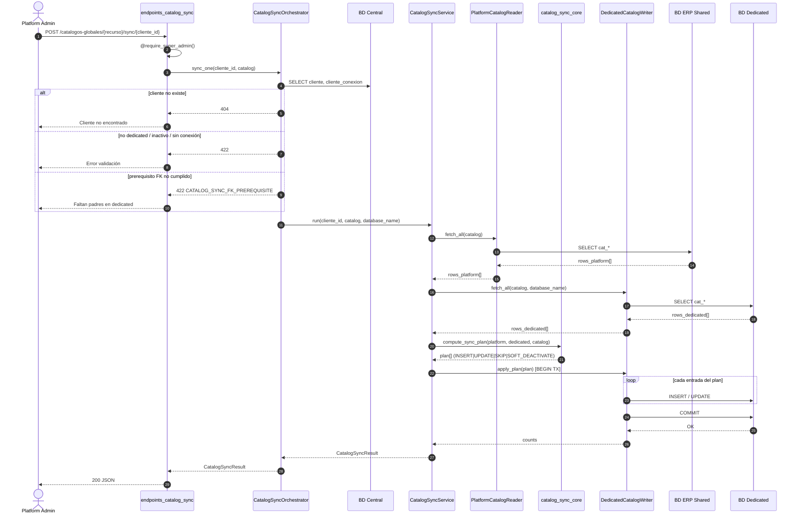
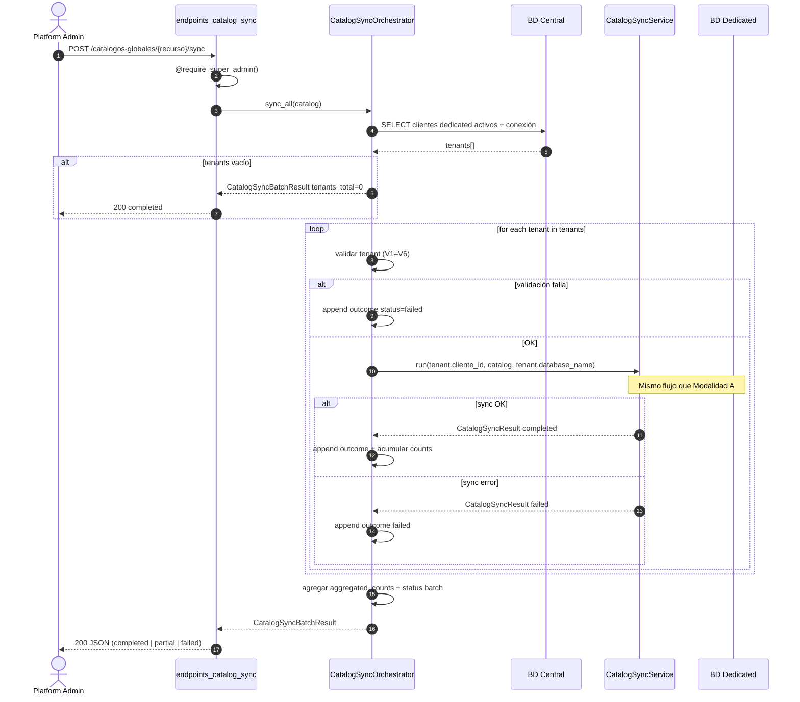
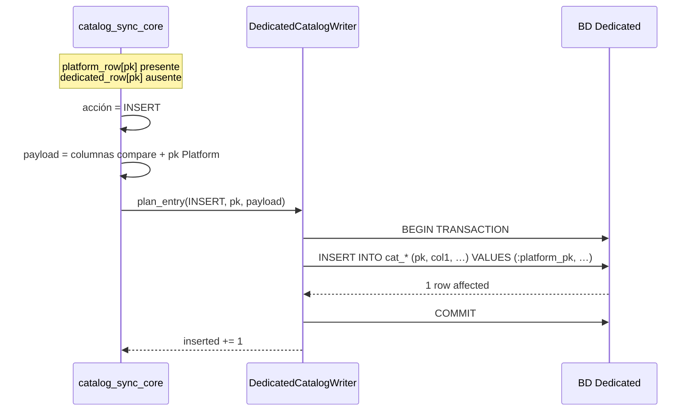
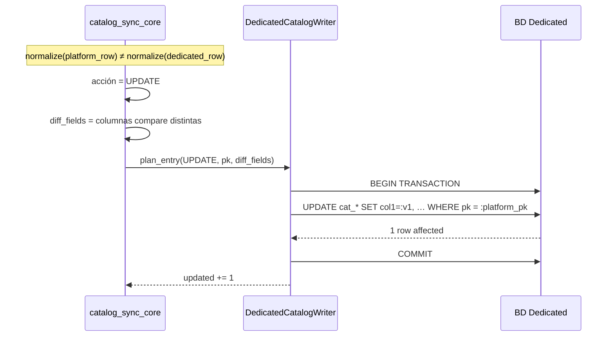
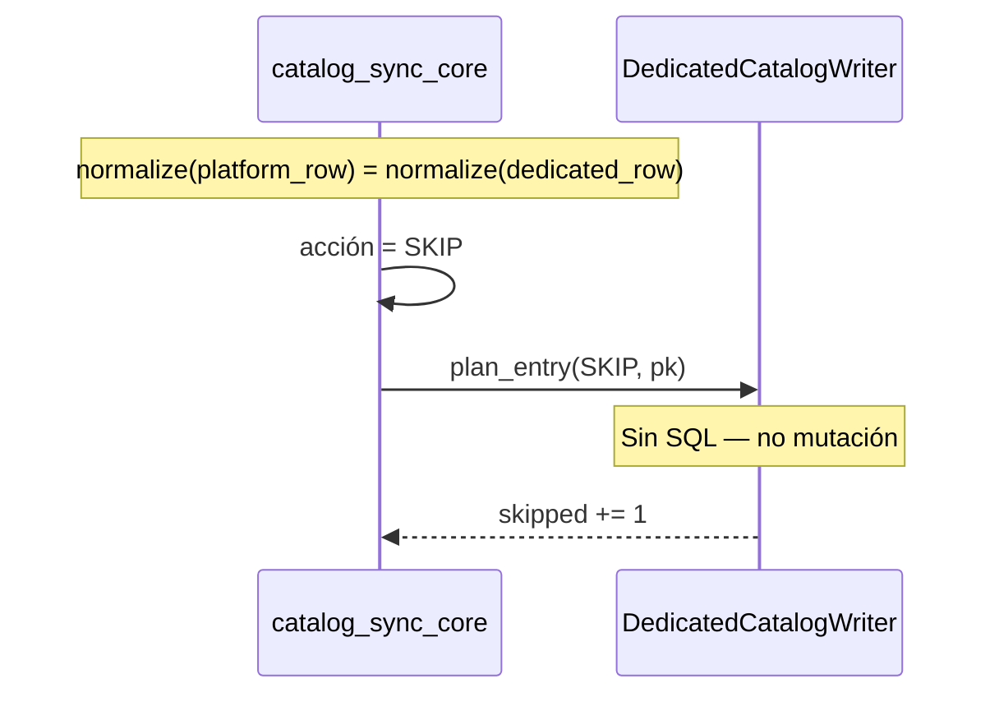
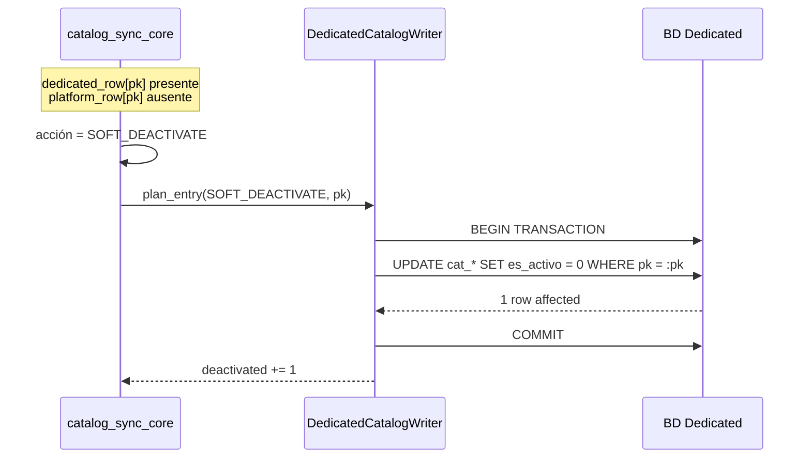
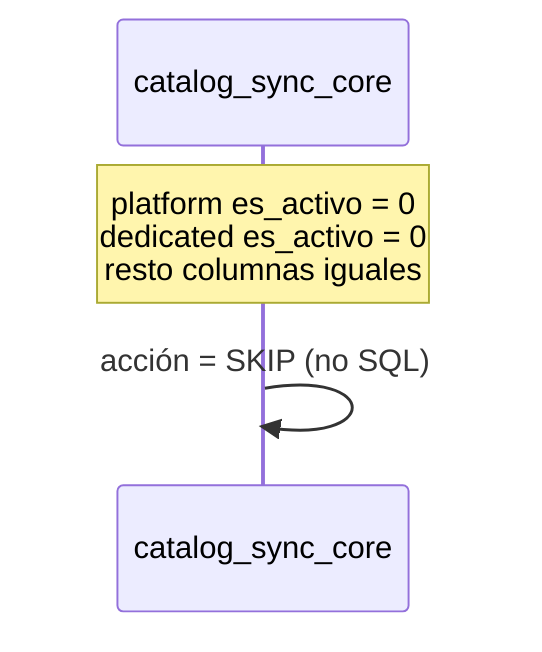
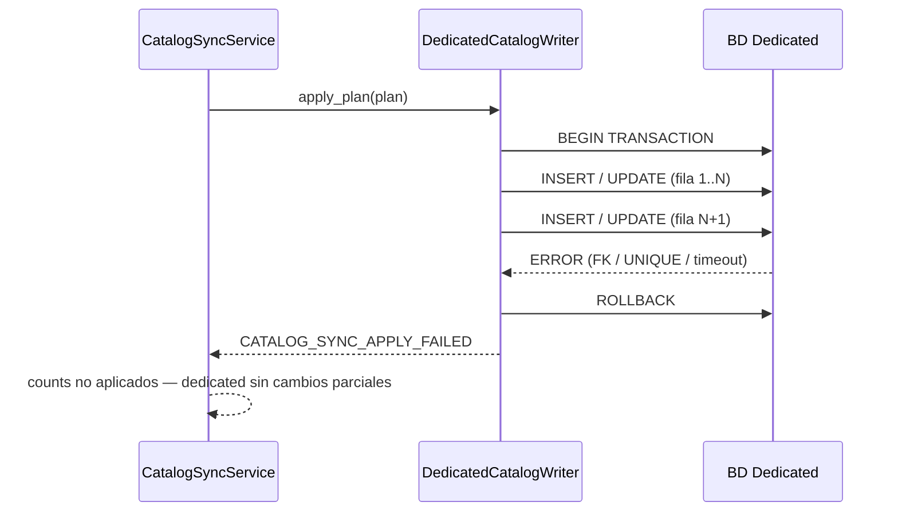
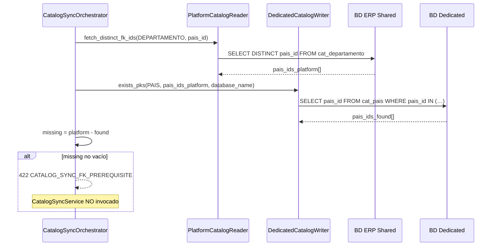

# 07 — Diagramas de Secuencia

**Fecha:** 2026-07-02  
**Estado:** Diseño oficial — **sin implementación**  
**Referencia:** `05_IMPLEMENTATION_ARCHITECTURE.md`, `06_API_CONTRACT.md`

---

## 1. Sync Individual (Modalidad A)

Sincronización de **un catálogo** hacia **un cliente Dedicated**.

---

## 2. Sync Todos (Modalidad B)

Sincronización del **mismo catálogo** hacia **todos** los clientes Dedicated. Sin lógica de diff propia — solo iteración.

---

## 3. Flow INSERT

PK existe en Platform, ausente en Dedicated.

**Invariante:** `:platform_pk` es el UUID de Platform — nunca `NEWID()` / `uuid4()` en destino.

---

## 4. Flow UPDATE

PK en ambos lados; al menos una columna compare difiere.

**Nota:** Si solo `es_activo` difiere (Platform activo, dedicated inactivo), cuenta como UPDATE.

---

## 5. Flow SKIP

PK en ambos lados; todas las columnas compare iguales tras normalización.

**Idempotencia:** Re-ejecución completa con datos estables produce `skipped = platform_total` (asumiendo sin huérfanas).

---

## 6. Flow SOFT DEACTIVATE

Dos sub-casos con la misma acción SQL.

### 6a. Fila huérfana — PK solo en Dedicated

### 6b. Dedicated ya inactivo — SKIP en lugar de UPDATE redundante

Si Platform `es_activo=0` y dedicated `es_activo=1` con resto igual → **UPDATE** (no SOFT_DEACTIVATE separado).

---

## 7. Rollback ante error (transacción dedicated)

**Contrato:** Ninguna fila del plan se persiste si falla una mutación dentro de la TX.

---

## 8. Validación FK prerequisito (pre-motor)

Ejemplo: sync `departamentos` sin `paises` previo.

---

## 9. Leyenda de actores

| Actor | Rol |
|-------|-----|
| `PlatformCatalogReader` | Lectura SSOT — BD ERP shared |
| `DedicatedCatalogWriter` | Lectura snapshot + escritura TX — BD dedicated |
| `catalog_sync_core` | Diff puro — sin SQL |
| `CatalogSyncService` | Compone reader + core + writer |
| `CatalogSyncOrchestrator` | Validación CP + loop modalidad B |
