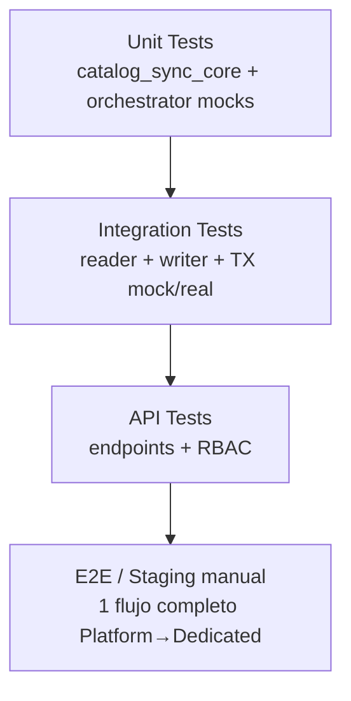

# 08 — Estrategia de Pruebas

**Fecha:** 2026-07-02  
**Estado:** Diseño oficial — **sin implementación de tests**  
**Referencia:** `05`–`07` en `app/docs/arquitectura/catalog-sync/`

---

## 1. Objetivos de calidad

| Objetivo | Criterio |
|----------|----------|
| Corrección diff | INSERT/UPDATE/SKIP/SOFT_DEACTIVATE según PK + columnas compare |
| Preservación PK | Dedicated replica UUID Platform en INSERT |
| Idempotencia | Segunda ejecución sin cambios → `inserted=0`, `updated=0` |
| Aislamiento TX | Fallo mid-plan → rollback total dedicated |
| FK safety | Catálogos hijo rechazan sync sin padres |
| Modalidad B | Misma lógica que A — solo iteración |
| Sin regresión | Onboarding S6 y CRUD Platform sin cambios |

---

## 2. Pirámide de pruebas

| Nivel | Cantidad relativa | Herramientas sugeridas |
|-------|-------------------|------------------------|
| Unit | Alta (~70%) | `pytest`, mocks puros |
| Integration | Media (~20%) | `pytest` + mock `AsyncSession` / testcontainers SQL Server opcional |
| API | Media (~10%) | `TestClient` / `httpx` async |
| E2E staging | Baja (manual + smoke automatizado) | Tenant dedicated real |

---

## 3. Unit Tests

### 3.1 `catalog_sync_core` (prioridad P0)

Archivo sugerido: `tests/unit/test_catalog_sync_core.py`

| # | Caso | Entrada | Acción esperada |
|---|------|---------|-----------------|
| U-01 | PK solo Platform | platform=[A], dedicated=[] | INSERT A |
| U-02 | PK solo Dedicated | platform=[], dedicated=[B] | SOFT_DEACTIVATE B |
| U-03 | Filas idénticas | platform=[A], dedicated=[A] | SKIP A |
| U-04 | Diff nombre | platform nombre X, dedicated Y | UPDATE |
| U-05 | Diff solo es_activo | platform activo, dedicated inactivo | UPDATE |
| U-06 | Platform inactivo, dedicated inactivo, resto igual | — | SKIP |
| U-07 | Normalización codigo | platform `usd`, dedicated `USD` | SKIP |
| U-08 | decimales null vs 2 | — | SKIP (equivalentes) |
| U-09 | Múltiples filas mixtas | 4 escenarios combinados | plan con 4 acciones |
| U-10 | Preservar PK en INSERT payload | — | payload.pk == platform.pk |

**Sin I/O** — solo estructuras dict/list.

### 3.2 `catalog_sync_definitions` (prioridad P1)

| # | Caso | Verificación |
|---|------|--------------|
| U-11 | Enum `CatalogKind` tiene exactamente 5 valores | — |
| U-12 | Columnas compare por catálogo coinciden con `01_CATALOG_INVENTORY.md` | — |
| U-13 | Mapping tabla SQL correcto | `MONEDA` → `cat_moneda` |

### 3.3 `CatalogSyncOrchestrator` (prioridad P0)

Archivo sugerido: `tests/unit/test_catalog_sync_orchestrator.py`

Mock `CatalogSyncService.run` — verificar **no** duplica lógica diff.

| # | Caso | Mock / assert |
|---|------|---------------|
| U-20 | `sync_one` dedicated válido | `CatalogSyncService.run` llamado 1 vez |
| U-21 | `sync_one` tenant shared | `run` **no** llamado; excepción 422 |
| U-22 | `sync_one` cliente inexistente | 404 |
| U-23 | `sync_all` 3 tenants | `run` llamado 3 veces con mismos args catalog |
| U-24 | `sync_all` tenant 2 falla | `outcomes` length 3; `status=partial`; tenants 1 y 3 OK |
| U-25 | `sync_all` 0 dedicated | `tenants_total=0`, `status=completed` |
| U-26 | FK prerequisito departamentos | `run` **no** llamado; 422 |

### 3.4 `CatalogSyncService` (prioridad P1)

Mock reader + writer + core.

| # | Caso | Verificación |
|---|------|--------------|
| U-30 | Orquesta reader → core → writer en orden | call order |
| U-31 | Propaga error writer como `CATALOG_SYNC_APPLY_FAILED` | — |
| U-32 | Retorna counts agregados del writer | — |

---

## 4. Integration Tests

### 4.1 `PlatformCatalogReader` (prioridad P1)

Archivo sugerido: `tests/integration/test_platform_catalog_reader.py`

| # | Caso | Setup | Assert |
|---|------|-------|--------|
| I-01 | Lee todas las filas cat_moneda | Seed shared test DB | count = seed count |
| I-02 | Incluye filas es_activo=0 | Seed activo + inactivo | ambas presentes |
| I-03 | Usa PLATFORM_CATALOG_REFERENCE_CLIENTE_ID | mock routing | connection DEFAULT shared |

### 4.2 `DedicatedCatalogWriter` (prioridad P0)

Archivo sugerido: `tests/integration/test_dedicated_catalog_writer.py`

| # | Caso | Assert |
|---|------|--------|
| I-10 | INSERT preserva PK Platform | `SELECT pk` = platform pk |
| I-11 | TX rollback en error UNIQUE | dedicated sin filas nuevas |
| I-12 | SOFT_DEACTIVATE no DELETE | fila existe `es_activo=0` |
| I-13 | UPDATE solo columnas compare | columnas no compare intactas |

**Estrategia DB:** Mock `AsyncSession` con `execute` capturado **o** SQL Server efímero si CI lo permite.

### 4.3 `CatalogSyncService` end-to-end mock (prioridad P0)

| # | Caso | Assert |
|---|------|--------|
| I-20 | Primera sync monedas dedicated vacío | `inserted = platform_total` |
| I-21 | Segunda sync sin cambios | `skipped = platform_total`, `inserted=0` |
| I-22 | Platform añade moneda | `inserted=1` en segunda sync |
| I-23 | Dedicated huérfana | `deactivated=1` |

---

## 5. API Tests

Archivo sugerido: `tests/unit/test_catalog_sync_endpoints.py`

| # | Caso | HTTP | Assert |
|---|------|------|--------|
| A-01 | Superadmin sync monedas individual | 200 | `CatalogSyncResult` schema |
| A-02 | Usuario no superadmin | 403 | — |
| A-03 | cliente_id inválido dedicated | 422 | `CLIENT_NOT_DEDICATED` |
| A-04 | Sync todos monedas | 200 | `CatalogSyncBatchResult` |
| A-05 | 10 endpoints registrados en OpenAPI | — | operationIds únicos |
| A-06 | Path `cliente_id` UUID malformado | 422 | validation error |

---

## 6. Casos borde

| ID | Escenario | Comportamiento esperado |
|----|-----------|-------------------------|
| E-01 | Platform catálogo vacío (0 filas) | `inserted=0`; dedicated huérfanas → `deactivated=N` |
| E-02 | Dedicated ya sincronizado idéntico | `skipped=platform_total` |
| E-03 | Platform 10k distritos | Performance aceptable; TX única — evaluar timeout |
| E-04 | `decimales` NULL Platform | Tratado como 2 en compare |
| E-05 | `es_activo` NULL Platform | Tratado como True |
| E-06 | Cambio `pais_id` en departamento Platform | UPDATE dedicated — FK válida si pais existe |
| E-07 | Cambio `ubigeo` distrito (UNIQUE) | UPDATE; conflicto si otro registro tiene ubigeo → 409 rollback |
| E-08 | Sync departamentos sin paises previo | 422 prerequisito — motor no ejecuta |
| E-09 | Sync distritos con provincias parciales | 422 con `missing_provincia_ids` |
| E-10 | Tenant dedicated provisioning incompleto | 422 `DEDICATED_CONNECTION_NOT_FOUND` |
| E-11 | Modalidad B: 1 de 5 tenants falla | 200 `partial` |
| E-12 | Modalidad B: todos fallan | 200 `failed` |
| E-13 | CRUD Platform durante sync concurrente | Fuera de scope v1 — documentar riesgo operativo |
| E-14 | Segunda sync tras desactivar en Platform | `updated` o `skipped` según estado dedicated |

---

## 7. Idempotencia — matriz de verificación

Ejecutar secuencia **dos veces** sin mutar Platform entre ejecuciones:

| Catálogo | Ejecución 1 (dedicated vacío) | Ejecución 2 |
|----------|--------------------------------|-------------|
| moneda | `inserted=N` | `skipped=N`, resto 0 |
| pais | `inserted=N` | `skipped=N` |
| departamento | `inserted=N` (tras pais) | `skipped=N` |
| provincia | `inserted=N` | `skipped=N` |
| distrito | `inserted=N` | `skipped=N` |

**Assert DB:** Conteo filas dedicated = Platform; PKs idénticos.

---

## 8. FK hierarchy — escenarios de prueba

| Orden runbook | Test | Resultado |
|---------------|------|-----------|
| ❌ departamentos sin paises | I-30 | 422 prerequisito |
| ✅ paises → departamentos | I-31 | 200 ambos |
| ❌ provincias sin departamentos | I-32 | 422 |
| ✅ cadena completa pais→depto→prov→distrito | I-33 | 200 secuencial |
| ✅ moneda independiente de geo | I-34 | 200 en cualquier momento |

---

## 9. Rollback esperado

| # | Escenario | Setup | Assert post-rollback |
|---|-----------|-------|----------------------|
| R-01 | UNIQUE violation en INSERT | Ubigeo duplicado forzado | dedicated = estado pre-sync |
| R-02 | FK violation en INSERT departamento | pais_id inexistente en dedicated (bypass validación en test) | rollback total |
| R-03 | Timeout / connection lost mid-TX | Simular excepción en fila 50/100 | 0..49 no persistidas |
| R-04 | Error después de SKIP entries | Solo mutaciones fallan | ningún INSERT/UPDATE aplicado |

**Verificación:** `dedicated_before` count == count post-fallo para catálogo afectado.

---

## 10. Errores Dedicated

| Error simulado | `internal_code` | HTTP modalidad A |
|----------------|-----------------|------------------|
| Login SQL inválido | `DEDICATED_UNREACHABLE` | 503 |
| Database offline | `DEDICATED_UNREACHABLE` | 503 |
| Tabla cat_* no existe | `DEDICATED_CATALOG_READ_FAILED` | 409 o 200 failed |
| Violación UNIQUE | `CATALOG_SYNC_APPLY_FAILED` | 409 |
| Violación FK | `CATALOG_SYNC_APPLY_FAILED` | 409 |
| Permisos DDL insuficientes | `CATALOG_SYNC_APPLY_FAILED` | 409 |

Modalidad B: mismos errores en `outcomes[].error`; HTTP 200 batch.

---

## 11. Errores Platform

| Error simulado | `internal_code` | HTTP |
|----------------|-----------------|------|
| BD shared no disponible | `PLATFORM_CATALOG_READ_FAILED` | 503 |
| `PLATFORM_CATALOG_REFERENCE_CLIENTE_ID` inválido | `PLATFORM_CATALOG_READ_FAILED` | 503 |
| Tabla cat_* vacía (válido) | — | 200 `inserted=0` o huérfanas deactivated |

---

## 12. Regresión — componentes que NO deben romperse

| Componente | Test existente | Acción |
|------------|----------------|--------|
| `DedicatedCatalogSeedService` | `test_f4_06_dedicated_catalog_seed_service.py` | Ejecutar sin modificar — cat_* siguen 0 filas |
| `CatalogosGlobalesService` listados | `test_catalogos_globales_listados_pa005.py` | Ejecutar sin modificar |
| `CatalogosService` lectura tenant | Añadir test post-sync dedicated mock | `list_monedas` retorna datos |
| Onboarding saga | Tests provisioning existentes | Sin cambios en steps |

---

## 13. Cobertura mínima aceptación (Definition of Done tests)

| Área | Mínimo |
|------|--------|
| `catalog_sync_core` | 100% branches acciones INSERT/UPDATE/SKIP/SOFT_DEACTIVATE |
| `CatalogSyncOrchestrator` | Modalidad A + B + FK prerequisito |
| `DedicatedCatalogWriter` | INSERT PK + rollback |
| API | 403 + 200 happy path por al menos 1 catálogo × 2 modalidades |
| Idempotencia | 1 test integración por catálogo independiente (moneda) |
| FK chain | 1 test cadena completa geo |

---

## 14. Datos de prueba sugeridos

### Fixture Platform (mínimo viable)

| Tabla | Filas |
|-------|-------|
| `cat_moneda` | PEN, USD (1 activa, 1 inactiva) |
| `cat_pais` | PE |
| `cat_departamento` | Lima (PE) |
| `cat_provincia` | Lima (dep Lima) |
| `cat_distrito` | Miraflores (ubigeo fijo) |

UUIDs **fijos** en fixtures para assert PK preservation.

### Fixture Dedicated

- Post-onboarding simulado: tablas existen, 0 filas.
- Variante `with_orphan`: 1 fila con PK no presente en Platform.

---

## 15. Fuera de scope testing v1

- Performance / carga 50k+ distritos.
- Concurrencia dos sync simultáneos mismo tenant.
- Tests Frontend Platform Admin.
- Persistencia metadata sync (no existe por diseño).
