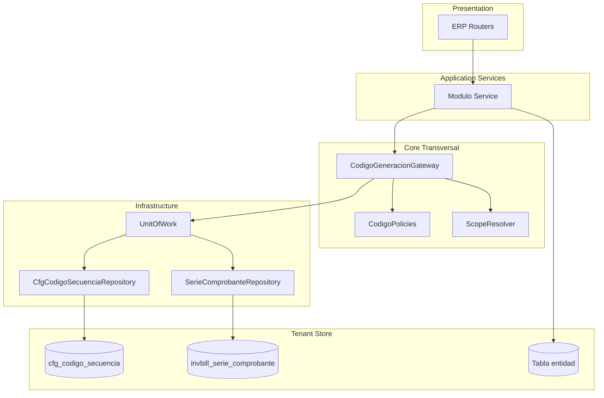

# F15 — Arquitectura propuesta (conceptual)

**Fase:** F15 — Solo definición arquitectónica. **Sin implementación.**  
**Fecha:** 2026-07-02  
**Excluido de este documento:** DDL definitivo de `cfg_codigo_secuencia`, algoritmo, endpoints, frontend.

---

## 1. Decisión arquitectónica principal

**Sí debe existir un servicio transversal de generación de códigos** para el ERP CAXIS, con responsabilidad única:

- Asignar identificadores internos **atómicos**, **idempotentes bajo retry**, y **alineados al scope UNIQUE** de cada entidad.
- Separar claramente **maestros** (códigos persistentes de entidad) de **documentos** (correlativos de proceso).
- No reemplazar identificadores legales/externos (RUC, EAN, series SUNAT pre-asignadas).

---

## 2. Ubicación en la arquitectura V4

Propuesta alineada a capas existentes (`ERP_BACKEND_STANDARDS_V4.md`) y patrones ya usados (`identity_gateway`, `auth_config_gateway`, `UnitOfWork`):

```
app/
├── core/
│   └── codigo/                          ← NUEVO (dominio transversal, sin módulo ERP)
│       ├── codigo_generacion_gateway.py # Fachada pública para services
│       ├── codigo_generacion_types.py   # Enums: familia, scope, política
│       ├── codigo_scope_resolver.py     # Deriva scope desde metadatos de entidad
│       └── codigo_policies.py           # Reglas: manual permitido, override, fiscal
│
├── infrastructure/
│   └── database/
│       ├── repositories/
│       │   └── cfg_codigo_secuencia_repository.py  # EXISTENTE — persistencia
│       └── queries/
│           └── codigo/                   ← NUEVO (SQL atómico UPDLOCK si aplica)
│
└── modules/{cod}/application/services/
    └── *_servicio.py                     # Consumen gateway en CREATE documento/maestro
```

### 2.1 ¿Por qué `app/core/codigo/` y no un módulo ERP?

| Criterio | `core/codigo` | `modules/inv` u `org` |
|----------|---------------|------------------------|
| Consumo cross-módulo | INV, PUR, SLS, FIN, HCM… | Acoplaría INV como dueño indebido |
| Naturaleza | Política transversal | Dominio operativo |
| Estándar V4 §3 | Infra de sesión/tenant en `core/` | Módulos ERP sin `domain/` |
| IAM/Platform | Excluido (no genera `codigo_cliente`) | — |

### 2.2 Responsabilidades por capa

| Capa | Responsabilidad | No debe |
|------|-----------------|---------|
| **Gateway** (`codigo_generacion_gateway`) | Orquestar: resolver política → adquirir número → formatear → devolver string | Conocer reglas de negocio del módulo (workflow INV, etc.) |
| **Scope resolver** | Mapear entidad → dimensiones (`cliente_id`, `empresa_id`, `almacen_id`, `serie_id`) | Ejecutar SQL directamente |
| **Repository cfg** | Persistir/incrementar contador en UoW | Validar permisos RBAC |
| **Service ERP** | Invocar gateway si el payload no trae código; persistir entidad | Implementar lógica de formato por módulo |
| **Presentation** | Hacer código **opcional** en Create cuando política sea `auto`; Read siempre lo devuelve | Generar códigos |

---

## 3. Familias de generación

```
┌─────────────────────────────────────────────────────────────┐
│                  MOTOR DE CÓDIGOS (core)                     │
├──────────────┬──────────────────────┬───────────────────────┤
│  F1 Maestro  │  F2 Documento        │  F3 Fiscal            │
│  prefijo+seq │  prefijo+seq         │  serie.numero_actual  │
│  scope T1/T2 │  scope T2            │  scope T5             │
├──────────────┴──────────────────────┴───────────────────────┤
│  F4 Almacén (WMS)          │  F5 POS turno               │
│  scope T3                  │  scope T4                    │
└────────────────────────────┴──────────────────────────────┘
```

| Familia | Entidades ejemplo | Fuente de verdad numérica |
|---------|-------------------|---------------------------|
| F1 Maestro | `codigo_sku`, `codigo_empresa` | `cfg_codigo_secuencia` (Fase 2) |
| F2 Documento | `numero_oc`, `numero_movimiento` | `cfg_codigo_secuencia` |
| F3 Fiscal | `invbill_comprobante` | `invbill_serie_comprobante.numero_actual` |
| F4 WMS | `numero_tarea`, `codigo_ubicacion` | Extensión cfg con `almacen_id` |
| F5 POS | `numero_turno` | Extensión cfg con `punto_venta_id` |

**Excluidas:** F0 Catálogo global (`cat_*`), identidad legal, códigos externos.

---

## 4. Políticas por tipo de entidad (conceptual)

| Política | Descripción | Ejemplo |
|----------|-------------|---------|
| `AUTO_REQUIRED` | El sistema siempre genera; el cliente no puede enviar | Correlativo fiscal tras asignar serie |
| `AUTO_DEFAULT` | Genera si omitido; acepta manual si cumple formato y UNIQUE | Maestros ORG en migración |
| `MANUAL_ONLY` | Usuario obligado; solo validación de formato/uniquidad | `codigo_barra` EAN |
| `EXTERNAL` | Importado de sistema externo | `numero_documento` RUC |

**Recomendación F15 para nuevos desarrollos ERP:**

- Documentos transaccionales → `AUTO_REQUIRED` (post Fase 2).
- Maestros → `AUTO_DEFAULT` con transición desde `MANUAL_ONLY` actual.
- Fiscal → motor F3 integrado con serie; nunca timestamp.

---

## 5. Integración con Unit of Work

La generación debe ocurrir **dentro de la misma transacción** que el INSERT de la entidad:

1. Abrir UoW (movimiento, OC, maestro).
2. Adquirir siguiente número (lock pesimista en fila cfg o serie fiscal).
3. Insertar entidad con código asignado.
4. Commit único.

Si falla el INSERT, rollback revierte el incremento (o se usa gap permitido con auditoría — decisión Fase 2).

El patrón existente en `CfgCodigoSecuenciaRepository` que acepta `session: AsyncSession` es el ancla correcta.

---

## 6. Compatibilidad multi-tenant y hybrid platform

| Modo | Implicancia arquitectónica |
|------|----------------------------|
| **Shared database** | `cfg_codigo_secuencia` en BD ERP del tenant; filtro `cliente_id` obligatorio |
| **Dedicated database** | Misma tabla en store dedicado (V010 + seed S7); sin secuencias en BD central |
| **Multiempresa** | Resolver siempre `empresa_id` de sesión ERP (`require_session_empresa_id`); excepción `org_empresa` |
| **Multi-tenant** | Nunca compartir contadores entre `cliente_id`; gateway recibe `client_id` operativo de sesión |

El gateway debe usar el **mismo operation store resolver** que el módulo invocador (patrón F13 `operation_store_resolver`), evitando leer secuencias en BD central cuando el tenant es dedicated.

---

## 7. Contrato conceptual del gateway (no implementación)

Entrada mínima:

- `client_id`, `empresa_id` (opcional según entidad)
- `entidad_logica` (catálogo normativo Fase 2, ej. `inv_movimiento`)
- `scope_extra` opcional: `almacen_id`, `punto_venta_id`, `serie_id`
- `modo`: `siguiente` | `preview` (opcional para UI)

Salida:

- `codigo_generado: str`
- `componentes` (opcional): `{ prefijo, secuencia, separador }`
- `secuencia_id` / referencia para auditoría

Errores mapeados a `ConflictError` (agotamiento, serie inactiva) o `ValidationError` (política manual violada).

---

## 8. Qué NO debe hacer el motor

- Generar UUID (ya es PK).
- Sustituir `codigo_cliente` SaaS (plataforma).
- Calcular `codigo_hash` / `codigo_qr` SUNAT (módulo fiscal).
- Imponer formato a catálogos globales sincronizados.
- Exponerse directamente en routers (solo vía services).

---

## 9. Evolución por fases

| Fase | Entregable |
|------|------------|
| **F15 (actual)** | Estándar arquitectónico, inventario, scope, riesgos |
| **F16+** | Catálogo normativo `entidad_logica`, DDL cfg extendido, gateway + políticas |
| **F16+** | Migración módulos P0: INV movimiento, PUR OC, SLS pedido, invbill |
| **Posterior** | Maestros AUTO_DEFAULT, UI de configuración de prefijos |

---

## 10. Flujos conceptuales

### 10.1 Alta de maestro con código autogenerado

```
Cliente HTTP POST /org/sucursales
        ↓
Router ORG (require_erp_session, RBAC)
        ↓
SucursalService.create_sucursal_servicio
        ↓
¿payload.codigo presente?
   ├─ Sí → validar formato + unicidad (política AUTO_DEFAULT)
   └─ No  → CodigoGeneracionGateway.siguiente(
              entidad=org_sucursal,
              client_id, empresa_id)
        ↓
ScopeResolver → (cliente_id, empresa_id, entidad)
        ↓
CfgCodigoSecuenciaRepository (dentro de UoW)
   → lock + increment ultimo_numero
   → formatear: prefijo + separador + número
        ↓
Código generado (ej. "SUC004")
        ↓
INSERT org_sucursal + COMMIT
        ↓
SucursalRead al cliente
```

### 10.2 Alta de documento transaccional

```
Cliente HTTP POST /inv/movimientos
        ↓
MovimientoService.create_movimiento_servicio
        ↓
Política AUTO_REQUIRED → ignorar numero_movimiento del cliente
        ↓
CodigoGeneracionGateway.siguiente(entidad=inv_movimiento, …)
        ↓
cfg_codigo_secuencia (empresa-scoped)
        ↓
INSERT inv_movimiento (estado=borrador)
        ↓
MovimientoRead
```

### 10.3 Emisión de comprobante fiscal

```
POST /invbill/comprobantes
        ↓
ComprobanteService
        ↓
Resolver invbill_serie_comprobante activa (tipo + empresa + PV)
        ↓
Motor F3: increment numero_actual en serie (no cfg genérica)
        ↓
Formatear numero con padding legal (8 dígitos)
        ↓
INSERT invbill_comprobante (serie, numero)
        ↓
Pipeline OSE → codigo_hash / codigo_qr (fuera del motor interno)
```

### 10.4 Onboarding tenant (sin cambio de responsabilidad)

```
ClienteOnboardingService
        ↓
INSERT cliente (codigo_cliente manual plataforma)
        ↓
INSERT org_empresa (EMP001 bootstrap)
        ↓
Seed cfg_codigo_secuencia (9 filas, política Fase 2 corregirá scope)
        ↓
(No genera códigos de negocio operativos aún)
```

### 10.5 Diagrama de componentes



---

*Resumen ejecutivo: `06_EXECUTIVE_SUMMARY.md`.*
