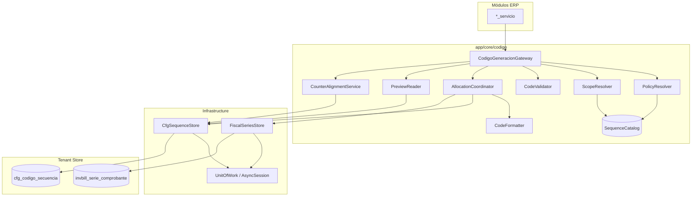
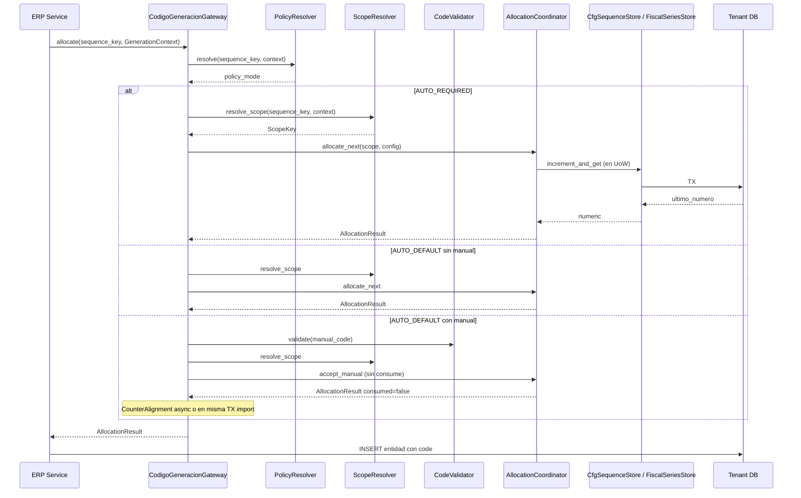

# F16 — Arquitectura técnica del Motor de Generación de Códigos

**Fase:** F16 — Diseño técnico (solo documentación)  
**Fecha:** 2026-07-03  
**Base congelada:** F15 (`01`–`06`) + F15A (`07`–`10`)  
**Alcance:** Arquitectura implementable. Sin código, sin DDL, sin pseudocódigo.

---

## 1. Propósito

Este documento define la **arquitectura técnica completa** del Motor de Generación de Códigos CAXIS ERP para que la implementación posterior sea prácticamente mecánica.

Las reglas de negocio (políticas AUTO_*, scope funcional, inmutabilidad) **no se replantean**; solo se traducen a componentes, contratos y flujos técnicos.

---

## 2. Decisión arquitectónica principal

| ID | Decisión |
|----|----------|
| **TA-01** | Motor transversal en `app/core/codigo/` como **capability de plataforma ERP**, no módulo `{cod}`. |
| **TA-02** | Punto de entrada único: **`CodigoGeneracionGateway`**. Los `*_servicio` nunca acceden a stores de secuencia directamente. |
| **TA-03** | Dos familias de persistencia de contador: **cfg genérica** (`cfg_codigo_secuencia` evolucionada) y **fiscal** (`invbill_serie_comprobante` / equivalente guía). |
| **TA-04** | Metadatos de entidades en **catálogo estático versionado** (`SequenceCatalog`), no inferidos en runtime desde DDL. |
| **TA-05** | Toda asignación que consume contador ocurre **dentro de la UoW** del servicio ERP que persiste la entidad. |
| **TA-06** | Routing de conexión vía **mismo operation store** que el módulo invocador (shared/dedicated). |

---

## 3. Vista de componentes



---

## 4. Componentes internos (inventario oficial)

Solo los componentes **necesarios**. No se incluyen abstracciones redundantes.

| Componente | Obligatorio | Responsabilidad |
|------------|-------------|-----------------|
| **CodigoGeneracionGateway** | Sí | Fachada pública; orquesta operaciones `allocate`, `preview`, `align`, `validate_manual`. |
| **SequenceCatalog** | Sí | Registro inmutable de `sequence_key` → metadatos (scope, policy, campo BD, familia, módulo). |
| **ScopeResolver** | Sí | Traduce contexto de sesión + payload a **ScopeKey** canónico. |
| **PolicyResolver** | Sí | Determina modo de operación según política F15A y presencia de código en request. |
| **CodeValidator** | Sí | Formato, longitud, charset, reglas de padding parcial en manual. |
| **CodeFormatter** | Sí | Ensambla valor final desde prefijo, separador, número, reglas de padding. |
| **AllocationCoordinator** | Sí | Consume contador y devuelve código en contexto transaccional. |
| **CfgSequenceStore** | Sí | Lectura/escritura de `cfg_codigo_secuencia` (evolucionada). |
| **FiscalSeriesStore** | Sí | Lectura/escritura de contador fiscal por `serie_id`. |
| **PreviewReader** | Sí | Estimación sin consumo (solo AUTO_DEFAULT). |
| **CounterAlignmentService** | Sí | High-water mark post-importación y post-manual (AUTO_DEFAULT). |
| **Generator** | No | Responsabilidad absorbida por AllocationCoordinator + CodeFormatter. |
| **Sequence Repository (actual)** | Evoluciona | Se convierte en implementación de CfgSequenceStore; no expuesto a servicios ERP. |

---

## 5. Concepto oficial: `sequence_key`

### 5.1 Decisión de naming

| Candidato | Veredicto |
|-----------|-----------|
| `entidad` | **Rechazado** como nombre canónico: ambiguo (fila vs. tipo), mezcla español/inglés en API interna. |
| `entity_key` | Aceptable; riesgo de confusión con identidad de fila (`entity_id`). |
| `resource` | **Rechazado**: colisión con RBAC `{modulo}.{recurso}.{accion}`. |
| `resource_name` | **Rechazado**: mismo conflicto RBAC. |
| `entity_code` | **Rechazado**: sugiere el valor del código, no la clave de catálogo. |
| **`sequence_key`** | **ADOPTADO OFICIALMENTE** |

**`sequence_key`**: identificador estable, único en el catálogo del motor, que designa **un par lógico (tabla BD + columna código)** susceptible de secuencia.

### 5.2 Formato normativo

```
sequence_key = {nombre_tabla_v010}
```

Ejemplos: `org_sucursal`, `inv_movimiento`, `inv_categoria_producto`.

**Reglas:**

- Coincide exactamente con el nombre de tabla en V010.
- Una tabla con dos columnas secuenciales (raro) usa sufijo: `invbill_comprobante.numero` → sequence_key `invbill_comprobante` con campo documentado en catálogo; fiscal usa store aparte.
- El seed histórico `inv_categoria` se corrige a `inv_categoria_producto` en migración de datos.

### 5.3 Columna física BD

| Aspecto | Decisión |
|---------|----------|
| Nombre actual `entidad` | **Deprecado**; migración futura renombra a `sequence_key`. |
| Hasta migración | Capa store mapea `sequence_key` ↔ columna `entidad`. |
| Tipo | `NVARCHAR(50)` suficiente; reservar hasta 64 en evolución. |

---

## 6. Tipos de valor (contratos conceptuales)

Sin interfaces de código. Solo estructuras semánticas.

### 6.1 `GenerationContext`

| Campo | Origen | Obligatorio |
|-------|--------|-------------|
| `client_id` | Sesión ERP operativa | Siempre |
| `empresa_id` | Sesión / payload | Según scope |
| `almacen_id` | Payload / contexto WMS | Si scope T3 |
| `punto_venta_id` | Payload / contexto POS | Si scope T4 |
| `serie_id` | Payload fiscal | Si scope T5 emisión |
| `operation` | `create`, `import`, `preview`, `align` | Siempre |
| `manual_code` | Payload usuario | Solo AUTO_DEFAULT manual / import |
| `idempotency_key` | Header / metadata opcional | Reintentos |

### 6.2 `ScopeKey`

| Campo | Descripción |
|-------|-------------|
| `scope_type` | `TENANT`, `EMPRESA`, `ALMACEN`, `PUNTO_VENTA`, `SERIE_FISCAL` |
| `client_id` | UUID tenant |
| `empresa_id` | UUID o null (TENANT) |
| `almacen_id` | UUID o null |
| `punto_venta_id` | UUID o null |
| `serie_id` | UUID o null |
| `sequence_key` | Catálogo |

### 6.3 `AllocationResult`

| Campo | Descripción |
|-------|-------------|
| `code` | Valor final a persistir |
| `sequence_key` | Clave catálogo |
| `scope_key` | Scope resuelto |
| `numeric_part` | Parte numérica (si aplica) |
| `consumed` | Si incrementó contador |
| `source` | `CFG` \| `FISCAL` \| `MANUAL_ACCEPTED` |

### 6.4 `PreviewResult`

| Campo | Descripción |
|-------|-------------|
| `estimated_code` | Código estimado |
| `disclaimer` | Siempre indica no reservado |
| `based_on_ultimo_numero` | Valor leído sin lock |

---

## 7. Flujo técnico completo (allocate)



---

## 8. Extensibilidad: registrar nueva entidad

Pasos **sin implementación** — checklist mecánico:

| Paso | Acción |
|------|--------|
| 1 | Verificar entidad en F15 clasificación B o C y política en `08`. |
| 2 | Agregar entrada en **SequenceCatalog** con scope_type, policy, `code_column`, `family` (F1/F2/F3/F4/F5). |
| 3 | Si scope nuevo: extender **ScopeResolver** (matriz en `13_SCOPE_RESOLUTION.md`). |
| 4 | Definir defaults de prefijo/padding en catálogo o seed por `sequence_key`. |
| 5 | Si fiscal: registrar en FiscalSeriesStore, no en cfg. |
| 6 | Actualizar servicio ERP: llamar gateway en create; no persistir código sin gateway en AUTO_REQUIRED. |
| 7 | Actualizar schema presentation: opcional/obligatorio según policy. |
| 8 | Añadir prueba de integración de asignación + unicidad (fase implementación). |

**No requiere** cambiar gateway signature si `sequence_key` + `GenerationContext` bastan.

---

## 9. Administración futura (vista técnica)

Configurable vía API/UI futura sobre `cfg_codigo_secuencia` (ver `14_SEQUENCE_MODEL.md`):

| Parámetro | Nivel |
|-----------|-------|
| `prefijo`, `separador`, `longitud_numero`, `ultimo_numero` | Por ScopeKey + sequence_key |
| `es_activo` | Por fila cfg |
| `politica` | Solo lectura desde catálogo (no override BD) |
| Reinicio contador | Operación administrativa separada con validación anti-colisión |

La política AUTO_* **no** es editable por tenant; evita divergencia de estándar F15A.

---

## 10. Compatibilidad hybrid platform

| Modo | Implicancia técnica |
|------|---------------------|
| Shared DB | `CfgSequenceStore` usa conexión tenant con `client_id`; cfg en misma BD ERP. |
| Dedicated DB | Idéntico; cfg vive en store dedicado (V010). |
| Multiempresa | ScopeKey incluye `empresa_id` salvo TENANT. |
| Multi-tenant | `client_id` obligatorio en toda operación; sin cache cross-tenant. |

Gateway recibe `client_id` del **session scope ERP** (`require_session_cliente_id`), nunca de body.

---

## 11. Diagrama de responsabilidades (capas)

| Capa | Puede | No puede |
|------|-------|----------|
| Presentation | Omitir/enviar código según policy | Generar, incrementar contador |
| Application Service | Invocar gateway; persistir entidad | SQL directo a cfg |
| Gateway | Orquestar política, scope, alloc | Reglas workflow módulo |
| Stores | Persistir contador | Validar permisos RBAC |
| SequenceCatalog | Declarar metadatos | Acceder BD |

---

## 12. Documentos relacionados

| Documento | Contenido |
|-----------|-----------|
| `12_GATEWAY_DESIGN.md` | Contrato y límites del gateway |
| `13_SCOPE_RESOLUTION.md` | Matriz scope completa |
| `14_SEQUENCE_MODEL.md` | Modelo cfg definitivo |
| `15_TRANSACTION_AND_CONCURRENCY.md` | TX, concurrencia, manual, preview |
| `16_IMPLEMENTATION_ROADMAP.md` | Olas, riesgos, recomendaciones |

---

*F16 — Diseño técnico. Implementación prohibida en esta fase.*
