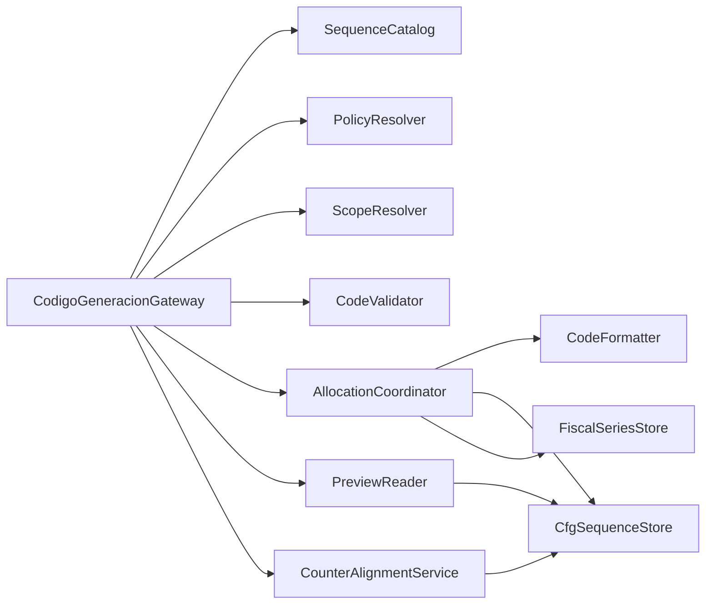
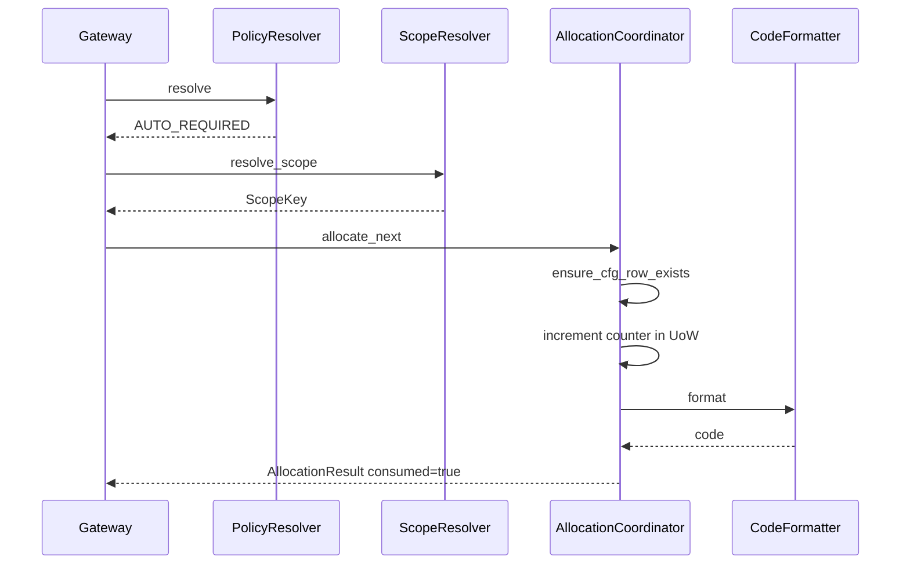
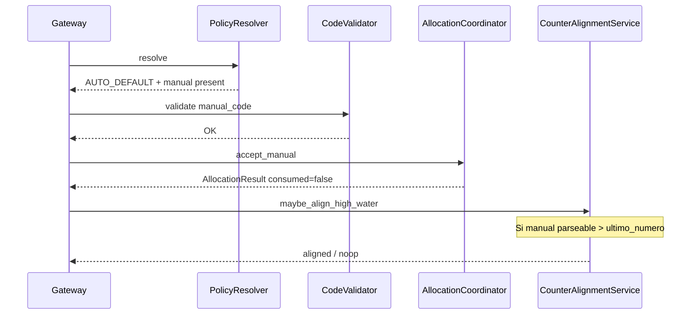

# F16 — Diseño del CodigoGeneracionGateway

**Fase:** F16 — Diseño técnico  
**Fecha:** 2026-07-03  
**Base congelada:** F15A + `11_TECHNICAL_ARCHITECTURE.md`

---

## 1. Nombre oficial

| Elemento | Valor |
|----------|-------|
| **Clase / módulo** | `CodigoGeneracionGateway` |
| **Ubicación** | `app/core/codigo/codigo_generacion_gateway.py` |
| **Patrón** | Gateway (misma familia que `IdentityGateway`, `AuthConfigGateway`) |
| **Exposición** | Solo a `application/services`; prohibido en `presentation/` |

---

## 2. Misión

Único punto de entrada del ERP para:

1. **Asignar** códigos que consumen secuencia.
2. **Aceptar** códigos manuales válidos sin consumo indebido.
3. **Estimar** próximo código (preview).
4. **Alinear** contadores tras importación o manual alto (high-water).
5. **Validar** formato de código sin asignar.

El gateway **no persiste entidades de negocio** (no INSERT en `org_sucursal`, etc.).

---

## 3. Límites explícitos

### 3.1 Dentro del gateway

| Responsabilidad |
|-----------------|
| Resolver `sequence_key` en catálogo |
| Resolver política y scope |
| Coordinar consumo de contador en UoW recibida |
| Formatear valor final |
| Validar formato/longitud |
| Alinear contador (high-water) cuando corresponda |
| Distinguir familia cfg vs fiscal |
| Propagar errores de dominio (`ConflictError`, `ValidationError`) |

### 3.2 Fuera del gateway

| No responsable |
|----------------|
| RBAC / permisos (lo hace el servicio antes de invocar) |
| Workflow (`borrador` → `procesado`) |
| Unicidad de terceros (`numero_documento` RUC) |
| Generación hash/QR SUNAT |
| Enforcement de inmutabilidad del código en UPDATE (**BR-IMM** — responsabilidad del **servicio ERP** / schemas Update; el Gateway **no** participa en UPDATE) |
| Elegir conexión BD (la recibe o usa contexto UoW del caller) |
| Crear empresa/sucursal en onboarding plataforma |

---

## 4. Dependencias permitidas

| Dependencia | Tipo | Notas |
|-------------|------|-------|
| `SequenceCatalog` | Estático / config | Sin I/O |
| `PolicyResolver` | Puro | Lee catálogo + context |
| `ScopeResolver` | Puro + validación refs | Puede recibir IDs ya validados por servicio |
| `CodeValidator` | Puro | |
| `AllocationCoordinator` | Stateful por TX | Requiere sesión UoW |
| `PreviewReader` | Lectura | Sin escritura |
| `CounterAlignmentService` | Escritura | Solo vía UoW |
| `CfgSequenceStore` | Infra | Implementación repository evolucionada |
| `FiscalSeriesStore` | Infra | Acceso `invbill_serie_comprobante` |
| Servicios ERP | **Ninguna** | Evitar dependencia circular |
| FastAPI / routers | **Ninguna** | |

---

## 5. Operaciones públicas del gateway (conceptual)

Sin firmas de código. Semántica contractual.

### 5.1 `allocate`

| Aspecto | Definición |
|---------|------------|
| **Propósito** | Obtener el código definitivo para persistir la entidad en esta transacción. |
| **Entrada** | `sequence_key`, `GenerationContext`, `UnitOfWork` activo |
| **Salida** | `AllocationResult` |
| **Efecto lateral** | Incrementa contador si `consumed=true` |
| **Políticas** | AUTO_REQUIRED siempre consume; AUTO_DEFAULT consume solo si autogenera |

### 5.2 `preview`

| Aspecto | Definición |
|---------|------------|
| **Propósito** | Mostrar estimación UI para maestros AUTO_DEFAULT. |
| **Entrada** | `sequence_key`, `GenerationContext` (sin UoW obligatorio) |
| **Salida** | `PreviewResult` |
| **Efecto lateral** | **Ninguno** |
| **Restricción** | Rechazado para AUTO_REQUIRED y familia fiscal |

### 5.3 `validate_manual`

| Aspecto | Definición |
|---------|------------|
| **Propósito** | Validar código manual antes de create (opcional; `allocate` también valida). |
| **Entrada** | `sequence_key`, `manual_code`, `GenerationContext` |
| **Salida** | Éxito o error de validación |
| **Efecto lateral** | Ninguno |

### 5.4 `align_counter`

| Aspecto | Definición |
|---------|------------|
| **Propósito** | Ajustar `ultimo_numero` tras importación o manual con parte numérica alta. |
| **Entrada** | `sequence_key`, `ScopeKey`, `candidate_code` o `numeric_high`, `UnitOfWork` |
| **Salida** | Nuevo `ultimo_numero` efectivo |
| **Efecto lateral** | Actualiza cfg si candidate > actual |
| **Quién invoca** | Servicio de importación masiva o `allocate` post-manual (política high-water) |

---

## 6. Componentes internos bajo el gateway

El gateway **no contiene lógica de negocio ERP**; delega en:

| Componente | Relación con gateway |
|------------|---------------------|
| **PolicyResolver** | Primera resolución tras recibir request |
| **ScopeResolver** | Segunda resolución; falla si faltan dimensiones |
| **AllocationCoordinator** | Ejecuta la decisión de allocate |
| **PreviewReader** | Rama separada sin TX de escritura |
| **CounterAlignmentService** | Invocado desde allocate (manual) o import |

El gateway es **orquestador fino** (~delegación, no ~lógica).

---

## 7. Secuencia: allocate AUTO_REQUIRED

---

## 8. Secuencia: allocate AUTO_DEFAULT con manual

---

## 9. Manejo de errores (mapeo conceptual)

| Condición | Excepción ERP |
|-----------|---------------|
| `sequence_key` desconocido | `ValidationError` — catálogo |
| Scope incompleto (falta empresa_id) | `ValidationError` — sesión incompleta |
| Secuencia inactiva | `ConflictError` — secuencia inactiva |
| Serie fiscal agotada / inactiva | `ConflictError` |
| Manual en AUTO_REQUIRED | `ValidationError` — política |
| Manual duplicado (pre-check servicio) | `ConflictError` — ya existe |
| Contador overflow longitud | `ConflictError` — secuencia agotada |

---

## 10. Idempotencia (expectativa contractual)

| Escenario | Comportamiento gateway |
|-----------|------------------------|
| Reintento misma petición con `idempotency_key` y misma intención | Debe devolver **mismo** código sin segundo consumo (responsabilidad compartida con servicio que guarda mapping; gateway documenta soporte opcional de deduplicación por key en misma ventana TX) |
| Reintento sin idempotency tras commit exitoso | Servicio debe detectar duplicado de negocio; gateway no interviene |
| Reintento tras rollback TX | Nueva asignación; nuevo número (correcto) |

Detalle en `15_TRANSACTION_AND_CONCURRENCY.md`.

---

## 11. Integración con servicios ERP (patrón)

| Paso | Servicio ERP |
|------|--------------|
| 1 | Validar RBAC, refs, empresa en tenant |
| 2 | Abrir UoW |
| 3 | `allocate(sequence_key, context, uow)` |
| 4 | INSERT entidad con `result.code` |
| 5 | Commit UoW |

El servicio **nunca** pasa `ultimo_numero` ni manipula cfg.

---

## 12. Fiscal: rama especial

Para `sequence_key` en familia F3 (`invbill_comprobante`, `log_guia_remision` emisión):

| Aspecto | Decisión |
|---------|----------|
| Store | `FiscalSeriesStore`, no cfg genérica |
| Entrada | `serie_id` obligatorio en context |
| Gateway | Misma operación `allocate`; enruta internamente por `family` del catálogo |

---

## 13. Testing (criterios para implementación)

| Área | Caso mínimo |
|------|-------------|
| AUTO_REQUIRED | Ignora manual si enviado |
| AUTO_DEFAULT | Autogenera si omitido |
| AUTO_DEFAULT manual | No consume; alinea high-water |
| Scope | Empresa vs tenant vs almacén |
| Fiscal | Incremento en serie |
| Preview | Sin cambio ultimo_numero |
| TX rollback | Contador revierte con UoW |

---

*Ver modelo de datos en `14_SEQUENCE_MODEL.md` y scope en `13_SCOPE_RESOLUTION.md`.*
