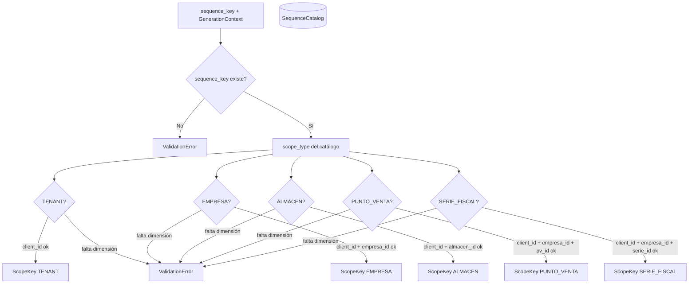

# F16 — Resolución de scope (Scope Resolver)

**Fase:** F16 — Diseño técnico  
**Fecha:** 2026-07-03  
**Base congelada:** F15 `03_SEQUENCE_SCOPE.md`, F15A `08_CODE_POLICIES.md`

---

## 1. Propósito

El **ScopeResolver** traduce un `sequence_key` + `GenerationContext` en un **`ScopeKey` canónico** que identifica de forma unívoca la fila de configuración de secuencia (o serie fiscal) que gobierna el contador.

**Regla técnica TD-SR-01:** el `scope_type` se toma del **SequenceCatalog**, no se infiere dinámicamente desde SQL en runtime.

**Regla técnica TD-SR-02:** las dimensiones UUID del ScopeKey deben coincidir con las columnas del UNIQUE de V010 para la entidad (F15 R-SEC-01).

---

## 2. Tipos de scope oficiales

| `scope_type` | Código F15 | Dimensiones activas en ScopeKey | Columna cfg / store |
|--------------|------------|--------------------------------|---------------------|
| `TENANT` | T1 | `client_id` | `empresa_id IS NULL`, demás null |
| `EMPRESA` | T2 | `client_id`, `empresa_id` | `empresa_id` NOT NULL |
| `ALMACEN` | T3 | `client_id`, `almacen_id` | `almacen_id` NOT NULL; `empresa_id` derivado opcional para FK |
| `PUNTO_VENTA` | T4 | `client_id`, `empresa_id`, `punto_venta_id` | `punto_venta_id` NOT NULL |
| `SERIE_FISCAL` | T5 | `client_id`, `empresa_id`, `serie_id` | Store fiscal; no fila cfg genérica |

---

## 3. Algoritmo de resolución (comportamiento, no código)

```
ENTRADA: sequence_key, GenerationContext

1. Buscar sequence_key en SequenceCatalog
   → si no existe: error catálogo

2. Leer scope_type declarado en catálogo

3. Validar presencia de dimensiones obligatorias según scope_type:

   TENANT:
     - client_id (sesión)
     - empresa_id debe ignorarse o ser null

   EMPRESA:
     - client_id, empresa_id (sesión ERP require_session_empresa_id)

   ALMACEN:
     - client_id, almacen_id (payload o contexto WMS)
     - validar que almacén pertenece a empresa de sesión

   PUNTO_VENTA:
     - client_id, empresa_id, punto_venta_id

   SERIE_FISCAL:
     - client_id, empresa_id, serie_id
     - validar serie activa y pertenencia a empresa

4. Construir ScopeKey normalizado

5. Devolver ScopeKey
```

La validación de pertenencia tenant/empresa es responsabilidad compartida: el servicio ERP valida refs; el ScopeResolver valida **completitud** del contexto.

---

## 4. Diagrama Scope Resolver



---

## 5. Matriz completa: sequence_key → scope

### 5.1 Maestros (familia F1)

| sequence_key | Campo código | scope_type | Dimensión resolutiva |
|--------------|--------------|------------|----------------------|
| `org_empresa` | `codigo_empresa` | TENANT | tenant |
| `org_sucursal` | `codigo` | EMPRESA | empresa |
| `org_centro_costo` | `codigo` | EMPRESA | empresa |
| `org_departamento` | `codigo` | EMPRESA | empresa |
| `org_cargo` | `codigo` | EMPRESA | empresa |
| `inv_categoria_producto` | `codigo` | EMPRESA | empresa |
| `inv_unidad_medida` | `codigo` | EMPRESA | empresa |
| `inv_producto` | `codigo_sku` | EMPRESA | empresa |
| `inv_almacen` | `codigo` | EMPRESA | empresa |
| `inv_tipo_movimiento` | `codigo` | EMPRESA | empresa |
| `wms_zona_almacen` | `codigo` | ALMACEN | almacén |
| `wms_ubicacion` | `codigo_ubicacion` | ALMACEN | almacén |
| `pur_proveedor` | `codigo_proveedor` | EMPRESA | empresa |
| `sls_cliente` | `codigo_cliente` | EMPRESA | empresa |
| `hcm_empleado` | `codigo_empleado` | EMPRESA | empresa |
| `log_transportista` | `codigo_transportista` | EMPRESA | empresa |
| `log_ruta` | `codigo_ruta` | EMPRESA | empresa |
| `mfg_centro_trabajo` | `codigo` | EMPRESA | empresa |
| `mfg_operacion` | `codigo` | EMPRESA | empresa |
| `mfg_lista_materiales` | `codigo_bom` | EMPRESA | empresa |
| `mfg_ruta_fabricacion` | `codigo_ruta` | EMPRESA | empresa |
| `mnt_activo` | `codigo_activo` | EMPRESA | empresa |
| `mnt_plan_mantenimiento` | `codigo_plan` | EMPRESA | empresa |
| `mrp_plan_maestro` | `codigo_plan` | EMPRESA | empresa |
| `mps_plan_produccion` | `codigo_plan` | EMPRESA | empresa |
| `crm_campana` | `codigo_campana` | EMPRESA | empresa |
| `prc_lista_precio` | `codigo_lista` | EMPRESA | empresa |
| `prc_promocion` | `codigo_promocion` | EMPRESA | empresa |
| `fin_plan_cuentas` | `codigo_cuenta` | EMPRESA | empresa |
| `hcm_concepto_planilla` | `codigo_concepto` | EMPRESA | empresa |
| `qms_parametro_calidad` | `codigo` | EMPRESA | empresa |
| `qms_plan_inspeccion` | `codigo` | EMPRESA | empresa |
| `pos_punto_venta` | `codigo_punto_venta` | EMPRESA | empresa |
| `bdg_presupuesto` | `codigo_presupuesto` | EMPRESA | empresa |
| `cst_centro_costo_tipo` | `codigo` | EMPRESA | empresa |
| `pm_proyecto` | `codigo_proyecto` | EMPRESA | empresa |
| `bi_reporte` | `codigo_reporte` | EMPRESA | empresa |
| `wfl_flujo_trabajo` | `codigo_flujo` | EMPRESA | empresa |
| `dms_documento` | `codigo_documento` | EMPRESA | empresa |

> `invbill_serie_comprobante` (alta de serie): MANUAL_ONLY — **no** usa ScopeResolver para allocate; alta manual de serie.

### 5.2 Documentos cfg (familia F2)

| sequence_key | Campo | scope_type |
|--------------|-------|------------|
| `inv_movimiento` | `numero_movimiento` | EMPRESA |
| `inv_inventario_fisico` | `numero_inventario` | EMPRESA |
| `pur_solicitud_compra` | `numero_solicitud` | EMPRESA |
| `pur_cotizacion` | `numero_cotizacion` | EMPRESA |
| `pur_orden_compra` | `numero_oc` | EMPRESA |
| `pur_recepcion` | `numero_recepcion` | EMPRESA |
| `log_despacho` | `numero_despacho` | EMPRESA |
| `mfg_orden_produccion` | `numero_op` | EMPRESA |
| `mnt_orden_trabajo` | `numero_ot` | EMPRESA |
| `sls_cotizacion` | `numero_cotizacion` | EMPRESA |
| `sls_pedido` | `numero_pedido` | EMPRESA |
| `crm_oportunidad` | `numero_oportunidad` | EMPRESA |
| `pos_venta` | `numero_venta` | EMPRESA |
| `hcm_contrato` | `numero_contrato` | EMPRESA |
| `hcm_planilla` | `numero_planilla` | EMPRESA |
| `hcm_prestamo` | `numero_prestamo` | EMPRESA |
| `fin_asiento_contable` | `numero_asiento` | EMPRESA |
| `qms_inspeccion` | `numero_inspeccion` | EMPRESA |
| `qms_no_conformidad` | `numero_nc` | EMPRESA |
| `wms_tarea` | `numero_tarea` | ALMACEN |
| `svc_orden_servicio` | `numero_os` | EMPRESA |
| `tkt_ticket` | `numero_ticket` | EMPRESA |
| `pos_turno_caja` | `numero_turno` | PUNTO_VENTA |

### 5.3 Documentos fiscales (familia F3)

| sequence_key | Campo | scope_type | Store |
|--------------|-------|------------|-------|
| `invbill_comprobante` | `numero` (+ `serie` FK) | SERIE_FISCAL | `invbill_serie_comprobante` |
| `log_guia_remision` | `numero` (+ `serie`) | SERIE_FISCAL | Serie guía (cfg serie dedicada o extensión fiscal) |

---

## 6. Resolución automática: fuentes de dimensiones

| Dimensión | Fuente canónica en runtime ERP |
|-----------|-------------------------------|
| `client_id` | `require_session_cliente_id()` / `get_{cod}_session_client_id` |
| `empresa_id` | `require_session_empresa_id()` |
| `almacen_id` | Payload create o cabecera documento WMS |
| `punto_venta_id` | Payload POS / sesión caja |
| `serie_id` | Payload emisión fiscal o resolución desde PV |

**Anti-patrón prohibido:** `current_user.cliente_id` en presentation para autorización de scope.

---

## 7. Lazy creation de fila cfg

| Escenario | Comportamiento |
|-----------|----------------|
| Primera asignación en scope sin fila cfg | AllocationCoordinator crea fila con defaults del catálogo (prefijo, longitud, ultimo=0) |
| Onboarding seed | Precarga filas TENANT/EMPRESA según política corregida |
| Nueva empresa en tenant | Seed lazy por `sequence_key` empresa-scoped al primer allocate o job de provisioning |

---

## 8. Casos especiales

### 8.1 `org_empresa` post primera empresa

| Caso | Scope |
|------|-------|
| Primera empresa bootstrap `EMP001` | Puede omitir allocate (constante onboarding) |
| Segunda empresa en tenant | TENANT scope; mismo contador `org_empresa` para todo el tenant |

### 8.2 WMS con `empresa_id` en tabla pero UNIQUE por almacén

El ScopeKey usa **ALMACEN**; `empresa_id` puede almacenarse en fila cfg como denormalización para reporting pero **no** forma parte de la unicidad cfg.

### 8.3 `pos_venta` vs `pos_turno_caja`

| Entidad | Scope distinto |
|---------|----------------|
| `pos_turno_caja` | PUNTO_VENTA |
| `pos_venta` | EMPRESA (V010 UNIQUE sin pv_id) |

Si en el futuro retail exige PV, cambio de catálogo + migración UNIQUE, no hack en resolver.

---

## 9. UNIQUE cfg alineado a ScopeKey

La unicidad de fila en `cfg_codigo_secuencia` evolucionada debe ser:

```
UNIQUE (cliente_id, sequence_key, scope_type,
        COALESCE(empresa_id, '00000000-...'),
        COALESCE(almacen_id, '00000000-...'),
        COALESCE(punto_venta_id, '00000000-...'))
```

O modelo de **scope_hash** (ver `14_SEQUENCE_MODEL.md`). El ScopeResolver produce el identificador que alimenta esa unicidad.

---

## 10. Extensión: nuevo scope

Si un módulo futuro requiere scope no previsto (ej. `proyecto_id`):

| Paso | Acción |
|------|--------|
| 1 | Añadir `scope_type` al enumerado |
| 2 | Extender `ScopeKey` y modelo cfg |
| 3 | Documentar en catálogo y esta matriz |
| 4 | Actualizar ScopeResolver validación de dimensiones |

No añadir columnas ad hoc sin paso 2.

---

*Modelo físico en `14_SEQUENCE_MODEL.md`. Gateway en `12_GATEWAY_DESIGN.md`.*
