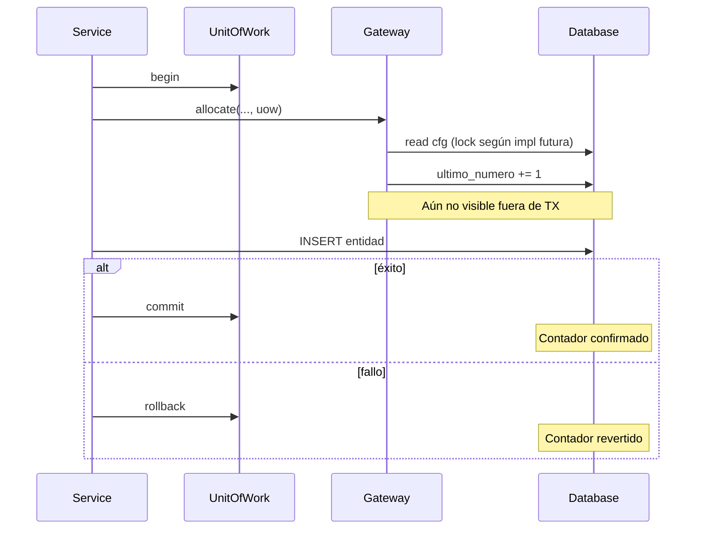
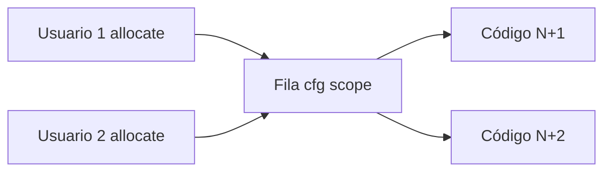
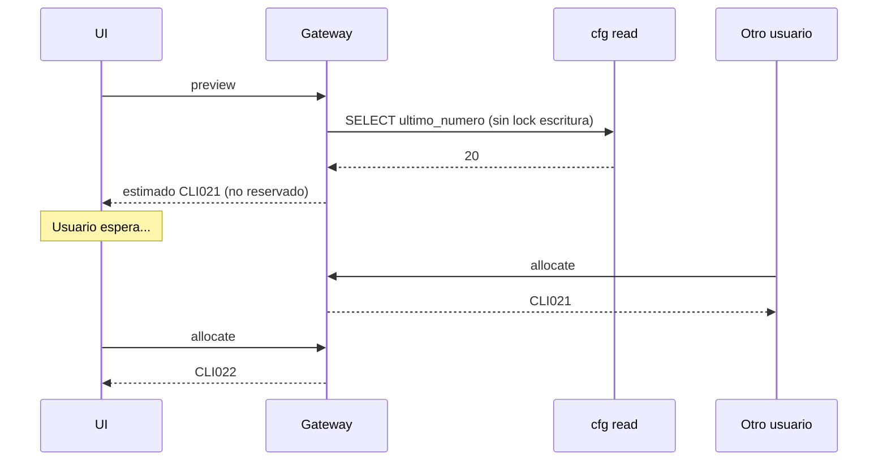

# F16 — Transacciones, concurrencia, manual y preview

**Fase:** F16 — Diseño técnico  
**Fecha:** 2026-07-03  
**Base congelada:** F15A `07`, `08`, `10`

---

## 1. Estrategia transaccional

### 1.1 Principios

| ID | Principio |
|----|-----------|
| **TX-01** | Consumo de secuencia y INSERT de entidad en la **misma unidad de trabajo**. |
| **TX-02** | El incremento de `ultimo_numero` / `numero_actual` se **confirma** solo con COMMIT de la UoW del servicio ERP. |
| **TX-03** | ROLLBACK de la UoW **revierte** el incremento de contador. |
| **TX-04** | Preview y validate_manual **no abren** transacción de escritura. |
| **TX-05** | align_counter en importación masiva usa la **misma UoW** del lote o fase de cierre de lote. |

### 1.2 Línea de tiempo: cuándo ocurre cada acción

### 1.3 Cuándo se consume la secuencia

| Operación | ¿Consume? | Momento |
|-----------|-----------|---------|
| AUTO_REQUIRED allocate | **Sí** | Antes del INSERT entidad, en misma TX |
| AUTO_DEFAULT autogenerado | **Sí** | Idem |
| AUTO_DEFAULT manual aceptado | **No** | Solo validación + opcional align |
| Preview | **No** | Lectura sin lock de escritura |
| Import con código histórico | **No** en fila | align al final de fila/lote |
| Fiscal allocate | **Sí** | Incremento `numero_actual` en serie |

### 1.4 Atomicidad y consistencia (comportamiento esperado)

| Propiedad | Expectativa |
|-----------|-------------|
| **Atomicidad** | Código asignado y contador avanzado son una unidad con el INSERT; rollback deshace ambos. |
| **Consistencia** | Tras commit, `ultimo_numero` ≥ parte numérica de cualquier código autogenerado emitido en ese scope. |
| **Aislamiento** | Dos allocates concurrentes no reciben el mismo número. |
| **Durabilidad** | Tras commit, siguiente allocate continúa la secuencia. |

La técnica de lock (UPDLOCK, optimistic, etc.) queda para implementación; el comportamiento observable es el de arriba.

---

## 2. Estrategia de concurrencia

### 2.1 Escenarios

| Escenario | Comportamiento esperado |
|-----------|-------------------------|
| **2 usuarios**, misma entidad, sin código | Dos códigos distintos consecutivos; sin error. |
| **2 usuarios**, mismo código manual | Uno éxito; otro `ConflictError` duplicado. |
| **100 usuarios**, documentos simultáneos | Secuencia lineal sin colisiones; posible contención en fila cfg (latencia, no incorrectitud). |
| **Retry** tras timeout antes de commit | Nuevo número al reintentar; riesgo de hueco si primer intento hizo commit parcial — mitigar con idempotency. |
| **Retry** tras rollback | Nuevo número; correcto. |
| **Duplicados** | UNIQUE BD última línea de defensa; servicio pre-check opcional. |
| **Idempotencia** | Misma operación lógica + `idempotency_key` → mismo resultado sin doble consumo. |

### 2.2 Diagrama concurrencia

### 2.3 Contención y escalabilidad

| Nivel | Expectativa |
|-------|-------------|
| Tenant típico | Una fila cfg por (sequence_key, scope) es cuello de botella aceptable |
| Alto volumen POS/facturación | Scope granular (serie fiscal, PV) distribuye contención |
| 100+ TPS mismo scope | Requiere lock eficiente; diseño permite sharding futuro por serie |

### 2.4 Idempotencia (arquitectura)

| Componente | Rol |
|------------|-----|
| Servicio ERP | Persiste `idempotency_key` → `entity_id` + `code` si patrón API lo soporta |
| Gateway | Opcional: en misma TX, si key ya resolvió allocate, devolver `AllocationResult` previo |
| Ventana | Misma sesión/UoW o tabla dedup con TTL (decisión implementación) |

Expectativa F15A STD-C-03.

---

## 3. Comportamiento ante código manual (decisión oficial)

### 3.1 Regla maestra TD-MAN-01

> **El contador solo avanza cuando el motor autogenera (consume).**  
> **El código manual no consume.**  
> **El contador puede alinearse hacia arriba (high-water) si el manual lo justifica.**

### 3.2 Escenario canónico: contador = 20, usuario crea `CLI999`

| Paso | Comportamiento |
|------|----------------|
| Política | AUTO_DEFAULT (`sls_cliente.codigo_cliente`) |
| Usuario envía | `CLI999` |
| Validación | Formato OK, UNIQUE OK |
| Consume contador | **No** — `ultimo_numero` permanece **20** |
| Persistencia | Entidad con `CLI999` |
| High-water | Si catálogo define prefijo `CLI` y parser extrae `999` > 20 → **align `ultimo_numero` = 999** |
| Siguiente autogenerado | **CLI1000** (si prefijo CLI + padding) |

**Decisión oficial TD-MAN-02:** high-water **activado por defecto** en AUTO_DEFAULT cuando el código manual es **parseable** bajo reglas del `sequence_key` (prefijo + parte numérica).

### 3.3 Matriz de escenarios manuales

| # | Escenario | Política | Consume | High-water | Siguiente auto |
|---|-----------|----------|---------|------------|----------------|
| 1 | Manual parseable mayor (`CLI999`, contador 20) | AUTO_DEFAULT | No | Sí → 999 | CLI1000 |
| 2 | Manual parseable menor (`CLI005`, contador 20) | AUTO_DEFAULT | No | No | CLI021 |
| 3 | Manual no parseable (`X-ALPHA`, contador 20) | AUTO_DEFAULT | No | No | CLI021 |
| 4 | Manual sin prefijo (`999`, contador 20) | AUTO_DEFAULT | No | Solo si regla catálogo permite numérico puro | 021 o 1000 según regla |
| 5 | Manual duplicado | AUTO_DEFAULT | — | — | ConflictError |
| 6 | Manual en AUTO_REQUIRED | AUTO_REQUIRED | — | — | ValidationError; ignorado |
| 7 | Import lote con códigos mixtos | AUTO_DEFAULT / import | No por fila | align al cierre por MAX del lote | Correcto |
| 8 | Import documento histórico `OC-2019-0045` | AUTO_REQUIRED excepción implantación | No | align MAX | — |
| 9 | Manual fiscal número | AUTO_REQUIRED | — | — | Prohibido usuario |
| 10 | Segunda empresa mismo tenant, manual | AUTO_DEFAULT | No | Por scope **empresa** independiente | No afecta otra empresa |

### 3.4 Configurabilidad high-water

| Parámetro | Nivel | Default F16 |
|-----------|-------|-------------|
| `align_on_manual` | Catálogo por sequence_key | `true` |
| `parse_pattern` | Catálogo | `prefijo + número` estándar |

**No configurable por tenant** en V1 (evita soporte imposible).

### 3.5 Interacción manual + preview

Preview muestra basado en `ultimo_numero` **sin** considerar manuales futuros. Tras manual alto, preview siguiente sube solo tras align.

---

## 4. Preview (diseño técnico)

### 4.1 Qué hace

| Acción | Detalle |
|--------|---------|
| Lee | `ultimo_numero`, `prefijo`, `separador`, `longitud_numero` del scope |
| Calcula | `ultimo_numero + 1` formateado |
| Devuelve | `PreviewResult` con disclaimer |
| Política | Solo AUTO_DEFAULT maestros |

### 4.2 Qué NO hace

| Prohibido |
|-----------|
| Incrementar contador |
| Reservar número |
| Bloquear otros usuarios |
| Garantizar que el usuario recibirá ese código |
| Operar en documentos AUTO_REQUIRED |
| Operar en emisión fiscal |

### 4.3 Convivencia con concurrencia

### 4.4 Garantías oficiales

| Garantía | Sí/No |
|----------|-------|
| Lectura coherente monótona en ausencia de concurrencia | Sí |
| Mismo código que preview si nadie más alloca entre preview y create | Sí |
| Mismo código bajo concurrencia | **No garantizado** |
| Sin efecto en contador | **Garantizado** |

---

## 5. Reinicio y overflow (comportamiento)

| Evento | Comportamiento |
|--------|----------------|
| `ultimo_numero` alcanza `10^longitud - 1` | ConflictError secuencia agotada; requiere admin (ampliar longitud o prefijo) |
| Reinicio admin a valor < max código existente | Rechazado en validación anti-colisión |
| Reinicio admin válido | Solo filas sin códigos futuros conflictivos |

---

## 6. Rollback y casos borde

| Caso | Resultado esperado |
|------|-------------------|
| allocate OK, INSERT falla | Rollback → contador no avanza |
| allocate OK, commit OK, respuesta HTTP perdida | Reintento idempotente → mismo código |
| Dos-phase: allocate en TX1, INSERT en TX2 | **Prohibido** — un solo TX |
| Import 1000 filas, falla fila 500 | Rollback lote o checkpoint según servicio import; align solo tras commit parcial explícito |

---

## 7. Fiscal (comportamiento TX)

| Regla | Descripción |
|-------|-------------|
| TX-F-01 | Incremento `numero_actual` en misma TX que INSERT comprobante |
| TX-F-02 | Rollback emisión revierte incremento serie |
| TX-F-03 | Hueco por rollback aceptable; hueco por anulación legal aceptable |
| TX-F-04 | Sin preview de número fiscal en flujo estándar |

---

*Roadmap en `16_IMPLEMENTATION_ROADMAP.md`.*
