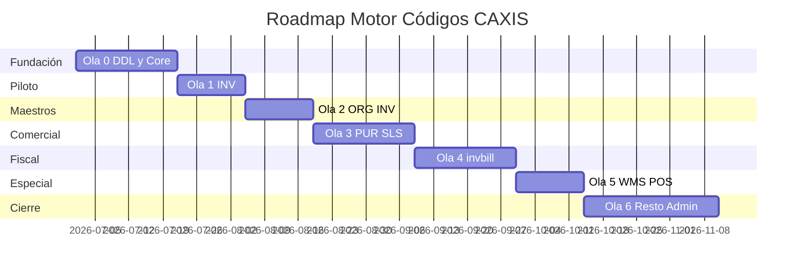

# F16 — Roadmap de implementación y cierre de diseño

**Fase:** F16 — Diseño técnico (cierre)  
**Fecha:** 2026-07-03  
**Estado:** Listo para fase de implementación (F17+)

---

## 1. Resumen de decisiones arquitectónicas

| ID | Decisión | Documento |
|----|----------|-----------|
| **D-01** | Gateway único: `CodigoGeneracionGateway` en `app/core/codigo/` | `11`, `12` |
| **D-02** | Clave de catálogo oficial: **`sequence_key`** (= nombre tabla V010) | `11`, `13` |
| **D-03** | Columna BD `entidad` → migrar a `sequence_key` | `14` |
| **D-04** | Cinco `scope_type`: TENANT, EMPRESA, ALMACEN, PUNTO_VENTA, SERIE_FISCAL | `13` |
| **D-05** | cfg evolucionada con `almacen_id`, `punto_venta_id`, `scope_fingerprint` | `14` |
| **D-06** | Fiscal en `FiscalSeriesStore`, no en cfg genérica | `11`, `14` |
| **D-07** | Metadatos en `SequenceCatalog` estático, no introspección DDL | `11` |
| **D-08** | Manual no consume; high-water align por defecto | `15` §3 |
| **D-09** | Preview sin consumo ni reserva | `15` §4 |
| **D-10** | Allocate + INSERT en misma UoW; rollback revierte contador | `15` §1 |
| **D-11** | Políticas F15A no editables por tenant | `11` §9 |
| **D-12** | `prefijo` ampliado a NVARCHAR(10) | `14` |

---

## 2. Inconsistencias detectadas (AS-IS vs diseño F16)

| ID | Inconsistencia | Severidad | Resolución en implementación |
|----|----------------|-----------|------------------------------|
| **INC-01** | Seed onboarding usa `empresa_id=NULL` para 8/9 entidades empresa-scoped | P0 | Migración seed + lazy per empresa |
| **INC-02** | Seed `inv_categoria` vs tabla `inv_categoria_producto` | P1 | Renombrar sequence_key y datos |
| **INC-03** | `prefijo` NVARCHAR(5) vs necesidad ≥3 chars OK pero sin margen | P2 | Migración columna |
| **INC-04** | UNIQUE cfg no soporta almacén/PV | P0 | Migración fingerprint |
| **INC-05** | `CfgCodigoSecuenciaRepository` sin caller de `update_ultimo_numero` | P0 | Integrar en AllocationCoordinator |
| **INC-06** | API INV exige `numero_movimiento` en Create | P1 | Schema opcional + gateway |
| **INC-07** | Patrones timestamp y concatenación en servicios | P1 | Sustituir por allocate en olas |
| **INC-08** | ORM `entidad` vs `sequence_key` canónico | P2 | Alias hasta migración |
| **INC-09** | FK `cliente_id` en ORM apunta central; dedicated usa store local | P1 | Operation store resolver |
| **INC-10** | `log_guia_remision` fiscal sin tabla serie dedicada explícita en diseño V010 | P2 | Evaluar extensión serie guía en ola fiscal |

---

## 3. Riesgos técnicos pre-implementación

| ID | Riesgo | Mitigación diseñada |
|----|--------|---------------------|
| **R-01** | Contención fila cfg hot-spot | Scope granular; fiscal por serie |
| **R-02** | NULL en UNIQUE SQL Server | `scope_fingerprint` |
| **R-03** | Migración contadores desalineados | Script align MAX post-migración |
| **R-04** | Idempotencia HTTP incompleta | Contrato idempotency_key en olas API |
| **R-05** | High-water parse incorrecto en códigos no estándar | `parse_pattern` por catálogo; fallback no align |
| **R-06** | Preview mal interpretado como reserva | Disclaimer obligatorio UI |
| **R-07** | Bypass gateway en servicios legacy | Lint/review checklist; una ola por módulo |
| **R-08** | Dual-write cfg en central y dedicated | Nunca; cfg solo en tenant store |

---

## 4. Recomendaciones antes de codificar

### 4.1 Orden obligatorio

| Orden | Entregable implementación |
|-------|---------------------------|
| 1 | Migración DDL cfg (V0xx bootstrap, **no V010 edit**) |
| 2 | `SequenceCatalog` + tests unitarios catálogo |
| 3 | `ScopeResolver`, `PolicyResolver`, `CodeValidator`, `CodeFormatter` (puros) |
| 4 | `CfgSequenceStore` + `FiscalSeriesStore` |
| 5 | `AllocationCoordinator`, `CounterAlignmentService`, `PreviewReader` |
| 6 | `CodigoGeneracionGateway` |
| 7 | Integración UoW existente |
| 8 | Corrección seed onboarding |
| 9 | Ola INV movimiento (piloto) |
| 10 | Resto de olas |

### 4.2 No hacer en implementación

| Evitar |
|--------|
| Editar V010 in-place |
| Exponer gateway en routers |
| Permitir override política por tenant |
| Mezclar fiscal en cfg |
| Concatenar correlativos entre módulos |
| Implementar sin migración de seed INC-01 |

### 4.3 Criterios de done por ola

| Criterio | Verificación |
|----------|--------------|
| AUTO_REQUIRED | Campo no requerido en OpenAPI Create |
| Tests concurrencia | 2+ allocates paralelos, números únicos |
| Rollback | Contador no avanza |
| Manual high-water | Escenario CLI999 documentado en `15` |
| Dedicated + Shared | Misma suite en ambos modos |

---

## 5. Roadmap de implementación

### Ola 0 — Fundación (bloqueante)

| Item | Descripción |
|------|-------------|
| 0.1 | Migración DDL `cfg_codigo_secuencia` según `14` |
| 0.2 | Paquete `app/core/codigo/` con componentes puros |
| 0.3 | `SequenceCatalog` completo (todas las keys F16) |
| 0.4 | Gateway + stores + UoW wiring |
| 0.5 | Migración datos seed + align MAX |
| 0.6 | Tests fundacionales TX y concurrencia |

### Ola 1 — Piloto INV (P0)

| Item | Descripción |
|------|-------------|
| 1.1 | `inv_movimiento` AUTO_REQUIRED |
| 1.2 | Eliminar timestamp estorno → allocate compensatorio |
| 1.3 | `inv_inventario_fisico` AUTO_REQUIRED |
| 1.4 | Ajuste aprobación inv. físico |

### Ola 2 — ORG + INV maestros

| Item | Descripción |
|------|-------------|
| 2.1 | Maestros ORG AUTO_DEFAULT |
| 2.2 | `inv_producto`, `inv_almacen`, categoría, UM |
| 2.3 | Preview UI maestros (opcional frontend) |

### Ola 3 — PUR + SLS documentos

| Item | Descripción |
|------|-------------|
| 3.1 | OC, recepción, solicitud, cotización compras |
| 3.2 | Cotización y pedido ventas |
| 3.3 | Eliminar `PED-{cot}` |

### Ola 4 — Fiscal

| Item | Descripción |
|------|-------------|
| 4.1 | `FiscalSeriesStore` producción |
| 4.2 | `invbill_comprobante` emisión |
| 4.3 | `log_guia_remision` emisión |

### Ola 5 — WMS + POS

| Item | Descripción |
|------|-------------|
| 5.1 | Scope ALMACEN |
| 5.2 | `pos_turno_caja` PUNTO_VENTA |
| 5.3 | `pos_venta` |

### Ola 6 — Resto módulos + admin

| Item | Descripción |
|------|-------------|
| 6.1 | FIN, HCM, MFG, CRM, etc. según prioridad negocio |
| 6.2 | API admin cfg (prefijo, padding, activo) |
| 6.3 | Import alignment masivo |



*(Fechas ilustrativas; ajustar en planificación de proyecto.)*

---

## 6. Mapa documental completo F15 → F16

```
F15  Auditoría          F15A  Negocio           F16  Técnico
──── ─────────          ────  ───────           ────  ───────
01 Inventario           07 Business Rules       11 Technical Architecture
02 Clasificación        08 Code Policies        12 Gateway Design
03 Sequence Scope       09 ERP Best Practices   13 Scope Resolution
04 Estado/Riesgos       10 Final Recommendation 14 Sequence Model
05 Arquitectura                                 15 TX & Concurrency
06 Executive Summary                            16 Implementation Roadmap
```

---

## 7. Checklist pre-F17 (implementación)

- [ ] DDL revisado por DBA / arquitectura
- [ ] INC-01 plan de migración seed aprobado
- [ ] SequenceCatalog peer review vs `08` matrices
- [ ] Scope matrix `13` vs V010 UNIQUE validado
- [ ] Contrato UoW con equipo INV (piloto)
- [ ] Estrategia idempotencia API acordada
- [ ] Sin objetos código en esta fase ✅

---

## 8. Entregables F16 completados

| Archivo | Estado |
|---------|--------|
| `11_TECHNICAL_ARCHITECTURE.md` | ✅ |
| `12_GATEWAY_DESIGN.md` | ✅ |
| `13_SCOPE_RESOLUTION.md` | ✅ |
| `14_SEQUENCE_MODEL.md` | ✅ |
| `15_TRANSACTION_AND_CONCURRENCY.md` | ✅ |
| `16_IMPLEMENTATION_ROADMAP.md` | ✅ |

---

## 9. Declaración de cierre F16

El diseño técnico del Motor de Generación de Códigos CAXIS ERP queda **suficientemente detallado** para:

1. Redactar migración DDL de `cfg_codigo_secuencia` sin replantear negocio.
2. Implementar `CodigoGeneracionGateway` y componentes de forma mecánica.
3. Integrar módulos ERP por olas con criterios de aceptación claros.

**No se requiere** nueva auditoría de clasificación ni políticas. Cualquier cambio funcional exige enmienda explícita a F15A.

---

*Fin F16 — Solo documentación. Sin commits en esta fase.*
