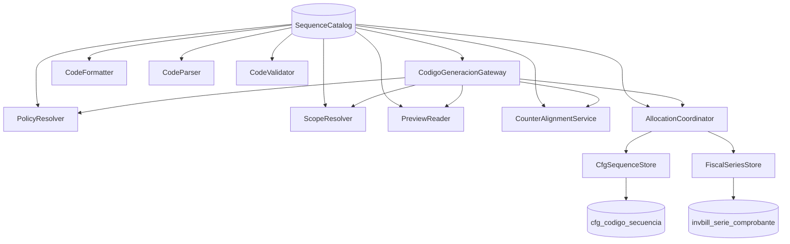

# F16A — SequenceCatalog: propósito y contrato maestro

**Fase:** F16A — Diseño del SequenceCatalog  
**Fecha:** 2026-07-03  
**Base congelada:** F15, F15A, F16 (sin replantear)  
**Alcance:** Solo documentación. Sin código.

---

## 1. Qué es el SequenceCatalog

El **SequenceCatalog** es el **registro normativo versionado** que describe cada `sequence_key` participante en el Motor de Generación de Códigos CAXIS ERP.

Cada entrada del catálogo — conceptualmente una **SequenceDefinition** — concentra en un solo lugar todos los metadatos que el motor necesita para:

- resolver scope y política;
- elegir store de contador;
- formatear, parsear y validar códigos;
- decidir preview, manual y alineación high-water.

Es la **única fuente oficial de metadatos** del motor. Ni el Gateway ni ningún componente auxiliar deben inferir estas propiedades desde V010, ORM, OpenAPI o servicios ERP en runtime.

---

## 2. Por qué existe

| Problema sin catálogo | Cómo lo resuelve SequenceCatalog |
|-----------------------|----------------------------------|
| Lógica dispersa por módulo (`INV-EST-`, `PED-{cot}`) | Comportamiento uniforme por `sequence_key` |
| Seed onboarding desalineado con UNIQUE V010 | Defaults y scope declarados por entrada |
| Gateway acoplado al DDL | Desacoplamiento BD ↔ motor |
| Imposible auditar qué entidades usa el motor | Matriz única verificable (`21`) |
| Cada módulo nuevo reinventa reglas | Registro mecánico de nueva entrada |
| Política F15A no enforceable técnicamente | `policy` explícita por entrada |

---

## 3. Responsabilidades

### 3.1 Sí es responsabilidad del SequenceCatalog

| Responsabilidad |
|-----------------|
| Declarar el universo de `sequence_key` activos del motor |
| Fijar `policy`, `scope_type`, `sequence_family`, `store_type` por entrada |
| Referenciar `table_name` y `code_column` (trazabilidad a V010, no inferencia) |
| Declarar perfiles de Formatter, Parser y Validator aplicables |
| Declarar capacidades: preview, manual, import, high-water alignment |
| Proveer defaults de prefijo, separador, padding y longitud máxima |
| Documentar reglas de edición (antes/después de uso) como metadato |
| Versionarse y gobernarse (`22`) |

### 3.2 No es responsabilidad del SequenceCatalog

| Fuera de alcance |
|------------------|
| Persistir contadores (`ultimo_numero`) — eso es `cfg_codigo_secuencia` / fiscal store |
| Ejecutar transacciones SQL |
| Validar permisos RBAC |
| Resolver `cliente_id` / `empresa_id` de sesión (eso es ScopeResolver + sesión) |
| Workflow de documentos (`borrador` → `procesado`) |
| Definir políticas de negocio nuevas (viven en F15A; el catálogo solo las referencia) |
| Sustituir documentación funcional de módulos ERP |
| Contener código ejecutable |

---

## 4. Consumidores y no-consumidores

### 4.1 Componentes que consumen SequenceCatalog

| Componente | Uso del catálogo |
|------------|------------------|
| **CodigoGeneracionGateway** | Lookup de entrada por `sequence_key`; enruta operaciones |
| **PolicyResolver** | Lee `policy`, flags `allow_manual`, `supports_import` |
| **ScopeResolver** | Lee `scope_type`, dimensiones requeridas |
| **CodeFormatter** | Lee perfil `formatter_profile`, defaults padding/prefijo |
| **CodeParser** | Lee `parser_profile`, reglas extracción numérica |
| **CodeValidator** | Lee `validator_profile`, `max_output_length`, charset |
| **AllocationCoordinator** | Lee `store_type`, `sequence_family` |
| **PreviewReader** | Lee `supports_preview` |
| **CounterAlignmentService** | Lee `supports_high_water`, `align_on_manual` |
| **CfgSequenceStore** | Lee defaults para lazy-create de fila cfg |
| **FiscalSeriesStore** | Lee entradas `store_type=FISCAL` |
| **Herramientas CI** | Validación catálogo vs matrices F15/F16 (`22`) |

### 4.2 Quién NO debe conocer la implementación interna del catálogo

| Actor | Regla |
|-------|-------|
| `*_servicio` ERP | Solo pasa `sequence_key` al Gateway; no lee catálogo |
| Routers / OpenAPI | No importan catálogo |
| Frontend | No accede al catálogo; consume API |
| ORM / `tables.py` | Sin referencia al catálogo |
| V010 DDL | Fuente de columnas en diseño, no runtime |
| Módulos tenant/onboarding | Usan lista derivada del catálogo en build-time, no introspección |

El catálogo se implementará como artefacto estático versionado (p. ej. módulo Python declarativo o YAML en repo) en fase de implementación; esa decisión de formato **no** forma parte de F16A.

---

## 5. Relación con componentes del motor

| Relación | Descripción |
|----------|-------------|
| Catalog → Gateway | Gateway **siempre** inicia con lookup de `sequence_key` |
| Catalog → Resolvers | Policy y scope son **lectura pura** del catálogo |
| Catalog → Formatter/Parser/Validator | Perfiles nombrados en cada entrada |
| Catalog → Stores | `store_type` decide cfg vs fiscal |
| Catalog ↔ cfg | cfg guarda **estado** (contador); catálogo guarda **definición** |
| Catalog ↛ V010 runtime | V010 solo valida diseño en CI/gobernanza |

---

## 6. Por qué el Gateway nunca debe consultar V010

| Razón | Explicación |
|-------|-------------|
| **Desacoplamiento** | El motor debe operar aunque el DDL evolucione en otra migración |
| **Rendimiento** | No hay introspección `INFORMATION_SCHEMA` por request |
| **Determinismo** | Mismo `sequence_key` → mismo comportamiento en shared y dedicated |
| **Seguridad de tipos** | Metadatos revisados en PR, no descubiertos en producción |
| **Política congelada** | AUTO_REQUIRED no se deduce de “tiene columna numero_*” |
| **Multi-store** | Fiscal no vive en cfg; V010 no indica qué store usar |

V010 es **evidencia de diseño** al registrar el catálogo; el runtime lee **SequenceCatalog**.

---

## 7. Por qué el Gateway nunca debe inspeccionar entidades ERP

| Razón | Explicación |
|-------|-------------|
| **Límite de capas** | Servicios ERP conocen dominio; gateway conoce secuencias |
| **Acoplamiento** | `producto_service` no debe dictar formato de `numero_oc` |
| **Reutilización** | Un mismo perfil `FMT_STANDARD` sirve a decenas de entidades |
| **Testing** | Catálogo testeable sin BD ERP poblada |
| **Impersonación / multi-scope** | El contexto llega como `GenerationContext`, no como ORM model |

---

## 8. Por qué toda la información debe vivir en SequenceCatalog

| Principio | Beneficio |
|-----------|-----------|
| **Single source of truth** | Una entrada = un contrato |
| **Implementación mecánica** | Desarrollador implementa perfil, no caso por módulo |
| **Gobernanza** | Cambios auditables y versionados (`22`) |
| **Onboarding de módulos** | Checklist: agregar fila al catálogo |
| **Coherencia F15→F16→F16A** | Trazabilidad documental completa |

Lo que **no** va en el catálogo: valores runtime (`ultimo_numero`), series fiscales concretas del tenant (`F001`), ni políticas EXTERNAL/MANUAL_ONLY de campos excluidos del motor.

---

## 9. Entradas excluidas del catálogo

Campos con política EXTERNAL o MANUAL_ONLY **sin participación en el motor** no tienen `sequence_key` activo. Se registran en apéndice de `21_SEQUENCE_CATALOG_MATRIX.md` como **exclusión declarada**, no como omisión.

Ejemplos: `cat_moneda`, `numero_documento` terceros, `inv_producto.codigo_barra`, `cliente.codigo_cliente` SaaS.

---

## 10. Documentos F16A

| Documento | Contenido |
|-----------|-----------|
| `18_SEQUENCE_DEFINITION_MODEL.md` | Metadatos de una entrada |
| `19_SEQUENCE_FAMILIES.md` | Familias oficiales |
| `20_SEQUENCE_COMPONENTS.md` | Formatter, Parser, Validator, etc. |
| `21_SEQUENCE_CATALOG_MATRIX.md` | Matriz completa |
| `22_SEQUENCE_CATALOG_GOVERNANCE.md` | Gobernanza y versionado |
| `23_EXECUTIVE_SUMMARY.md` | Cierre F16A |

---

*F16A — Contrato maestro. Implementación en fase posterior.*
