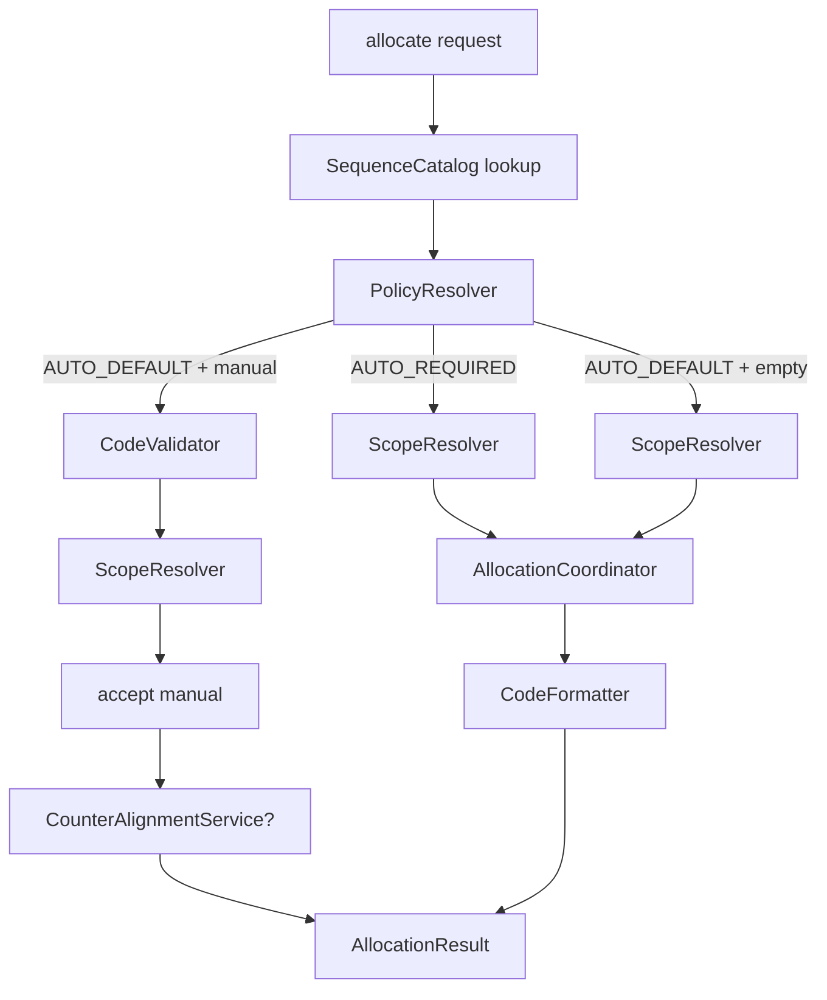

# F16A — Componentes auxiliares del motor

**Fase:** F16A  
**Fecha:** 2026-07-03  
**Alcance:** Diseño conceptual. Sin código.

---

## 1. Principio de responsabilidad única

Cada decisión del motor tiene **un dueño**. El Gateway orquesta; no decide reglas que pertenecen a otro componente.

| Decisión | Dueño |
|----------|-------|
| ¿Existe sequence_key? | SequenceCatalog |
| ¿Qué política aplica? | PolicyResolver + catálogo |
| ¿Qué scope? | ScopeResolver + catálogo |
| ¿Formato válido? | CodeValidator + perfil |
| ¿Cómo se arma el string? | CodeFormatter + perfil |
| ¿Parte numérica extraíble? | CodeParser + perfil |
| ¿Consume contador? | AllocationCoordinator |
| ¿Alinea high-water? | CounterAlignmentService |
| ¿Estimación sin consumo? | PreviewReader |
| ¿Persiste contador? | CfgSequenceStore / FiscalSeriesStore |

---

## 2. CodeFormatter

### 2.1 Responsabilidades

- Ensamblar valor final: prefijo + separador + parte numérica con padding.
- Aplicar `normalize_case` del catálogo.
- Truncar o rechazar si excede `max_output_length`.
- Variante fiscal: padding fijo legal sin prefijo configurable en emisión.

### 2.2 Perfiles oficiales

| Perfil | Uso | Reglas |
|--------|-----|--------|
| **FMT_STANDARD** | F1, F2, F4, F5 | `{prefijo}{sep}{num:0{padding}d}`; prefijo de cfg o catálogo |
| **FMT_FISCAL_8** | F3 emisión `numero` | 8 dígitos; sin prefijo; serie en columna aparte |
| **FMT_NUMERIC_ONLY** | Reservado | Solo número padded; sin prefijo |

### 2.3 Extensibilidad

Nuevo perfil solo si el formato no es composable con FMT_STANDARD (ej. año incorporado `OC-2026-0001` — **fuera V1**, prohibido por F15A).

### 2.4 No hace

- Incrementar contador.
- Validar unicidad BD.
- Parsear manual.

---

## 3. CodeParser

### 3.1 Responsabilidades

- Extraer **parte numérica** de código manual o importado para high-water.
- Determinar si el código es **parseable** según perfil.

### 3.2 Perfiles oficiales

| Perfil | Regla extracción | Ejemplo |
|--------|------------------|---------|
| **PAR_PREFIX_NUM** | Prefijo cfg + separador opcional + dígitos finales | `CLI999` con prefijo `CLI` → 999 |
| **PAR_NUM_ONLY** | Solo dígitos (documentos sin prefijo semántico) | `000042` → 42 |
| **PAR_NONE** | No parsea; high-water desactivado | Fiscal emisión |

### 3.3 Casos borde

| Caso | Comportamiento |
|------|----------------|
| Manual sin prefijo esperado | No parseable; sin align |
| Múltiples bloques numéricos | Regla: **último segmento dígito** del sufijo |
| Separador en medio (`CC-ADM-01`) | Perfil puede declarar `semantic_free` → no align |
| Código puramente alfabético | No parseable |
| Overflow dígitos vs padding | Align al valor numérico; formatter siguiente respeta padding width o expande hasta max_output_length |

### 3.4 No hace

- Validar charset completo (Validator).
- Formatear salida.

---

## 4. CodeValidator

### 4.1 Responsabilidades

- Longitud ≤ `max_output_length`.
- Charset permitido (alfanumérico + `-` `_`).
- Coherencia prefijo si política exige prefijo fijo.
- Rechazo temprano antes de INSERT (servicio puede pre-check UNIQUE).

### 4.2 Perfiles oficiales

| Perfil | Aplica a |
|--------|----------|
| **VAL_MASTER** | F1, F4 maestros; mayúsculas |
| **VAL_DOCUMENT** | F2, F5; mayúsculas |
| **VAL_FISCAL_NUM** | F3; solo dígitos en `numero` |
| **VAL_UBICACION** | F4 `wms_ubicacion`; permite `-` en pasillo-rack |

### 4.3 No hace

- Consultar UNIQUE (servicio/BD).
- Decidir política.

---

## 5. PreviewReader

### 5.1 Cuándo aplica

| Condición | Preview |
|-----------|---------|
| `supports_preview=true` en catálogo | Permitido |
| `policy=AUTO_DEFAULT` | Típico sí |
| `policy=AUTO_REQUIRED` | **Prohibido** |
| F3 FISCAL | **Prohibido** |

### 5.2 Qué hace

- Lee `ultimo_numero` sin lock de escritura.
- Calcula `ultimo_numero + 1` formateado vía Formatter.
- Devuelve disclaimer no vinculante.

### 5.3 Qué NO hace

- Consumir ni reservar.
- Validar manual.
- Garantizar código bajo concurrencia.

---

## 6. CounterAlignmentService

### 6.1 Cuándo participa

| Escenario | Participa |
|-----------|-----------|
| Manual AUTO_DEFAULT parseable > ultimo | **Sí** — high-water |
| Import masivo fin de lote | **Sí** — MAX del lote |
| Import fila a fila | **Sí** — por fila o batch |
| AUTO_REQUIRED allocate normal | **No** |
| Manual no parseable | **No** |
| Preview | **No** |

### 6.2 Qué hace

- Actualiza `ultimo_numero` en cfg si `candidate_numeric > ultimo_numero`.
- Operación en misma UoW que import o inmediatamente post-allocate manual.

### 6.3 Qué NO hace

- Crear código.
- Validar unicidad (servicio).
- Afectar fiscal store salvo entrada F3 con reglas propias.

---

## 7. PolicyResolver

| Entrada | Salida |
|---------|--------|
| `sequence_key`, `GenerationContext` | Modo: `AUTO_GENERATE`, `ACCEPT_MANUAL`, `REJECT_MANUAL`, `IMPORT_HISTORICAL` |

Lee `policy` y flags del catálogo. No lee V010.

---

## 8. ScopeResolver

Documentado en `13_SCOPE_RESOLUTION.md`. Lee `scope_type` y `required_context` del catálogo.

---

## 9. AllocationCoordinator

| Responsabilidad |
|----------------|
| Lazy-create fila cfg con defaults del catálogo |
| Invocar store increment atómico en UoW |
| Invocar Formatter |
| Marcar `consumed` en resultado |

Enruta a CfgSequenceStore o FiscalSeriesStore según `store_type` del catálogo.

---

## 10. Diagrama de decisión por componente

---

## 11. Matriz componente × operación

| Operación | Catalog | Policy | Scope | Validator | Parser | Formatter | Alloc | Align | Preview |
|-----------|---------|--------|-------|-----------|--------|-----------|-------|-------|---------|
| allocate auto | ✓ | ✓ | ✓ | — | — | ✓ | ✓ | — | — |
| allocate manual | ✓ | ✓ | ✓ | ✓ | ✓ | — | — | ✓ | — |
| preview | ✓ | ✓ | ✓ | — | — | ✓ | — | — | ✓ |
| import align | ✓ | — | ✓ | ✓ | ✓ | — | — | ✓ | — |
| validate_manual | ✓ | ✓ | — | ✓ | — | — | — | — | — |

---

*Definiciones de entrada en `18`. Matriz entidades en `21`.*
