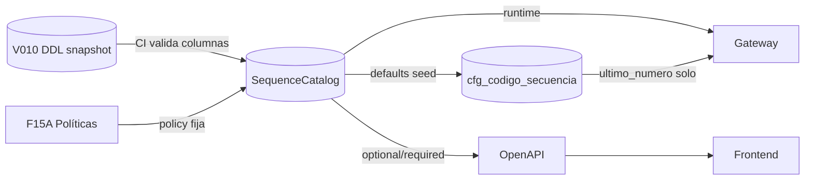

# F16A — Gobernanza del SequenceCatalog

**Fase:** F16A  
**Fecha:** 2026-07-03  
**Versión inicial catálogo:** `1.0.0`

---

## 1. Principios de gobernanza

| Principio | Descripción |
|-----------|-------------|
| **G-01** | El catálogo es la única fuente de metadatos del motor en runtime |
| **G-02** | V010 es fuente de verdad de **columnas y longitudes**, validada en CI |
| **G-03** | F15A es fuente de verdad de **políticas**; el catálogo las refleja, no las redefine |
| **G-04** | Cambios breaking requieren bump de versión mayor del catálogo |
| **G-05** | Toda entrada nueva requiere fila en `21` antes de implementar gateway |

---

## 2. Cómo agregar una nueva entidad

### 2.1 Checklist obligatorio

| # | Paso | Responsable |
|---|------|-------------|
| 1 | Confirmar clasificación F15 (B o C) y política F15A | Arquitectura / producto |
| 2 | Verificar columna y UNIQUE en V010 (o nueva migración futura) | DBA + arquitectura |
| 3 | Definir `sequence_key`, `scope_type`, `sequence_family` | Arquitectura |
| 4 | Completar fila en `21_SEQUENCE_CATALOG_MATRIX.md` | Arquitectura |
| 5 | Validar reglas V-01…V-08 (`18`) | CI |
| 6 | Agregar defaults seed cfg si aplica | Implementación |
| 7 | Integrar servicio ERP con `sequence_key` | Módulo owner |
| 8 | Actualizar OpenAPI (opcionalidad campo código) | Módulo owner |
| 9 | Bump versión catálogo | Arquitectura |

### 2.2 Información obligatoria mínima

Todos los campos marcados **Sí** en `18_SEQUENCE_DEFINITION_MODEL.md` §2–7.

---

## 3. Cambios compatibles vs breaking

### 3.1 Compatibles (versión MINOR)

| Cambio |
|--------|
| Nueva entrada `sequence_key` |
| Nueva documentación en `documentation` |
| Ajuste `default_prefix` default (sin bajar contador) |
| Nuevo perfil formatter/parser/validator **aditivo** |
| Ampliar `max_output_length` si V010 lo permite |

### 3.2 Breaking (versión MAJOR)

| Cambio |
|--------|
| Eliminar o renombrar `sequence_key` |
| Cambiar `policy` AUTO_REQUIRED ↔ AUTO_DEFAULT |
| Cambiar `scope_type` |
| Cambiar `store_type` CFG ↔ FISCAL |
| Cambiar `formatter_profile` que altere códigos emitidos |
| Reducir `max_output_length` |
| Cambiar reglas `align_on_manual` de true → false con datos existentes |

### 3.3 Prohibido sin ADR

| Cambio |
|--------|
| Override de política por tenant en catálogo |
| Entrada catálogo para campo EXTERNAL |
| Inferir entrada desde V010 automáticamente |

---

## 4. Versionado

| Elemento | Esquema |
|----------|---------|
| **Catálogo** | SemVer `MAJOR.MINOR.PATCH` |
| **Ubicación** | Constante `SEQUENCE_CATALOG_VERSION` en artefacto implementación |
| **Documentación** | Header `catalog_version` en `21` |
| **Compatibilidad** | Gateway rechaza `sequence_key` de versión futura si no reconocida |

| Bump | Cuándo |
|------|--------|
| MAJOR | Breaking §3.2 |
| MINOR | Nueva entrada o perfil aditivo |
| PATCH | Typos documentación, clarificaciones |

---

## 5. Validación

### 5.1 Validaciones automáticas (CI — fase implementación)

| ID | Validación |
|----|------------|
| CI-01 | Cada `sequence_key` único |
| CI-02 | Reglas V-01…V-08 (`18`) |
| CI-03 | `code_column` existe en `table_name` según snapshot V010 |
| CI-04 | `max_output_length` ≤ longitud columna V010 |
| CI-05 | Matriz `21` sincronizada con artefacto código |
| CI-06 | Conteo entradas = 63 activas |
| CI-07 | Ninguna entrada EXTERNAL/MANUAL_ONLY en catálogo activo |
| CI-08 | `scope_type` coherente con F16 `13` |

### 5.2 Validaciones manuales (PR review)

- ¿Duplica otra entrada?
- ¿Módulo owner asignado?
- ¿Ola roadmap actualizada?

---

## 6. Sincronización sin duplicar información

| Artefacto | Qué guarda | Qué NO guarda |
|-----------|------------|---------------|
| **V010** | Columnas, UNIQUE, longitudes | Política, prefijo, parser |
| **SequenceCatalog** | Metadatos motor completos | Contador runtime |
| **cfg_codigo_secuencia** | Estado por tenant/scope | Política, perfiles |
| **Gateway** | Orquestación | Definición entidades |
| **OpenAPI** | Contrato HTTP optional/required | Perfiles formatter |
| **Frontend** | UX preview label | Reglas motor |

**Regla anti-duplicación SC-GOV-01:** Si un dato existe en catálogo, **no se repite** en cfg salvo `prefijo`, `separador`, `longitud_numero`, `ultimo_numero` administrables.

**Regla anti-duplicación SC-GOV-02:** OpenAPI deriva optional/required de `policy` vía generación o checklist manual en PR — no segunda fuente inventada.

---

## 7. Evitar inconsistencias

| Riesgo | Control |
|--------|---------|
| Seed onboarding desalineado | Generar seed desde catálogo build-time |
| Servicio bypass gateway | Lint / arquitectura review |
| Matriz doc ≠ código | CI-05 |
| Nueva tabla V010 sin catálogo | CI falla si módulo registra motor sin entrada |
| Cambio política F15A sin catálogo | Proceso: F15A primero, luego catálogo MAJOR |

---

## 8. Deprecación de entrada

| Paso | Acción |
|------|--------|
| 1 | `motor_enabled=false` en catálogo |
| 2 | MAJOR o MINOR según impacto |
| 3 | Servicio deja de invocar gateway |
| 4 | Mantener entrada 2 versiones para rollback |
| 5 | Eliminar en MAJOR siguiente |

---

## 9. Ownership

| Rol | Responsabilidad |
|-----|-----------------|
| **Arquitectura ERP** | Aprobar nuevas entradas y versiones MAJOR |
| **Módulo owner** | Integración servicio + OpenAPI |
| **Plataforma** | cfg store, migraciones, CI |
| **QA** | Casos concurrencia, manual, import |

---

## 10. Relación con documentos F15–F16

| Documento | Rol respecto al catálogo |
|-----------|--------------------------|
| F15 `02` | Clasificación A/B/C/D — input diseño |
| F15A `08` | Política por entidad — copiada a catálogo |
| F16 `13` | Scope — copiado a catálogo |
| F16 `14` | cfg físico — complementa defaults |
| F16 `21` (este paquete) | **Matriz canónica** |

---

*Resumen ejecutivo: `23_EXECUTIVE_SUMMARY.md`.*
