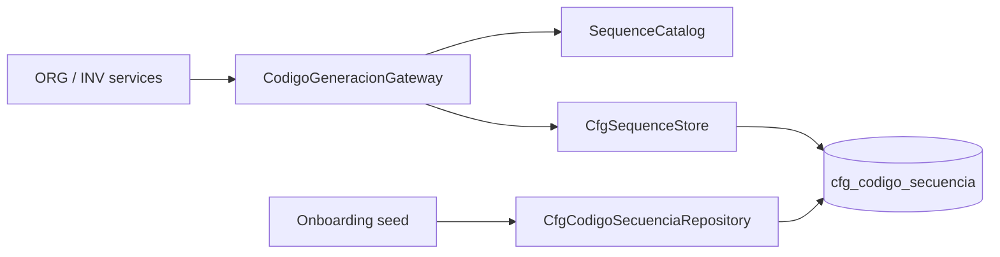

# Arquitectura actual de CFG (AS-IS)

**Paquete:** `cfg-admin-audit`  
**Fecha:** 2026-07-17  
**Regla:** solo código y diseño existentes; sin propuestas de implementación detallada.

---

## 1. Hallazgo estructural principal

**No existe el módulo ERP `app/modules/cfg/`.**

Lo que existe hoy son tres capas distintas que no deben confundirse:

| Capa | Ubicación | Rol actual |
|------|-----------|------------|
| **Persistencia** | DDL V010 + `CfgCodigoSecuenciaTable` | Tabla tenant de secuencias CFG |
| **Motor** (`app/core/codigo`) | Store, Gateway, Catalog, Formatter | Runtime de generación |
| **Bootstrap / onboarding** | `CfgCodigoSecuenciaRepository` + seed tenant | Creación inicial de filas |
| **Diseño admin (docs)** | `codigo-generation-admin/` | Especificación futura del módulo ERP |

CFG como **módulo administrador** es un producto pendiente. CFG como **store del Motor** ya está en producción vía ORG/INV.

---

## 2. Estructura actual (lo que hay)

```text
app/
├── bootstrap_v2/01_schema/V010__…sql     # DDL cfg_codigo_secuencia
├── infrastructure/database/
│   ├── tables.py                         # CfgCodigoSecuenciaTable
│   └── repositories/
│       └── cfg_codigo_secuencia_repository.py
├── core/codigo/                          # Motor (congelado Ola 1)
│   ├── gateway/codigo_generacion_gateway.py
│   ├── stores/cfg_sequence_store.py
│   ├── sequence_catalog.py
│   ├── formatter|parser|validator/
│   ├── resolvers/policy_resolver.py
│   └── onboarding_seed.py
├── modules/tenant/.../cfg_codigo_onboarding_seed.py
└── modules/cfg/                          # ❌ NO EXISTE
```

No hay:

- `presentation/endpoints_*` CFG
- `application/services/*_servicio` CFG admin
- `queries/cfg/`
- `cfg_deps.py`
- rutas montadas bajo `/cfg`

---

## 3. Flujo runtime actual (sin admin)



- ORG/INV **nunca** leen cfg directamente para emitir códigos; usan el Gateway.
- El admin futuro debería ser un **cuarto cliente**: lectura/config vía queries+repo; preview/align vía Gateway.

---

## 4. Relación con diseño previo

El paquete `app/docs/arquitectura/codigo-generation-admin/` (2026-07-12) ya define:

- Taxonomía de operaciones
- Clasificación de columnas A/B/C/D
- API REST propuesta `/cfg/secuencias`
- RBAC `cfg.secuencias.*`
- Arquitectura de módulo ERP V4

**Estado:** diseño normativo de producto; **cero** código de módulo generado a partir de él.

Esta auditoría **confirma** ese diseño contra el código AS-IS y cuantifica gaps; no lo sustituye ni lo implementa.

---

## 5. Fronteras de responsabilidad (AS-IS)

| Responsable | Hoy hace | Hoy no hace |
|-------------|----------|-------------|
| SequenceCatalog | Defaults, policy nominal, perfiles | Persistencia tenant |
| cfg fila | Overrides formato + contador | Definir nuevas sequence_key |
| Gateway | allocate / preview / validate / align | UI ni CRUD admin |
| ORG/INV adapters | CREATE/UPDATE maestros | Configurar secuencias |
| Tenant Admin | — | Configurar Motor (sin API) |

---

## 6. Conclusión de arquitectura

CFG admin debe nacer como **módulo ERP transversal** (`cfg`), no como extensión de ORG ni de INV, y no como mutación del Motor. El Motor permanece cliente de `cfg_codigo_secuencia`; el admin es gobernanza sobre las filas, no reescritura del catálogo.
