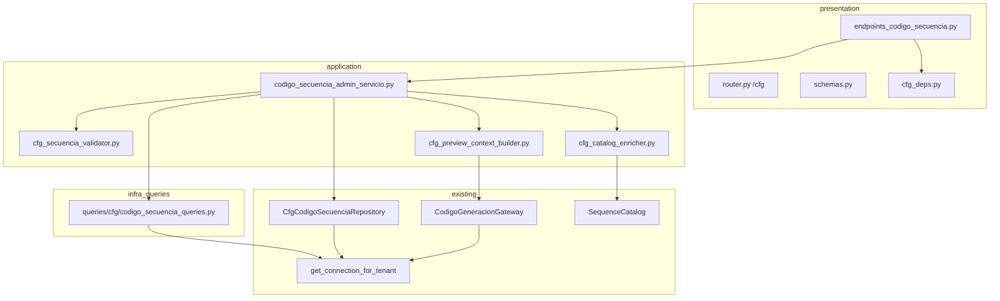

# Arquitectura interna del módulo `cfg` (MVP)

**Paquete:** `cfg-backend-mvp-design`  
**Fecha:** 2026-07-17

---

## 1. Visión arquitectónica



**Principio:** el módulo **orquesta**; el Motor **ejecuta** preview; el Catalog **enriquece** lecturas.

---

## 2. Estructura completa de carpetas (a crear)

```text
app/modules/cfg/
├── __init__.py
├── presentation/
│   ├── __init__.py
│   ├── router.py
│   ├── cfg_deps.py
│   ├── schemas.py
│   └── endpoints_codigo_secuencia.py
└── application/
    ├── __init__.py
    └── services/
        ├── __init__.py
        ├── codigo_secuencia_admin_servicio.py
        ├── cfg_secuencia_validator.py
        ├── cfg_catalog_enricher.py
        └── cfg_preview_context_builder.py

app/infrastructure/database/queries/cfg/
├── __init__.py
└── codigo_secuencia_queries.py
```

**Prohibido crear en MVP:**

- `app/modules/cfg/domain/`
- `app/modules/cfg/infrastructure/`
- Reimplementación de Store/Formatter dentro del módulo

**Extensión permitida (existente):**

- `CfgCodigoSecuenciaRepository.update_secuencia` → añadir `numero_inicial`, `fecha_actualizacion`, `usuario_actualizacion_id`

**Montaje API** (`app/api/v1/api.py` — cuando se implemente):

```python
api_router.include_router(cfg_router, prefix="/cfg", tags=["CFG - Secuencias de código"])
```

---

## 3. Router principal

**Archivo:** `presentation/router.py`

```text
APIRouter(
  dependencies=[Depends(require_cfg_tenant_erp_session)],
)
include_router(endpoints_codigo_secuencia.router, prefix="/secuencias", tags=[...])
```

| Decisión | Valor | Justificación |
|---------|-------|---------------|
| Gate sesión | `require_cfg_tenant_erp_session` | Recurso TENANT (como `/org/empresa`); no exige `empresa_id` obligatorio |
| Prefijo recurso | `/secuencias` | URL final `/api/v1/cfg/secuencias` |
| Clasificación entidad | TENANT | Autorización por `cliente_id` |

> `require_erp_session` estricto (company) se descarta para el padre: el admin debe listar secuencias TENANT/EMPRESA/ALMACEN sin forzar empresa activa. Patrón: clonar semántica de `require_org_tenant_erp_session`.

---

## 4. Dependencias (`cfg_deps.py`)

| Dependency | Responsabilidad |
|------------|-----------------|
| `get_cfg_session_client_id` | `require_session_cliente_id` (payload JWT / impersonación / request.state) |
| `require_cfg_tenant_erp_session` | Sesión ERP completa + cliente operativo; policy TENANT (sin exigir empresa) |
| `get_cfg_audit_usuario_id` (opcional helper) | UUID usuario para `usuario_actualizacion_id` desde sesión |

**Prohibido:** usar `current_user.cliente_id` en presentation para queries.

**Empresa en preview:** si la fila es scope EMPRESA/ALMACEN/PV, el context builder usa los IDs **de la fila cfg**, no un override del body. La sesión puede aportar `empresa_id` solo como fallback documentado si hiciera falta; regla MVP: **scope desde fila**.

---

## 5. Endpoints (capa presentation)

Un solo archivo `endpoints_codigo_secuencia.py`:

| Handler | Service |
|---------|---------|
| `list_secuencias` | `list_codigo_secuencias_servicio` |
| `get_secuencia` | `get_codigo_secuencia_servicio` |
| `patch_secuencia` | `update_codigo_secuencia_servicio` |
| `activar_secuencia` | `activar_codigo_secuencia_servicio` |
| `desactivar_secuencia` | `desactivar_codigo_secuencia_servicio` |
| `preview_secuencia` | `preview_codigo_secuencia_servicio` |

Cada uno:

- `Depends(get_cfg_session_client_id)`
- `Depends(require_permission("cfg.secuencias.…"))`
- `Depends(get_current_active_user)` / audit user según patrón ORG
- Propagar `CustomException` (preferido) o mapear `status_code`/`detail` — **sin** `except Exception → 500`

---

## 6. Schemas (diseño — ver detalle en `02_OPENAPI_DESIGN.md`)

| Schema | Uso |
|--------|-----|
| `CodigoSecuenciaRead` | Detalle + ítems listado |
| `PaginatedCodigoSecuenciaResponse` | Envelope si `page` |
| `CodigoSecuenciaUpdate` | PATCH body (solo B) |
| `CodigoSecuenciaPreviewResponse` | Preview |
| (activar/desactivar) | Sin body o body vacío; response = `CodigoSecuenciaRead` |

Normalización: `normalize_upper` en `prefijo` (Create/Update mixin pattern ORG); `separador` strip.

---

## 7. Queries necesarias

**Archivo:** `queries/cfg/codigo_secuencia_queries.py`

| Función | Comportamiento |
|---------|----------------|
| `list_codigo_secuencias` | `WHERE cliente_id = :cid` + filtros; dual-path `session`; `apply_erp_pagination` / `apply_erp_sort` |
| `count_codigo_secuencias` | COUNT si `page` presente |
| `get_codigo_secuencia_by_id` | `secuencia_id` + `cliente_id`; None → NotFound en service |
| `update_codigo_secuencia_config` | UPDATE campos B + audit; **exige session**; filtro `cliente_id` |
| `set_codigo_secuencia_activo` | UPDATE `es_activo` + audit; exige session |

**Filtros listado:**

| Query param | SQL |
|-------------|-----|
| `scope_type` | igualdad |
| `sequence_key` | igualdad o LIKE vía `buscar` |
| `empresa_id` | igualdad (nullable scopes) |
| `es_activo` | igualdad |
| `buscar` | LIKE sobre `sequence_key` / `prefijo` |
| `modulo_codigo` | **Post-filter en service** tras enrich Catalog (MVP aceptable) o subquery no — preferir filter en memoria post-enrich si volumen ~57–100 filas; documentar límite |

**Decisión MVP `modulo_codigo`:** filtrar en service después de enrich (volumen bajo eager+lazy). Si el volumen crece, fase posterior mueve filtro a SQL con tabla puente — fuera de MVP.

**Sort whitelist:** `sequence_key`, `scope_type`, `prefijo`, `ultimo_numero`, `es_activo`, `fecha_creacion`, `fecha_actualizacion` + tie-breaker `secuencia_id`.

---

## 8. Servicios funcionales

**Archivo:** `codigo_secuencia_admin_servicio.py` — funciones `*_servicio` (no clases Platform).

| Función | Pasos |
|---------|-------|
| `list_codigo_secuencias_servicio` | UoW read → query list → enrich cada fila → filtro modulo → paginar/envelope |
| `get_codigo_secuencia_servicio` | get by id → 404 → enrich → Read |
| `update_codigo_secuencia_servicio` | get → validator (org_empresa, immutables, BR-CUST) → begin → update → enrich |
| `activar_codigo_secuencia_servicio` | get → si ya activa idempotente OK → update es_activo=1 |
| `desactivar_codigo_secuencia_servicio` | get → reject org_empresa → update es_activo=0 |
| `preview_codigo_secuencia_servicio` | get → build GenerationContext → Gateway.preview → map PreviewResponse |

**UoW patrón (mutaciones y preview):**

```text
async with get_connection_for_tenant(cliente_id=..., purpose=...) as session:
    async with session.begin():  # mutaciones
        ...
    # preview: puede usar session sin begin escritura, o begin read-only según patrón ORG
```

Preview: abrir session tenant y llamar Gateway **sin** incrementar; no usar Path A ADMIN del Repo para preview.

**Lecturas list/detail:** preferible misma `get_connection_for_tenant` (paridad Dedicated). Evitar `Repo.get_by_cliente` sin session en Dedicated (leería CP). **Regla MVP:** toda I/O admin cfg usa session tenant.

---

## 9. Validaciones (`cfg_secuencia_validator.py`)

| Check | Error | Código interno |
|-------|-------|----------------|
| Payload con campos A/C/D | ValidationError | `IMMUTABLE_FIELD` |
| `sequence_key == org_empresa` en PATCH/desactivar | ValidationError | `ORG_EMPRESA_CFG_LOCKED` |
| prefijo longitud > 10 / charset | ValidationError | `CFG_PREFIX_INVALID` |
| longitud_numero < 1 o excesivo vs max_output | ValidationError | `CFG_PADDING_INVALID` |
| numero_inicial < 1 | ValidationError | `CFG_NUMERO_INICIAL_INVALID` |
| numero_inicial inconsistente con ultimo_numero (piso absurdo) | ValidationError | `CFG_NUMERO_INICIAL_CONFLICT` |
| Separador no permitido | ValidationError | `CFG_SEPARATOR_INVALID` |

**Separadores MVP permitidos:** `""` y `"-"` (alineado BS-CFG-01; ampliables después).

Anti-colisión avanzada entre keys (mismo prefijo+pad) = **best-effort MVP**: warning no bloqueante **o** validación simple same-scope — decisión: **bloqueo solo si mismo `prefijo`+`separador`+`longitud_numero` en otra fila del mismo `cliente_id` y distinto `sequence_key`** (ConflictError `CFG_FORMAT_COLLISION`). Opcional en MVP; si el costo es alto, diferir a v1.3 y documentar en riesgos.

**Decisión blueprint MVP:** implementar check de colisión de formato (ConflictError) — volumen bajo.

---

## 10. Integraciones

### 10.1 Gateway

| Operación | API | Notas |
|-----------|-----|-------|
| Preview | `CodigoGeneracionGateway.preview(sequence_key, context, session)` | `GenerationOperation.PREVIEW` |
| Align | **No MVP** | — |
| validate_manual | **No MVP** | — |
| allocate | **Nunca** desde admin | — |

Mapear `PreviewResult.code` → `codigo_estimado`; incluir `disclaimer` del resultado; añadir `consume_contador: false`, `ultimo_numero_actual` desde fila leída antes del preview.

### 10.2 Repository

| Uso MVP | Método |
|---------|--------|
| Alternativa a queries update | `update_secuencia` **extendido** (session obligatoria) |
| Insert | **No** desde admin |
| `update_ultimo_numero` | **Prohibido** en servicios admin |

Preferencia: queries dedicadas en `queries/cfg/` para list/get/update alineadas a ORG; Repo como opción si se reutiliza update — **una sola ruta de escritura** en implementación (elegir queries como canónica V4).

**Decisión blueprint:** **queries/cfg canónicas** para list/get/update/activo; Repo no es obligatorio en el path HTTP (sigue usándose en onboarding).

### 10.3 SequenceCatalog

| Uso | Cómo |
|-----|------|
| Enrich | `SequenceCatalog.get(sequence_key)` si `contains` |
| Campos enrich | `table_name`, `code_column`, `modulo_codigo`, `policy`→`catalog_policy`, `supports_preview`, `allow_manual`, `sequence_family`, defaults |
| Key desconocida | Enrich parcial null + flag; no 500 |

---

## 11. RBAC

| Endpoint | Permiso |
|----------|---------|
| GET list/detail, POST preview | `cfg.secuencias.consultar` |
| PATCH, activar, desactivar | `cfg.secuencias.actualizar` |

Seed (cuando se implemente): insertar permisos en catálogo + otorgar a rol `ADMIN_TENANT` (y plantilla implantación si existe). **Fuera de MVP HTTP:** `mantener`, `diagnosticar`.

---

## 12. Auditoría

| Mutación | Campos a setear |
|----------|-----------------|
| PATCH / activar / desactivar | `fecha_actualizacion = GETDATE()`, `usuario_actualizacion_id = audit_user` |

No auditoría obligatoria de preview en BD.

---

## 13. Manejo de errores

| Situación | Excepción | HTTP |
|-----------|-----------|------|
| No encontrada / otro tenant | NotFoundError | 404 |
| org_empresa lock / immutable / validación | ValidationError | 422 |
| Colisión formato | ConflictError | 409 |
| Secuencia inactiva en preview Gateway | ConflictError SEQUENCE_INACTIVE — **MVP preview:** capturar y devolver estimación con warning **o** permitir preview vía PreviewReader sin check activo. **Decisión:** builder llama Gateway.preview; si PreviewReader no chequea activo, OK. Si falla, mapear a 409 con mensaje claro. |
| Sin permiso | AuthorizationError / require_permission | 403 |
| Write sin session | No debe ocurrir (siempre UoW) | — |

---

## 14. Shared vs Dedicated

| Topología | Comportamiento módulo |
|-----------|----------------------|
| Shared | `get_connection_for_tenant` → session DEFAULT con aislamiento `cliente_id` |
| Dedicated | Misma API → session BD dedicada |

**Prohibido:** Path A ADMIN del Repo para escrituras o lecturas del admin HTTP.

Una sola implementación de servicios; tests cubren ambos paths de conexión (mock/fixture).
