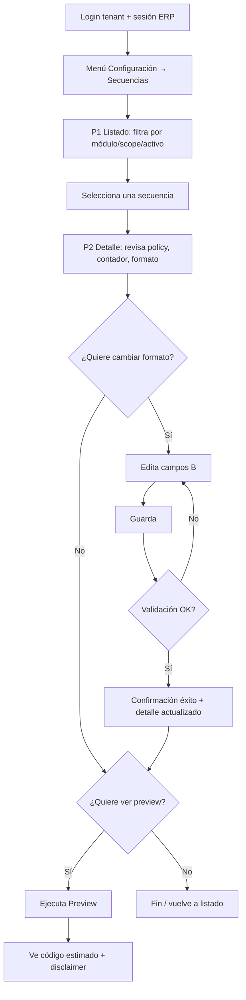

# Flujos de usuario

**Paquete:** `cfg-functional-design`  
**Fecha:** 2026-07-17

---

## 1. Flujo completo de configuración (happy path MVP)



**Criterio de éxito:** el usuario comprende el impacto (“afecta códigos nuevos”) y recibe feedback inmediato tras guardar.

---

## 2. Flujo de Preview

| Paso | Actor | Sistema |
|------|-------|---------|
| 1 | Abre detalle o listado con acción Preview | Verifica `consultar` |
| 2 | Pulsa **Previsualizar próximo código** | Resuelve scope de la fila + sesión ERP |
| 3 | — | Calcula estimación **sin** incrementar contador |
| 4 | Ve resultado | Muestra `codigo_estimado`, `ultimo_numero` leído, disclaimer |
| 5 | Cierra modal | Sin cambios persistidos |

### Reglas de comportamiento Preview

| Regla | Detalle |
|-------|---------|
| No reserva | Concurrentemente otro usuario puede obtener ese número en un CREATE real |
| No muta | `ultimo_numero` intacto |
| Secuencia inactiva | Preview permitido (informativo); mensaje “secuencia inactiva — allocate fallará” |
| Sin fila lazy | Mensaje claro: secuencia aún no materializada (no error críptico) |
| org_empresa | Preview permitido |
| Disclaimer obligatorio | Texto visible: “Estimación; no reserva correlativo” |

### Copy UX sugerido

> Próximo código estimado: **SUC042**  
> Basado en el contador actual. Este valor **no se reserva**; puede variar si se generan códigos en paralelo.

---

## 3. Flujo de edición

| Paso | Actor | Sistema |
|------|-------|---------|
| 1 | En detalle, pulsa **Editar configuración** | Verifica `actualizar` |
| 2 | Modifica prefijo / separador / padding / numero_inicial | Campos A/C/D bloqueados visualmente |
| 3 | (Opcional) pulsa Preview con valores del formulario *si se soporta draft* — MVP: preview sobre valores **guardados** | Evita ambigüedad |
| 4 | Guarda | Valida anti-colisión, longitudes, org_empresa lock, inmutables |
| 5a | OK | Persiste + auditoría + toast éxito |
| 5b | Error | Mensaje funcional (no SQL); permanece en edición |

### Reglas de edición

| Regla | Detalle |
|-------|---------|
| MVP preview post-save | Tras guardar, CTA “Ver preview con nueva configuración” |
| Históricos | Banner: “Los códigos ya emitidos no cambian” |
| org_empresa | Botón Editar **ausente** o disabled + tooltip `ORG_EMPRESA_CFG_LOCKED` |
| Contador | `ultimo_numero` visible read-only; sin input |
| Policy | Badge read-only (AUTO_REQUIRED / AUTO_DEFAULT / MANUAL_ONLY) |

---

## 4. Flujo de activación / desactivación

### Activar

```text
Detalle (es_activo=false) → Activar → Confirmación breve → es_activo=true → Toast
```

Sin modal pesado; impacto = “vuelve a permitir generación automática”.

### Desactivar

```text
Detalle (es_activo=true) → Desactivar → Modal de confirmación →
  Texto: “No se podrán emitir códigos nuevos para esta secuencia hasta reactivar.
          Los registros existentes no se eliminan.” →
  Confirmar → es_activo=false → Toast
```

| Caso especial | Comportamiento |
|---------------|----------------|
| `org_empresa` | **Desactivar bloqueado** (bloquearía altas de empresa en el tenant) |
| Secuencias de documentos AUTO_REQUIRED | Modal refuerza severidad (“altas de documentos fallarán”) |

---

## 5. Flujos de error / vacío

| Situación | UX esperada |
|-----------|-------------|
| Sin permiso consultar | Menú oculto; deep-link → 403 amigable |
| Sin permiso actualizar | Detalle solo lectura; sin botones editar/activar |
| Listado vacío (tenant sin seed — anómalo) | Empty state: contactar soporte / reprovisionar |
| Filtro sin resultados | Empty state de filtro, no error |
| Cross-tenant / id inválido | 404 “Secuencia no encontrada” |
| Validación BR-CUST | Inline en campos + resumen |
| Conflicto concurrencia | “La secuencia fue modificada; recargue” (si se detecta) |

---

## 6. Flujo post-MVP: Align (referencia)

No forma parte del MVP, pero el diseño funcional lo anticipa:

```text
Detalle → Mantenimiento → Alinear contador →
  Ingresa código candidato + motivo obligatorio →
  Confirmación doble → Gateway.align →
  Muestra antes/después ultimo_numero
```

Visible solo con `cfg.secuencias.mantener`.

---

## 7. Paridad Shared / Dedicated en flujos

El usuario **no elige** topología. Los mismos pasos, pantallas y mensajes aplican en Shared y Dedicated. Cualquier diferencia de latencia o infraestructura es transparente.
