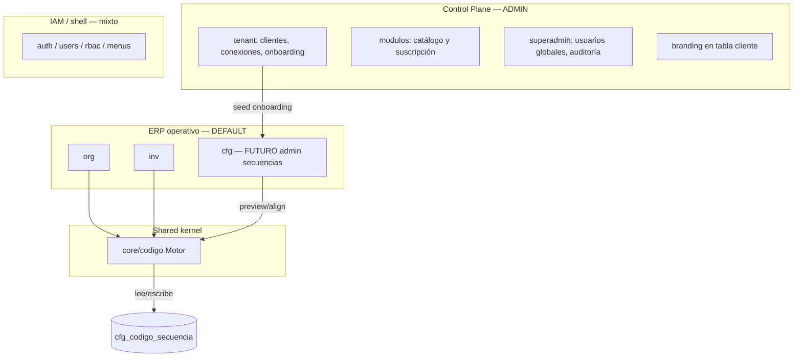

# Fronteras Platform — comparación con capacidades existentes

**Paquete:** `cfg-platform-architecture`  
**Fecha:** 2026-07-17  
**Normativa:** `ERP_BACKEND_STANDARDS_V4.md` §7, §15, §21

---

## 1. Mapa de dominios SaaS (AS-IS)

---

## 2. Comparación por capacidad

### 2.1 Branding

| Atributo | Branding | Admin Motor |
|----------|----------|-------------|
| Ubicación código | `modules/tenant` (`endpoints_clientes`, `cliente_service`) | Candidato `modules/cfg` |
| Persistencia | Columnas en `cliente` (**ADMIN**) | Filas `cfg_codigo_secuencia` (**DEFAULT / tenant**) |
| Usuarios | Público (login) + Tenant Admin `tenant.branding.leer` + SA en CRUD cliente | Tenant Admin `cfg.secuencias.*` |
| ¿Analogía válida? | **No** — distinto store y distinta conexión |

Branding es **identidad visual del cliente SaaS**.  
Admin Motor es **parametrización de numeración ERP**.

### 2.2 Onboarding / Tenant Management

| Atributo | Onboarding / Tenant Mgmt | Admin Motor |
|----------|--------------------------|-------------|
| Módulo | `modules/tenant` | No pertenece al ciclo de alta de cliente |
| Quién | SuperAdmin + jobs provisioning | ADMIN_TENANT post-ready |
| Efecto sobre cfg | **Inserta** seeds (`cfg_codigo_onboarding_seed`) | **Consulta/actualiza** filas existentes |
| Frontera correcta | Platform **termina** al dejar tenant READY + seed | ERP **comienza** la gobernanza continua |

**Regla:** onboarding escribe cfg una vez; el admin no reimplementa onboarding.

### 2.3 IAM (auth, users, rbac, menus)

| Atributo | IAM | Admin Motor |
|----------|-----|-------------|
| Checklist ERP completo | **No** (STANDARDS §21) | **Sí** (debe seguirlo) |
| BD | Mixto ADMIN/DEFAULT | Solo DEFAULT + session tenant |
| Propósito | Identidad, sesión, permisos, menú | Configuración de secuencias |
| Relación | Admin Motor **consume** RBAC (`require_permission`) | No gestiona usuarios |

IAM **habilita** el admin; no lo **alberga**.

### 2.4 Módulos SaaS (`modulos`)

| Atributo | `modulos` | Admin Motor |
|----------|-----------|-------------|
| Dato | Catálogo global + `cliente_modulo` (ADMIN) | Contadores tenant |
| Pregunta que responde | ¿Qué productos ERP tiene contratados el cliente? | ¿Cómo se formatean los códigos de esos productos? |

Suscribir el módulo INV ≠ configurar prefijos INV. Son capas distintas.

---

## 3. Criterios STANDARDS aplicados

### §15 ADMIN vs DEFAULT

| Store | Conexión normativa |
|-------|-------------------|
| `cliente`, `cliente_conexion`, `cliente_modulo` | ADMIN |
| `org_*`, `inv_*`, `cfg_codigo_secuencia` | DEFAULT (+ session Dedicated) |

**Prohibición explícita:** usar ADMIN para datos ERP operacionales.

### §7 LBAC

- LBAC → Platform Administration  
- ERP → **solo RBAC**  

Admin Motor → **solo RBAC**.

### §21 Platform caso especial

Platform no sigue estructura ERP V4 completa.  
Un admin de secuencias que viviera en `tenant`/`superadmin` heredaría el anti-patrón (class services, ADMIN, LBAC) sobre un dato que exige DEFAULT + session ERP.

---

## 4. Shared Database vs Dedicated Database

| Topología | Impacto si Admin = ERP `cfg` | Impacto si Admin = Platform |
|-----------|------------------------------|-----------------------------|
| **Shared** | DEFAULT + `client_id`; mismo patrón ORG/INV | Tentación de leer/escribir vía ADMIN/CP → incorrecto para contadores tenant |
| **Dedicated** | `get_connection_for_tenant` + session obligatoria (ADJ-03) | Alto riesgo: mutar CP o BD incorrecta; romper aislamiento |

La arquitectura SaaS del proyecto **exige** que datos por-tenant en schema ERP se administren con el patrón ERP Dedicated/Shared ya certificado en Ola 1 (ORG/INV + Motor).

---

## 5. Matriz de decisión rápida

| Pregunta | Respuesta para Admin Motor |
|----------|----------------------------|
| ¿El dato vive en control plane? | No |
| ¿El usuario primario es SuperAdmin? | No |
| ¿Se necesita LBAC? | No |
| ¿Se necesita `require_erp_session`? | Sí |
| ¿Se parece a Branding? | No |
| ¿Se parece a parámetros ORG/listados INV? | Sí (configuración tenant) |
| ¿Es transversal a varios módulos ERP? | Sí → módulo propio, no colgado de ORG |

---

## 6. Conclusión de fronteras

Platform Administration y el Administrador del Motor **colaboran en el tiempo** (seed → operación) pero **no comparten dominio**.

Colocar el admin en Platform rompería:

1. Localidad de datos (§15)  
2. Modelo de sesión ERP (§5 / §3.7)  
3. Aislamiento Dedicated (ADJ-03)  
4. Claridad de personas (Tenant Admin vs SuperAdmin)

Colocarlo como **módulo ERP `cfg`** preserva la arquitectura SaaS ya usada en ORG/INV y deja Platform en su rol: **provisionar**, no **parametrizar numeración**.
